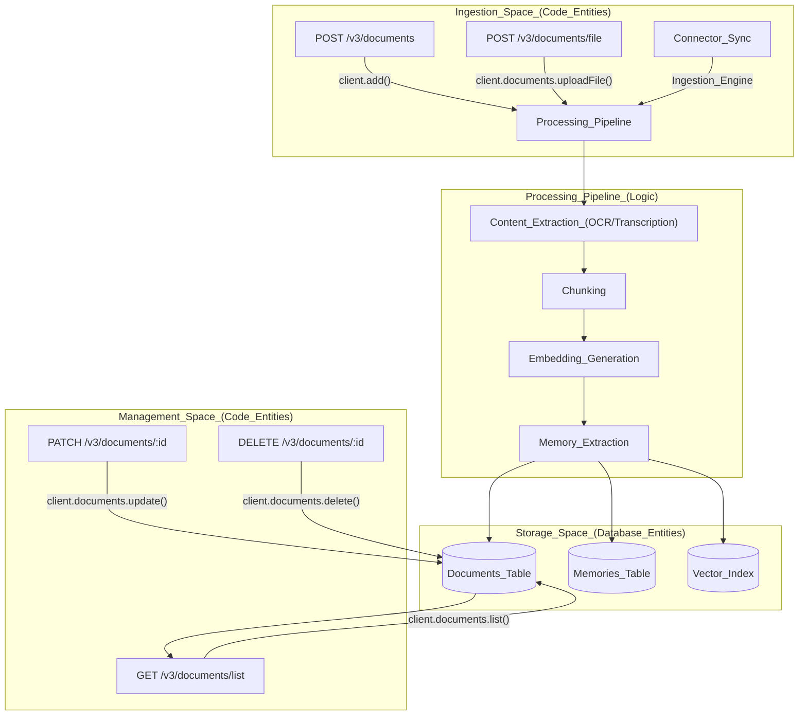
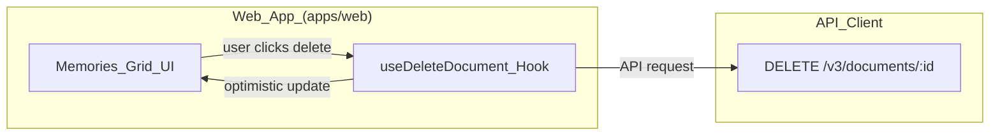

<!-- source: DeepWiki mcp.deepwiki.com · repo supermemoryai/supermemory · page 6.1 Memory & Document Endpoints · fetched 2026-10-30 -->

# Memory & Document Endpoints

<details>
<summary>Relevant source files</summary>

The following files were used as context for generating this wiki page:

- [apps/docs/add-memories/overview.mdx](apps/docs/add-memories/overview.mdx)
- [apps/docs/document-operations.mdx](apps/docs/document-operations.mdx)
- [apps/docs/memory-api/creation/adding-memories.mdx](apps/docs/memory-api/creation/adding-memories.mdx)
- [apps/docs/memory-api/ingesting.mdx](apps/docs/memory-api/ingesting.mdx)
- [apps/docs/memory-api/introduction.mdx](apps/docs/memory-api/introduction.mdx)
- [apps/docs/memory-api/overview.mdx](apps/docs/memory-api/overview.mdx)
- [apps/docs/memory-api/sdks/native.mdx](apps/docs/memory-api/sdks/native.mdx)
- [apps/docs/memory-api/sdks/python.mdx](apps/docs/memory-api/sdks/python.mdx)
- [apps/docs/memory-api/sdks/typescript.mdx](apps/docs/memory-api/sdks/typescript.mdx)
- [apps/docs/memory-api/searching/searching-memories.mdx](apps/docs/memory-api/searching/searching-memories.mdx)
- [apps/docs/memory-api/track-progress.mdx](apps/docs/memory-api/track-progress.mdx)
- [apps/docs/migration/from-zep.mdx](apps/docs/migration/from-zep.mdx)
- [apps/docs/n8n.mdx](apps/docs/n8n.mdx)
- [apps/docs/update-delete-memories/overview.mdx](apps/docs/update-delete-memories/overview.mdx)
- [apps/docs/zapier.mdx](apps/docs/zapier.mdx)

</details>


This page documents the core document management API endpoints for creating, updating, deleting, and retrieving documents in Supermemory. These endpoints form the foundation for ingesting content into the memory system.

**Scope**: This page covers document CRUD operations, file uploads, and batch processing. For semantic search and retrieval operations, see **Profile & Search Endpoints (6.2)**. For automated data ingestion from external services, see **Connectors API (6.3)**. For organizing documents with container tags, see **Projects & Container Tags (6.4)**.

---

## Document Lifecycle

Supermemory distinguishes between **Documents** (raw input like files, URLs, or text) and **Memories** (intelligently chunked, searchable pieces derived from documents) [apps/docs/memory-api/ingesting.mdx:13-18]().

### Code Entity to System Space Mapping
The following diagram illustrates how API requests interact with the internal processing pipeline and storage entities.

Title: "Document Ingestion Architecture"


**Document Flow**: Content enters through direct API calls or connectors, undergoes processing (extraction, chunking, embedding), and is stored. Documents are automatically broken into optimal memories for search [apps/docs/memory-api/ingesting.mdx:48-67]().

Sources: [apps/docs/memory-api/ingesting.mdx:13-27](), [apps/docs/memory-api/ingesting.mdx:48-67](), [apps/docs/memory-api/ingesting.mdx:15-18]()

---

## Creating Documents

### POST /v3/documents
The primary endpoint for adding content. It supports text, URLs (auto-extracted), and metadata [apps/docs/add-memories/overview.mdx:121-123]().

#### Request Parameters
| Parameter | Type | Required | Description |
|-----------|------|----------|-------------|
| `content` | string | Yes | Text, URL, or supported format to process [apps/docs/memory-api/ingesting.mdx:150](). |
| `containerTag` | string | No | **Recommended**: Single tag to group memories in a space [apps/docs/memory-api/ingesting.mdx:151](). |
| `customId` | string | No | Your identifier (max 100 chars). Enables idempotent updates [apps/docs/update-delete-memories/overview.mdx:161-165](). |
| `metadata` | object | No | Additional key-value metadata (strings, numbers, booleans) [apps/docs/memory-api/ingesting.mdx:153](). |

#### Response Schema
```json
{
  "id": "D2Ar7Vo7ub83w3PRPZcaP1",
  "status": "queued"
}
```
[apps/docs/memory-api/ingesting.mdx:161-166]()

#### Idempotency with customId
Using `customId` enables idempotent operations. If a document with the same `customId` is sent via `client.add()`, Supermemory updates the existing document instead of creating a duplicate [apps/docs/update-delete-memories/overview.mdx:68-70]().

Sources: [apps/docs/memory-api/ingesting.mdx:146-166](), [apps/docs/update-delete-memories/overview.mdx:68-165](), [apps/docs/add-memories/overview.mdx:119-148]()

---

## File Upload

### POST /v3/documents/file
Uploads binary files for automatic extraction. Supports OCR for images and transcription for videos [apps/docs/memory-api/ingesting.mdx:180-182]().

#### Supported Content Types
| Category | Formats | Processing |
|----------|---------|------------|
| Documents | PDF, Google Docs, Office files | Text extraction + OCR for scans [apps/docs/add-memories/overview.mdx:212-217]() |
| Images | JPG, PNG, GIF, WebP | OCR text extraction [apps/docs/add-memories/overview.mdx:219]() |
| Media | YouTube videos, MP4 | Transcription/Caption extraction [apps/docs/add-memories/overview.mdx:223]() |

#### Example: SDK Upload
```typescript
import Supermemory from 'supermemory';
import fs from 'fs';

await client.documents.uploadFile({
  file: fs.createReadStream('/path/to/file'),
  containerTag: "research"
});
```
[apps/docs/memory-api/sdks/typescript.mdx:64-71]()

Sources: [apps/docs/memory-api/ingesting.mdx:177-197](), [apps/docs/add-memories/overview.mdx:210-230](), [apps/docs/memory-api/sdks/typescript.mdx:55-82]()

---

## Listing & Tracking

### GET /v3/documents/processing
Monitors all documents currently being processed across an account [apps/docs/memory-api/track-progress.mdx:30]().

### GET /v3/documents/{id}
Retrieves the status and content of a specific document [apps/docs/memory-api/track-progress.mdx:103]().

### Listing Documents
While not explicitly detailed as a single `list` endpoint in the docs provided, the SDK supports `client.documents.list()` to retrieve document records.

Sources: [apps/docs/memory-api/track-progress.mdx:26-103](), [apps/docs/memory-api/sdks/typescript.mdx:43-49]()

---

## Updating & Deleting

### PATCH /v3/documents/{id}
Updates existing document content or metadata [apps/docs/add-memories/overview.mdx:183]().
- **Content change**: Triggers full reprocessing (status becomes `queued`) [apps/docs/update-delete-memories/overview.mdx:13]().
- **Metadata-only change**: Document is updated in place with no reindexing [apps/docs/update-delete-memories/overview.mdx:14]().

### DELETE /v3/documents/{id}
Performs a permanent hard delete of a document by its ID [apps/docs/update-delete-memories/overview.mdx:167-169]().

### DELETE /v3/documents/bulk
Deletes multiple memories at once by providing an array of IDs (max 100 per request) [apps/docs/update-delete-memories/overview.mdx:206-208]().

Title: "Mutation Flow in Web Client"


Sources: [apps/docs/update-delete-memories/overview.mdx:9-231](), [apps/docs/add-memories/overview.mdx:181-208]()

---

## Processing Statuses

When a document is created, it moves through a pipeline. Typical durations vary by content type [apps/docs/memory-api/track-progress.mdx:9-24]().

| Status | Description | Typical Duration |
|--------|-------------|------------------|
| `queued` | Waiting in the processing queue [apps/docs/memory-api/track-progress.mdx:163](). | < 5 seconds |
| `extracting` | OCR or transcription in progress [apps/docs/memory-api/track-progress.mdx:164](). | 5-30 seconds |
| `chunking` | Breaking content into searchable pieces [apps/docs/memory-api/track-progress.mdx:165](). | 5-15 seconds |
| `embedding` | Creating vector representations [apps/docs/memory-api/track-progress.mdx:166](). | 10-30 seconds |
| `indexing` | Adding to the search index [apps/docs/memory-api/track-progress.mdx:167](). | 5-10 seconds |
| `done` | Fully processed and searchable [apps/docs/memory-api/track-progress.mdx:168](). | - |
| `failed` | Processing encountered an error [apps/docs/memory-api/track-progress.mdx:169](). | - |

Sources: [apps/docs/memory-api/track-progress.mdx:159-170](), [apps/docs/memory-api/overview.mdx:88-97]()

---

