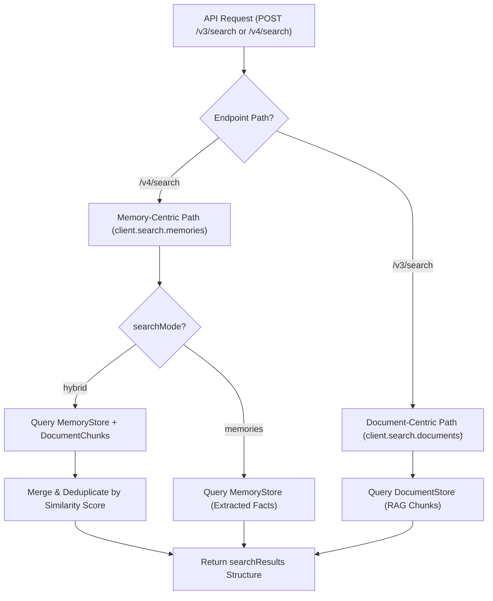
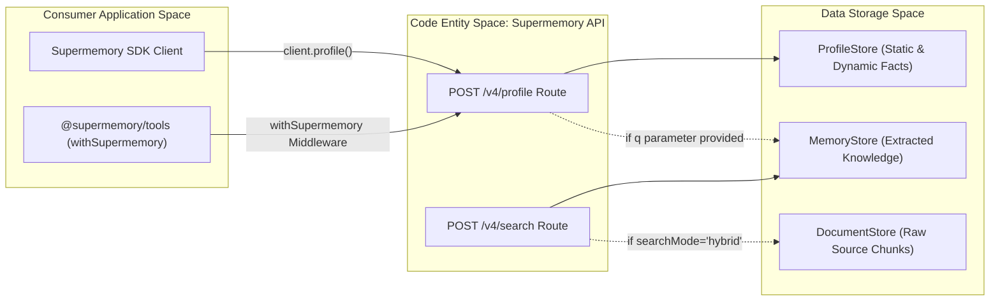

<!-- source: DeepWiki mcp.deepwiki.com · repo supermemoryai/supermemory · page 6.2 Profile & Search Endpoints · fetched 2026-10-30 -->

# Profile & Search Endpoints

<details>
<summary>Relevant source files</summary>

The following files were used as context for generating this wiki page:

- [apps/docs/add-memories.mdx](apps/docs/add-memories.mdx)
- [apps/docs/analytics.mdx](apps/docs/analytics.mdx)
- [apps/docs/concepts/customization.mdx](apps/docs/concepts/customization.mdx)
- [apps/docs/images/memory-graph.png](apps/docs/images/memory-graph.png)
- [apps/docs/install.md](apps/docs/install.md)
- [apps/docs/list-memories/examples/monitoring.mdx](apps/docs/list-memories/examples/monitoring.mdx)
- [apps/docs/search/examples/memory-search.mdx](apps/docs/search/examples/memory-search.mdx)
- [apps/docs/search/overview.mdx](apps/docs/search/overview.mdx)
- [apps/docs/search/parameters.mdx](apps/docs/search/parameters.mdx)
- [apps/docs/search/response-schema.mdx](apps/docs/search/response-schema.mdx)
- [apps/docs/test.py](apps/docs/test.py)
- [apps/docs/test.ts](apps/docs/test.ts)
- [apps/docs/user-profiles.mdx](apps/docs/user-profiles.mdx)
- [apps/docs/user-profiles/api.mdx](apps/docs/user-profiles/api.mdx)
- [apps/docs/user-profiles/examples.mdx](apps/docs/user-profiles/examples.mdx)
- [apps/docs/vibe-coding.mdx](apps/docs/vibe-coding.mdx)
- [packages/docs-test/tests/integrations/ai-sdk.ts](packages/docs-test/tests/integrations/ai-sdk.ts)

</details>


This page documents the primary read endpoints of the Supermemory REST API: `POST /v4/profile` for fetching user profiles (with optional embedded search), and the search ecosystem comprising `POST /v3/search` (Document-centric) and `POST /v4/search` (Memory-centric). These endpoints require a `containerTag` to scope results to a specific user, project, or organization.

---

## Overview

Supermemory provides distinct endpoints optimized for different retrieval needs, ranging from low-latency conversational context to deep document RAG.

| Endpoint | Primary Use | Data Source | Key Features |
|---|---|---|---|
| `POST /v4/profile` | Personalized LLM Context | Profile Store + Memories | Static facts, Dynamic context, Optional search |
| `POST /v4/search` | Fast Conversational Search | Memories | Minimal latency, optimized for Chatbots |
| `POST /v3/search` | Advanced RAG | Documents | Full control, Reranking, Query rewriting |

Sources: [apps/docs/search/overview.mdx:48-62](), [apps/docs/install.md:220-231]()

---

## POST /v4/profile

### Purpose
Retrieves a synthesized user profile for a `containerTag`. Supermemory maintains two layers of context automatically:
- **`static`**: Long-term, stable facts (e.g., "User is a software engineer"). [apps/docs/user-profiles/api.mdx:59-59]()
- **`dynamic`**: Recently learned or frequently updated information (e.g., "User is working on Project Alpha"). [apps/docs/user-profiles/api.mdx:60-60]()

If a query `q` is provided, it executes a memory search in the same call, enabling a "one-shot" context injection for LLM system prompts. [apps/docs/user-profiles.mdx:79-82]()

### Request Structure
**`POST https://api.supermemory.ai/v4/profile`**

| Parameter | Type | Required | Description |
|-----------|------|----------|-------------|
| `containerTag` | `string` | Yes | The unique identifier for the user or project. |
| `q` | `string` | No | Optional search query to include relevant memories. |
| `threshold` | `float` | No | Minimum relevance score (0-1) for search results. |

Sources: [apps/docs/user-profiles/api.mdx:25-29](), [apps/docs/search/parameters.mdx:195-206]()

### Response Schema
The response contains the profile facts and query-specific search results if `q` was passed.
```json
{
  "profile": {
    "static": ["User is a software engineer"],
    "dynamic": ["User is debugging authentication issues"]
  },
  "searchResults": {
    "results": [
      { "memory": "Relevant memory found via q", "score": 0.85 }
    ],
    "total": 1,
    "timing": 45.2
  }
}
```
Sources: [apps/docs/user-profiles/api.mdx:33-53](), [apps/docs/user-profiles.mdx:249-261]()

---

## Search Endpoints

Supermemory distinguishes between **Documents** (raw ingested sources like PDFs, videos, URLs) and **Memories** (extracted facts inferred from documents). [apps/docs/search/overview.mdx:64-71]()

### 1. Memories Search (`POST /v4/search`)
Optimized for minimal latency in conversational AI. It searches through extracted facts and user preferences.

**Key Parameters:**
- `searchMode`: `"memories"` (default) or `"hybrid"` (falls back to document chunks if memory results are insufficient). [apps/docs/search/overview.mdx:197-206]()
- `rerank`: Boolean to enable secondary ranking to improve relevance. [apps/docs/search/parameters.mdx:67-76]()
- `rewriteQuery`: Boolean to expand query via LLM for better matching. [apps/docs/search/parameters.mdx:78-93]()

Sources: [apps/docs/search/overview.mdx:183-206](), [apps/docs/search/parameters.mdx:191-214]()

### 2. Document Search (`POST /v3/search`)
Designed for "literal" search through ingested files and text. This is the primary RAG (Retrieval-Augmented Generation) endpoint.

**Key Parameters:**
- `documentThreshold` / `chunkThreshold`: Granular sensitivity controls for filtering. [apps/docs/search/parameters.mdx:99-123]()
- `includeFullDocs`: Returns the entire document content. [apps/docs/search/parameters.mdx:150-163]()
- `includeSummary`: Returns AI-generated summaries. [apps/docs/search/parameters.mdx:165-174]()

Sources: [apps/docs/search/overview.mdx:73-85](), [apps/docs/search/parameters.mdx:95-174]()

---

## Data Flow & Implementation

### Search Dispatcher Logic
The system differentiates between searching raw source material (documents) and processed knowledge (memories).

**Diagram: Search Routing Logic**

Sources: [apps/docs/search/overview.mdx:197-206](), [apps/docs/search/parameters.mdx:208-214](), [apps/docs/search/response-schema.mdx:165-178]()

### Profile Retrieval Architecture
The profile endpoint bridges the gap between long-term facts and immediate query context.

**Diagram: Context Retrieval Architecture**

Sources: [apps/docs/user-profiles/api.mdx:10-30](), [apps/docs/install.md:111-122](), [apps/docs/user-profiles.mdx:225-243]()

---

## Integration Patterns

### Personalized Prompt Injection
The most common use case is injecting profile data into an LLM's system prompt to provide persona-aware responses.

```typescript
// Fetching profile to build system prompt
const { profile } = await client.profile({ containerTag: userId });

const systemPrompt = `You are assisting a user.
ABOUT THE USER:
${profile.static.join('\n')}

CURRENT CONTEXT:
${profile.dynamic.join('\n')}`;
```
Sources: [apps/docs/user-profiles.mdx:131-152](), [apps/docs/user-profiles/examples.mdx:28-37]()

### Metadata Filtering
Both search and profile endpoints support advanced metadata filtering using a JSON logic structure.

```json
{
  "AND": [
    { "key": "category", "value": "ai", "negate": false },
    { "key": "priority", "value": "high", "negate": false }
  ]
}
```
Sources: [apps/docs/search/parameters.mdx:48-65](), [apps/docs/search/parameters.mdx:176-189]()

---

## Response Structure & Filtering

### Search Results Structure
Search results typically include metadata and scores. In hybrid mode, results are distinguished by their content keys.

- **Memories**: Contain a `memory` string field. [apps/docs/search/overview.mdx:201-201]()
- **Chunks**: Contain a `chunk` string field (in hybrid mode) or are nested within document objects (in v3 search). [apps/docs/search/overview.mdx:202-202]()

### Error Handling
Common status codes for these endpoints include:
- `400`: Missing `containerTag` or invalid `threshold`. [apps/docs/user-profiles/api.mdx:215-215]()
- `401`: Invalid or missing `Authorization` Bearer token. [apps/docs/user-profiles/api.mdx:216-216]()
- `404`: Container not found. [apps/docs/user-profiles/api.mdx:217-217]()

Sources: [apps/docs/user-profiles/api.mdx:211-218]()

---

