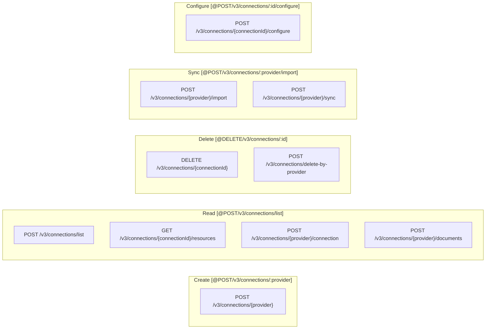
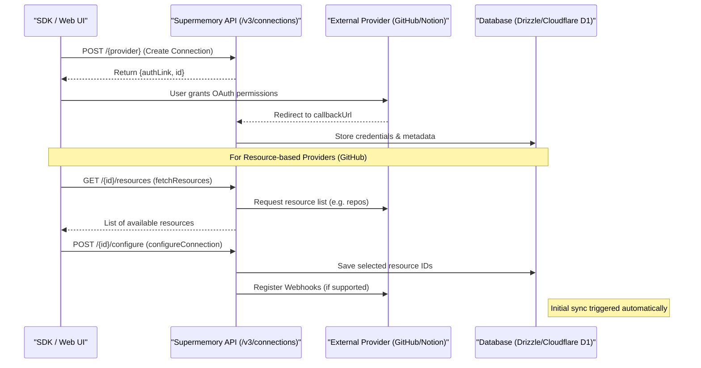

<!-- source: DeepWiki mcp.deepwiki.com · repo supermemoryai/supermemory · page 6.3 Connectors API · fetched 2026-10-30 -->

# Connectors API

<details>
<summary>Relevant source files</summary>

The following files were used as context for generating this wiki page:

- [apps/docs/connectors/github.mdx](apps/docs/connectors/github.mdx)
- [apps/docs/connectors/gmail.mdx](apps/docs/connectors/gmail.mdx)
- [apps/docs/connectors/granola.mdx](apps/docs/connectors/granola.mdx)
- [apps/docs/connectors/notion.mdx](apps/docs/connectors/notion.mdx)
- [apps/docs/connectors/overview.mdx](apps/docs/connectors/overview.mdx)
- [apps/docs/connectors/s3.mdx](apps/docs/connectors/s3.mdx)
- [apps/docs/connectors/troubleshooting.mdx](apps/docs/connectors/troubleshooting.mdx)
- [apps/docs/connectors/web-crawler.mdx](apps/docs/connectors/web-crawler.mdx)
- [apps/docs/images/granola.svg](apps/docs/images/granola.svg)
- [apps/docs/memory-api/connectors/creating-connection.mdx](apps/docs/memory-api/connectors/creating-connection.mdx)
- [apps/docs/memory-api/connectors/managing-resources.mdx](apps/docs/memory-api/connectors/managing-resources.mdx)
- [apps/docs/memory-api/connectors/overview.mdx](apps/docs/memory-api/connectors/overview.mdx)
- [apps/web/components/remove-connection-dialog.tsx](apps/web/components/remove-connection-dialog.tsx)

</details>


This page documents the REST endpoints that make up the Connections API under the `/v3/connections` path. It covers creating connections to external providers, listing and deleting them, triggering manual syncs, and listing or configuring provider-specific resources (e.g., GitHub repositories).

For a conceptual explanation of what connectors are, which providers are supported, and how the sync lifecycle works, see the Connector Overview ([7]()), ([7.1]()). For provider-specific OAuth flows, setup, and behavior, see the individual connector pages ([7.2](), [7.3](), [7.4](), [7.5]()). For API authentication and search integration, see ([6.2]()) and ([6.5]()).

---

## Endpoint Map

The following diagram shows all connection-related endpoints grouped by operation type, mapping the high-level actions to the API routes.

**Connections API Endpoint Topology**



Sources: [apps/docs/memory-api/connectors/creating-connection.mdx:6-7](), [apps/docs/memory-api/connectors/managing-resources.mdx:16-106](), [apps/docs/connectors/overview.mdx:106-191](), [apps/docs/connectors/notion.mdx:122-141]()

---

## Supported Providers

The `{provider}` path parameter in these endpoints accepts the following values. Note that some providers like `gmail`, `github`, `granola`, and `s3` require specific billing plans.

| Provider value | Auth type | Real-time sync | Plan Required |
|---|---|---|---|
| `notion` | OAuth | Webhooks | Any |
| `google-drive` | OAuth | Webhooks | Any |
| `gmail` | OAuth | Pub/Sub (Real-time) | Scale/Enterprise |
| `onedrive` | OAuth | Webhooks (Scheduled) | Any |
| `github` | OAuth | Webhooks | Scale/Enterprise |
| `s3` | API Keys | Scheduled | Scale |
| `granola` | API Keys | API-based | Pro/Max |
| `web-crawler` | URL-based | Scheduled | Any |

Sources: [apps/docs/connectors/overview.mdx:12-54](), [apps/docs/connectors/gmail.mdx:9-11](), [apps/docs/connectors/github.mdx:9-11](), [apps/docs/connectors/s3.mdx:9-11](), [apps/docs/connectors/granola.mdx:9-11](), [apps/web/components/remove-connection-dialog.tsx:17-25]()

---

## Create Connection

```
POST /v3/connections/{provider}
```

Initiates a connection. For OAuth providers (Notion, Google Drive, OneDrive, Gmail, GitHub), the response includes an `authLink`. For credential-based providers (`s3`, `granola`), credentials are passed in the `metadata` object.

### Request Body (General)

| Field | Type | Required | Description |
|---|---|---|---|
| `redirectUrl` | string | OAuth only | URL for OAuth callback |
| `containerTags` | string[] | No | Scoping tags (e.g. `["user-123"]`) |
| `metadata` | object | No | Provider-specific config (e.g. `startUrl` for crawler) |
| `documentLimit` | number | No | Max documents to sync. Range: `1-10000` |

### Provider-Specific Metadata

- **S3**: Requires `accessKeyId`, `secretAccessKey`, `bucket`, and `region` in the `metadata` object [apps/docs/connectors/s3.mdx:76-81]().
- **Granola**: Requires `apiKey` in the `metadata` object [apps/docs/connectors/granola.mdx:95]().
- **Web Crawler**: Requires `startUrl` in the `metadata` object [apps/docs/memory-api/connectors/creating-connection.mdx:73]().

Sources: [apps/docs/memory-api/connectors/creating-connection.mdx:64-77](), [apps/docs/connectors/overview.mdx:106-114](), [apps/docs/connectors/s3.mdx:56-68]()

---

## List Connections

```
POST /v3/connections/list
```

Returns connections associated with the organization or specific tags.

### Request Body

| Field | Type | Required | Description |
|---|---|---|---|
| `containerTags` | string[] | No | Filter by tags |
| `provider` | string | No | Filter by specific provider |

### Response

Array of connection objects containing:
- `id`: Connection identifier
- `provider`: Provider name
- `email`: Connected account email (if applicable)
- `createdAt`: ISO timestamp
- `documentLimit`: Current sync limit

Sources: [apps/docs/connectors/overview.mdx:188-191](), [apps/docs/connectors/gmail.mdx:129-135](), [apps/docs/connectors/notion.mdx:122-135]()

---

## Delete Connection

### By ID
```
DELETE /v3/connections/{connectionId}?deleteDocuments=true
```

Deleting a connection removes OAuth authorization and stops syncing. By default, it also removes all synced documents.

| Query Parameter | Type | Default | Description |
|---|---|---|---|
| `deleteDocuments` | boolean | `true` | Whether to permanently delete synced memories |

In the web UI, this is handled by the `RemoveConnectionDialog` component [apps/web/components/remove-connection-dialog.tsx:37-45]().

Sources: [apps/docs/connectors/s3.mdx:190-198](), [apps/docs/connectors/granola.mdx:158-166](), [apps/web/components/remove-connection-dialog.tsx:148-162]()

---

## Resource Management (GitHub)

Providers that support resource management (currently GitHub) require selecting which resources (repositories) to sync.

### 1. Get Resources
```
GET /v3/connections/{connectionId}/resources?page=1&per_page=30
```

Returns available resources for the connection using stored credentials. This calls the provider's `fetchResources()` method [apps/docs/memory-api/connectors/managing-resources.mdx:101]().

### 2. Configure Connection
```
POST /v3/connections/{connectionId}/configure
```

**Request Body:**
```json
{
  "resources": [
    {
      "id": 123456789,
      "name": "org/repo",
      "defaultBranch": "main"
    }
  ]
}
```

Sources: [apps/docs/memory-api/connectors/managing-resources.mdx:16-106](), [apps/docs/memory-api/connectors/managing-resources.mdx:182-200](), [apps/docs/connectors/github.mdx:169-190]()

---

## Data Flow: Connection Lifecycle

The following diagram maps the relationship between the API endpoints and the internal state of a connection.

**Code Entity & API Flow Map**



Sources: [apps/docs/connectors/overview.mdx:208-214](), [apps/docs/memory-api/connectors/managing-resources.mdx:240-245](), [apps/docs/connectors/github.mdx:15-132]()

---

## Troubleshooting & Health Checks

Users can verify connection health by checking for failed document imports.

```typescript
// Example: Checking for failed documents in a connection
const documents = await client.connections.listDocuments('notion', {
  containerTags: ['user-123']
});

const failed = documents.filter(doc => doc.status === 'failed');
```

Common error codes:
- `400`: Connection missing refresh token [apps/docs/memory-api/connectors/managing-resources.mdx:95]().
- `401`: Unauthorized API key [apps/docs/memory-api/connectors/managing-resources.mdx:96]().
- `404`: Connection not found [apps/docs/memory-api/connectors/managing-resources.mdx:97]().
- `501`: Provider does not support resource fetching/configuration [apps/docs/memory-api/connectors/managing-resources.mdx:98]().

Sources: [apps/docs/connectors/troubleshooting.mdx:16-34](), [apps/docs/memory-api/connectors/managing-resources.mdx:93-102](), [apps/docs/connectors/granola.mdx:208-214]()

---

