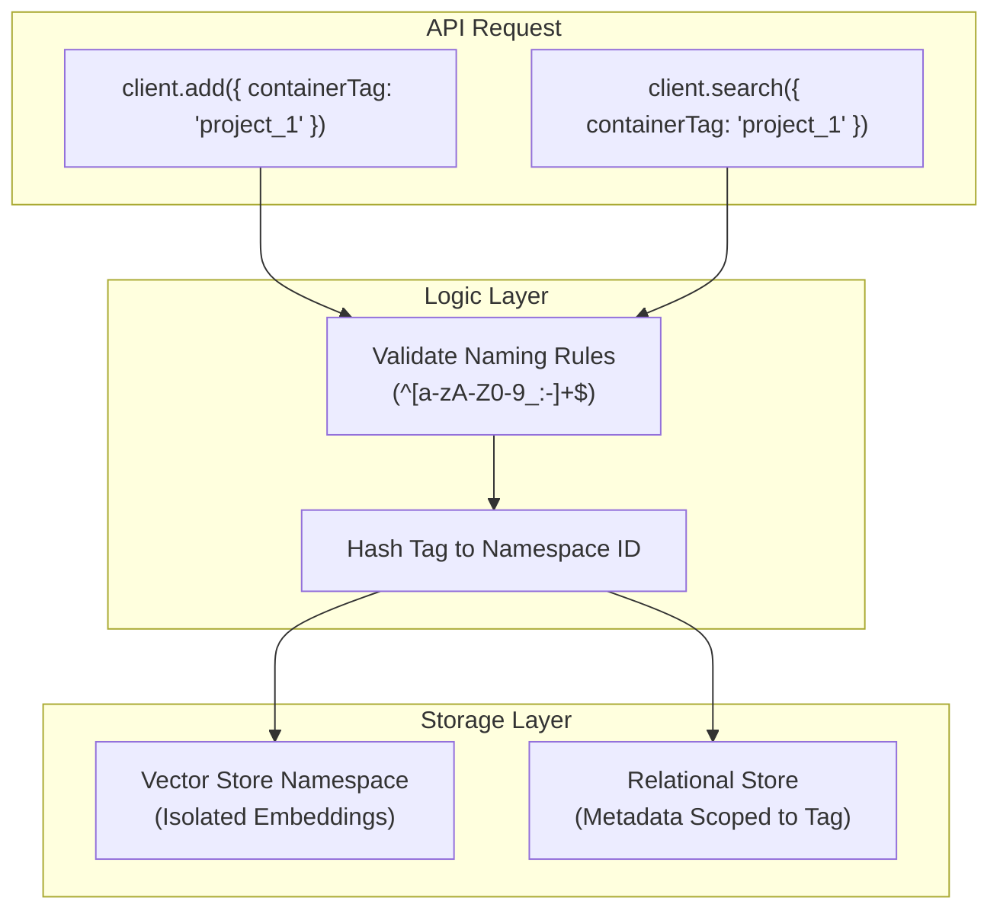
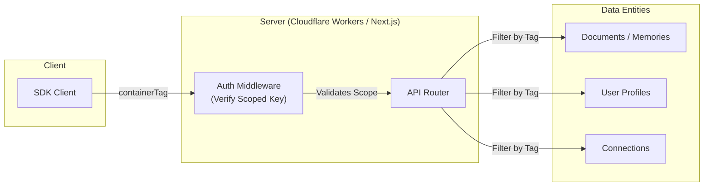
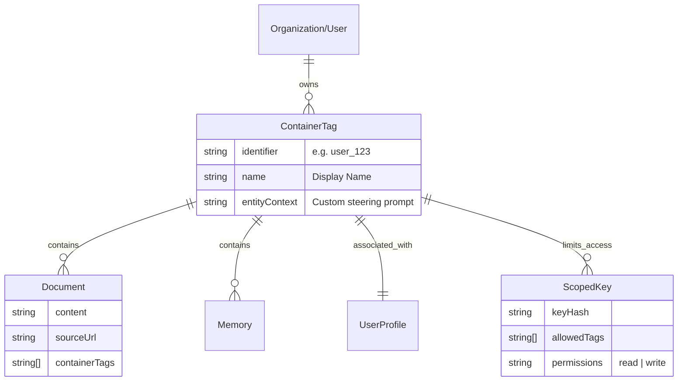

<!-- source: DeepWiki mcp.deepwiki.com · repo supermemoryai/supermemory · page 6.4 Projects & Container Tags · fetched 2026-10-30 -->

# Projects & Container Tags

Relevant source files

The following files were used as context for generating this wiki page:

- [apps/docs/concepts/container-tags.mdx](apps/docs/concepts/container-tags.mdx)
- [apps/web/components/dashboard-view.tsx](apps/web/components/dashboard-view.tsx)
- [apps/web/components/highlights-card.tsx](apps/web/components/highlights-card.tsx)
- [apps/web/components/select-spaces-modal.tsx](apps/web/components/select-spaces-modal.tsx)
- [apps/web/components/space-selector.tsx](apps/web/components/space-selector.tsx)
- [apps/web/globals.css](apps/web/globals.css)
- [apps/web/hooks/use-personalization.ts](apps/web/hooks/use-personalization.ts)
- [apps/web/lib/chat-space-label.ts](apps/web/lib/chat-space-label.ts)
- [apps/web/lib/ingest-auto-space.ts](apps/web/lib/ingest-auto-space.ts)

This page documents the projects and container tags system in Supermemory, which provides data isolation and multi-tenancy capabilities. Container tags are the low-level scoping mechanism used throughout the API, while Projects and Spaces provide the user-facing abstraction for organizing memories, documents, and connections.

---

## Container Tags Concept

A **container tag** is the primary isolation boundary in Supermemory. It acts as a namespace that groups and partitions memories by user, project, or any logical scope [apps/docs/concepts/container-tags.mdx:4-10]().

**Key characteristics:**
- **Namespace Isolation**: Every memory tagged with a specific string (e.g., `user_alex`) lives in an isolated space. Search and retrieval operations never leak across these boundaries [apps/docs/concepts/container-tags.mdx:10-18]().
- **Automatic Provisioning**: Supermemory automatically creates a space for a tag upon the first write request. No pre-provisioning is required [apps/docs/concepts/container-tags.mdx:25-32]().
- **Physical Isolation**: Under the hood, each container tag is hashed into a dedicated vector namespace. There is no shared index to filter through, ensuring strict isolation [apps/docs/concepts/container-tags.mdx:41-42]().
- **Naming Rules**: Tags must be 100 characters or less and match the pattern `^[a-zA-Z0-9_:-]+$`. The colon (`:`) is allowed to support hierarchical tagging (e.g., `org:acme:user:john`) [apps/docs/concepts/container-tags.mdx:51-71]().

**Container Tag Implementation Flow**

**Sources:** [apps/docs/concepts/container-tags.mdx:8-18](), [apps/docs/concepts/container-tags.mdx:25-32](), [apps/docs/concepts/container-tags.mdx:41-42](), [apps/docs/concepts/container-tags.mdx:51-71]()

---

## Projects & Spaces in UI

In the Supermemory web application, container tags are presented as **Spaces** or **Projects**. The `SpaceSelector` component allows users to switch between different `containerTags`, including the default user space and auto-provisioned plugin spaces [apps/web/components/space-selector.tsx:109-120]().

### UI Abstractions
- **My Space**: The default container for a user, represented by `DEFAULT_PROJECT_ID` (usually `sm_project_default`) [apps/web/components/select-spaces-modal.tsx:135-144](), [apps/web/lib/chat-space-label.ts:11-13]().
- **Plugin Spaces**: Containers auto-created by integrations (e.g., Twitter, GitHub). These are detected via `detectPluginSpace` and often use specific naming conventions [apps/web/components/select-spaces-modal.tsx:124-130](), [apps/web/lib/ingest-auto-space.ts:11-16]().
- **Nova Chats**: A special space for conversation history, typically scoped to the user's ID [apps/web/lib/ingest-auto-space.ts:29-34]().

### Project Data Structure

| Field | Type | Description |
|-------|------|-------------|
| `id` | string | Unique identifier for the project record. |
| `name` | string | Human-friendly display name (e.g., "Space project_123" for auto-provisioned ones) [apps/web/lib/ingest-auto-space.ts:11-16](). |
| `containerTag` | string | The underlying identifier used for API scoping [apps/docs/concepts/container-tags.mdx:137-137](). |
| `entityContext` | string | A custom context prompt applied during processing to steer extraction per project [apps/docs/concepts/container-tags.mdx:138-143](). |

**Sources:** [apps/web/components/space-selector.tsx:148-155](), [apps/web/lib/ingest-auto-space.ts:4-16](), [apps/web/lib/chat-space-label.ts:5-16](), [apps/docs/concepts/container-tags.mdx:131-143]()

---

## Data Isolation Architecture

All data operations respect container tag boundaries. The system provides strict isolation at the data layer, ensuring that queries only return results from the specified `containerTag`.

**Implementation Scoping**

### Scoping Across API Endpoints

| Endpoint | Parameter | Behavior |
|----------|-----------|----------|
| `POST /v3/add` | `containerTag` | Writes memory into the tag's isolated container [apps/docs/concepts/container-tags.mdx:96-96](). |
| `POST /v3/search` | `containerTag` | Restricts retrieval to the given tag's namespace [apps/docs/concepts/container-tags.mdx:97-97](). |
| `POST /v4/profile` | `containerTag` | Scopes the AI profile generation to the specific project context [apps/docs/concepts/container-tags.mdx:97-98](). |
| `documents/list` | `containerTags` | Returns documents belonging to the specified tags [apps/web/components/space-selector.tsx:159-167](). |

**Sources:** [apps/docs/concepts/container-tags.mdx:90-110](), [apps/web/components/space-selector.tsx:156-177](), [apps/docs/concepts/container-tags.mdx:131-143]()

---

## Scoped API Keys

To support fine-grained access control, Supermemory allows the creation of API keys restricted to specific container tags. This is an authorization boundary enforced at the data layer [apps/docs/concepts/container-tags.mdx:114-116]().

- **Enforcement**: Requesting a tag outside the allowed set returns a `403 Forbidden` [apps/docs/concepts/container-tags.mdx:123-123]().
- **Automatic Scoping**: If a restricted caller provides no tag, the request is automatically scoped to their allowed tags [apps/docs/concepts/container-tags.mdx:125-125]().
- **Write Protection**: Write operations to a tag where the key only has read permissions are rejected [apps/docs/concepts/container-tags.mdx:124-124]().

**Sources:** [apps/docs/concepts/container-tags.mdx:114-127]()

---

## Data Model Summary

**Entity Relationship Diagram**

**Sources:** [apps/docs/concepts/container-tags.mdx:114-143](), [apps/docs/concepts/container-tags.mdx:8-10](), [apps/web/components/space-selector.tsx:159-167]()

---

