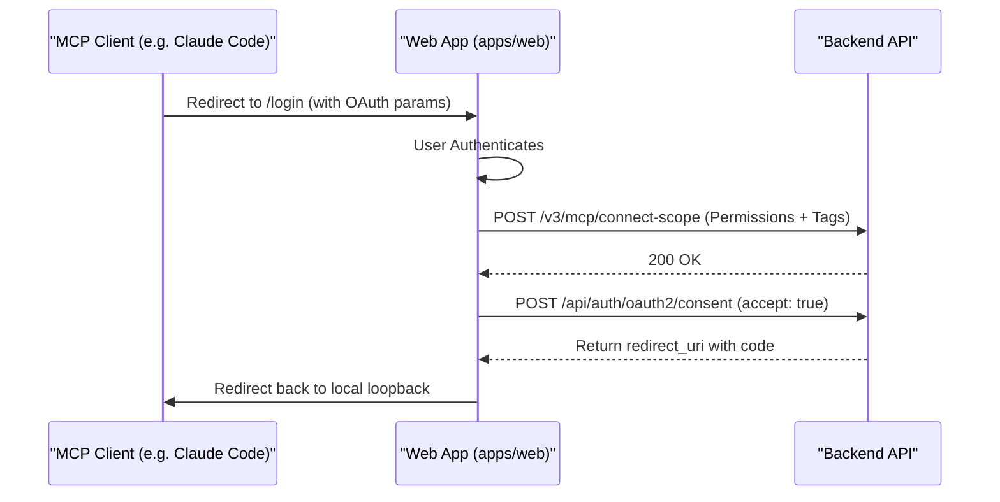
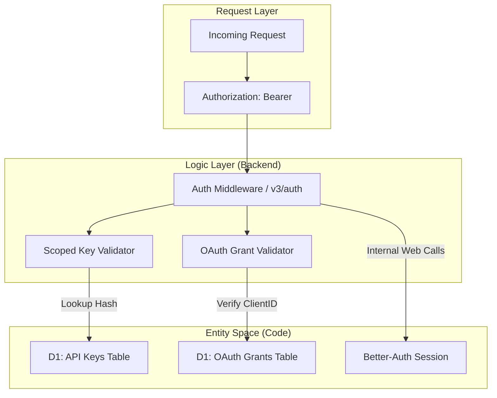

<!-- source: DeepWiki mcp.deepwiki.com · repo supermemoryai/supermemory · page 6.5 Authentication & Scoped Keys · fetched 2026-10-30 -->

# Authentication & Scoped Keys

<details>
<summary>Relevant source files</summary>

The following files were used as context for generating this wiki page:

- [apps/docs/authentication.mdx](apps/docs/authentication.mdx)
- [apps/web/app/(app)/connect/page.tsx](apps/web/app/(app)/connect/page.tsx)
- [apps/web/app/(auth)/login/new/page.tsx](apps/web/app/(auth)/login/new/page.tsx)
- [apps/web/app/(auth)/login/page.tsx](apps/web/app/(auth)/login/page.tsx)
- [apps/web/app/oauth/consent/ConsentCard.tsx](apps/web/app/oauth/consent/ConsentCard.tsx)
- [apps/web/app/oauth/consent/page.tsx](apps/web/app/oauth/consent/page.tsx)
- [apps/web/lib/oauth-plugins.ts](apps/web/lib/oauth-plugins.ts)

</details>


This page documents the authentication mechanisms for the Supermemory API, including API key types, scoped keys for container-level access control, the Model Context Protocol (MCP) OAuth flow, and how Authorization headers are utilized across the platform.

---

## API Key Authentication

All Supermemory API requests require authentication using a Bearer token. Primary API keys are obtained from the [Developer Platform](https://console.supermemory.ai) and must be included in the `Authorization` header [apps/docs/authentication.mdx:7-13]().

### Usage

Include the API key in the `Authorization` header with the `Bearer` scheme:

```bash
curl https://api.supermemory.ai/v3/search \
  -H "Authorization: Bearer YOUR_API_KEY" \
  -H "Content-Type: application/json" \
  -d '{"q": "hello"}'
```

**Sources:** [apps/docs/authentication.mdx:15-22]()

---

## Scoped API Keys

Scoped keys provide fine-grained access control by restricting a token to a single `containerTag`. These keys are limited to document and memory operations within that specific container, preventing access to the rest of the organization's data [apps/docs/authentication.mdx:58-61]().

### Allowed Endpoints
Scoped keys are restricted to a specific subset of the API [apps/docs/authentication.mdx:63-63]():
*   `/v3/documents`
*   `/v3/memories` / `/v4/memories`
*   `/v3/search` / `/v4/search`
*   `/v4/profile`

### Lifecycle Management

| Action | Method | Endpoint | Description |
| :--- | :--- | :--- | :--- |
| **Create** | `POST` | `/v3/auth/scoped-key` | Generates a new key for a `containerTag` [apps/docs/authentication.mdx:68-77](). |
| **Revoke** | `DELETE` | `/v3/auth/scoped-key/{id}` | Immediately disables the key; does not delete data [apps/docs/authentication.mdx:109-112](). |

**Creation Parameters:**
*   `containerTag` (Required): Alphanumeric identifier for the scope [apps/docs/authentication.mdx:83-83]().
*   `expiresInDays` (Optional): Validity period between 1–365 days [apps/docs/authentication.mdx:85-85]().
*   `rateLimitMax` (Optional): Max requests per window (Default: 500) [apps/docs/authentication.mdx:86-86]().

**Sources:** [apps/docs/authentication.mdx:58-118]()

---

## MCP OAuth & Consent Flow

Supermemory implements an OAuth2-based flow for Model Context Protocol (MCP) clients and external plugins like Claude Code. This allows users to grant specific permissions (read/write) and scopes (full or container-restricted) to third-party applications [apps/web/app/oauth/consent/page.tsx:81-108]().

### Authorization Resume
When an MCP client initiates an OAuth flow, the `LoginPage` detects the context using `isMcpOAuthAuthorizeContext` [apps/web/app/(auth)/login/page.tsx:24-26](). After the user authenticates via Next.js Auth, they are redirected to the resume URL [apps/web/app/(auth)/login/page.tsx:49-50](), which leads to the consent screen.

### Consent & Scoping
The `OAuthConsentContent` component allows users to:
1.  **Select Organization**: Switch active organizations via `authClient.organization.setActive` [apps/web/app/oauth/consent/page.tsx:43-57]().
2.  **Pick Spaces**: Restrict the plugin to specific `containerTags` using the `SpacesPicker` [apps/web/app/oauth/consent/ConsentCard.tsx:122-134]().
3.  **Set Expiry**: Choose how long the grant remains valid (e.g., 30 days, 1 year, or never) [apps/web/app/oauth/consent/ConsentCard.tsx:53-60]().

### Grant Revocation
Users can manage and revoke these permissions at any time via the `/connect` page, which calls `DELETE /v3/oauth/grants/{clientId}` [apps/web/app/(app)/connect/page.tsx:97-115]().



**Diagram: MCP OAuth Authorization Flow**
Bridges the interaction between the `LoginPage` [apps/web/app/(auth)/login/page.tsx:114](), the `OAuthConsentContent` [apps/web/app/oauth/consent/page.tsx:17](), and the backend OAuth handlers.

**Sources:** [apps/web/app/(auth)/login/page.tsx:24-50](), [apps/web/app/oauth/consent/page.tsx:81-187](), [apps/web/app/(app)/connect/page.tsx:97-115]()

---

## Authentication Data Flow

The following diagram maps how different authentication entities in the code interact during a request.



**Diagram: Authentication Verification Architecture**
This diagram shows how the system differentiates between raw API keys (verified via hash lookup in D1) and web-based session authentication used for the consent flow [apps/web/app/oauth/consent/page.tsx:122-130]().

**Sources:** [apps/docs/authentication.mdx:93-99](), [apps/web/app/oauth/consent/page.tsx:96-108](), [apps/web/app/(app)/connect/page.tsx:77-82]()

---

## Summary of Key Types

| Key Type | Use Case | Prefix | Revocation |
| :--- | :--- | :--- | :--- |
| **Standard API Key** | Full programmatic access to organization resources. | `sm_` | Developer Console [apps/docs/authentication.mdx:7-11]() |
| **Scoped API Key** | Third-party integrations limited to one `containerTag`. | `sm_` | `DELETE /v3/auth/scoped-key/{id}` [apps/docs/authentication.mdx:104-106]() |
| **OAuth Grant** | Browser-based authorization for MCP tools/plugins. | N/A | `/connect` UI or `DELETE /v3/oauth/grants/{id}` [apps/web/app/(app)/connect/page.tsx:97-103]() |

**Sources:** [apps/docs/authentication.mdx:58-112](), [apps/web/app/(app)/connect/page.tsx:13-23]()

---

