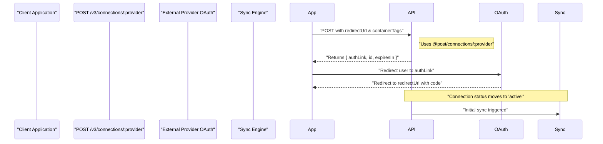
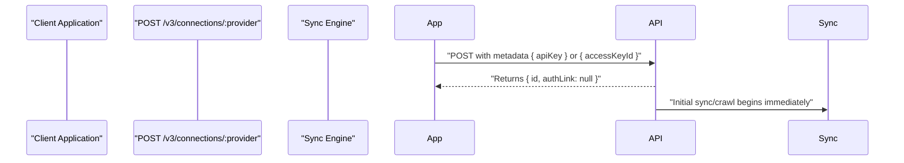
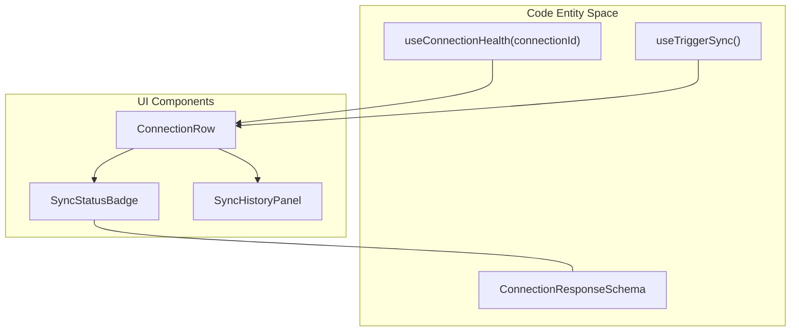
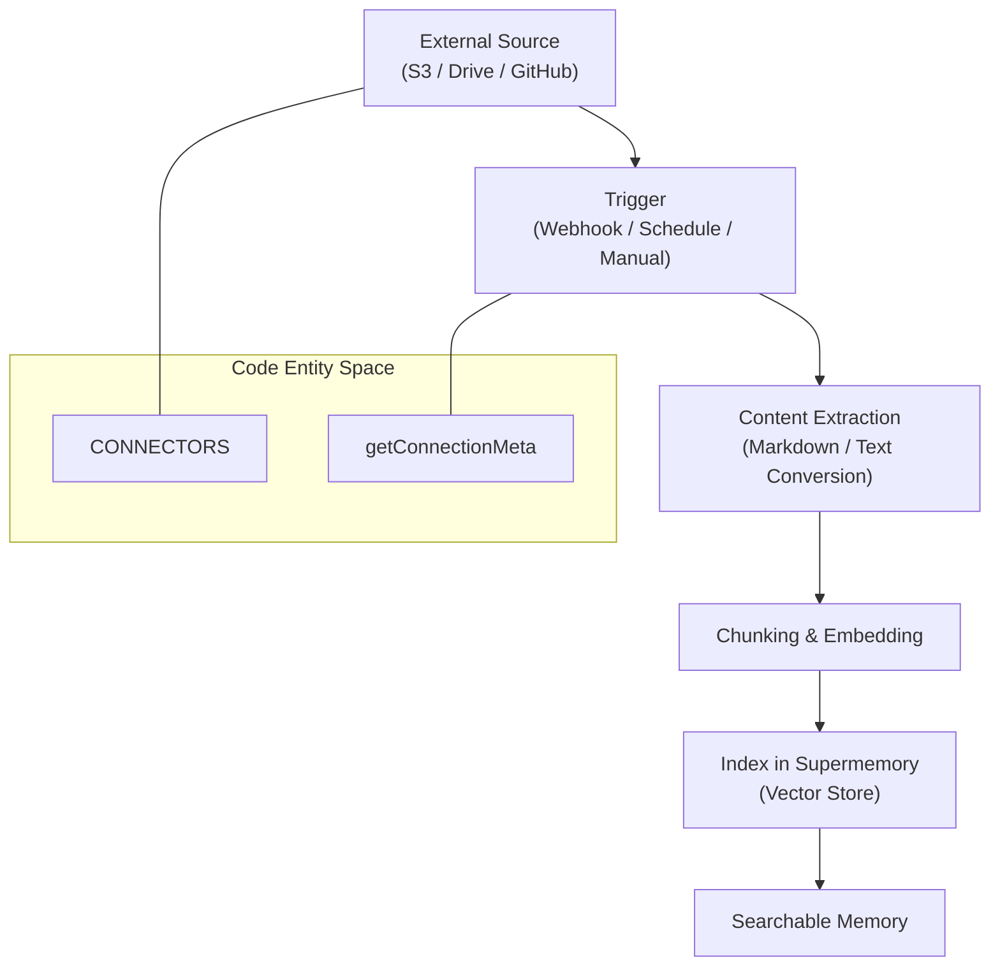

<!-- source: DeepWiki mcp.deepwiki.com · repo supermemoryai/supermemory · page 7 Connectors System · fetched 2026-10-30 -->

# Connectors System

Relevant source files

The following files were used as context for generating this wiki page:

- [apps/docs/connectors/github.mdx](apps/docs/connectors/github.mdx)
- [apps/docs/connectors/gmail.mdx](apps/docs/connectors/gmail.mdx)
- [apps/docs/connectors/granola.mdx](apps/docs/connectors/granola.mdx)
- [apps/docs/connectors/overview.mdx](apps/docs/connectors/overview.mdx)
- [apps/docs/connectors/s3.mdx](apps/docs/connectors/s3.mdx)
- [apps/docs/connectors/troubleshooting.mdx](apps/docs/connectors/troubleshooting.mdx)
- [apps/docs/images/granola.svg](apps/docs/images/granola.svg)
- [apps/docs/memory-api/connectors/managing-resources.mdx](apps/docs/memory-api/connectors/managing-resources.mdx)
- [apps/web/app/auth/connect/page.tsx](apps/web/app/auth/connect/page.tsx)
- [apps/web/components/add-document/connections.tsx](apps/web/components/add-document/connections.tsx)
- [apps/web/components/integrations-view.tsx](apps/web/components/integrations-view.tsx)
- [apps/web/components/integrations/plugins-detail.tsx](apps/web/components/integrations/plugins-detail.tsx)
- [apps/web/components/remove-connection-dialog.tsx](apps/web/components/remove-connection-dialog.tsx)
- [apps/web/hooks/use-token-usage.ts](apps/web/hooks/use-token-usage.ts)
- [apps/web/lib/billing-utils.ts](apps/web/lib/billing-utils.ts)
- [packages/lib/queries.ts](packages/lib/queries.ts)

The Connectors System allows Supermemory to pull content from external platforms and sync it into a user's knowledge base. This page covers the purpose of connectors, which providers are supported, the core sync lifecycle, and the document processing pipeline. For detailed per-provider setup, see pages [Connector Overview](#7.1) through [Web Crawler](#7.5). For the REST API endpoints that back these operations, see [Connectors API](#6.3).

---

## What Connectors Do

A connector is a persistent, authenticated link between a Supermemory container and an external data source. Once established, the connector continuously keeps that source's content synchronized as memories in Supermemory's index, making it searchable via the standard search and RAG APIs.

Connectors are scoped to `containerTags`, which map to users, projects, or tenants in your application. A single organization API key can manage connections for many containers. 

Sources: [apps/docs/connectors/overview.mdx:7-9](), [apps/docs/connectors/overview.mdx:70-75]()

---

## Supported Providers

| Provider | Auth Method | Real-time Sync | Scheduled Sync | Manual Sync | Plan Required |
|----------|-------------|----------------|----------------|-------------|---------------|
| **Google Drive** | OAuth | ✅ Webhooks | ✅ Every 4 hours | ✅ | — |
| **Gmail** | OAuth | ✅ Pub/Sub | ✅ Every 4 hours | ✅ | Scale / Enterprise |
| **Notion** | OAuth | ✅ Webhooks | ✅ Every 4 hours | ✅ | — |
| **OneDrive** | OAuth | ✅ Webhooks | ✅ Every 4 hours | ✅ | — |
| **GitHub** | OAuth | ✅ Webhooks | ✅ Every 4 hours | ✅ | Scale / Enterprise |
| **Granola** | API Key | ❌ | ✅ Incremental | ✅ | Pro |
| **Web Crawler** | None | ❌ | ✅ Recrawl | ✅ | Scale / Enterprise |
| **S3** | Access Keys | ❌ | ✅ Every 4 hours | ✅ | Scale / Enterprise |

Sources: [apps/docs/connectors/overview.mdx:12-54](), [apps/docs/connectors/overview.mdx:230-238](), [apps/docs/connectors/s3.mdx:9-11](), [apps/docs/connectors/granola.mdx:9-11](), [apps/web/components/add-document/connections.tsx:83-90]()

---

## Connection Lifecycle

There are distinct creation flows depending on whether the provider requires OAuth.

### OAuth Provider Flow

**OAuth Providers:** `google-drive`, `gmail`, `notion`, `onedrive`, `github`

**OAuth Sync Lifecycle**

Sources: [apps/docs/connectors/overview.mdx:208-213](), [apps/docs/connectors/overview.mdx:106-121]()

### Key-Based Provider Flow

**Providers:** `s3`, `granola`, `web-crawler`

**Non-OAuth Creation Flow**

Sources: [apps/docs/connectors/granola.mdx:41-50](), [apps/docs/connectors/s3.mdx:24-32]()

---

## Sync Monitoring & Health

Supermemory provides detailed visibility into the sync status and health of every connection. This is managed via hooks like `useConnectionHealth` and displayed using `SyncStatusBadge`.

**Connection Health and Sync UI**

- **Sync Statuses:** Connections track `syncInProgress`, `lastSyncedAt`, and `documentCount` within their metadata. [apps/web/components/add-document/connections.tsx:93-101]()
- **Health Checks:** The `useConnectionHealth` hook identifies if a connection `needsReauth`. [apps/web/components/add-document/connections.tsx:124-129]()
- **Manual Triggers:** Users can manually trigger a sync using `onTriggerSync` which calls the `useTriggerSync` hook. [apps/web/components/add-document/connections.tsx:202-217]()

Sources: [apps/web/components/add-document/connections.tsx:93-101](), [apps/web/components/add-document/connections.tsx:124-129](), [apps/web/components/settings/sync-status-badge.tsx:5-14]()

---

## Document Processing Pipeline

After a connector is triggered, each document goes through this pipeline:

**Ingestion Pipeline**

Sources: [apps/docs/connectors/overview.mdx:217-226](), [apps/web/components/add-document/connections.tsx:57-90]()

---

## Connection Management

### Deleting Connections
When deleting a connection via `RemoveConnectionDialog`, users can choose to:
1. **Remove connection only:** Disconnect the integration but keep all imported memories.
2. **Remove connection and memories:** Permanently delete all memories imported from this connection by setting `alsoDelete` to true.

Sources: [apps/web/components/remove-connection-dialog.tsx:37-46](), [apps/docs/connectors/s3.mdx:196-198]()

### Resource Selection (GitHub)
GitHub requires an explicit resource-selection step. After OAuth completes, the user must select which repositories to sync using the resource management endpoints.
- `client.connections.github.listRepositories(connectionId)`
- `client.connections.github.configure(connectionId, { repositories })`

Sources: [apps/docs/connectors/github.mdx:105-130]()

---

## Sub-pages

| Page | Content |
|------|---------|
| [Connector Overview](#7.1) | Creation flow, OAuth vs non-OAuth, and listing/deleting connections. |
| [GitHub Connector](#7.2) | Repository selection, webhook setup, and incremental syncing. |
| [Gmail Connector](#7.3) | OAuth flow, Pub/Sub webhooks, and email thread processing. |
| [Google Drive, Notion & OneDrive](#7.4) | Supported document types and provider-specific configurations. |
| [Web Crawler](#7.5) | Creating crawl jobs, URL configuration, and ingestion. |
| [Connector Troubleshooting](#7.6) | Health checks, common sync issues, and forcing re-syncs. |

---

