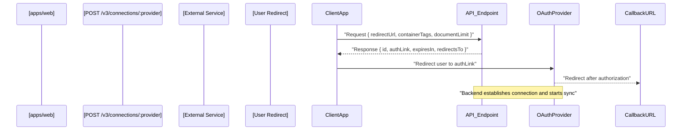
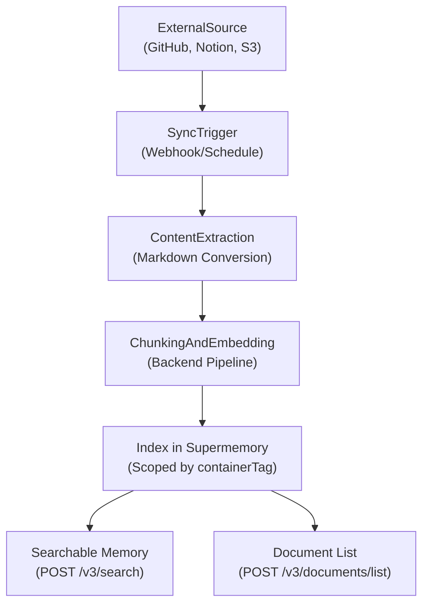
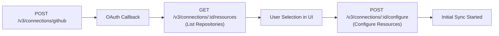

<!-- source: DeepWiki mcp.deepwiki.com · repo supermemoryai/supermemory · page 7.1 Connector Overview · fetched 2026-10-30 -->

# Connector Overview

Relevant source files

The following files were used as context for generating this wiki page:

- [apps/docs/connectors/github.mdx](apps/docs/connectors/github.mdx)
- [apps/docs/connectors/gmail.mdx](apps/docs/connectors/gmail.mdx)
- [apps/docs/connectors/granola.mdx](apps/docs/connectors/granola.mdx)
- [apps/docs/connectors/overview.mdx](apps/docs/connectors/overview.mdx)
- [apps/docs/connectors/s3.mdx](apps/docs/connectors/s3.mdx)
- [apps/docs/connectors/troubleshooting.mdx](apps/docs/connectors/troubleshooting.mdx)
- [apps/docs/images/granola.svg](apps/docs/images/granola.svg)
- [apps/docs/memory-api/connectors/managing-resources.mdx](apps/docs/memory-api/connectors/managing-resources.mdx)
- [apps/web/components/remove-connection-dialog.tsx](apps/web/components/remove-connection-dialog.tsx)

This page documents the general connector creation flow, the distinction between OAuth and non-OAuth providers, `authLink` redirect handling, and the API calls for listing and deleting connections. Connectors link external data sources to a Supermemory knowledge base, where content is ingested, chunked, and made searchable.

---

## What Connectors Do

Connectors automate the ingestion of external documents into Supermemory. Once a connection is established, the system handles content extraction (e.g., converting HTML, Google Docs, or GitHub Markdown to Markdown), chunking, and generating vector embeddings. Connectors are scoped to one or more `containerTag` values to ensure data isolation between users or projects.

Sources: [apps/docs/connectors/overview.mdx:7-9](), [apps/docs/connectors/overview.mdx:215-226](), [apps/docs/memory-api/connectors/creating-connection.mdx:69-70]()

---

## Supported Providers

| Provider | Auth Method | Real-time Sync | Scheduled Sync |
|---|---|---|---|
| `notion` | OAuth | ✅ Webhooks | ✅ Every 4 hours |
| `google-drive` | OAuth | ✅ Webhooks | ✅ Every 4 hours |
| `gmail` | OAuth | ✅ Pub/Sub | ✅ Every 4 hours |
| `onedrive` | OAuth | ✅ Webhooks | ✅ Every 4 hours |
| `github` | OAuth | ✅ Webhooks | ✅ Every 4 hours |
| `s3` | API Key/Secret | ❌ Not supported | ✅ Every 4 hours |
| `granola` | API Key | ❌ Not supported | ✅ Incremental Sync |
| `web-crawler` | None | ❌ Not supported | ✅ Scheduled recrawl |

Sources: [apps/docs/connectors/overview.mdx:223-231](), [apps/docs/connectors/s3.mdx:179-187](), [apps/docs/connectors/granola.mdx:198-204](), [apps/docs/connectors/overview.mdx:50-54]()

---

## Connection Creation Flow

The creation of a connector is initiated via `POST /v3/connections/{provider}`.

### OAuth Providers

**OAuth Connection Flow**

Sources: [apps/docs/memory-api/connectors/creating-connection.mdx:6-25](), [apps/docs/connectors/overview.mdx:208-212]()

The `authLink` is a provider-specific URL (e.g., Notion or Google OAuth page). After the user grants permissions, the provider redirects to the `redirectUrl` provided in the initial request [apps/docs/memory-api/connectors/creating-connection.mdx:85-93]().

### Non-OAuth Providers (S3, Granola & Web Crawler)

For providers like `s3` and `granola`, credentials (API keys/secrets) are passed directly in the `metadata` object of the creation request.

*   **S3**: Requires `accessKeyId`, `secretAccessKey`, `bucket`, and `region` [apps/docs/connectors/s3.mdx:76-81]().
*   **Granola**: Requires `apiKey` [apps/docs/connectors/granola.mdx:93-95]().
*   **Web Crawler**: Requires a `startUrl` in metadata.

These connections are active as soon as the API call returns successfully.

Sources: [apps/docs/connectors/s3.mdx:56-68](), [apps/docs/connectors/granola.mdx:73-83](), [apps/docs/memory-api/connectors/creating-connection.mdx:20-24]()

---

## Request Parameters

The `POST /v3/connections/{provider}` endpoint accepts the following structure:

| Parameter | Type | Required | Description |
|---|---|---|---|
| `provider` | `string` | Yes (Path) | `google-drive`, `notion`, `onedrive`, `gmail`, `github`, `s3`, `granola`, `web-crawler`. |
| `redirectUrl` | `string` | OAuth Only | The callback URL in your application. |
| `containerTags` | `string[]` | No | Tags used to partition data (e.g., `["user_123"]`). |
| `documentLimit` | `number` | No | Max items to sync per run (default 10,000). |
| `metadata` | `object` | No | Provider-specific config (e.g., `apiKey` for Granola). |

Sources: [apps/docs/memory-api/connectors/creating-connection.mdx:64-77](), [apps/docs/connectors/granola.mdx:93-97](), [apps/docs/connectors/s3.mdx:76-87]()

---

## Document Processing Pipeline

The pipeline transforms raw external data into searchable "Memories".

**Document Ingestion Pipeline**

Sources: [apps/docs/connectors/overview.mdx:217-226](), [apps/docs/connectors/notion.mdx:178-190](), [apps/docs/connectors/gmail.mdx:163-176]()

---

## Connection Management

### Listing Connections
Connections can be retrieved by provider and tags.
- `POST /v3/connections/list`: Returns all connections for specified `containerTags` [apps/docs/connectors/overview.mdx:188-191]().
- `POST /v3/connections/{provider}/connection`: Returns details for a specific provider connection matching the tags.

### Deleting Connections
Connections are removed via `DELETE /v3/connections/:connectionId`.

**Associated Document Handling:**
The API supports an optional `deleteDocuments` boolean query parameter [apps/docs/connectors/s3.mdx:197-198]().
- If `true`: All memories imported via this connection are permanently deleted.
- If `false` (or omitted): The connection is removed, but previously imported memories remain.

In the web application, this is handled by the `RemoveConnectionDialog` component [apps/web/components/remove-connection-dialog.tsx:37](), which uses `PROVIDER_LABELS` for display and prompts the user for document deletion via a `Checkbox` [apps/web/components/remove-connection-dialog.tsx:119-123]().

Sources: [apps/docs/connectors/s3.mdx:190-198](), [apps/web/components/remove-connection-dialog.tsx:17-25](), [apps/web/components/remove-connection-dialog.tsx:114-130]()

---

## Resource Management (GitHub)

The GitHub connector requires an intermediate step where users select specific repositories (resources) to sync.

**GitHub Resource Configuration**

- `GET /v3/connections/:connectionId/resources`: Returns available repositories (name, id, default branch) for the authenticated user [apps/docs/memory-api/connectors/managing-resources.mdx:16-18]().
- `POST /v3/connections/:connectionId/configure`: Accepts an array of resource objects to begin indexing [apps/docs/memory-api/connectors/managing-resources.mdx:106-108]().

Sources: [apps/docs/connectors/github.mdx:93-133](), [apps/docs/memory-api/connectors/managing-resources.mdx:14-18](), [apps/docs/memory-api/connectors/managing-resources.mdx:104-108]()

---

## Sync Mechanisms

| Frequency | Trigger | Provider Support |
|---|---|---|
| **Instant** | Webhooks | Notion, Google Drive, GitHub, Gmail (Pub/Sub) |
| **Scheduled** | 4 Hours | OAuth providers (fallback), S3 |
| **Incremental** | Manual/Auto | Granola (via `updated_at` timestamps) |
| **Manual** | API Call | `POST /v3/connections/{provider}/import` |

Sources: [apps/docs/connectors/overview.mdx:213-214](), [apps/docs/connectors/granola.mdx:198-204](), [apps/docs/connectors/s3.mdx:202-212]()

---

