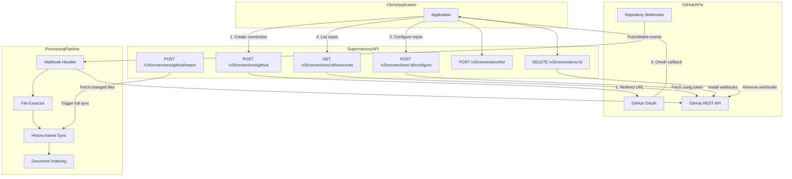
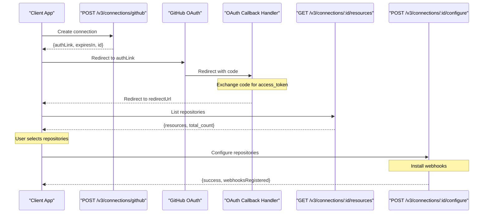
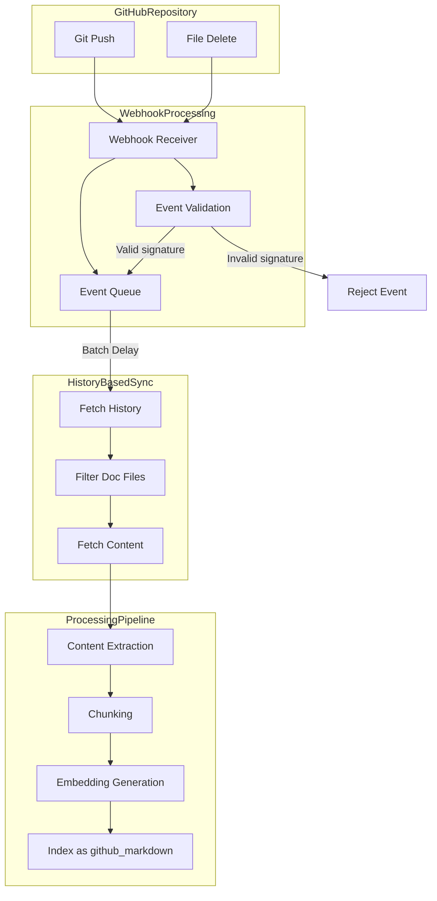

<!-- source: DeepWiki mcp.deepwiki.com · repo supermemoryai/supermemory · page 7.2 GitHub Connector · fetched 2026-10-30 -->

# GitHub Connector

<details>
<summary>Relevant source files</summary>

The following files were used as context for generating this wiki page:

- [apps/docs/connectors/github.mdx](apps/docs/connectors/github.mdx)
- [apps/docs/connectors/gmail.mdx](apps/docs/connectors/gmail.mdx)
- [apps/docs/connectors/granola.mdx](apps/docs/connectors/granola.mdx)
- [apps/docs/connectors/overview.mdx](apps/docs/connectors/overview.mdx)
- [apps/docs/connectors/s3.mdx](apps/docs/connectors/s3.mdx)
- [apps/docs/connectors/troubleshooting.mdx](apps/docs/connectors/troubleshooting.mdx)
- [apps/docs/images/granola.svg](apps/docs/images/granola.svg)
- [apps/docs/memory-api/connectors/managing-resources.mdx](apps/docs/memory-api/connectors/managing-resources.mdx)
- [apps/web/components/remove-connection-dialog.tsx](apps/web/components/remove-connection-dialog.tsx)

</details>


This document describes the GitHub connector system, which enables automated synchronization of documentation files from GitHub repositories into Supermemory's knowledge base. The GitHub connector uses OAuth authentication, webhook-based incremental syncing, and repository-level resource selection.

For information about the general connector architecture and sync mechanisms shared across all providers, see [Connector Overview](#7.1). For Gmail, Google Drive, Notion, and OneDrive connectors, see their respective sections ([Gmail Connector](#7.3), [Google Drive, Notion & OneDrive](#7.4)). For web crawling without OAuth, see [Web Crawler](#7.5).

## Overview

The GitHub connector is a Scale Plan/Enterprise Plan feature that syncs documentation files from GitHub repositories [apps/docs/connectors/github.mdx:9-11](). Unlike other connectors, it requires explicit repository selection before syncing begins, giving users fine-grained control over which repositories to index [apps/docs/connectors/github.mdx:93-95](). The connector uses webhooks for real-time incremental updates and supports both public and private repositories [apps/docs/connectors/github.mdx:221-223]().

**Key characteristics:**
- OAuth-based authentication with repository and webhook scopes [apps/docs/connectors/github.mdx:82-87]().
- Two-phase setup: OAuth flow followed by repository selection [apps/docs/connectors/github.mdx:89-95]().
- Webhook-based incremental sync with 10-minute batch delay [apps/docs/connectors/github.mdx:224-227]().
- Per-repository webhook installation with unique secrets [apps/docs/connectors/github.mdx:238-239]().
- Supports only documentation file types (`.md`, `.mdx`, `.txt`, etc.) [apps/docs/connectors/github.mdx:207-215]().

Sources: [apps/docs/connectors/github.mdx:1-25](), [apps/docs/connectors/overview.mdx:38-42]()

## Architecture Overview

Title: GitHub Connector Architecture


Sources: [apps/docs/connectors/github.mdx:1-100](), [apps/docs/memory-api/connectors/managing-resources.mdx:1-50](), [apps/docs/connectors/overview.mdx:9-35]()

## OAuth Flow and Required Scopes

The GitHub connector requires a standard OAuth 2.0 authorization flow with specific scopes for repository access and webhook management [apps/docs/connectors/github.mdx:82-87]().

### Required OAuth Scopes

| Scope | Purpose |
|-------|---------|
| `repo` | Access to private and public repositories [apps/docs/connectors/github.mdx:84-84]() |
| `user:email` | Access to user's email address [apps/docs/connectors/github.mdx:85-85]() |
| `admin:repo_hook` | Manage webhooks for incremental sync [apps/docs/connectors/github.mdx:86-86]() |

The `admin:repo_hook` scope is critical for the connector's webhook-based incremental sync mechanism. Without it, the connector cannot install webhooks and must rely solely on scheduled syncing [apps/docs/connectors/github.mdx:86-87]().

Sources: [apps/docs/connectors/github.mdx:82-87]()

### OAuth Flow Sequence

Title: OAuth Flow and Repository Selection Sequence


Sources: [apps/docs/connectors/github.mdx:89-92](), [apps/docs/memory-api/connectors/managing-resources.mdx:14-102]()

## Repository Selection and Resource Management

Unlike other connectors that immediately begin syncing after OAuth, the GitHub connector requires explicit repository selection [apps/docs/memory-api/connectors/managing-resources.mdx:9-10](). This two-phase approach gives users control over which repositories to index and enables per-repository webhook configuration.

### Listing Available Repositories

After OAuth completion, use the generic resource endpoint to fetch repositories [apps/docs/memory-api/connectors/managing-resources.mdx:16-16]():

**Endpoint:** `GET /v3/connections/:connectionId/resources`

**Query Parameters:**
- `page` (optional): Page number, default `1` [apps/docs/memory-api/connectors/managing-resources.mdx:71-71]()
- `per_page` (optional): Results per page, default `30` [apps/docs/memory-api/connectors/managing-resources.mdx:72-72]()

**Response Structure:**

| Field | Type | Description |
|-------|------|-------------|
| `resources` | Array | List of repository objects [apps/docs/memory-api/connectors/managing-resources.mdx:78-78]() |
| `total_count` | Number | Total repositories available [apps/docs/memory-api/connectors/managing-resources.mdx:89-89]() |

**Repository Object Fields:**

| Field | Type | Description |
|-------|------|-------------|
| `id` | Number | GitHub repository ID (unique) [apps/docs/memory-api/connectors/managing-resources.mdx:80-80]() |
| `name` | String | Repository name (e.g., `"your-org/docs"`) [apps/docs/memory-api/connectors/managing-resources.mdx:81-81]() |
| `full_name` | String | Full repository name [apps/docs/memory-api/connectors/managing-resources.mdx:82-82]() |
| `description` | String | Repository description [apps/docs/memory-api/connectors/managing-resources.mdx:83-83]() |
| `private` | Boolean | Whether repository is private [apps/docs/memory-api/connectors/managing-resources.mdx:84-84]() |
| `default_branch` | String | Default branch name [apps/docs/memory-api/connectors/managing-resources.mdx:85-85]() |
| `updated_at` | String | Last update timestamp (ISO 8601) [apps/docs/memory-api/connectors/managing-resources.mdx:86-86]() |

Sources: [apps/docs/memory-api/connectors/managing-resources.mdx:14-91](), [apps/docs/connectors/github.mdx:93-120]()

### Configuring Selected Repositories

After repository selection, configure the connection to set up webhooks and initiate syncing [apps/docs/memory-api/connectors/managing-resources.mdx:106-108]():

**Endpoint:** `POST /v3/connections/:connectionId/configure`

**Request Body:**
```json
{
  "resources": [
    {
      "id": 123456789,
      "name": "your-org/documentation",
      "defaultBranch": "main"
    }
  ]
}
```
[apps/docs/memory-api/connectors/managing-resources.mdx:205-215]()

The configuration endpoint stores repository configuration and triggers an initial sync automatically [apps/docs/memory-api/connectors/managing-resources.mdx:239-241]().

Sources: [apps/docs/memory-api/connectors/managing-resources.mdx:104-241](), [apps/docs/connectors/github.mdx:172-190]()

## Webhook-Based Incremental Sync

The GitHub connector uses webhooks for real-time incremental synchronization, processing only changed files rather than re-syncing entire repositories [apps/docs/connectors/github.mdx:221-223]().

### Webhook Installation

When repositories are configured via `POST /v3/connections/:id/configure`, the connector automatically installs webhooks on each repository. Webhooks are configured for `push` and `delete` events [apps/docs/connectors/github.mdx:221-223]().

Each webhook uses HMAC-SHA256 signature validation with constant-time comparison to verify authenticity [apps/docs/connectors/github.mdx:236-239]().

Sources: [apps/docs/connectors/github.mdx:221-239]()

### Incremental Sync Mechanism

Title: Webhook-Based Incremental Sync Pipeline


Sources: [apps/docs/connectors/github.mdx:221-235]()

### Batch Processing Delay

Webhook events are processed in batches with a **10-minute delay** to optimize performance [apps/docs/connectors/github.mdx:224-227]():

**Rationale:**
- Prevents excessive syncing during rapid commits (e.g., documentation updates) [apps/docs/connectors/github.mdx:224-227]().
- Reduces API calls to GitHub REST API.
- Minimizes database write operations.

Sources: [apps/docs/connectors/github.mdx:224-227]()

## Supported Document Types

The GitHub connector syncs only documentation and text files, excluding code files, images, and other binary formats [apps/docs/connectors/github.mdx:217-219]().

### File Extensions

| Extension | Type | Indexed As |
|-----------|------|-----------|
| `.md` | Markdown | `github_markdown` [apps/docs/connectors/github.mdx:209-215]() |
| `.mdx` | MDX (Markdown + JSX) | `github_markdown` [apps/docs/connectors/github.mdx:209-215]() |
| `.markdown` | Markdown | `github_markdown` [apps/docs/connectors/github.mdx:209-215]() |
| `.txt` | Plain text | `github_markdown` [apps/docs/connectors/github.mdx:210-215]() |
| `.rst` | reStructuredText | `github_markdown` [apps/docs/connectors/github.mdx:211-215]() |
| `.adoc` | AsciiDoc | `github_markdown` [apps/docs/connectors/github.mdx:212-215]() |
| `.org` | Org-mode | `github_markdown` [apps/docs/connectors/github.mdx:213-215]() |

Sources: [apps/docs/connectors/github.mdx:205-219]()

## API Endpoints Reference

### Connection Creation

**Endpoint:** `POST /v3/connections/github` [apps/docs/connectors/github.mdx:66-66]()

**Request Body Schema:**
```typescript
{
  containerTags?: string[];
  documentLimit?: number;
  metadata?: Record<string, any>;
  redirectUrl?: string;
}
```
[apps/docs/connectors/github.mdx:69-77]()

**Response Schema:**
```typescript
{
  authLink: string;
  expiresIn: string;
  id: string;
}
```
[apps/docs/connectors/overview.mdx:116-121]()

Sources: [apps/docs/connectors/github.mdx:64-80](), [apps/docs/connectors/overview.mdx:105-122]()

### Get Available Resources

**Endpoint:** `GET /v3/connections/:connectionId/resources` [apps/docs/memory-api/connectors/managing-resources.mdx:16-16]()

**Response:**
```typescript
{
  "resources": [
    {
      "id": 123456789,
      "name": "your-org/documentation",
      "full_name": "your-org/documentation",
      "description": "Documentation repository",
      "private": false,
      "default_branch": "main",
      "updated_at": "2024-01-15T10:00:00Z"
    }
  ],
  "total_count": 45
}
```
[apps/docs/memory-api/connectors/managing-resources.mdx:76-91]()

Sources: [apps/docs/memory-api/connectors/managing-resources.mdx:14-91]()

### Delete Connection

**Endpoint:** `DELETE /v3/connections/:connectionId` [apps/docs/connectors/s3.mdx:190-190]()

**Query Parameters:**
- `deleteDocuments` (boolean, optional): Whether to delete synced memories [apps/docs/connectors/s3.mdx:197-197]().

The `RemoveConnectionDialog` component in the web app handles this interaction, allowing users to choose between keeping or deleting documents [apps/web/components/remove-connection-dialog.tsx:115-187]().

Sources: [apps/docs/connectors/s3.mdx:180-198](), [apps/web/components/remove-connection-dialog.tsx:36-51]()

## Sync Mechanisms Summary

The GitHub connector supports three sync mechanisms:

| Mechanism | Trigger | Use Case |
|-----------|---------|----------|
| **Webhook-based** | Git push/delete events [apps/docs/connectors/github.mdx:221-223]() | Real-time incremental updates |
| **Scheduled** | Every 4 hours [apps/docs/connectors/overview.mdx:230-230]() | Consistency check |
| **Manual** | API call (`/import`) [apps/docs/connectors/s3.mdx:211-215]() | Troubleshooting, forced refresh |

Sources: [apps/docs/connectors/overview.mdx:206-230](), [apps/docs/connectors/github.mdx:221-227]()

## Troubleshooting

### Common Issues

| Issue | Cause | Solution |
|-------|-------|----------|
| **OAuth Callback Fails** | Redirect URL mismatch [apps/docs/connectors/troubleshooting.mdx:73-73]() | Match redirect URL exactly with OAuth app settings [apps/docs/connectors/troubleshooting.mdx:75-75](). |
| **Documents Not Syncing** | Stuck in queued/extracting [apps/docs/connectors/troubleshooting.mdx:95-95]() | Trigger manual sync via `client.connections.import()` [apps/docs/connectors/troubleshooting.mdx:97-104](). |
| **Permission Denied** | Insufficient scopes [apps/docs/connectors/troubleshooting.mdx:113-113]() | Re-authenticate with `repo` and `admin:repo_hook` scopes [apps/docs/connectors/github.mdx:82-87](). |

Sources: [apps/docs/connectors/troubleshooting.mdx:69-130]()

---

