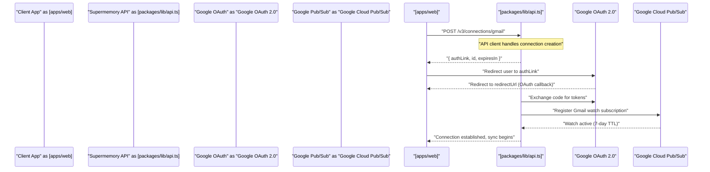
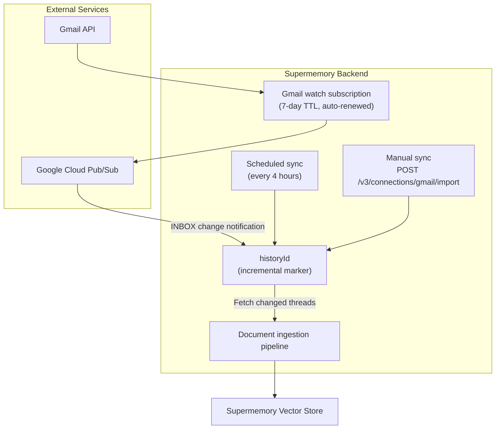

<!-- source: DeepWiki mcp.deepwiki.com · repo supermemoryai/supermemory · page 7.3 Gmail Connector · fetched 2026-10-30 -->

# Gmail Connector

Relevant source files

The following files were used as context for generating this wiki page:

- [apps/docs/connectors/github.mdx](apps/docs/connectors/github.mdx)
- [apps/docs/connectors/gmail.mdx](apps/docs/connectors/gmail.mdx)
- [apps/docs/connectors/granola.mdx](apps/docs/connectors/granola.mdx)
- [apps/docs/connectors/overview.mdx](apps/docs/connectors/overview.mdx)
- [apps/docs/connectors/s3.mdx](apps/docs/connectors/s3.mdx)
- [apps/docs/connectors/troubleshooting.mdx](apps/docs/connectors/troubleshooting.mdx)
- [apps/docs/images/granola.svg](apps/docs/images/granola.svg)
- [apps/docs/memory-api/connectors/managing-resources.mdx](apps/docs/memory-api/connectors/managing-resources.mdx)
- [apps/web/components/granola-connect-modal.tsx](apps/web/components/granola-connect-modal.tsx)
- [apps/web/components/remove-connection-dialog.tsx](apps/web/components/remove-connection-dialog.tsx)
- [apps/web/components/settings/sync-history-panel.tsx](apps/web/components/settings/sync-history-panel.tsx)
- [apps/web/components/settings/sync-status-badge.tsx](apps/web/components/settings/sync-status-badge.tsx)
- [apps/web/components/settings/sync-utils.ts](apps/web/components/settings/sync-utils.ts)
- [apps/web/hooks/use-sync-runs.ts](apps/web/hooks/use-sync-runs.ts)
- [apps/web/hooks/use-trigger-sync.ts](apps/web/hooks/use-trigger-sync.ts)
- [packages/ui/assets/icons.tsx](packages/ui/assets/icons.tsx)

This page documents the Gmail connector for Supermemory: how to create and authenticate a Gmail connection, what email data gets synced, how sync is triggered and maintained, and how to manage or remove a connection. For a general overview of how all connectors work, see [Connector Overview](7.1). For troubleshooting failed or stalled connections, see [Connector Troubleshooting](7.6).

---

## Overview

The Gmail connector syncs email threads from a user's Gmail account into Supermemory as searchable documents. It uses Google's OAuth 2.0 flow for authorization and Google Cloud Pub/Sub for real-time change notifications. [apps/docs/connectors/gmail.mdx:1-7]()

> **Plan requirement:** The Gmail connector is available on **Scale** and **Enterprise** plans only. [apps/docs/connectors/gmail.mdx:9-11]()

The provider identifier used in all API calls is `"gmail"`. [apps/web/components/settings/sync-utils.ts:41-41]() [apps/web/components/remove-connection-dialog.tsx:21-21]()

Sources: [apps/docs/connectors/gmail.mdx:1-11](), [apps/web/components/remove-connection-dialog.tsx:17-25](), [apps/web/components/settings/sync-utils.ts:37-46]()

---

## OAuth Flow

The Gmail connector follows the standard OAuth-based connector flow. The Supermemory backend manages the exchange of authorization codes for refresh tokens and sets up the necessary webhooks.

### Setup Flow Diagram

Sources: [apps/docs/connectors/gmail.mdx:15-84](), [apps/docs/connectors/overview.mdx:208-214](), [apps/docs/connectors/overview.mdx:59-82]()

### Create a Connection

The connection is initiated via the API using the `POST /v3/connections/gmail` endpoint. [apps/docs/connectors/gmail.mdx:66-78]()

| Parameter | Required | Description |
|---|---|---|
| `redirectUrl` | Yes | Your app's OAuth callback URL |
| `containerTags` | No | Scope the connection to specific users/orgs |
| `documentLimit` | No | Max threads to sync (default: 10,000) |
| `metadata` | No | Key-value pairs added to every synced document |

**Response fields:** [apps/docs/connectors/overview.mdx:116-122]()

| Field | Description |
|---|---|
| `id` | Connection identifier |
| `authLink` | Google OAuth URL to redirect the user to |
| `expiresIn` | Expiry of the auth link (e.g., "1 hour") |
| `redirectsTo` | The `redirectUrl` you provided |

Sources: [apps/docs/connectors/gmail.mdx:15-78](), [apps/docs/connectors/overview.mdx:106-122]()

---

## What Gets Synced

Gmail threads (full conversation histories) are synced as individual documents with type `gmail_thread`. [apps/docs/connectors/gmail.mdx:151-167]()

**Data ingested per thread:** [apps/docs/connectors/gmail.mdx:153-159]()

- **Thread content**: Converted to structured markdown.
- **Messages**: All messages in the thread preserved in order.
- **Metadata**: Subject, from, to, cc, bcc, and date.
- **HTML Cleanup**: HTML content is converted to clean markdown.
- **Attachments**: Filename, MIME type, and size are stored as metadata. Content is referenced, not stored.

### Document Metadata Fields

Each synced thread includes searchable metadata used in filters: [apps/docs/connectors/gmail.mdx:165-176]()

| Field | Description |
|---|---|
| `type` | Always `gmail_thread` |
| `subject` | Email subject line |
| `threadId` | Gmail thread ID |
| `from` | Sender email address |
| `to` | Recipient email addresses |
| `date` | Date of the first message |
| `messageCount` | Number of messages in thread |
| `attachmentCount` | Number of attachments |
| `attachmentNames` | List of attachment filenames |

Sources: [apps/docs/connectors/gmail.mdx:165-176](), [apps/docs/connectors/gmail.mdx:179-190]()

---

## Sync Mechanisms

The Gmail connector utilizes a hybrid approach to ensure data freshness while respecting API rate limits.

### Sync Architecture Diagram

Sources: [apps/docs/connectors/gmail.mdx:7-11](), [apps/docs/connectors/overview.mdx:213-214](), [apps/docs/connectors/overview.mdx:218-226]()

| Sync Method | Behavior |
|---|---|
| **Real-time (Pub/Sub)** | Triggers on **INBOX** changes via Google Cloud Pub/Sub webhooks. [apps/docs/connectors/troubleshooting.mdx:191-193]() |
| **Scheduled** | Runs every 4 hours to catch changes missed by webhooks. [apps/docs/connectors/overview.mdx:213-214]() |
| **Manual** | On-demand via `POST /v3/connections/gmail/import`. [apps/docs/connectors/gmail.mdx:197-199]() |
| **Incremental** | Uses Gmail's `historyId` and `updated_at` timestamps to fetch only threads changed since the last sync. [apps/docs/connectors/gmail.mdx:7-7]() |

---

## Connection Management

### List Connections

Connections can be retrieved using the `POST /v3/connections/list` endpoint, filtering by provider or tags. [apps/docs/connectors/gmail.mdx:129-135]()

### Delete a Connection

Connections can be removed via the API or the web UI using the `RemoveConnectionDialog`. [apps/web/components/remove-connection-dialog.tsx:37-45]()

`DELETE /v3/connections/:connectionId` [apps/docs/connectors/troubleshooting.mdx:212-214]()

| Parameter | Type | Description |
|---|---|---|
| `connectionId` | Param | The unique ID of the connection |
| `deleteDocuments` | Query | Boolean. If `true`, permanently deletes all imported memories. [apps/web/components/remove-connection-dialog.tsx:53-55]() |

**UI Implementation**: The `RemoveConnectionDialog` component provides a toggle for users to choose between "Disconnect" (keeping imported memories) or "Disconnect and delete memories". [apps/web/components/remove-connection-dialog.tsx:114-130]()

Sources: [apps/docs/connectors/gmail.mdx:194-212](), [apps/web/components/remove-connection-dialog.tsx:114-162]()

---

## Troubleshooting

### Common Gmail Issues

| Problem | Potential Cause | Solution |
|---|---|---|
| **OAuth Callback Fails** | Redirect URL mismatch | Ensure `redirectUrl` matches the OAuth app configuration exactly. [apps/docs/connectors/troubleshooting.mdx:71-86]() |
| **Sync Stops** | Revoked access or expired refresh token | Delete and recreate the connection to force a fresh OAuth flow. [apps/docs/connectors/troubleshooting.mdx:203-220]() |
| **Real-time Sync Fails** | Non-INBOX label | Real-time sync only triggers on INBOX changes. Use manual sync for other labels. [apps/docs/connectors/troubleshooting.mdx:187-201]() |
| **Plan Error** | Subscription mismatch | Verify the organization is on a **Scale** or **Enterprise** plan. [apps/docs/connectors/troubleshooting.mdx:222-226]() |

Sources: [apps/docs/connectors/troubleshooting.mdx:71-227]()

---

