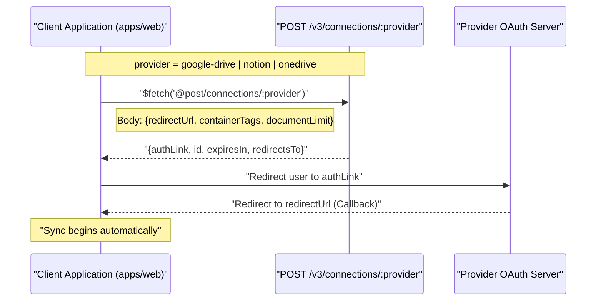
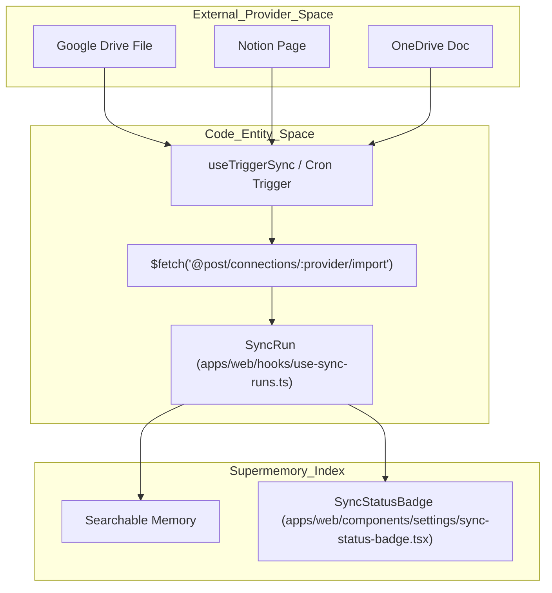

<!-- source: DeepWiki mcp.deepwiki.com · repo supermemoryai/supermemory · page 7.4 Google Drive, Notion & OneDrive · fetched 2026-10-30 -->

# Google Drive, Notion & OneDrive

<details>
<summary>Relevant source files</summary>

The following files were used as context for generating this wiki page:

- [apps/docs/connectors/notion.mdx](apps/docs/connectors/notion.mdx)
- [apps/docs/connectors/web-crawler.mdx](apps/docs/connectors/web-crawler.mdx)
- [apps/docs/memory-api/connectors/creating-connection.mdx](apps/docs/memory-api/connectors/creating-connection.mdx)
- [apps/docs/memory-api/connectors/overview.mdx](apps/docs/memory-api/connectors/overview.mdx)
- [apps/web/components/granola-connect-modal.tsx](apps/web/components/granola-connect-modal.tsx)
- [apps/web/components/settings/sync-history-panel.tsx](apps/web/components/settings/sync-history-panel.tsx)
- [apps/web/components/settings/sync-status-badge.tsx](apps/web/components/settings/sync-status-badge.tsx)
- [apps/web/components/settings/sync-utils.ts](apps/web/components/settings/sync-utils.ts)
- [apps/web/hooks/use-sync-runs.ts](apps/web/hooks/use-sync-runs.ts)
- [apps/web/hooks/use-trigger-sync.ts](apps/web/hooks/use-trigger-sync.ts)
- [packages/ui/assets/icons.tsx](packages/ui/assets/icons.tsx)

</details>


This document covers the Google Drive, Notion, and OneDrive connector implementations. These three connectors share a common OAuth-based authentication pattern and sync mechanism, while differing in their provider-specific APIs and document handling.

## Purpose and Scope

These connectors automatically sync documents from external services into Supermemory's knowledge base. They bridge the gap between third-party storage and the Supermemory "Natural Language Space" by extracting content and converting it into searchable memories.

- **Google Drive**: Syncs Google Docs, Slides, and Sheets. Real-time sync is achieved via webhooks. [apps/docs/memory-api/connectors/overview.mdx:29-29]()
- **Notion**: Syncs workspace pages, databases, and blocks. Supports rich formatting and database properties. [apps/docs/connectors/notion.mdx:6-6]()
- **OneDrive**: Syncs Microsoft Word, Excel, and PowerPoint files. [apps/docs/memory-api/connectors/overview.mdx:7-7]()

## OAuth Authentication Flow

The authentication flow is standardized across these providers. The flow begins with a call to the `/v3/connections/{provider}` endpoint, which generates an `authLink` for user redirection.

### Connection Creation



**Connection Initialization: OAuth Flow and Token Exchange**

Sources: [apps/docs/memory-api/connectors/creating-connection.mdx:6-25](), [apps/docs/memory-api/connectors/overview.mdx:9-16](), [apps/web/components/granola-connect-modal.tsx:53-59]()

### Request Parameters
The connection API validates several key parameters:

| Parameter | Type | Required | Description |
|-----------|------|----------|-------------|
| `containerTags` | `string[]` | No | Groups memories (e.g., by `userId` or `projectId`). [apps/docs/memory-api/connectors/creating-connection.mdx:69-70]() |
| `documentLimit` | `number` | No | Max documents to sync (1-10,000). [apps/docs/memory-api/connectors/creating-connection.mdx:74-77]() |
| `redirectUrl` | `string` | Yes | Where to send user after OAuth. [apps/docs/memory-api/connectors/creating-connection.mdx:67-67]() |
| `metadata` | `object` | No | Associated metadata for every document synced. [apps/docs/memory-api/connectors/creating-connection.mdx:71-73]() |

Sources: [apps/docs/memory-api/connectors/creating-connection.mdx:64-77]()

## Sync Mechanisms

Supermemory employs a multi-tier sync strategy to ensure data consistency:
1. **Real-time (Webhooks)**: Immediate updates when files change (Google Drive & Notion). [apps/docs/memory-api/connectors/overview.mdx:27-29]()
2. **Scheduled Sync**: Every four hours for OAuth-based connectors. [apps/docs/memory-api/connectors/overview.mdx:31-31]()
3. **Manual Sync**: Triggered via the `useTriggerSync` hook or API. [apps/web/hooks/use-trigger-sync.ts:13-37]()

### Provider-Specific Sync Lifecycles

| Provider | Real-time Sync | Scheduled Sync | Notes |
|----------|----------------|----------------|-------|
| **Google Drive** | Yes (Webhooks) | Every 4 hours | Documents synced instantaneously. [apps/docs/memory-api/connectors/overview.mdx:29-29]() |
| **Notion** | Yes (Webhooks) | Every 4 hours | Uses Notion Search API, newest edited first. [apps/docs/connectors/notion.mdx:154-155]() |
| **OneDrive** | No | Every 4 hours | Standard scheduled sync. [apps/docs/memory-api/connectors/overview.mdx:31-31]() |

Sources: [apps/docs/memory-api/connectors/overview.mdx:24-35](), [apps/docs/connectors/notion.mdx:152-160]()

### Document Processing Pipeline

Once a document is fetched, it is processed into the Supermemory index.



**Bridge: Provider Content to Code Ingestion Entities**

Sources: [apps/web/hooks/use-trigger-sync.ts:13-37](), [apps/web/hooks/use-sync-runs.ts:10-20](), [apps/web/components/settings/sync-status-badge.tsx:23-28]()

## Supported Document Types

Supermemory processes various formats depending on the provider.

- **Google Drive**: Google Docs, Slides, Sheets. [packages/ui/assets/icons.tsx:76-116]()
- **Notion**: Pages, Databases (Properties preserved), Blocks (Text, Heading, Code, Quote, Callout, Table, Image, Embed). [apps/docs/connectors/notion.mdx:163-189]()
- **OneDrive**: Microsoft Word, Excel, PowerPoint. [packages/ui/assets/icons.tsx:1-25](), [packages/ui/assets/icons.tsx:132-145]()

## Monitoring and Management

### Sync Status and History
The web application provides detailed monitoring of sync operations via the `SyncHistoryPanel` and `SyncStatusBadge`.

- **SyncStatusBadge**: Displays the current state (`syncing`, `synced`, `expired`, `idle`). [apps/web/components/settings/sync-status-badge.tsx:5-14]()
- **SyncHistoryPanel**: Shows a timeline of `SyncRun` objects, including items processed, failures, and trigger types (Manual, Scheduled, Webhook). [apps/web/components/settings/sync-history-panel.tsx:79-157]()
- **useSyncRuns**: A hook that polls for updates every 5 seconds if a sync is currently `running`. [apps/web/hooks/use-sync-runs.ts:37-43]()

### Manual Sync Trigger
Users can manually trigger a re-sync through the UI, which utilizes optimistic updates to provide immediate feedback.

```typescript
// useTriggerSync implementation detail
onMutate: async (variables) => {
    // Optimistically set syncInProgress to true in the connections cache
    queryClient.setQueryData(['connections'], (old) => 
        old?.map(c => c.provider === variables.provider ? { ...c, metadata: { ...c.metadata, syncInProgress: true } } : c)
    );
}
```

Sources: [apps/web/hooks/use-trigger-sync.ts:39-56](), [apps/web/components/settings/sync-utils.ts:30-34]()

## Configuration and Limits

- **Document Limits**: Notion syncs are ordered by `last edited time, newest first`. If the `documentLimit` is reached, older pages are skipped until a subsequent sync run. [apps/docs/connectors/notion.mdx:154-157]()
- **Re-authentication**: If a connection's credentials expire, the `SyncStatusBadge` will display "Needs reauth" based on the `isExpired` flag. [apps/web/components/settings/sync-status-badge.tsx:73-82]()

Sources: [apps/docs/connectors/notion.mdx:152-160](), [apps/web/components/settings/sync-status-badge.tsx:23-30]()

---

