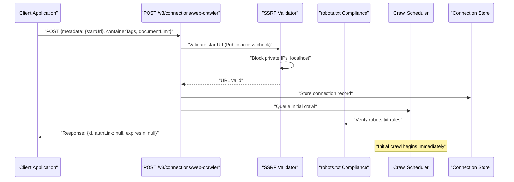
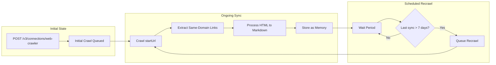

<!-- source: DeepWiki mcp.deepwiki.com · repo supermemoryai/supermemory · page 7.5 Web Crawler · fetched 2026-10-30 -->

# Web Crawler

<details>
<summary>Relevant source files</summary>

The following files were used as context for generating this wiki page:

- [apps/docs/connectors/github.mdx](apps/docs/connectors/github.mdx)
- [apps/docs/connectors/gmail.mdx](apps/docs/connectors/gmail.mdx)
- [apps/docs/connectors/granola.mdx](apps/docs/connectors/granola.mdx)
- [apps/docs/connectors/notion.mdx](apps/docs/connectors/notion.mdx)
- [apps/docs/connectors/overview.mdx](apps/docs/connectors/overview.mdx)
- [apps/docs/connectors/s3.mdx](apps/docs/connectors/s3.mdx)
- [apps/docs/connectors/troubleshooting.mdx](apps/docs/connectors/troubleshooting.mdx)
- [apps/docs/connectors/web-crawler.mdx](apps/docs/connectors/web-crawler.mdx)
- [apps/docs/images/granola.svg](apps/docs/images/granola.svg)
- [apps/docs/memory-api/connectors/creating-connection.mdx](apps/docs/memory-api/connectors/creating-connection.mdx)
- [apps/docs/memory-api/connectors/managing-resources.mdx](apps/docs/memory-api/connectors/managing-resources.mdx)
- [apps/docs/memory-api/connectors/overview.mdx](apps/docs/memory-api/connectors/overview.mdx)
- [apps/web/components/remove-connection-dialog.tsx](apps/web/components/remove-connection-dialog.tsx)

</details>


The Web Crawler connector automatically ingests and syncs web pages from public websites into Supermemory's knowledge base. Unlike other connectors that use OAuth and real-time webhooks, the web crawler operates without authentication and uses scheduled recrawling to keep content up-to-date.

**Scope**: This document covers the web crawler connector implementation, including connection setup, crawl mechanisms, URL validation, security protections, and scheduled recrawling.

**Plan Requirement**: The web crawler requires a **Scale Plan** or **Enterprise Plan** [apps/docs/connectors/web-crawler.mdx:9-11]().

## Connection Creation

The web crawler follows a simplified connection flow compared to OAuth-based connectors. No user authentication or OAuth redirect is required—the connection is established immediately upon creation [apps/docs/connectors/web-crawler.mdx:88-90]().

**Connection creation sequence for `POST /v3/connections/web-crawler`**


Sources: [apps/docs/memory-api/connectors/overview.mdx:17-20](), [apps/docs/connectors/web-crawler.mdx:175-178](), [apps/docs/memory-api/connectors/creating-connection.mdx:21-24]()

### API Request Parameters

The connection creation request to `POST /v3/connections/web-crawler` accepts the following parameters:

| Parameter | Type | Required | Description |
|-----------|------|----------|-------------|
| `metadata` | `object` | Yes | Must include `startUrl` (e.g., `{"startUrl": "https://docs.example.com"}`) [apps/docs/memory-api/connectors/creating-connection.mdx:71-73]() |
| `containerTags` | `string[]` | No | Optional tags for partitioning data [apps/docs/memory-api/connectors/creating-connection.mdx:69-70]() |
| `documentLimit` | `number` | No | Caps pages fetched per sync (Range: 1–10,000) [apps/docs/memory-api/connectors/creating-connection.mdx:74-77]() |
| `redirectUrl` | `string` | No | Optional; not required for crawler functionality [apps/docs/memory-api/connectors/creating-connection.mdx:67-68]() |

**Response Structure**: Unlike OAuth connectors, `authLink` and `expiresIn` are `null` [apps/docs/memory-api/connectors/creating-connection.mdx:94-96]().

```json
{
  "id": "conn_wc123",
  "authLink": null,
  "expiresIn": null,
  "redirectsTo": "https://yourapp.com/callback"
}
```
Sources: [apps/docs/memory-api/connectors/creating-connection.mdx:82-90](), [apps/docs/connectors/web-crawler.mdx:78-84]()

## Crawl Mechanism

The web crawler operates on a scheduled recrawling model rather than real-time webhooks [apps/docs/connectors/web-crawler.mdx:182-187]().

### Sync Timing Architecture


Sources: [apps/docs/memory-api/connectors/overview.mdx:30-32](), [apps/docs/connectors/web-crawler.mdx:184-186](), [apps/docs/connectors/web-crawler.mdx:168-171]()

### Recrawl Schedule Logic

The recrawl mechanism follows these principles:

1. **Trigger Condition**: Sites are recrawled if they haven't been synced in 7+ days [apps/docs/memory-api/connectors/overview.mdx:32-32]().
2. **Domain Boundary**: Crawling is restricted to **same-domain** only (respects hostname boundaries) [apps/docs/connectors/web-crawler.mdx:169-169]().
3. **Manual Sync**: Users can trigger a sync manually via `POST /v3/connections/web-crawler/sync` [apps/docs/memory-api/connectors/overview.mdx:34-34]().

## URL Validation and Security

The web crawler implements strict protections to prevent Server-Side Request Forgery (SSRF) and ensure compliance with site owner preferences.

### Security Validation Pipeline

| Protection | Requirement |
|------------|-------------|
| **SSRF Protection** | Blocks localhost, private IPs (10.x, 192.168.x), and cloud metadata endpoints [apps/docs/connectors/web-crawler.mdx:7-7](), [apps/docs/connectors/web-crawler.mdx:175-176](). |
| **Robots.txt** | Respects `robots.txt` disallow rules for the target domain [apps/docs/connectors/web-crawler.mdx:170-170](). |
| **Content Filtering** | Only processes valid public URLs that return HTML content; non-HTML files are skipped [apps/docs/connectors/web-crawler.mdx:171-178](). |

Sources: [apps/docs/connectors/web-crawler.mdx:7-7](), [apps/docs/connectors/web-crawler.mdx:170-178]()

## Content Ingestion as Memories

Crawled pages are transformed into memories and can be monitored via the connections API.

### Document Metadata

Each crawled web page is stored as a document with the following properties:
- **Type**: `webpage` [apps/docs/connectors/web-crawler.mdx:158-159]().
- **Status**: `done` or `pending` [apps/docs/connectors/web-crawler.mdx:158-159]().
- **Source**: The `url` of the crawled page [apps/docs/connectors/web-crawler.mdx:158-159]().

### Monitoring Sync Progress

Developers can list the synced pages for a specific web crawler connection:

```typescript
// List synced web pages
const documents = await client.connections.listDocuments('web-crawler', {
  containerTags: ['user-123', 'website-sync']
});
```
Sources: [apps/docs/connectors/web-crawler.mdx:106-108](), [apps/docs/connectors/web-crawler.mdx:151-161]()

## Troubleshooting

Common issues with the web crawler include:
- **Robots.txt Block**: The site owner has explicitly blocked crawlers via `robots.txt` [apps/docs/connectors/web-crawler.mdx:170-170]().
- **Private URLs**: The crawler cannot access `localhost`, internal domains, or password-protected sites [apps/docs/connectors/web-crawler.mdx:175-178]().
- **Document Limit**: If the `documentLimit` (max 10,000) is reached, further pages on the site will not be crawled until the limit is increased [apps/docs/memory-api/connectors/creating-connection.mdx:74-77]().

Sources: [apps/docs/connectors/web-crawler.mdx:170-178](), [apps/docs/memory-api/connectors/creating-connection.mdx:74-77]()

---

