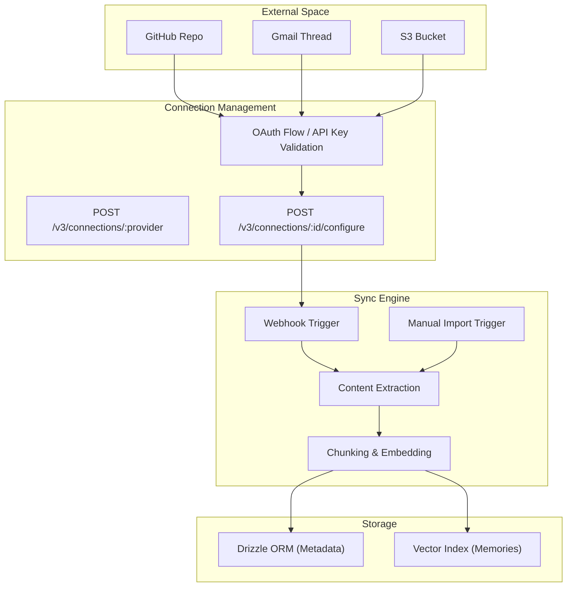
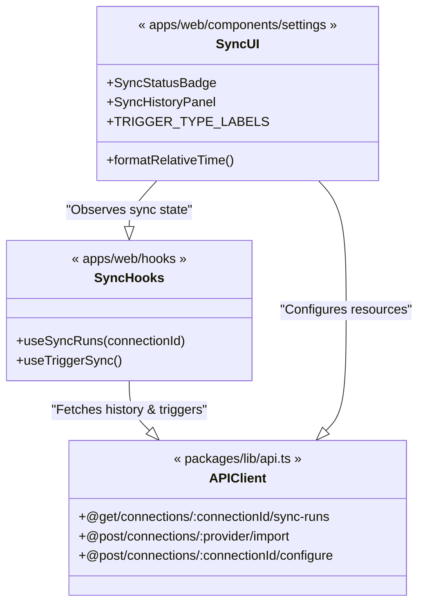

<!-- source: DeepWiki mcp.deepwiki.com · repo supermemoryai/supermemory · page 7.6 Connector Troubleshooting · fetched 2026-10-30 -->

# Connector Troubleshooting

<details>
<summary>Relevant source files</summary>

The following files were used as context for generating this wiki page:

- [apps/docs/connectors/github.mdx](apps/docs/connectors/github.mdx)
- [apps/docs/connectors/gmail.mdx](apps/docs/connectors/gmail.mdx)
- [apps/docs/connectors/granola.mdx](apps/docs/connectors/granola.mdx)
- [apps/docs/connectors/overview.mdx](apps/docs/connectors/overview.mdx)
- [apps/docs/connectors/s3.mdx](apps/docs/connectors/s3.mdx)
- [apps/docs/connectors/troubleshooting.mdx](apps/docs/connectors/troubleshooting.mdx)
- [apps/docs/images/granola.svg](apps/docs/images/granola.svg)
- [apps/docs/memory-api/connectors/managing-resources.mdx](apps/docs/memory-api/connectors/managing-resources.mdx)
- [apps/web/components/granola-connect-modal.tsx](apps/web/components/granola-connect-modal.tsx)
- [apps/web/components/remove-connection-dialog.tsx](apps/web/components/remove-connection-dialog.tsx)
- [apps/web/components/settings/sync-history-panel.tsx](apps/web/components/settings/sync-history-panel.tsx)
- [apps/web/components/settings/sync-status-badge.tsx](apps/web/components/settings/sync-status-badge.tsx)
- [apps/web/components/settings/sync-utils.ts](apps/web/components/settings/sync-utils.ts)
- [apps/web/hooks/use-sync-runs.ts](apps/web/hooks/use-sync-runs.ts)
- [apps/web/hooks/use-trigger-sync.ts](apps/web/hooks/use-trigger-sync.ts)
- [packages/ui/assets/icons.tsx](packages/ui/assets/icons.tsx)

</details>


This document provides diagnostic procedures and resolution strategies for issues with the Supermemory connector system. Connectors automatically sync content from external services (GitHub, Gmail, Notion, Google Drive, OneDrive, S3, Granola, Web Crawler) into the Supermemory knowledge base.

### Plan Requirements

Access to specific connectors is gated by user plans. If a connection fails with a "Plan Required" error, verify the organization's current subscription level.

| Provider | Required Plan |
|----------|--------------|
| GitHub | Scale or Enterprise |
| Gmail | Scale or Enterprise |
| Web Crawler | Scale or Enterprise |
| S3 | Scale or Higher |
| Granola | Pro or Higher |
| Google Drive | Paid Plans |
| Notion | Paid Plans |
| OneDrive | Paid Plans |

Sources: [apps/docs/connectors/github.mdx:9-11](), [apps/docs/connectors/gmail.mdx:9-12](), [apps/docs/connectors/s3.mdx:9-11](), [apps/docs/connectors/granola.mdx:9-11]()

## Diagnostic Overview

The connector system follows a multi-stage pipeline. Failures can occur during authentication, resource selection, webhook registration, or content extraction.

### Connector Lifecycle and Data Flow

**Connector Data Flow: From External Provider to Vector Index**



**Key Failure Points:**
- **OAuth Stage**: `redirectUrl` mismatch or missing scopes (e.g., `admin:repo_hook` for GitHub). [apps/docs/connectors/troubleshooting.mdx:71-86](), [apps/docs/connectors/github.mdx:82-87]()
- **Credential Stage**: Invalid API Key for Granola or incorrect AWS keys for S3. [apps/docs/connectors/granola.mdx:208-212](), [apps/docs/connectors/s3.mdx:213-214]()
- **Sync Stage**: Rate limiting, document size limits (>50MB), or unsupported file types. [apps/docs/connectors/troubleshooting.mdx:106-109]()
- **Processing Stage**: Content extraction timeouts or embedding failures. [apps/docs/connectors/troubleshooting.mdx:94-96]()

Sources: [apps/docs/connectors/troubleshooting.mdx:71-131](), [apps/docs/connectors/overview.mdx:215-226](), [apps/docs/connectors/github.mdx:82-87](), [apps/docs/connectors/granola.mdx:208-214]()

## Sync Status and Monitoring

Supermemory provides several mechanisms to check the health of active connections.

### Health Check via SDK/API
You can programmatically check for "stuck" or failed documents using the `client.connections.listDocuments` method or the `/v3/documents/list` endpoint.

```typescript
// Check for failed documents in a Notion connection
const documents = await client.connections.listDocuments('notion', {
  containerTags: ['user-123']
});

const failed = documents.filter(doc => doc.status === 'failed');
if (failed.length > 0) {
  console.log(`⚠️ ${failed.length} documents failed to sync`);
}
```
Sources: [apps/docs/connectors/troubleshooting.mdx:25-34](), [apps/docs/connectors/troubleshooting.mdx:60-65]()

### UI Status Mapping
The web application uses the `formatRelativeTime` utility and `TRIGGER_TYPE_LABELS` to display sync metadata in the settings panel.

| Internal Trigger | UI Label | Source |
|------------------|----------|--------|
| `event` | Webhook | [apps/web/components/settings/sync-utils.ts:31-31]() |
| `cron` | Scheduled | [apps/web/components/settings/sync-utils.ts:32-32]() |
| `manual` | Manual | [apps/web/components/settings/sync-utils.ts:33-33]() |

Sources: [apps/web/components/settings/sync-utils.ts:30-34](), [apps/web/components/settings/sync-utils.ts:5-27]()

## Common Issues and Resolutions

### 1. OAuth Callback Failures
**Problem**: "Invalid redirect URI" error during the OAuth handshake.
**Solution**: Ensure the `redirectUrl` passed to `client.connections.create` matches the one configured in the provider's developer console (Google, Notion, GitHub) exactly. [apps/docs/connectors/troubleshooting.mdx:75-86]()

### 2. GitHub Repository Not Syncing
**Problem**: GitHub connection is active but no files are appearing.
**Solution**: GitHub requires explicit resource configuration. Use the `configure` endpoint to select specific repositories.
```typescript
await client.connections.github.configure(connectionId, {
  repositories: [{ id: repoId, name: "org/repo", defaultBranch: "main" }]
});
```
Sources: [apps/docs/connectors/github.mdx:121-130](), [apps/docs/memory-api/connectors/managing-resources.mdx:104-108]()

### 3. Gmail Real-time Sync Stopped
**Problem**: New emails aren't appearing immediately.
**Root Cause**: Gmail real-time sync relies on Google Cloud Pub/Sub "watch" subscriptions which expire every 7 days. While Supermemory attempts auto-renewal, a manual re-sync can fix stuck states. [apps/docs/connectors/troubleshooting.mdx:187-194]()
**Resolution**: Trigger a manual import.
```typescript
await client.connections.import('gmail', { containerTags: ['user-123'] });
```
Sources: [apps/docs/connectors/troubleshooting.mdx:196-200]()

### 4. Granola Connection Errors
**Problem**: `Granola API key is invalid`.
**Solution**: Verify the key in Granola under **Settings > Connectors > API keys**. Note that Granola requires a plan that supports API key generation. [apps/docs/connectors/granola.mdx:211-212](), [apps/docs/connectors/granola.mdx:176-178]()

## Summary of Troubleshooting Entities

**Bridge: UI Components to API Hooks**



Sources: [apps/web/hooks/use-sync-runs.ts:10-20](), [apps/web/components/settings/sync-utils.ts:30-34](), [apps/web/components/settings/sync-status-badge.tsx:5-14]()

---

