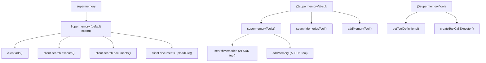
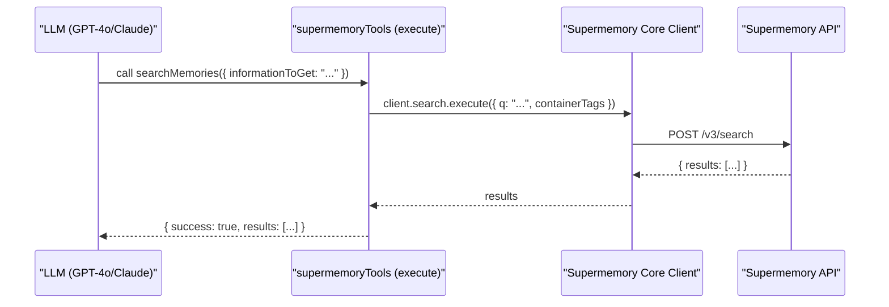

<!-- source: DeepWiki mcp.deepwiki.com · repo supermemoryai/supermemory · page 8.1 TypeScript/JavaScript SDK · fetched 2026-10-30 -->

# TypeScript/JavaScript SDK

<details>
<summary>Relevant source files</summary>

The following files were used as context for generating this wiki page:

- [apps/docs/ai-sdk/examples.mdx](apps/docs/ai-sdk/examples.mdx)
- [apps/docs/ai-sdk/infinite-chat.mdx](apps/docs/ai-sdk/infinite-chat.mdx)
- [apps/docs/ai-sdk/memory-tools.mdx](apps/docs/ai-sdk/memory-tools.mdx)
- [apps/docs/cookbook/ai-sdk-integration.mdx](apps/docs/cookbook/ai-sdk-integration.mdx)
- [apps/docs/cookbook/customer-support.mdx](apps/docs/cookbook/customer-support.mdx)
- [apps/docs/cookbook/document-qa.mdx](apps/docs/cookbook/document-qa.mdx)
- [apps/docs/cookbook/personal-assistant.mdx](apps/docs/cookbook/personal-assistant.mdx)
- [apps/docs/memory-api/sdks/native.mdx](apps/docs/memory-api/sdks/native.mdx)
- [apps/docs/memory-api/sdks/openai-plugins.mdx](apps/docs/memory-api/sdks/openai-plugins.mdx)
- [apps/docs/memory-api/sdks/python.mdx](apps/docs/memory-api/sdks/python.mdx)
- [apps/docs/memory-api/sdks/typescript.mdx](apps/docs/memory-api/sdks/typescript.mdx)
- [apps/docs/memory-router/usage.mdx](apps/docs/memory-router/usage.mdx)
- [apps/docs/memory-router/with-memory-api.mdx](apps/docs/memory-router/with-memory-api.mdx)
- [packages/ai-sdk/.npmignore](packages/ai-sdk/.npmignore)
- [packages/ai-sdk/README.md](packages/ai-sdk/README.md)
- [packages/ai-sdk/package.json](packages/ai-sdk/package.json)
- [packages/ai-sdk/src/tools.test.ts](packages/ai-sdk/src/tools.test.ts)
- [packages/ai-sdk/src/tools.ts](packages/ai-sdk/src/tools.ts)
- [packages/ai-sdk/tsconfig.json](packages/ai-sdk/tsconfig.json)
- [packages/ai-sdk/tsdown.config.ts](packages/ai-sdk/tsdown.config.ts)

</details>


This page documents the TypeScript/JavaScript SDK surface for Supermemory, primarily focusing on the `supermemory` core client and the `@supermemory/ai-sdk` framework-integration package. It covers client initialization, core methods, and integration with the Vercel AI SDK and OpenAI SDK.

---

## Packages at a Glance

The SDK ecosystem consists of the core client and framework-specific utilities:

| Package | Install | Purpose |
|---|---|---|
| `supermemory` | `npm install supermemory` | Core API client — `add`, `search`, `documents`, `profile` [apps/docs/memory-api/sdks/typescript.mdx:10]() |
| `@supermemory/ai-sdk` | `npm install @supermemory/ai-sdk` | Vercel AI SDK tools and "Infinite Chat" context management [packages/ai-sdk/package.json:2-16]() |
| `@supermemory/tools` | `npm install @supermemory/tools` | Function calling tools for OpenAI SDK and other frameworks [apps/docs/memory-api/sdks/openai-plugins.mdx:30-31]() |

---

**SDK Entity Map**



Sources: [apps/docs/memory-api/sdks/typescript.mdx:16-23](), [packages/ai-sdk/src/tools.ts:27-150](), [apps/docs/memory-api/sdks/openai-plugins.mdx:85-98]()

---

## Core Client (`supermemory`)

### Initialization

```typescript
import Supermemory from 'supermemory';

const client = new Supermemory({
  apiKey: process.env['SUPERMEMORY_API_KEY'], // Defaults to env var if omitted
});
```

Sources: [apps/docs/memory-api/sdks/typescript.mdx:16-20]()

### Core Methods

#### `client.add(params)`
Stores text or content in a memory container.
```typescript
const response = await client.add({
  content: 'User prefers functional programming and TypeScript.',
  containerTags: ['user_123']
});
```
Sources: [apps/docs/memory-api/sdks/typescript.mdx:43-48](), [packages/ai-sdk/src/tools.ts:110-114]()

#### `client.search.execute(params)`
Performs a semantic search across memories.
```typescript
const response = await client.search.execute({ 
  q: 'documents related to python',
  limit: 10
});
```
Sources: [apps/docs/memory-api/sdks/typescript.mdx:23-25](), [packages/ai-sdk/src/tools.ts:70-76]()

#### `client.documents.uploadFile(params)`
Uploads files (PDFs, text, etc.) for indexing. Supports `File` objects, `fs.ReadStream`, or `fetch` Responses.
```typescript
import fs from 'fs';
await client.documents.uploadFile({ 
  file: fs.createReadStream('/path/to/file') 
});
```
Sources: [apps/docs/memory-api/sdks/typescript.mdx:64-82]()

---

## Vercel AI SDK Integration (`@supermemory/ai-sdk`)

The `@supermemory/ai-sdk` package provides two primary ways to integrate memory: **Infinite Chat** and **Memory Tools**.

### 1. Infinite Chat Provider
This approach uses a custom `baseUrl` to route LLM requests through Supermemory's context-enhancement proxy. It automatically injects relevant context without requiring explicit tool calls.

```typescript
import { createOpenAI } from '@ai-sdk/openai'
import { generateText } from 'ai'

const supermemoryOpenai = createOpenAI({
  baseUrl: 'https://api.supermemory.ai/v3/https://api.openai.com/v1',
  apiKey: 'your-openai-api-key',
  headers: {
    'x-supermemory-api-key': 'your-supermemory-api-key',
    'x-sm-conversation-id': 'unique-conversation-id'
  }
})

const result = await generateText({
  model: supermemoryOpenai('gpt-4o'),
  messages: [{ role: 'user', content: 'What are my preferences?' }]
})
```
Sources: [packages/ai-sdk/README.md:32-47]()

### 2. Memory Tools
This provides explicit tools that the LLM can call to `searchMemories` or `addMemory`.

```typescript
import { supermemoryTools } from '@supermemory/ai-sdk'
import { generateText } from 'ai'
import { openai } from '@ai-sdk/openai'

const result = await generateText({
  model: openai('gpt-4o'),
  tools: {
    ...supermemoryTools(process.env.SUPERMEMORY_API_KEY!, {
      containerTags: ['user_123']
    })
  },
  messages: [{ role: 'user', content: 'Remember that I love Oolong tea' }]
})
```
Sources: [packages/ai-sdk/src/tools.ts:27-133](), [packages/ai-sdk/README.md:155-161]()

#### Available Tools Definition
The `supermemoryTools` function returns `tool` objects for use with `generateText` or `streamText`:

| Tool | Description | Implementation |
|---|---|---|
| `searchMemories` | Semantic search for user facts/details | Calls `client.search.execute` with `chunkThreshold: 0.6` [packages/ai-sdk/src/tools.ts:40-90]() |
| `addMemory` | Stores new information about the user | Calls `client.add` with the provided string [packages/ai-sdk/src/tools.ts:92-127]() |

**Data Flow: AI SDK Tool Execution**


Sources: [packages/ai-sdk/src/tools.ts:64-89](), [packages/ai-sdk/src/tools.ts:106-126]()

---

## OpenAI SDK Integration (`@supermemory/tools/openai`)

For projects using the official OpenAI SDK instead of the Vercel AI SDK, the `@supermemory/tools` package provides helpers to generate function definitions and execute tool calls.

```typescript
import { getToolDefinitions, createToolCallExecutor } from "@supermemory/tools/openai"
import OpenAI from "openai"

const toolDefinitions = getToolDefinitions()
const executeToolCall = createToolCallExecutor(process.env.SUPERMEMORY_API_KEY!, {
  projectId: "your-project-id",
})

const completion = await client.chat.completions.create({
  model: "gpt-4o",
  messages: [{ role: "user", content: "What do you remember?" }],
  tools: toolDefinitions,
})

if (completion.choices[0]?.message.tool_calls) {
  for (const toolCall of completion.choices[0].message.tool_calls) {
    const result = await executeToolCall(toolCall)
  }
}
```
Sources: [apps/docs/memory-api/sdks/openai-plugins.mdx:85-118]()

---

## Error Handling

The SDK throws specific subclasses of `APIError` for non-success status codes.

| Status Code | Error Type |
|---|---|
| 400 | `BadRequestError` |
| 401 | `AuthenticationError` |
| 429 | `RateLimitError` |
| >=500 | `InternalServerError` |

Sources: [apps/docs/memory-api/sdks/typescript.mdx:111-121]()

### Retries & Timeouts
- **Retries:** By default, the SDK retries 2 times for connection errors, 408, 409, 429, and >=500 errors using exponential backoff [apps/docs/memory-api/sdks/typescript.mdx:123-126]().
- **Timeouts:** Requests time out after 1 minute by default. This is configurable via the `timeout` option in the constructor [apps/docs/memory-api/sdks/typescript.mdx:143-152]().

---

## Configuration Options

`SupermemoryToolsConfig` for AI SDK tools [packages/ai-sdk/src/tools.ts:8-12]():

| Field | Type | Description |
|---|---|---|
| `baseUrl` | `string` | Custom endpoint for self-hosted instances. |
| `containerTags` | `string[]` | Array of tags to scope the search/storage. |
| `projectId` | `string` | Scopes memories to `sm_project_${projectId}` (mutually exclusive with `containerTags`). |

Sources: [packages/ai-sdk/src/tools.ts:8-12](), [packages/ai-sdk/src/tools.ts:36-39]()

---

