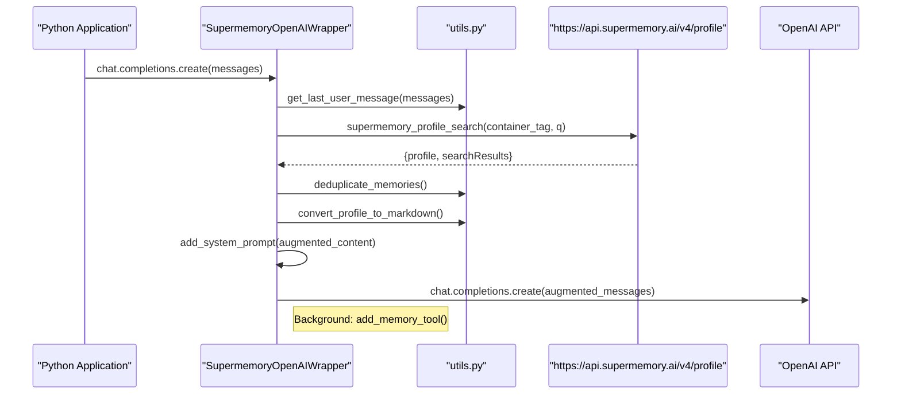

<!-- source: DeepWiki mcp.deepwiki.com · repo supermemoryai/supermemory · page 8.2 Python SDK · fetched 2026-10-30 -->

# Python SDK

<details>
<summary>Relevant source files</summary>

The following files were used as context for generating this wiki page:

- [packages/agent-framework-python/README.md](packages/agent-framework-python/README.md)
- [packages/openai-sdk-python/LICENSE](packages/openai-sdk-python/LICENSE)
- [packages/openai-sdk-python/README.md](packages/openai-sdk-python/README.md)
- [packages/openai-sdk-python/pyproject.toml](packages/openai-sdk-python/pyproject.toml)
- [packages/openai-sdk-python/src/supermemory_openai/__init__.py](packages/openai-sdk-python/src/supermemory_openai/__init__.py)
- [packages/openai-sdk-python/src/supermemory_openai/exceptions.py](packages/openai-sdk-python/src/supermemory_openai/exceptions.py)
- [packages/openai-sdk-python/src/supermemory_openai/middleware.py](packages/openai-sdk-python/src/supermemory_openai/middleware.py)
- [packages/openai-sdk-python/src/supermemory_openai/tools.py](packages/openai-sdk-python/src/supermemory_openai/tools.py)
- [packages/openai-sdk-python/src/supermemory_openai/utils.py](packages/openai-sdk-python/src/supermemory_openai/utils.py)
- [packages/openai-sdk-python/test_integration.py](packages/openai-sdk-python/test_integration.py)
- [packages/openai-sdk-python/tests/test_middleware.py](packages/openai-sdk-python/tests/test_middleware.py)
- [packages/openai-sdk-python/tests/test_tools.py](packages/openai-sdk-python/tests/test_tools.py)
- [packages/openai-sdk-python/uv.lock](packages/openai-sdk-python/uv.lock)
- [packages/tools/LICENSE](packages/tools/LICENSE)
- [skills/supermemory/LICENSE](skills/supermemory/LICENSE)
- [skills/supermemory/README.md](skills/supermemory/README.md)
- [skills/supermemory/SKILL.md](skills/supermemory/SKILL.md)
- [skills/supermemory/references/api-reference.md](skills/supermemory/references/api-reference.md)
- [skills/supermemory/references/architecture.md](skills/supermemory/references/architecture.md)
- [skills/supermemory/references/quickstart.md](skills/supermemory/references/quickstart.md)
- [skills/supermemory/references/sdk-guide.md](skills/supermemory/references/sdk-guide.md)
- [skills/supermemory/references/use-cases.md](skills/supermemory/references/use-cases.md)

</details>


## Purpose and Scope

The Python SDK provides a high-level interface to the Supermemory Memory API, enabling developers to integrate persistent memory, context management, and user profiles into Python applications. It consists of the core `supermemory` client for direct API interaction and specialized integration packages like `supermemory-openai-sdk` and `supermemory-agent-framework`.

The SDK handles authentication, request formatting, and response parsing for core operations including memory addition, profile retrieval, and semantic search.

Sources: [packages/openai-sdk-python/README.md:3-5](), [packages/openai-sdk-python/src/supermemory_openai/__init__.py:1-42]()

---

## Installation

The SDK is distributed via PyPI and can be installed using standard Python package managers.

### Core SDK
```bash
pip install supermemory
```
Sources: [skills/supermemory/references/sdk-guide.md:21-25]()

### OpenAI Integration SDK
For developers using the OpenAI Python SDK, a specialized integration package provides middleware and tool definitions.

```bash
# Standard installation
pip install supermemory-openai-sdk

# With async support (recommended for aiohttp usage)
pip install 'supermemory-openai-sdk[async]'
```
Sources: [packages/openai-sdk-python/README.md:15-27](), [packages/openai-sdk-python/pyproject.toml:27-35]()

### Agent Framework SDK
For Microsoft Agent Framework users:
```bash
pip install --pre supermemory-agent-framework
```
Sources: [packages/agent-framework-python/README.md:7-19]()

---

## SDK Architecture

The Python ecosystem for Supermemory consists of the base `supermemory` client and various framework-specific SDKs that extend it with middleware and tool capabilities.

### Class Relationship Diagram

```mermaid
graph TD
    subgraph "Base SDK (supermemory)"
        [SMClient] --> [AddMethod]
        [SMClient] --> [ProfileMethod]
        [SMClient] --> [SearchNS]
        [SMClient] --> [AsyncSMClient]
    end

    subgraph "OpenAI Integration (supermemory-openai-sdk)"
        [with_supermemory] -.->|"Wraps"| [SMClient]
        [SupermemoryTools] -->|"Initializes"| [SMClient]
        [with_supermemory] --> [OpenAIMiddlewareOptions]
    end

    subgraph "Agent Framework (supermemory-agent-framework)"
        [SupermemoryChatMiddleware] --> [SupermemoryMiddlewareOptions]
        [SupermemoryContextProvider] --> [SMClient]
    end

    [SMClient]:::code
    [AddMethod]:::code
    [ProfileMethod]:::code
    [SearchNS]:::code
    [AsyncSMClient]:::code
    [with_supermemory]:::code
    [SupermemoryTools]:::code
    [OpenAIMiddlewareOptions]:::code
    [SupermemoryChatMiddleware]:::code
    [SupermemoryContextProvider]:::code

    classDef code font-family:monospace
```
Sources: [packages/openai-sdk-python/src/supermemory_openai/middleware.py:33-40](), [packages/openai-sdk-python/src/supermemory_openai/tools.py:111-137](), [packages/agent-framework-python/README.md:35-107]()

---

## Core Client Usage

The base `Supermemory` client is used for direct data operations and is the foundation for other integrations.

### Initialization
The SDK supports both synchronous and asynchronous clients.
```python
import os
from supermemory import Supermemory, AsyncSupermemory

# Synchronous client
client = Supermemory(
    api_key=os.environ.get("SUPERMEMORY_API_KEY"),
    base_url="https://api.supermemory.ai"
)

# Asynchronous client
async_client = AsyncSupermemory(
    api_key=os.environ.get("SUPERMEMORY_API_KEY")
)
```
Sources: [skills/supermemory/references/sdk-guide.md:46-61]()

### Adding Memories
The `add` method stores content and associates it with a `container_tag` (often a user ID or project ID).
```python
client.add(
    content="User prefers dark mode and Python.",
    container_tag="user_123",
    metadata={"source": "onboarding"}
)
```
Sources: [skills/supermemory/references/sdk-guide.md:81-89]()

### Retrieving Profiles
The `profile` method returns a structured view of the user's long-term (static) and short-term (dynamic) context.
```python
response = client.profile(
    container_tag="user_123",
    q="What are the user's coding preferences?"
)

# Access profile data
print(response["profile"]["static"]) 
print(response["profile"]["dynamic"])
```
Sources: [skills/supermemory/references/sdk-guide.md:157-176]()

---

## OpenAI Integration

The `supermemory-openai-sdk` provides two primary ways to enhance OpenAI-based agents: **Automatic Middleware** and **Manual Tools**.

### 1. Automatic Memory Injection (Middleware)
The `with_supermemory` function wraps an `OpenAI` or `AsyncOpenAI` client. It intercepts `chat.completions.create` calls to fetch memories and inject them into the system prompt.

```python
from openai import AsyncOpenAI
from supermemory_openai import with_supermemory, OpenAIMiddlewareOptions

openai = AsyncOpenAI()
openai_with_memory = with_supermemory(
    openai,
    OpenAIMiddlewareOptions(
        container_tag="user_123",
        custom_id="chat-session-456",
        mode="full",         # Injects profile + search results
        add_memory="always"  # Automatically saves the conversation
    )
)
```
Sources: [packages/openai-sdk-python/README.md:31-66](), [packages/openai-sdk-python/src/supermemory_openai/middleware.py:109-213]()

### 2. Manual Memory Tools
The `SupermemoryTools` class generates tool definitions for OpenAI function calling.

| Tool Name | Implementation | Description |
|-----------|----------------|-------------|
| `search_memories` | `search_memories()` | Semantic recall of user information. |
| `add_memory` | `add_memory()` | Explicitly saves a fact to the user's memory. |

Sources: [packages/openai-sdk-python/src/supermemory_openai/tools.py:59-108](), [packages/openai-sdk-python/src/supermemory_openai/tools.py:173-225]()

---

## Agent Framework Integration

The `supermemory-agent-framework` package integrates with Microsoft's Agent Framework via `SupermemoryChatMiddleware` or `SupermemoryContextProvider`.

### Context Provider Pattern
This is the idiomatic way to add memory in Agent Framework, providing automatic context injection within an `AgentSession`.

```python
from agent_framework.openai import OpenAIResponsesClient
from supermemory_agent_framework import SupermemoryContextProvider

provider = SupermemoryContextProvider(
    container_tag="user-123",
    mode="full",
    store_conversations=True,
)

agent = OpenAIResponsesClient().as_agent(
    name="MemoryAgent",
    context_providers=[provider],
)
```
Sources: [packages/agent-framework-python/README.md:75-107]()

---

## Data Flow: Context Injection

The following diagram illustrates how the middleware (both OpenAI and Agent Framework) bridges the natural language space to code entities during a chat completion.


Sources: [packages/openai-sdk-python/src/supermemory_openai/middleware.py:109-213](), [packages/openai-sdk-python/src/supermemory_openai/utils.py:199-230](), [packages/openai-sdk-python/src/supermemory_openai/middleware.py:216-232]()

---

## Configuration and Utilities

### Memory Modes
- `"profile"`: Injects all static and dynamic profile memories.
- `"query"`: Only searches for memories relevant to the current user message.
- `"full"`: Combines both profile and query results.

Sources: [packages/openai-sdk-python/README.md:167-199]()

### Background Task Management
When `add_memory="always"`, the middleware tracks background tasks. It is recommended to use the context manager or call `wait_for_background_tasks()` to ensure data persistence.

```python
async with with_supermemory(openai, options) as client:
    await client.chat.completions.create(...)
# Tasks are automatically awaited on exit
```
Sources: [packages/openai-sdk-python/README.md:143-163](), [packages/openai-sdk-python/test_integration.py:141-169]()

---

