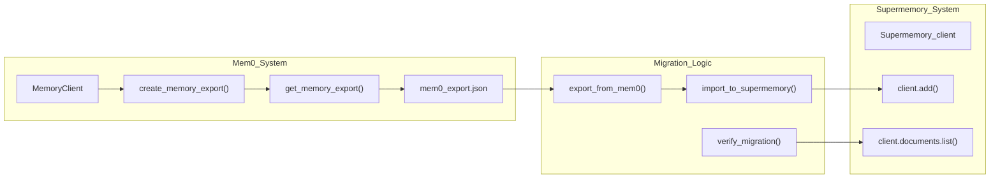
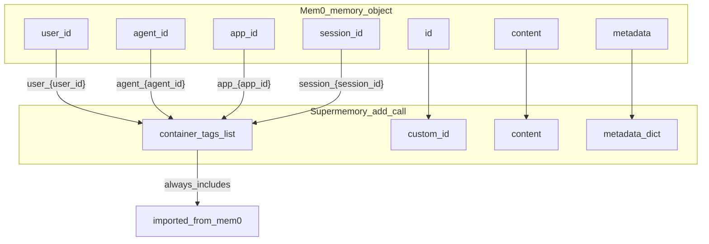
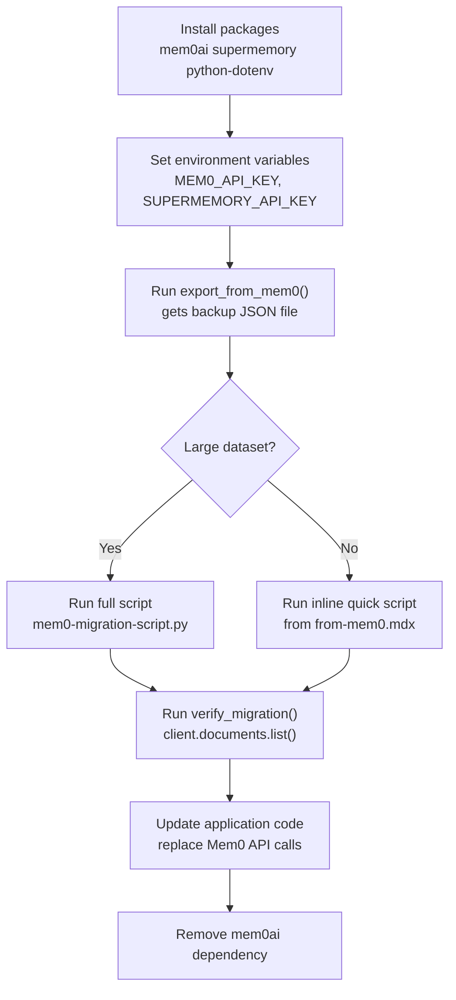

<!-- source: DeepWiki mcp.deepwiki.com · repo supermemoryai/supermemory · page 8.3 Migration from Mem0 · fetched 2026-10-30 -->

# Migration from Mem0

<details>
<summary>Relevant source files</summary>

The following files were used as context for generating this wiki page:

- [CONTRIBUTING.md](CONTRIBUTING.md)
- [README.md](README.md)
- [README.zh-CN.md](README.zh-CN.md)
- [apps/docs/cookbook/overview.mdx](apps/docs/cookbook/overview.mdx)
- [apps/docs/memory-api/sdks/overview.mdx](apps/docs/memory-api/sdks/overview.mdx)
- [apps/docs/migration/from-mem0.mdx](apps/docs/migration/from-mem0.mdx)
- [apps/docs/migration/mem0-migration-script.py](apps/docs/migration/mem0-migration-script.py)
- [turbo.json](turbo.json)

</details>


This page covers the process of migrating an existing Mem0 integration to Supermemory, including the conceptual mapping between the two systems, the API translation layer, and the provided migration script. For information about the Supermemory Python SDK used during migration, see [8.2](). For the TypeScript SDK equivalents, see [8.1]().

---

## Conceptual Mapping

Mem0 and Supermemory share the same high-level goal — persisting user memory across AI sessions — but model their data differently. Supermemory uses a "container" approach where all identity fields are flattened into tags.

| Mem0 concept | Supermemory equivalent | Notes |
|---|---|---|
| `user_id` | `container_tags` (e.g. `["user_alice"]`) | Supermemory uses arbitrary string tags instead of a typed user ID field [apps/docs/migration/mem0-migration-script.py:147-149]() |
| `agent_id` | additional `container_tags` (e.g. `["agent_mybot"]`) | Multiple tags can be applied to a single `add()` call [apps/docs/migration/mem0-migration-script.py:152-154]() |
| `app_id` | additional `container_tags` (e.g. `["app_myapp"]`) | Same mechanism as agent scoping [apps/docs/migration/mem0-migration-script.py:157-159]() |
| `run_id` / `session_id` | additional `container_tags` (e.g. `["session_xyz"]`) | Sessions are expressed as tags [apps/docs/migration/mem0-migration-script.py:162-164]() |
| `memory_id` | document `id` / `custom_id` | Supermemory accepts `custom_id` to preserve original IDs [apps/docs/migration/mem0-migration-script.py:181-182]() |
| `client.add(messages=…)` | `client.add(content=…)` | Field name change; Supermemory accepts raw text [apps/docs/migration/from-mem0.mdx:169-187]() |
| `client.search(query=…)` | `client.documents.search(query=…)` | Namespaced under `documents` in the SDK [apps/docs/migration/from-mem0.mdx:195-207]() |
| `client.get_all(user_id=…)` | `client.documents.list(container_tags=[…])` | Namespaced under `documents` [apps/docs/migration/from-mem0.mdx:215-226]() |
| `client.delete(memory_id=…)` | `client.documents.delete(id)` | Namespaced under `documents` [apps/docs/migration/from-mem0.mdx:234-240]() |

**Key structural difference:** Mem0 uses typed identity fields (`user_id`, `agent_id`, `app_id`). Supermemory collapses all of these into a flat list of `container_tags`, which are arbitrary strings. A memory in Supermemory can belong to multiple containers simultaneously [apps/docs/migration/mem0-migration-script.py:144-164]().

---

## Architecture: Before and After Migration

**Migration data flow**

The migration process involves exporting data from Mem0's API, processing it locally, and ingesting it into Supermemory using the Python SDK.

"Migration data flow"


Sources: [apps/docs/migration/mem0-migration-script.py:35-112](), [apps/docs/migration/mem0-migration-script.py:115-225](), [apps/docs/migration/mem0-migration-script.py:228-261]()

---

**Conceptual field mapping from Mem0 identity fields to Supermemory container tags**

The script transforms Mem0's specific identity fields into namespaced strings within the `container_tags` array.

"Field Mapping Transformation"


Sources: [apps/docs/migration/mem0-migration-script.py:143-165](), [apps/docs/migration/mem0-migration-script.py:181-182](), [apps/docs/migration/mem0-migration-script.py:203-205]()

---

## Migration Script

The migration script lives at `apps/docs/migration/mem0-migration-script.py` and is a self-contained Python program with three distinct phases.

### Prerequisites

```bash
pip install mem0ai supermemory python-dotenv
```

Environment variables required:

| Variable | Required | Description |
|---|---|---|
| `MEM0_API_KEY` | Yes | Mem0 API key |
| `MEM0_ORG_ID` | No | Mem0 organization ID |
| `MEM0_PROJECT_ID` | No | Mem0 project ID |
| `SUPERMEMORY_API_KEY` | Yes | Supermemory API key |

Sources: [apps/docs/migration/mem0-migration-script.py:7-15]()

### Phase 1: `export_from_mem0()`

[apps/docs/migration/mem0-migration-script.py:35-112]()

Initializes a `MemoryClient` from the `mem0` package and calls `create_memory_export()` with a JSON Schema describing the expected shape of the export. The schema requests `id`, `content`, `user_id`, `agent_id`, `app_id`, `run_id`, `metadata`, `created_at`, and `updated_at` for each memory [apps/docs/migration/mem0-migration-script.py:47-71]().

After a 5-second wait (the export job is asynchronous), it calls `get_memory_export(memory_export_id=export_id)` to retrieve the result [apps/docs/migration/mem0-migration-script.py:85-89](). The raw response is written to a timestamped backup file (`mem0_export_YYYYMMDD_HHMMSS.json`) before any further processing [apps/docs/migration/mem0-migration-script.py:92-94]().

### Phase 2: `import_to_supermemory()`

[apps/docs/migration/mem0-migration-script.py:115-225]()

Iterates over the `memories` list from the exported JSON. For each entry:

1. Skips records with empty `content` [apps/docs/migration/mem0-migration-script.py:137-141]().
2. Builds `container_tags` starting with `"imported_from_mem0"`, then appends `user_{user_id}`, `agent_{agent_id}`, `app_{app_id}`, and `session_{session_id}` for any non-`None` identity fields [apps/docs/migration/mem0-migration-script.py:144-164]().
3. Constructs a `custom_id` to preserve the original Mem0 ID or an MD5 hash of content if no ID exists [apps/docs/migration/mem0-migration-script.py:167-172]().
4. Assembles a `metadata` dict preserving `original_id`, `original_created_at`, `original_updated_at`, `original_hash`, `migration_date`, and merges in any existing Mem0 metadata [apps/docs/migration/mem0-migration-script.py:175-205]().
5. Calls `client.add(content=content, container_tags=container_tags, metadata=metadata)` [apps/docs/migration/mem0-migration-script.py:212-216]().
6. Pauses for 0.5 seconds every 10 records to avoid rate limiting [apps/docs/migration/mem0-migration-script.py:218-220]().

Returns a `stats` dict with `imported`, `failed`, and `skipped` counts.

### Phase 3: `verify_migration()`

[apps/docs/migration/mem0-migration-script.py:228-261]()

Calls `client.documents.list(container_tags=["imported_from_mem0"], limit=100)` and compares the returned total items against the expected count from the Mem0 export [apps/docs/migration/mem0-migration-script.py:241-248]().

---

## API Reference: Mem0 → Supermemory

The table below shows each common Mem0 operation and its Supermemory equivalent using the Python SDK.

### Adding a memory

| | Mem0 | Supermemory |
|---|---|---|
| Method | `client.add(messages=…, user_id=…)` | `client.add(content=…, container_tags=[…])` |
| Identity scoping | `user_id="alice"` (typed field) | `container_tags=["user_alice"]` (string tag) |

Sources: [apps/docs/migration/from-mem0.mdx:169-187]()

### Searching memories

| | Mem0 | Supermemory |
|---|---|---|
| Method | `client.search(query=…, user_id=…)` | `client.documents.search(query=…, container_tags=[…])` |
| Return type | list of memory objects | `searchResults` with ranked entries |

Sources: [apps/docs/migration/from-mem0.mdx:195-207]()

### Listing all memories

| | Mem0 | Supermemory |
|---|---|---|
| Method | `client.get_all(user_id=…)` | `client.documents.list(container_tags=[…], limit=…)` |
| Pagination | implicit | `limit` parameter [apps/docs/migration/from-mem0.mdx:221-226]() |

Sources: [apps/docs/migration/from-mem0.mdx:215-226]()

### Deleting a memory

| | Mem0 | Supermemory |
|---|---|---|
| Method | `client.delete(memory_id="mem_123")` | `client.documents.delete("mem_123")` |

Sources: [apps/docs/migration/from-mem0.mdx:234-240]()

---

## Quick One-Script Migration

For small memory sets, the full export and import can be done inline without saving an intermediate file:

[apps/docs/migration/from-mem0.mdx:21-46]()

The inline script:
1. Instantiates `MemoryClient` with a Mem0 API key [apps/docs/migration/from-mem0.mdx:27]().
2. Calls `create_memory_export()` with a minimal schema and empty `filters` [apps/docs/migration/from-mem0.mdx:28-31]().
3. Waits 5 seconds, then calls `get_memory_export()` [apps/docs/migration/from-mem0.mdx:32-33]().
4. Loops over `data["memories"]`, skipping entries without `content` [apps/docs/migration/from-mem0.mdx:37-38]().
5. Calls `supermemory.memories.add()` with `container_tags=["imported_from_mem0"]` [apps/docs/migration/from-mem0.mdx:39-42]().

---

## Step-by-Step Migration Checklist

"Migration Checklist Flow"


Sources: [apps/docs/migration/from-mem0.mdx:50-158](), [apps/docs/migration/mem0-migration-script.py:264-336]()

### Application code changes

After data migration, update your application integration:

1. Replace `from mem0 import MemoryClient` with `from supermemory import Supermemory`.
2. Replace `MemoryClient(api_key=…)` with `Supermemory(api_key=…)`.
3. Replace all `user_id="alice"` arguments with `container_tags=["user_alice"]`.
4. Rename `messages=` parameter to `content=` in `add()` calls.
5. Update search calls from `client.search(query=…)` to `client.documents.search(query=…, container_tags=[…])`.
6. Update list calls from `client.get_all(user_id=…)` to `client.documents.list(container_tags=[…])`.
7. Update delete calls from `client.delete(memory_id=…)` to `client.documents.delete(id)`.

---

## Notes on `container_tags`

The `container_tags` field is central to understanding how Supermemory replaces Mem0's identity system. In Mem0, identity is expressed through typed fields (`user_id`, `agent_id`, `app_id`). In Supermemory, these collapse into a flat, multi-valued `container_tags` list.

- A single memory can belong to multiple containers simultaneously [apps/docs/migration/mem0-migration-script.py:144-164]().
- Filtering with `container_tags` during search or list operations returns memories that match the listed tags [apps/docs/migration/from-mem0.mdx:205]().
- The migration script maps each non-null Mem0 identity field to a namespaced tag string to preserve the original scoping structure [apps/docs/migration/mem0-migration-script.py:147-164]().

For more on how `containerTag` works as a general concept in the API, see [6.4]().

---

## Enterprise Migration

For large-scale or complex migrations, contact [support@supermemory.ai](mailto:support@supermemory.ai) [apps/docs/migration/from-mem0.mdx:244-246](). The migration script's `filters` parameter (passed to `create_memory_export()`) can be used to export subsets of Mem0 data, for example `{"AND": [{"user_id": "specific_user"}]}`, enabling phased migration [apps/docs/migration/mem0-migration-script.py:39]().

Sources: [apps/docs/migration/from-mem0.mdx:244-246](), [apps/docs/migration/mem0-migration-script.py:39]()

---

