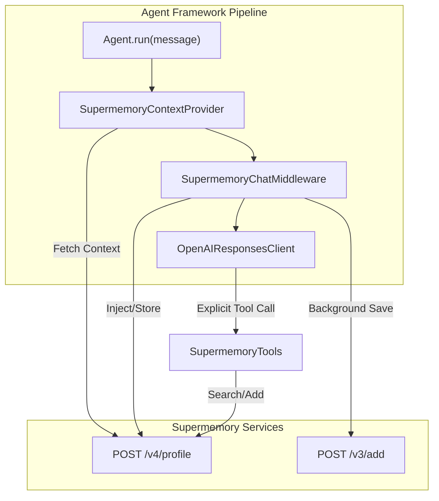
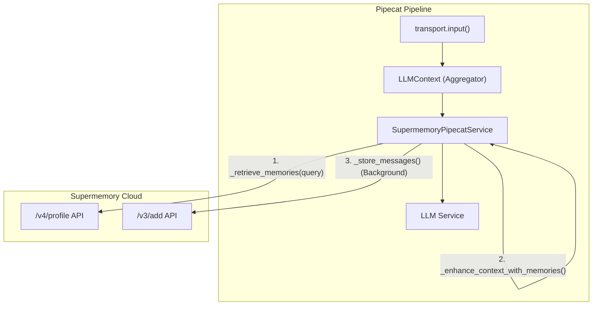
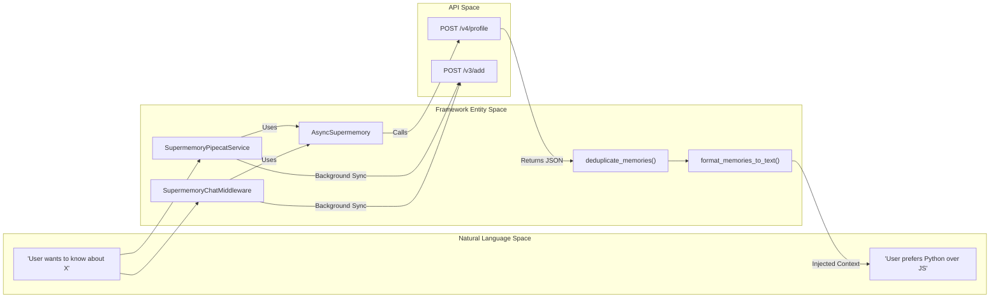

<!-- source: DeepWiki mcp.deepwiki.com · repo supermemoryai/supermemory · page 8.4 Agent Framework Integrations · fetched 2026-10-30 -->

# Agent Framework Integrations

<details>
<summary>Relevant source files</summary>

The following files were used as context for generating this wiki page:

- [apps/docs/integrations/pipecat.mdx](apps/docs/integrations/pipecat.mdx)
- [packages/agent-framework-python/README.md](packages/agent-framework-python/README.md)
- [packages/openai-sdk-python/README.md](packages/openai-sdk-python/README.md)
- [packages/pipecat-sdk-python/Agents.md](packages/pipecat-sdk-python/Agents.md)
- [packages/pipecat-sdk-python/README.md](packages/pipecat-sdk-python/README.md)
- [packages/pipecat-sdk-python/pyproject.toml](packages/pipecat-sdk-python/pyproject.toml)
- [packages/pipecat-sdk-python/src/supermemory_pipecat/__init__.py](packages/pipecat-sdk-python/src/supermemory_pipecat/__init__.py)
- [packages/pipecat-sdk-python/src/supermemory_pipecat/exceptions.py](packages/pipecat-sdk-python/src/supermemory_pipecat/exceptions.py)
- [packages/pipecat-sdk-python/src/supermemory_pipecat/service.py](packages/pipecat-sdk-python/src/supermemory_pipecat/service.py)
- [packages/pipecat-sdk-python/src/supermemory_pipecat/utils.py](packages/pipecat-sdk-python/src/supermemory_pipecat/utils.py)
- [packages/pipecat-sdk-python/tests/__init__.py](packages/pipecat-sdk-python/tests/__init__.py)
- [packages/pipecat-sdk-python/tests/test_empty_profile.py](packages/pipecat-sdk-python/tests/test_empty_profile.py)
- [skills/supermemory/LICENSE](skills/supermemory/LICENSE)
- [skills/supermemory/README.md](skills/supermemory/README.md)
- [skills/supermemory/SKILL.md](skills/supermemory/SKILL.md)
- [skills/supermemory/references/api-reference.md](skills/supermemory/references/api-reference.md)
- [skills/supermemory/references/architecture.md](skills/supermemory/references/architecture.md)
- [skills/supermemory/references/quickstart.md](skills/supermemory/references/quickstart.md)
- [skills/supermemory/references/sdk-guide.md](skills/supermemory/references/sdk-guide.md)
- [skills/supermemory/references/use-cases.md](skills/supermemory/references/use-cases.md)

</details>


Supermemory provides native Python SDKs for popular agentic and conversational AI frameworks, specifically **Microsoft Agent Framework**, **Pipecat**, and **OpenAI-compatible agent frameworks**. These integrations allow developers to inject persistent user memory, profiles, and semantic search capabilities directly into AI pipelines with minimal configuration.

## 1. Microsoft Agent Framework Integration (`supermemory-agent-framework`)

The `supermemory-agent-framework` package provides multiple patterns for adding memory to agents built with Microsoft's [Agent Framework](https://github.com/microsoft/agent-framework). It supports automatic context injection via middleware or context providers, as well as explicit memory management through tools.

### 1.1 Installation

Install the package via pip or uv. Note that the `--pre` flag is required due to dependencies on pre-release Azure packages [packages/agent-framework-python/README.md:15-21]().

```bash
pip install --pre supermemory-agent-framework
# For async support
pip install 'supermemory-agent-framework[async]'
```

### 1.2 Integration Patterns

The SDK offers three primary ways to integrate memory [packages/agent-framework-python/README.md:33-139]():

| Pattern | Class | Use Case |
| :--- | :--- | :--- |
| **Middleware** | `SupermemoryChatMiddleware` | Automatic injection for standard agent runs. |
| **Context Provider** | `SupermemoryContextProvider` | Idiomatic integration for `AgentSession` based workflows. |
| **Tools** | `SupermemoryTools` | Explicit memory search and storage by the agent itself. |

**Agent Framework Data Flow**
"Microsoft Agent Framework Memory Injection"

**Sources:** [packages/agent-framework-python/README.md:45-107](), [packages/agent-framework-python/README.md:141-180]()

## 2. Pipecat Integration (`supermemory-pipecat`)

The `supermemory-pipecat` package provides a way to add persistent memory to voice and conversational AI applications built with [Pipecat](https://github.com/pipecat-ai/pipecat). It functions as a `FrameProcessor` that intercepts conversation context and enhances it with relevant memories [packages/pipecat-sdk-python/src/supermemory_pipecat/service.py:37-42]().

### 2.1 Installation and Basic Setup

```bash
pip install supermemory-pipecat
```

Initialize the `SupermemoryPipecatService` and add it to your pipeline [packages/pipecat-sdk-python/src/supermemory_pipecat/__init__.py:7-25]().

```python
from supermemory_pipecat import SupermemoryPipecatService

memory = SupermemoryPipecatService(
    api_key=os.getenv("SUPERMEMORY_API_KEY"),
    user_id="user-123",  # Scopes memories to this user
)

pipeline = Pipeline([
    transport.input(),
    stt,
    user_context,
    memory,  # Intercepts frames and injects memory
    llm,
    transport.output(),
])
```
**Sources:** [packages/pipecat-sdk-python/README.md:19-35](), [packages/pipecat-sdk-python/src/supermemory_pipecat/service.py:71-106]()

### 2.2 Data Flow and Implementation

The service listens for `LLMContextFrame` or `OpenAILLMContextFrame` objects [packages/pipecat-sdk-python/src/supermemory_pipecat/service.py:17-20](). It retrieves memories via the `_retrieve_memories` method, which calls the Supermemory profile endpoint [packages/pipecat-sdk-python/src/supermemory_pipecat/service.py:122-147]().

**Pipecat Memory Flow Diagram**
"Pipecat Service Architecture"

**Sources:** [packages/pipecat-sdk-python/src/supermemory_pipecat/service.py:37-52](), [packages/pipecat-sdk-python/README.md:74-80]()

## 3. OpenAI Agent Integration (`supermemory-openai-sdk`)

The `supermemory-openai-sdk` provides middleware and toolsets for building memory-augmented agents using OpenAI's Python SDK [packages/openai-sdk-python/README.md:1-5]().

### 3.1 Context Injection via Middleware

The framework uses `with_supermemory()` to wrap an `OpenAI` or `AsyncOpenAI` client [packages/openai-sdk-python/README.md:33-54](). 
- **Profile Mode**: Injects static and dynamic profile facts [packages/openai-sdk-python/README.md:171-179]().
- **Query Mode**: Searches for memories relevant to the current message [packages/openai-sdk-python/README.md:181-189]().
- **Full Mode**: Combines both profile and query-based search [packages/openai-sdk-python/README.md:191-199]().

### 3.2 SupermemoryTools

For agents that require autonomous memory management, the integration provides `SupermemoryTools` [packages/openai-sdk-python/README.md:232-235](). These allow the agent to explicitly call functions to:
- `add_memory`: Save facts to the user's memory [packages/openai-sdk-python/README.md:95-97]().
- `search_memories`: Perform semantic search over past interactions [packages/openai-sdk-python/README.md:104-108]().

## 4. Technical Entity Mapping

The following diagram bridges the framework concepts to the specific code entities used in the Python integrations.

**Code Entity Mapping Diagram**
"Agent Integration Entity Map"

**Sources:** [packages/pipecat-sdk-python/src/supermemory_pipecat/service.py:122-148](), [packages/pipecat-sdk-python/src/supermemory_pipecat/utils.py:52-96](), [packages/agent-framework-python/README.md:247-250]()

## 5. Key Utilities and Configuration

| Class/Function | Role |
| :--- | :--- |
| `InputParams` | Configures `search_limit`, `search_threshold`, and `mode` in Pipecat [packages/pipecat-sdk-python/src/supermemory_pipecat/service.py:54-70](). |
| `SupermemoryMiddlewareOptions` | Configures `add_memory` (always/never) and `mode` for Agent Framework [packages/agent-framework-python/README.md:184-226](). |
| `deduplicate_memories` | Merges profile and search results with priority: Static > Dynamic > Search [packages/pipecat-sdk-python/src/supermemory_pipecat/utils.py:52-58](). |
| `format_memories_to_text` | Formats memories into a system prompt string with relative timestamps [packages/pipecat-sdk-python/src/supermemory_pipecat/utils.py:90-134](). |

**Sources:** [packages/pipecat-sdk-python/src/supermemory_pipecat/service.py:54-70](), [packages/pipecat-sdk-python/src/supermemory_pipecat/utils.py:52-134](), [packages/agent-framework-python/README.md:184-226]()

---

