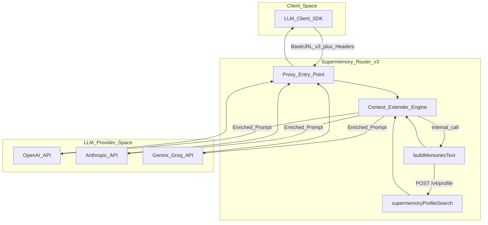
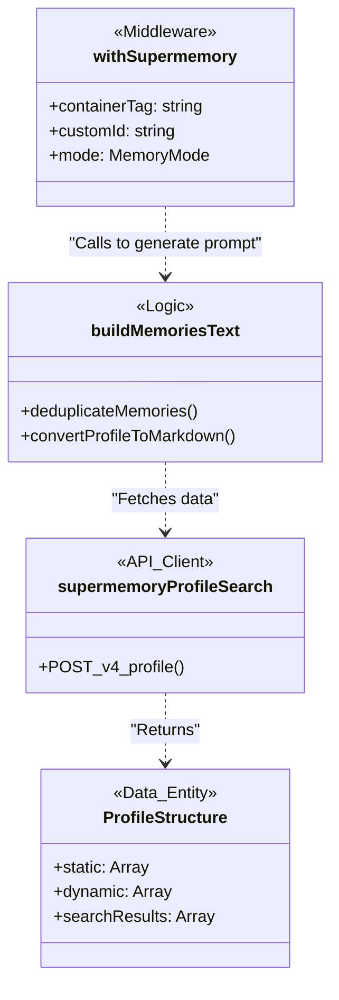

<!-- source: DeepWiki mcp.deepwiki.com · repo supermemoryai/supermemory · page 8.5 Memory Router & Model Enhancement · fetched 2026-10-30 -->

# Memory Router & Model Enhancement

<details>
<summary>Relevant source files</summary>

The following files were used as context for generating this wiki page:

- [apps/docs/ai-sdk/examples.mdx](apps/docs/ai-sdk/examples.mdx)
- [apps/docs/ai-sdk/infinite-chat.mdx](apps/docs/ai-sdk/infinite-chat.mdx)
- [apps/docs/ai-sdk/memory-tools.mdx](apps/docs/ai-sdk/memory-tools.mdx)
- [apps/docs/ai-sdk/overview.mdx](apps/docs/ai-sdk/overview.mdx)
- [apps/docs/ai-sdk/user-profiles.mdx](apps/docs/ai-sdk/user-profiles.mdx)
- [apps/docs/cookbook/ai-sdk-integration.mdx](apps/docs/cookbook/ai-sdk-integration.mdx)
- [apps/docs/cookbook/customer-support.mdx](apps/docs/cookbook/customer-support.mdx)
- [apps/docs/cookbook/document-qa.mdx](apps/docs/cookbook/document-qa.mdx)
- [apps/docs/cookbook/personal-assistant.mdx](apps/docs/cookbook/personal-assistant.mdx)
- [apps/docs/integrations/ai-sdk.mdx](apps/docs/integrations/ai-sdk.mdx)
- [apps/docs/integrations/openai.mdx](apps/docs/integrations/openai.mdx)
- [apps/docs/integrations/voltagent.mdx](apps/docs/integrations/voltagent.mdx)
- [apps/docs/memory-api/sdks/openai-plugins.mdx](apps/docs/memory-api/sdks/openai-plugins.mdx)
- [apps/docs/memory-router/usage.mdx](apps/docs/memory-router/usage.mdx)
- [apps/docs/memory-router/with-memory-api.mdx](apps/docs/memory-router/with-memory-api.mdx)
- [apps/docs/migration/tools-v2-upgrade.mdx](apps/docs/migration/tools-v2-upgrade.mdx)
- [packages/ai-sdk/README.md](packages/ai-sdk/README.md)
- [packages/ai-sdk/src/tools.test.ts](packages/ai-sdk/src/tools.test.ts)
- [packages/ai-sdk/src/tools.ts](packages/ai-sdk/src/tools.ts)
- [packages/tools/src/shared/memory-client.ts](packages/tools/src/shared/memory-client.ts)
- [packages/tools/src/shared/types.ts](packages/tools/src/shared/types.ts)

</details>


The Memory Router is a transparent proxy layer provided by Supermemory that allows developers to route standard LLM requests through the Supermemory infrastructure. This architecture enables "drop-in" memory capabilities by intercepting requests, injecting relevant user context (memories and profiles), and enhancing the model's response without requiring complex changes to existing application logic.

## Overview and Purpose

The Memory Router acts as a middleware between the application and the LLM provider (OpenAI, Anthropic, Gemini, Groq). By changing the base URL of the LLM client to route through `api.supermemory.ai/v3/`, developers can leverage Supermemory's context-extender features.

Key benefits include:
*   **Transparent Context Injection**: Automatically fetches and injects memories based on the conversation history.
*   **User Profiling**: Injects stable facts (static) and recent activity (dynamic) into the system prompt [apps/docs/ai-sdk/user-profiles.mdx:39-46]().
*   **Multi-Provider Support**: Unified interface for leading LLM providers [packages/ai-sdk/README.md:90-103]().
*   **Zero-Config RAG**: Context is managed automatically via middleware or proxy without manual vector search logic [apps/docs/ai-sdk/overview.mdx:7-11]().

## Implementation & Data Flow

The router functions by intercepting the standard chat completion payload. It uses identifiers to map requests to specific `containerTag` scopes, ensuring data isolation and relevant context retrieval.

### Request Routing Architecture

The following diagram illustrates how a request moves from a client through the Memory Router to the final LLM provider.

**LLM Request Enrichment Flow**

Sources: [packages/ai-sdk/README.md:32-39](), [packages/tools/src/shared/memory-client.ts:24-30](), [packages/tools/src/shared/memory-client.ts:88-90]()

## Configuration

To use the Memory Router, the client must be configured with the Supermemory base URL and the necessary identification headers.

### Supported Providers
The router supports leading providers by prepending the Supermemory proxy URL to the provider's API endpoint:
*   **OpenAI**: Set `baseURL` to `https://api.supermemory.ai/v3/https://api.openai.com/v1` [packages/ai-sdk/README.md:33]().
*   **Anthropic**: Use `https://api.supermemory.ai/v3/https://api.anthropic.com/v1`.
*   **Groq/Gemini**: Supported by routing through the unified `/v3/` prefix.

### Identifying Users and Conversations
Supermemory identifies the context to inject using several mechanisms:

1.  **`x-sm-user-id` header**: Maps to the `containerTag` for memory isolation.
2.  **`x-supermemory-api-key`**: The Supermemory API key used for authentication [packages/ai-sdk/README.md:36]().
3.  **`x-sm-conversation-id`**: Maps to the `customId` to track specific threads and enable automatic backfilling [packages/ai-sdk/README.md:37]().

| Header | Description |
| :--- | :--- |
| `Authorization` | Standard provider API key (e.g., OpenAI Key) [packages/ai-sdk/README.md:34](). |
| `x-supermemory-api-key` | Supermemory API key for context access [packages/ai-sdk/README.md:36](). |
| `x-sm-conversation-id` | Groups messages into a specific document [packages/ai-sdk/README.md:37](). |

Sources: [packages/ai-sdk/README.md:31-40](), [apps/docs/integrations/ai-sdk.mdx:53-59]()

## Model Enhancement (Context Extender)

The Model Enhancement feature uses a "Context Extender" pattern. When a request hits the router or middleware, the system performs internal operations to "enhance" the prompt.

### Enhancement Components

1.  **Memory Extraction**: Conversations are saved as memories automatically when `addMemory` is set to `"always"` (the default in v2) [apps/docs/migration/tools-v2-upgrade.mdx:137-140]().
2.  **User Profiles**: The system fetches `static` facts (stable) and `dynamic` facts (recent activity) [packages/tools/src/shared/types.ts:70-82]().
3.  **Context Building**: The `buildMemoriesText` function formats retrieved data into a string for system prompt injection [packages/tools/src/shared/memory-client.ts:88-100]().

### Data Entity Mapping

This diagram bridges the conceptual "Enhancement" to the specific code entities used within the `@supermemory/tools` and `@supermemory/ai-sdk` packages.

**Context Extender Entity Map**

Sources: [packages/tools/src/shared/memory-client.ts:88-108](), [packages/tools/src/shared/types.ts:70-90](), [apps/docs/integrations/ai-sdk.mdx:42-45]()

## Integration Patterns

### Direct Middleware Usage
Instead of the transparent proxy, developers can use the `withSupermemory` middleware which performs the same enhancement logic locally before calling the LLM.

```typescript
const modelWithMemory = withSupermemory(openai("gpt-4"), {
  containerTag: "user-123",
  customId: "conversation-456",
  mode: "full" // Combines profile and query search
})
```
Sources: [apps/docs/ai-sdk/user-profiles.mdx:17-26](), [apps/docs/ai-sdk/user-profiles.mdx:110-118]()

### Comparison: Router vs. Tools
Supermemory supports two primary integration patterns:
*   **Infinite Chat (Router/Middleware)**: Context is injected into the system prompt automatically. Best for general personalization [packages/ai-sdk/README.md:24-26]().
*   **Memory Tools**: The AI model explicitly calls tools like `searchMemories` or `addMemory` to interact with Supermemory. Best for agents needing explicit control [packages/ai-sdk/src/tools.ts:27-34]().

Sources: [packages/ai-sdk/README.md:17-22](), [apps/docs/integrations/ai-sdk.mdx:24-30]()

---

