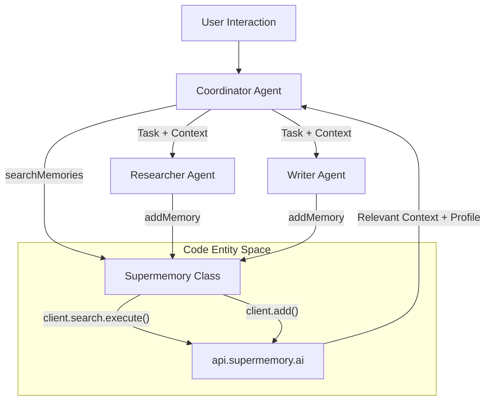
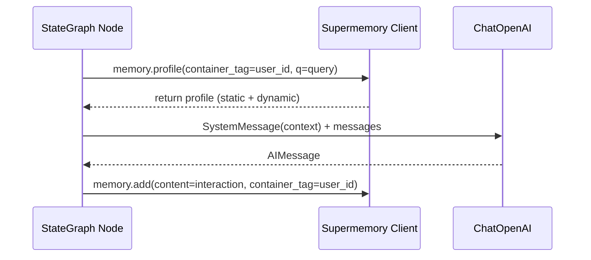

<!-- source: DeepWiki mcp.deepwiki.com · repo supermemoryai/supermemory · page 8.6 LangChain, LangGraph & Multi-Agent Frameworks · fetched 2026-10-30 -->

# LangChain, LangGraph & Multi-Agent Frameworks

<details>
<summary>Relevant source files</summary>

The following files were used as context for generating this wiki page:

- [apps/docs/ai-sdk/examples.mdx](apps/docs/ai-sdk/examples.mdx)
- [apps/docs/ai-sdk/infinite-chat.mdx](apps/docs/ai-sdk/infinite-chat.mdx)
- [apps/docs/ai-sdk/memory-tools.mdx](apps/docs/ai-sdk/memory-tools.mdx)
- [apps/docs/cookbook/ai-sdk-integration.mdx](apps/docs/cookbook/ai-sdk-integration.mdx)
- [apps/docs/cookbook/customer-support.mdx](apps/docs/cookbook/customer-support.mdx)
- [apps/docs/cookbook/document-qa.mdx](apps/docs/cookbook/document-qa.mdx)
- [apps/docs/cookbook/personal-assistant.mdx](apps/docs/cookbook/personal-assistant.mdx)
- [apps/docs/images/langgraph.svg](apps/docs/images/langgraph.svg)
- [apps/docs/integrations/langgraph.mdx](apps/docs/integrations/langgraph.mdx)
- [apps/docs/memory-api/sdks/openai-plugins.mdx](apps/docs/memory-api/sdks/openai-plugins.mdx)
- [apps/docs/memory-router/usage.mdx](apps/docs/memory-router/usage.mdx)
- [apps/docs/memory-router/with-memory-api.mdx](apps/docs/memory-router/with-memory-api.mdx)
- [packages/ai-sdk/README.md](packages/ai-sdk/README.md)
- [packages/ai-sdk/src/tools.test.ts](packages/ai-sdk/src/tools.test.ts)
- [packages/ai-sdk/src/tools.ts](packages/ai-sdk/src/tools.ts)

</details>


This page documents the integration of Supermemory into advanced AI orchestration frameworks including LangChain, LangGraph, CrewAI, Agno, and the OpenAI Agents SDK. These integrations allow developers to inject persistent user context into agents, store agentic outputs as long-term memories, and utilize Supermemory's hybrid search as a tool within multi-agent pipelines.

## Multi-Agent Context Flow

In multi-agent systems, Supermemory acts as a centralized "Context Layer." Instead of passing massive message histories between agents, agents can query Supermemory for specific user preferences or past project states.

### Implementation Logic
1.  **User Identification**: Every agent request is scoped using a `containerTags` or `projectId` which is used to isolate memories [packages/ai-sdk/src/tools.ts:36-39]().
2.  **Context Injection**: Agents fetch user profiles containing static facts (permanent information) and dynamic context (recent activity) to set the system prompt [apps/docs/integrations/langgraph.mdx:64-81]().
3.  **Memory Synthesis**: As agents complete tasks, they use the `addMemory` tool to persist findings for future runs [packages/ai-sdk/src/tools.ts:92-127]().

### Data Flow Diagram: Multi-Agent Memory
This diagram shows how a Coordinator agent uses Supermemory to inform specialized workers.


Sources: [packages/ai-sdk/src/tools.ts:27-133](), [apps/docs/integrations/langgraph.mdx:59-92]()

---

## LangChain & LangGraph Integration

Supermemory integrates with LangChain through custom Tool definitions. In LangGraph, Supermemory is typically implemented as a node that manages state persistence or as a tool available to the graph's agents.

### Tool Configuration
The `@supermemory/ai-sdk` package provides tools compatible with the Vercel AI SDK and LangChain. The `supermemoryTools` helper initializes a suite of memory operations [packages/ai-sdk/src/tools.ts:27-30]().

| Tool Name | Purpose | Key Parameters |
| :--- | :--- | :--- |
| `searchMemories` | Semantic retrieval of user-specific data [packages/ai-sdk/src/tools.ts:40-42]() | `informationToGet`, `limit`, `includeFullDocs` |
| `addMemory` | Persisting new facts or short sentences [packages/ai-sdk/src/tools.ts:92-94]() | `memory` |

### LangGraph Implementation
In LangGraph, you can define a state that includes a `user_id` to scope all Supermemory calls within nodes [apps/docs/integrations/langgraph.mdx:55-57]().


Sources: [apps/docs/integrations/langgraph.mdx:59-92](), [apps/docs/integrations/langgraph.mdx:183-221]()

---

## OpenAI SDK & Agents Integration

Supermemory provides specialized support for OpenAI function calling via the `@supermemory/tools/openai` module (JavaScript/TypeScript) and the `supermemory-openai-sdk` (Python).

### Function Calling Pipeline
1.  **Tool Definitions**: Use `getToolDefinitions()` (TS) or `tools.get_tool_definitions()` (Python) to get OpenAI-compatible function objects [apps/docs/memory-api/sdks/openai-plugins.mdx:67-68](), [apps/docs/memory-api/sdks/openai-plugins.mdx:93-94]().
2.  **Execution Handlers**: Use `execute_memory_tool_calls` (Python) or `createToolCallExecutor` (TS) to process the tool outputs returned by the LLM [apps/docs/memory-api/sdks/openai-plugins.mdx:72-76](), [apps/docs/memory-api/sdks/openai-plugins.mdx:96-98]().

### Configuration & Scoping
You can scope an entire agentic session to a specific project or user using the `SupermemoryToolsConfig` [packages/ai-sdk/src/tools.ts:8-12]().
*   `projectId`: Automatically mapped to a container tag `sm_project_{id}` [packages/ai-sdk/src/tools.ts:36-37]().
*   `containerTags`: A list of strings used to partition memory [packages/ai-sdk/src/tools.ts:38]().

Sources: [apps/docs/memory-api/sdks/openai-plugins.mdx:42-82](), [packages/ai-sdk/src/tools.ts:8-39]()

---

## Python Multi-Agent Support

For Python-based frameworks like CrewAI, Agno, or LangGraph Python, the `supermemory` Python package provides a standard interface for memory operations.

### Core Memory Operations
Agents can be given access to specific methods from the `Supermemory` class to manage their own long-term state [apps/docs/integrations/langgraph.mdx:53-54]().

```python
from supermemory import Supermemory

memory = Supermemory()

# Search memories across sessions
results = memory.search.memories(
    q="project goals",
    container_tag="agent_001",
    search_mode="hybrid"
)

# Store new findings
memory.add(
    content="User prefers async patterns in Python",
    container_tag="agent_001"
)
```
Sources: [apps/docs/integrations/langgraph.mdx:132-147](), [apps/docs/integrations/langgraph.mdx:153-163]()

### Profile-Driven Personalization
Supermemory automatically builds user profiles from stored memories, which can be injected into agent system prompts to provide immediate context without manual tool calls [apps/docs/integrations/langgraph.mdx:115-128]().

*   **Static facts**: Long-term information like preferences or expertise [apps/docs/integrations/langgraph.mdx:117]().
*   **Dynamic context**: Recent activity and current focus [apps/docs/integrations/langgraph.mdx:118]().

Sources: [apps/docs/integrations/langgraph.mdx:113-128](), [apps/docs/integrations/langgraph.mdx:201-220]()

---

