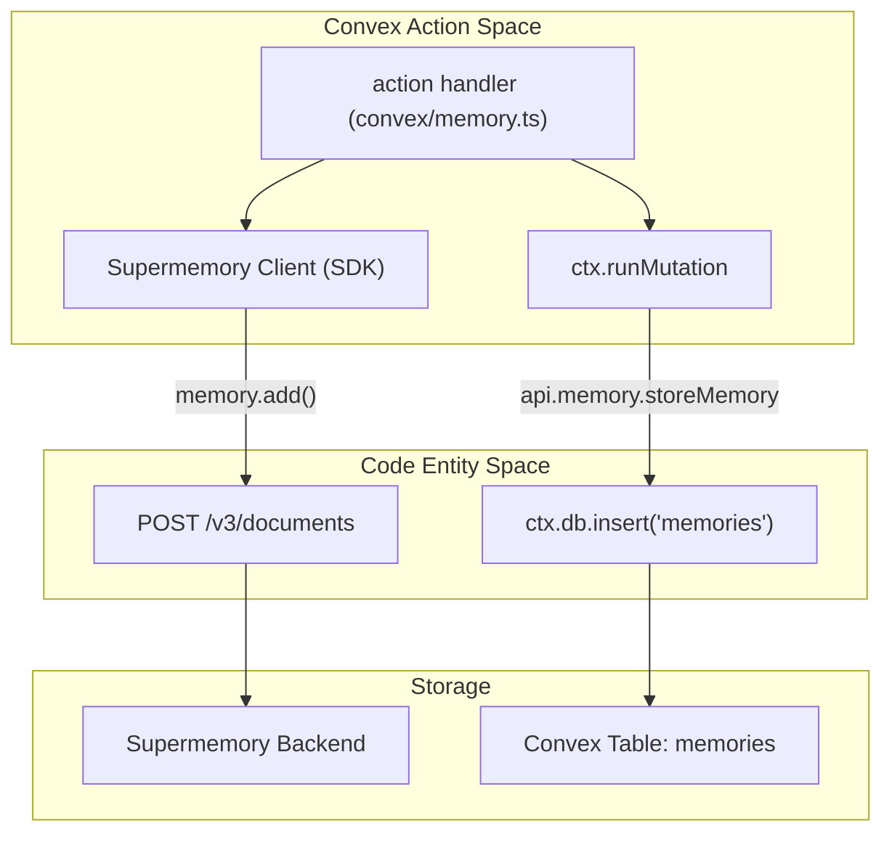
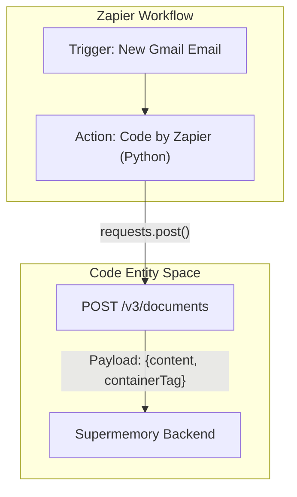

<!-- source: DeepWiki mcp.deepwiki.com · repo supermemoryai/supermemory · page 8.7 Automation & No-Code Integrations · fetched 2026-10-30 -->

# Automation & No-Code Integrations

Relevant source files

The following files were used as context for generating this wiki page:

- [apps/docs/add-memories/overview.mdx](apps/docs/add-memories/overview.mdx)
- [apps/docs/document-operations.mdx](apps/docs/document-operations.mdx)
- [apps/docs/images/viaSocket-supermemory-auth.png](apps/docs/images/viaSocket-supermemory-auth.png)
- [apps/docs/images/viaSocket-supermemory-connect.png](apps/docs/images/viaSocket-supermemory-connect.png)
- [apps/docs/images/viaSocket-supermemory-trigger.png](apps/docs/images/viaSocket-supermemory-trigger.png)
- [apps/docs/images/viasocket-icon-ico.ico](apps/docs/images/viasocket-icon-ico.ico)
- [apps/docs/images/viasocket-supermemory-action.png](apps/docs/images/viasocket-supermemory-action.png)
- [apps/docs/images/viasocket-supermemory-configured-trigger.png](apps/docs/images/viasocket-supermemory-configured-trigger.png)
- [apps/docs/images/viasocket-supermemory-connection.png](apps/docs/images/viasocket-supermemory-connection.png)
- [apps/docs/images/viasocket-supermemory-go-live.png](apps/docs/images/viasocket-supermemory-go-live.png)
- [apps/docs/integrations/convex.mdx](apps/docs/integrations/convex.mdx)
- [apps/docs/integrations/viasocket.mdx](apps/docs/integrations/viasocket.mdx)
- [apps/docs/memory-api/creation/adding-memories.mdx](apps/docs/memory-api/creation/adding-memories.mdx)
- [apps/docs/memory-api/ingesting.mdx](apps/docs/memory-api/ingesting.mdx)
- [apps/docs/memory-api/introduction.mdx](apps/docs/memory-api/introduction.mdx)
- [apps/docs/memory-api/overview.mdx](apps/docs/memory-api/overview.mdx)
- [apps/docs/memory-api/searching/searching-memories.mdx](apps/docs/memory-api/searching/searching-memories.mdx)
- [apps/docs/memory-api/track-progress.mdx](apps/docs/memory-api/track-progress.mdx)
- [apps/docs/migration/from-zep.mdx](apps/docs/migration/from-zep.mdx)
- [apps/docs/n8n.mdx](apps/docs/n8n.mdx)
- [apps/docs/update-delete-memories/overview.mdx](apps/docs/update-delete-memories/overview.mdx)
- [apps/docs/zapier.mdx](apps/docs/zapier.mdx)

Supermemory provides native support and implementation patterns for automation and no-code platforms, allowing users to build persistent memory layers into automated workflows. This enables AI agents and automation scripts to maintain context across sessions, build dynamic user profiles, and perform hybrid searches without manual data management.

## Convex Integration

Supermemory acts as a persistent memory layer for Convex applications, which do not have built-in stateful memory for AI.

### Core Implementation
Integration is achieved by creating Convex actions that wrap the Supermemory SDK. This allows Convex functions to interact with the Supermemory backend for adding, searching, and profiling memories.

| Operation | Convex Helper Function | Supermemory Method |
| :--- | :--- | :--- |
| **Add Memory** | `addMemory` | `memory.add` |
| **Search** | `searchMemories` | `memory.search.memories` |
| **User Profile** | `getProfile` | `memory.profile` |

Sources: [apps/docs/integrations/convex.mdx:41-85]()

### AI SDK Middleware in Convex
For chat-based applications, the `withSupermemory` middleware from `@supermemory/tools/ai-sdk` can be used within a Convex action to automatically inject context and save conversation turns.

Sources: [apps/docs/integrations/convex.mdx:94-121]()

### Data Flow: Convex to Supermemory
The following diagram illustrates how a Convex action interacts with the `Supermemory` client and optionally syncs data to a local Convex table.

**Convex Integration Data Flow**

Sources: [apps/docs/integrations/convex.mdx:49-85](), [apps/docs/integrations/convex.mdx:144-189](), [apps/docs/memory-api/ingesting.mdx:75-75]()

---

## n8n Integration

Supermemory integrates with n8n using the **HTTP Request** node to build intelligent automation agents.

### Setup and Authentication
1. **Node Type**: Use the **HTTP Request** node (Core).
2. **Authentication**: Select **Generic Credential Type** → **Bearer Auth**. Paste the API key from the [Supermemory Console](https://console.supermemory.ai) into the Token field.
3. **Endpoint**: Use `https://api.supermemory.ai/v3/documents` for ingestion or `https://api.supermemory.ai/v4/search` for retrieval.

Sources: [apps/docs/n8n.mdx:17-30]()

### Implementation Pattern: Gmail Archive
A common pattern is archiving Gmail snippets into Supermemory.
*   **Trigger**: Gmail "Message Received" node.
*   **Action**: HTTP Request node with JSON body mapping `content` to `{{ $json.snippet }}` and `containerTag` to `gmail`.

Sources: [apps/docs/n8n.mdx:36-66]()

---

## Zapier Integration

Zapier integration is typically handled via the **Code by Zapier** block using Python to interact with the Supermemory API.

### Implementation Logic

Sources: [apps/docs/zapier.mdx:14-51]()

### Configuration
Users map input data (e.g., Gmail raw snippet) to a variable like `content` in the Zapier UI, which is then accessed in the Python script via `inputData['content']`.

Sources: [apps/docs/zapier.mdx:25-53]()

---

## viaSocket Integration

viaSocket allows connecting Supermemory to third-party services through visual automation flows with dedicated triggers.

### Setup and Authentication
1. **API Key**: Retrieve a Personal API key from **Settings → API Key**.
2. **Connection**: In viaSocket, search for the **Supermemory** trigger and paste the API key to authenticate.

Sources: [apps/docs/integrations/viasocket.mdx:18-41]()

### Supported Triggers
*   **Search Memory**: Executes a hybrid search against stored memories.
*   **Search User Profile**: Retrieves dynamic or static profile information.

Sources: [apps/docs/integrations/viasocket.mdx:29-31]()

---

## Technical Reference: Common Integration Patterns

### Scoping with `containerTag`
In all no-code integrations, the `containerTag` (formerly `userId` in some legacy contexts) is critical. It ensures that memories are scoped to specific users or projects, preventing cross-pollination of data.

Sources: [apps/docs/memory-api/creation/adding-memories.mdx:9-13](), [apps/docs/memory-api/ingesting.mdx:148-152]()

### Document vs Memory Model
Integrations primarily interact with **Documents**. When an automation adds content via `POST /v3/documents`, Supermemory asynchronously processes it through a pipeline:
1. **Queued**: Initial submission.
2. **Extracting**: OCR/Transcription.
3. **Chunking**: Semantic splitting.
4. **Embedding**: Vector generation.
5. **Indexing**: Search availability.

Sources: [apps/docs/memory-api/ingesting.mdx:13-26](), [apps/docs/memory-api/track-progress.mdx:9-20]()

### Idempotency with `customId`
For automations that might trigger multiple times for the same event (e.g., webhook retries), use `customId`. Providing the same `customId` with a `POST /v3/documents` request will update the existing document instead of creating a duplicate.

Sources: [apps/docs/update-delete-memories/overview.mdx:68-71](), [apps/docs/update-delete-memories/overview.mdx:157-159]()

---

