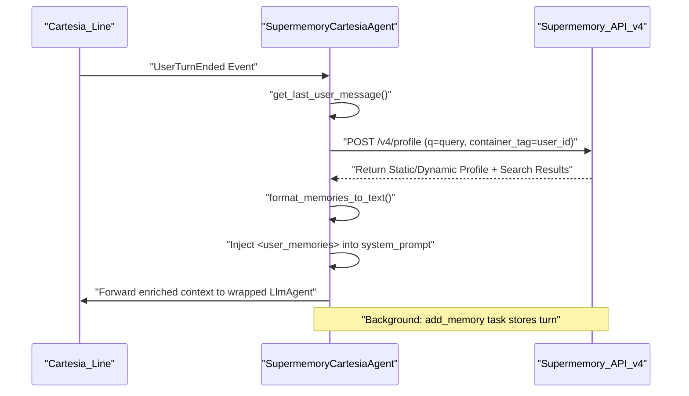
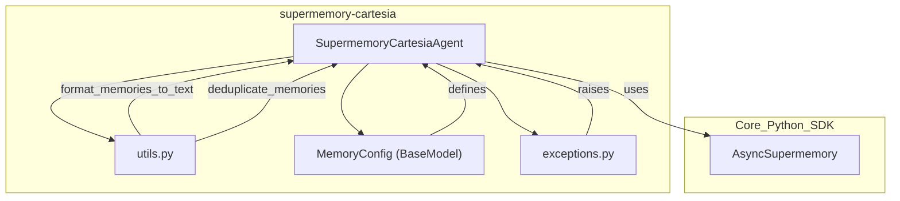

<!-- source: DeepWiki mcp.deepwiki.com · repo supermemoryai/supermemory · page 8.8 Voice & Cartesia Integration · fetched 2026-10-30 -->

# Voice & Cartesia Integration

<details>
<summary>Relevant source files</summary>

The following files were used as context for generating this wiki page:

- [apps/docs/integrations/cartesia.mdx](apps/docs/integrations/cartesia.mdx)
- [packages/cartesia-sdk-python/README.md](packages/cartesia-sdk-python/README.md)
- [packages/cartesia-sdk-python/pyproject.toml](packages/cartesia-sdk-python/pyproject.toml)
- [packages/cartesia-sdk-python/requirements.txt](packages/cartesia-sdk-python/requirements.txt)
- [packages/cartesia-sdk-python/src/supermemory_cartesia/__init__.py](packages/cartesia-sdk-python/src/supermemory_cartesia/__init__.py)
- [packages/cartesia-sdk-python/src/supermemory_cartesia/agent.py](packages/cartesia-sdk-python/src/supermemory_cartesia/agent.py)
- [packages/cartesia-sdk-python/src/supermemory_cartesia/exceptions.py](packages/cartesia-sdk-python/src/supermemory_cartesia/exceptions.py)
- [packages/cartesia-sdk-python/src/supermemory_cartesia/utils.py](packages/cartesia-sdk-python/src/supermemory_cartesia/utils.py)

</details>


The Supermemory ecosystem provides specialized SDKs for integrating persistent memory into voice-based AI agents. This integration primarily targets **Cartesia Line** and **Pipecat**, allowing voice assistants to maintain long-term context, recall user facts (static profiles), and adapt to recent interactions (dynamic profiles) during low-latency voice conversations.

## Supermemory Cartesia SDK

The `supermemory-cartesia` package provides a high-level wrapper for Cartesia Line agents. It intercepts conversation events to inject memory context before the LLM generates a response.

### Installation & Configuration

Install the package via pip:
```bash
pip install supermemory-cartesia
```
[packages/cartesia-sdk-python/README.md:7-9]()

The integration relies on the `SupermemoryCartesiaAgent` class which wraps a standard Cartesia `LlmAgent` [packages/cartesia-sdk-python/src/supermemory_cartesia/agent.py:33-60](). It requires a `container_tag` for scoping and a `custom_id` to group messages into a single document [packages/cartesia-sdk-python/src/supermemory_cartesia/agent.py:91-96]().

### The SupermemoryCartesiaAgent Wrapper

The wrapper monitors `UserTurnEnded` events from the Cartesia pipeline. When a user finishes speaking, the agent performs a memory lookup using the user's last utterance as a query [apps/docs/integrations/cartesia.mdx:89-99]().

| Parameter | Type | Description |
| :--- | :--- | :--- |
| `agent` | `Any` | The inner Cartesia Line agent to wrap. |
| `container_tag` | `str` | Primary tag for memory scoping (usually User ID). |
| `custom_id` | `str` | Required. Groups messages into a single document (e.g., Call ID). |
| `add_memory` | `Literal["always", "never"]` | Persistence mode (default: "always"). |
| `config` | `MemoryConfig` | Advanced settings for search limits and thresholds. |

**Sources:** [packages/cartesia-sdk-python/src/supermemory_cartesia/agent.py:77-105](), [apps/docs/integrations/cartesia.mdx:150-160]()

### Memory Context Injection

Memories are retrieved via the `profile` endpoint, which returns three types of data:
1.  **Static Profile**: Persistent facts (e.g., "User lives in New York").
2.  **Dynamic Profile**: Evolving preferences (e.g., "User is currently looking for a pizza place").
3.  **Search Results**: Semantically relevant snippets from past transcripts.

These are formatted into a text block and wrapped in `MEMORY_TAG_START` (`<user_memories>`) and `MEMORY_TAG_END` (`</user_memories>`) XML tags before being injected into the agent's system prompt [packages/cartesia-sdk-python/src/supermemory_cartesia/agent.py:28-31]().

### Data Flow: Cartesia Voice Agent

The following diagram illustrates how the `SupermemoryCartesiaAgent` mediates between the Cartesia event loop and the Supermemory API.

**Voice Agent Memory Flow**

**Sources:** [packages/cartesia-sdk-python/src/supermemory_cartesia/agent.py:148-183](), [apps/docs/integrations/cartesia.mdx:85-104](), [packages/cartesia-sdk-python/src/supermemory_cartesia/utils.py:7-12]()

---

## Technical Implementation Details

### Memory Deduplication & Formatting
The SDK handles overlapping data using the `deduplicate_memories` utility. If a fact appears in both the static profile and search results, it ensures the fact is only presented once, prioritizing static > dynamic > search [packages/cartesia-sdk-python/src/supermemory_cartesia/utils.py:52-87]().

The `format_memories_to_text` function generates a structured string with headers [packages/cartesia-sdk-python/src/supermemory_cartesia/utils.py:90-134]():
- `## User Profile (Persistent)`
- `## Recent Context`
- `## Relevant Memories` (includes relative timestamps generated by `format_relative_time` [packages/cartesia-sdk-python/src/supermemory_cartesia/utils.py:15-50]())

### Code Entity Map: SDK Structure

This diagram maps the Python classes to their respective roles in the voice integration ecosystem.

**SDK Entity Architecture**

**Sources:** [packages/cartesia-sdk-python/src/supermemory_cartesia/agent.py:33-88](), [packages/cartesia-sdk-python/src/supermemory_cartesia/utils.py:90-96](), [packages/cartesia-sdk-python/src/supermemory_cartesia/exceptions.py:6-34]()

### Memory Retrieval Modes
The integration supports three operational modes via the `MemoryConfig.mode` parameter [packages/cartesia-sdk-python/src/supermemory_cartesia/agent.py:75]():

| Mode | Description | Data Fetched |
| :--- | :--- | :--- |
| `profile` | Fast personalization | Static & Dynamic Profiles only |
| `query` | Deep recall | Vector Search Results only |
| `full` | Comprehensive (Default) | Profiles + Search Results |

**Sources:** [apps/docs/integrations/cartesia.mdx:106-112](), [packages/cartesia-sdk-python/src/supermemory_cartesia/agent.py:72-75]()

### Exception Handling
The SDK defines a hierarchy of exceptions for robust error handling [packages/cartesia-sdk-python/src/supermemory_cartesia/exceptions.py:6-58]():
- `ConfigurationError`: Missing API keys or required parameters.
- `MemoryRetrievalError`: Failures during lookup.
- `MemoryStorageError`: Failures during background persistence.
- `APIError`: Direct Supermemory API request failures (includes status codes).

---

