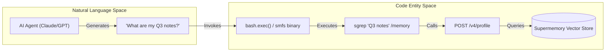
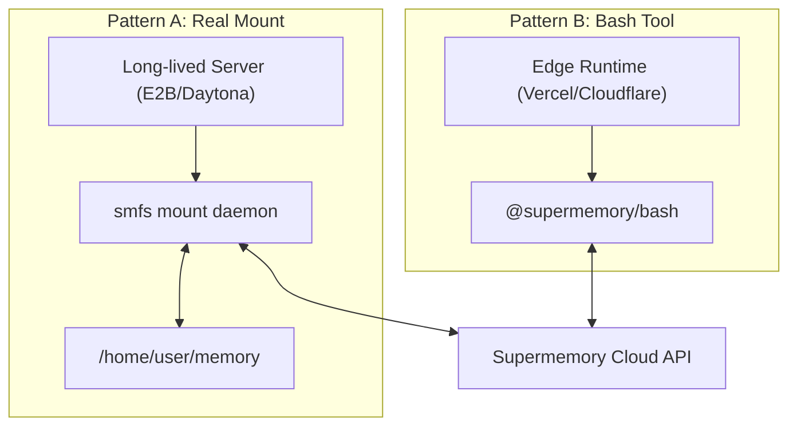

<!-- source: DeepWiki mcp.deepwiki.com · repo supermemoryai/supermemory · page 9 SMFS — Supermemory Filesystem · fetched 2026-10-30 -->

# SMFS — Supermemory Filesystem

Relevant source files

The following files were used as context for generating this wiki page:

- [apps/docs/smfs/bash-tool-python.mdx](apps/docs/smfs/bash-tool-python.mdx)
- [apps/docs/smfs/bash-tool.mdx](apps/docs/smfs/bash-tool.mdx)
- [apps/docs/smfs/examples.mdx](apps/docs/smfs/examples.mdx)
- [apps/docs/smfs/install.mdx](apps/docs/smfs/install.mdx)
- [apps/docs/smfs/mount.mdx](apps/docs/smfs/mount.mdx)
- [apps/docs/smfs/overview.mdx](apps/docs/smfs/overview.mdx)
- [apps/docs/smfs/providers/cloudflare.mdx](apps/docs/smfs/providers/cloudflare.mdx)
- [apps/docs/smfs/providers/daytona.mdx](apps/docs/smfs/providers/daytona.mdx)
- [apps/docs/smfs/providers/e2b.mdx](apps/docs/smfs/providers/e2b.mdx)
- [apps/docs/smfs/providers/vercel.mdx](apps/docs/smfs/providers/vercel.mdx)

**SMFS** (Supermemory Filesystem) mounts a Supermemory container as a real directory, allowing AI agents to use standard shell commands like `ls`, `cat`, and `grep` to interact with memory [apps/docs/smfs/overview.mdx:8-10](). By providing a filesystem interface, SMFS removes the need for agents to learn complex API schemas, leveraging the model's existing proficiency with Unix-style operations [apps/docs/smfs/overview.mdx:14-15]().

## Why a Filesystem Interface?

While standard filesystems are familiar, they often struggle with large-scale memory retrieval due to context window limits. SMFS solves this by providing:
- **Semantic `grep`**: The `sgrep` command performs vector search across the container, returning results ranked by meaning rather than just literal matches [apps/docs/smfs/overview.mdx:20-21]().
- **Memory Distillation**: Files at specific paths (e.g., `user.md`, `memory.md`) are automatically extracted and indexed as persistent memories [apps/docs/smfs/mount.mdx:30-37]().
- **Virtual `profile.md`**: A live, read-only digest of the entire container is exposed at the root, allowing models to get a "one-shot" summary of the user or session [apps/docs/smfs/mount.mdx:55-58]().

### SMFS Concept: From Shell to Supermemory

Sources: [apps/docs/smfs/overview.mdx](), [apps/docs/smfs/bash-tool.mdx:34-36]()

## Two Modes of Operation

SMFS can be used either as a persistent system mount or as a virtualized bash tool for serverless environments [apps/docs/smfs/overview.mdx:27-38]().

| Feature | **SMFS Mount (Binary)** | **SMFS Bash Tool (SDK)** |
| :--- | :--- | :--- |
| **Runtime** | Long-lived (VMs, Docker, Local) | Serverless / Edge (Vercel, Cloudflare) |
| **Tech** | NFSv3 (macOS) / FUSE (Linux) | HTTPS Proxy (No FUSE required) |
| **Installation** | `curl | bash` | `npm install @supermemory/bash` |
| **Usage** | Real directory on disk | `bash.exec("ls /")` via SDK |
| **Sync** | Background daemon | Eager-load cache |

### Provider Architecture: Mount vs. Bash Tool

Sources: [apps/docs/smfs/providers/vercel.mdx:19-45](), [apps/docs/smfs/providers/e2b.mdx:14-41]()

## SMFS Mount & Installation
The `smfs` binary turns a Supermemory container into a directory. It supports multiple sync modes: **Bidirectional** (default), **No-sync** (read-only poll), and **Ephemeral** (in-memory cache for throwaway sandboxes) [apps/docs/smfs/mount.mdx:65-98]().

For detailed instructions on the `smfs login`, `smfs mount`, and `smfs sync` commands, see [SMFS Mount & Installation](#9.1).

## SMFS Bash Tool
The Bash Tool is a virtualized shell environment that communicates with Supermemory over HTTPS. It is available as `@supermemory/bash` for TypeScript and `supermemory-bash` for Python [apps/docs/smfs/bash-tool.mdx:8-10](). It includes a `toolDescription` that can be passed directly to LLMs to define the `bash` tool schema [apps/docs/smfs/bash-tool.mdx:41-42]().

For SDK usage patterns and framework integrations (Vercel AI SDK, Anthropic, OpenAI), see [SMFS Bash Tool](#9.2).

## SMFS Provider Guides
SMFS is optimized for AI sandbox providers where agents need a workspace to read and write.
- **Daytona**: isolated Linux sandboxes [apps/docs/smfs/providers/daytona.mdx:6-8]().
- **E2B**: Firecracker microVMs for code execution [apps/docs/smfs/providers/e2b.mdx:6-7]().
- **Cloudflare**: Workers and Containers [apps/docs/smfs/providers/cloudflare.mdx:6-8]().

For platform-specific setup and Dockerfile examples, see [SMFS Provider Guides](#9.3).

Sources: [apps/docs/smfs/overview.mdx](), [apps/docs/smfs/mount.mdx](), [apps/docs/smfs/bash-tool.mdx](), [apps/docs/smfs/providers/vercel.mdx]()

---

