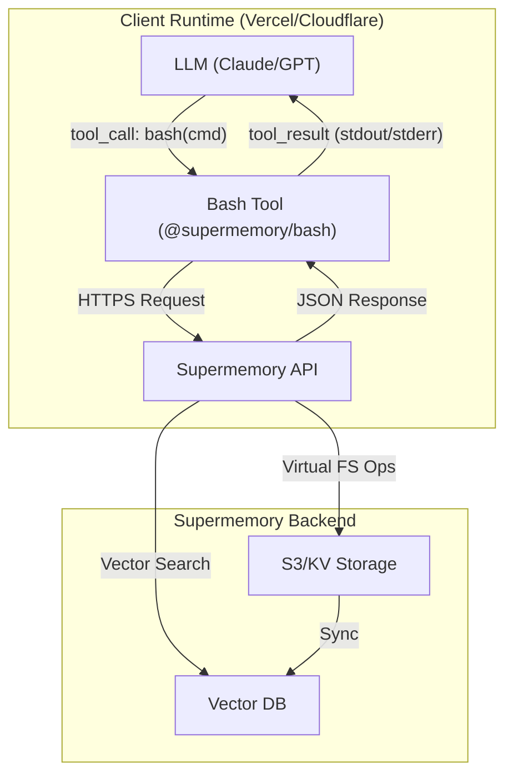
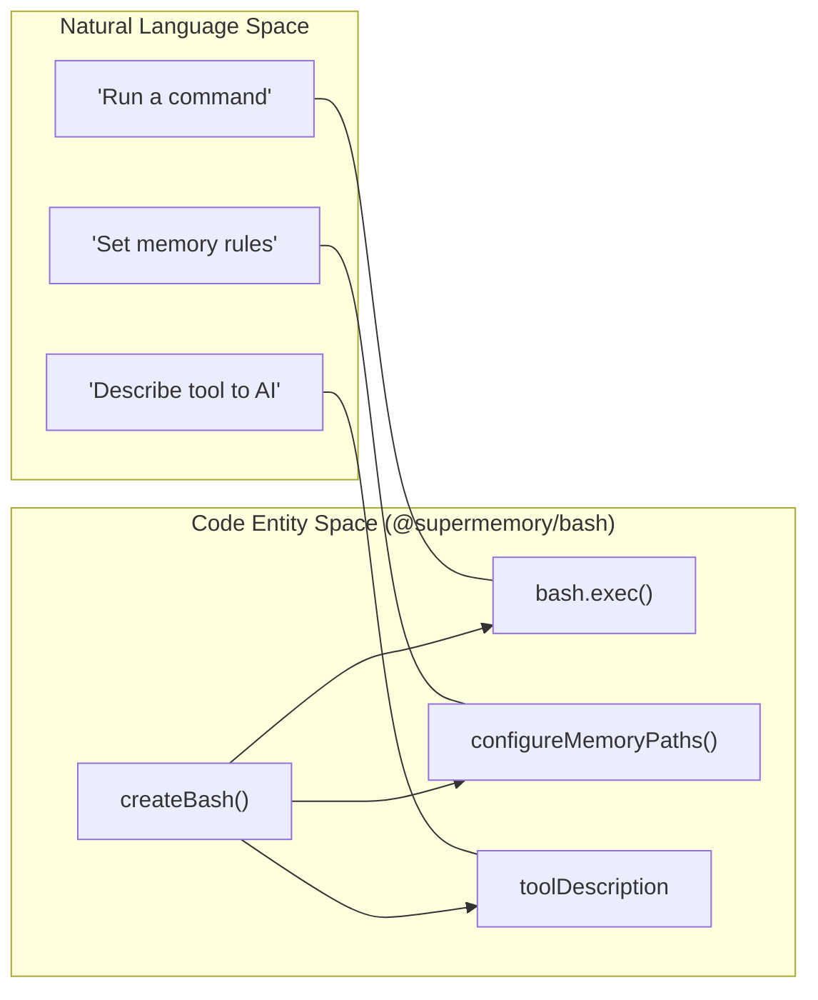
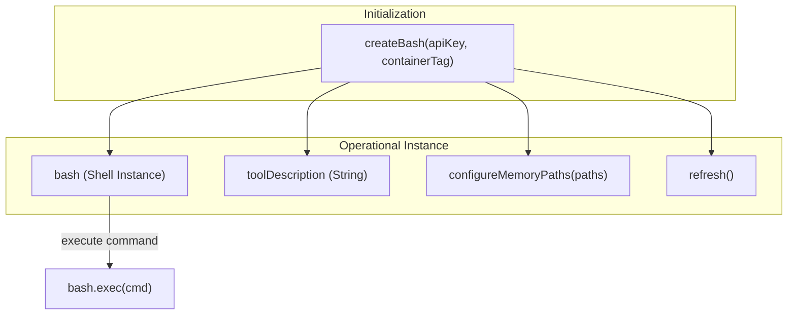

<!-- source: DeepWiki mcp.deepwiki.com · repo supermemoryai/supermemory · page 9.2 SMFS Bash Tool · fetched 2026-10-30 -->

# SMFS Bash Tool

<details>
<summary>Relevant source files</summary>

The following files were used as context for generating this wiki page:

- [apps/docs/smfs/bash-tool-python.mdx](apps/docs/smfs/bash-tool-python.mdx)
- [apps/docs/smfs/bash-tool.mdx](apps/docs/smfs/bash-tool.mdx)
- [apps/docs/smfs/examples.mdx](apps/docs/smfs/examples.mdx)
- [apps/docs/smfs/install.mdx](apps/docs/smfs/install.mdx)
- [apps/docs/smfs/mount.mdx](apps/docs/smfs/mount.mdx)
- [apps/docs/smfs/overview.mdx](apps/docs/smfs/overview.mdx)
- [apps/docs/smfs/providers/cloudflare.mdx](apps/docs/smfs/providers/cloudflare.mdx)
- [apps/docs/smfs/providers/daytona.mdx](apps/docs/smfs/providers/daytona.mdx)
- [apps/docs/smfs/providers/e2b.mdx](apps/docs/smfs/providers/e2b.mdx)
- [apps/docs/smfs/providers/vercel.mdx](apps/docs/smfs/providers/vercel.mdx)

</details>


The SMFS Bash Tool provides a virtualized shell environment for AI agents to interact with Supermemory containers as if they were local filesystems. It is specifically designed for environments where a real FUSE or NFS mount is not possible, such as **Vercel Functions**, **Cloudflare Workers**, **AWS Lambda**, or other serverless/edge runtimes [apps/docs/smfs/providers/vercel.mdx:12-15]().

The tool is available via two packages:
- **TypeScript**: `@supermemory/bash` [apps/docs/smfs/bash-tool.mdx:15-16]()
- **Python**: `supermemory-bash` [apps/docs/smfs/bash-tool-python.mdx:15-16]()

## Overview and Purpose

SMFS (Supermemory Filesystem) abstracts the Supermemory API into standard shell commands (`ls`, `cat`, `grep`, `echo`). While the `smfs` binary creates a real mount on long-lived servers [apps/docs/smfs/overview.mdx:32-34](), the Bash Tool proxies these commands over HTTPS to the Supermemory backend, allowing stateless execution [apps/docs/smfs/providers/vercel.mdx:39-45]().

### Key Features
- **Semantic Search**: The `sgrep` command provides vector-based search across all files in the container [apps/docs/smfs/bash-tool.mdx:171-171]().
- **Virtual `profile.md`**: A live-generated summary of the container's contents, providing immediate context to the model without manual file traversal [apps/docs/smfs/mount.mdx:55-57]().
- **Memory Path Distillation**: Specific directories can be configured so that files written to them are automatically indexed as memories [apps/docs/smfs/mount.mdx:38-40]().

## Implementation & Data Flow

The Bash Tool operates by intercepting bash commands from the LLM and executing them against a virtualized file tree hosted in the Supermemory cloud.

### Architecture Diagram: Serverless Execution

Sources: [apps/docs/smfs/providers/vercel.mdx:39-45](), [apps/docs/smfs/overview.mdx:18-24]()

## Key Functions and Classes

### `createBash()` / `create_bash()`
The entry point for initializing the tool. It requires a Supermemory API key and a `containerTag` to scope the filesystem [apps/docs/smfs/bash-tool.mdx:29-32]().

**Returns:**
- `bash`: An object/instance containing the `exec` method [apps/docs/smfs/bash-tool.mdx:40-40]().
- `toolDescription`: A pre-written prompt for the LLM explaining how to use the virtual filesystem [apps/docs/smfs/bash-tool.mdx:41-41]().
- `configureMemoryPaths(paths)`: A function to define which paths trigger memory extraction [apps/docs/smfs/bash-tool.mdx:42-42]().

### `bash.exec(command)`
Executes a string command. It supports standard Unix-like operations including pipes and redirects [apps/docs/smfs/bash-tool.mdx:150-185]().

| Command | Behavior in Bash Tool |
| :--- | :--- |
| `ls` | Lists files in the virtual container [apps/docs/smfs/bash-tool.mdx:158-158](). |
| `cat` | Reads content of a virtual file [apps/docs/smfs/bash-tool.mdx:159-159](). |
| `sgrep` | Performs semantic search across the container [apps/docs/smfs/bash-tool.mdx:171-171](). |
| `echo "text" > file` | Writes content to the virtual filesystem [apps/docs/smfs/bash-tool.mdx:166-166](). |

Sources: [apps/docs/smfs/bash-tool.mdx:150-185](), [apps/docs/smfs/bash-tool-python.mdx:223-224]()

## Model Integration

The Bash Tool is designed to be passed directly to LLMs using function calling (OpenAI) or tool use (Anthropic).

### Vercel AI SDK Usage
In the Vercel AI SDK, the tool is integrated into `generateText` or `streamText` by wrapping `bash.exec` [apps/docs/smfs/providers/vercel.mdx:113-142]().

```typescript
// Example Integration
const { bash, toolDescription } = await createBash({
  apiKey: process.env.SUPERMEMORY_API_KEY,
  containerTag: "my_agent"
});

const result = await generateText({
  model: anthropic("claude-3-5-sonnet"),
  tools: {
    bash: tool({
      description: toolDescription,
      inputSchema: z.object({ cmd: z.string() }),
      execute: async ({ cmd }) => bash.exec(cmd),
    }),
  },
  maxSteps: 10, // Recommended for multi-step reasoning
  prompt: "What do you know about my project from my notes?",
});
```
Sources: [apps/docs/smfs/providers/vercel.mdx:113-142](), [apps/docs/smfs/providers/vercel.mdx:145-148]()

### Python SDK Usage (OpenAI/Anthropic)
The Python package `supermemory-bash` provides similar functionality for the Python ecosystem [apps/docs/smfs/bash-tool-python.mdx:4-8]().

```python
# Example for Anthropic Python SDK
result = await create_bash(api_key=key, container_tag="user_42")
bash = result.bash

response = client.messages.create(
    model="claude-sonnet-4-20250514",
    tools=[{
        "name": "bash",
        "description": result.tool_description,
        "input_schema": { ... }
    }],
    messages=[{"role": "user", "content": "Search my notes"}]
)
# Dispatch tool_use to bash.exec()
```
Sources: [apps/docs/smfs/bash-tool-python.mdx:66-124]()

## Configuration and Runtimes

### Memory Paths
You can control which parts of the filesystem are "intelligent" by configuring memory paths. Files in these paths are automatically summarized and indexed [apps/docs/smfs/bash-tool.mdx:134-142]().

```typescript
// Paths ending in / are recursive
const { configureMemoryPaths } = await createBash({ apiKey, containerTag });
await configureMemoryPaths(["/notes/", "/journal.md"]);
```
Sources: [apps/docs/smfs/bash-tool.mdx:137-139](), [apps/docs/smfs/bash-tool-python.mdx:210-216]()

### Runtime Support
| Runtime | Support Level | Implementation Method |
| :--- | :--- | :--- |
| **Cloudflare Workers** | Full | Bash Tool (stateless HTTPS) [apps/docs/smfs/providers/cloudflare.mdx:33-35]() |
| **Vercel Edge** | Full | Bash Tool (stateless HTTPS) [apps/docs/smfs/providers/vercel.mdx:103-108]() |
| **E2B / Daytona** | Full | Real Mount (FUSE) OR Bash Tool [apps/docs/smfs/providers/e2b.mdx:11-15](), [apps/docs/smfs/providers/daytona.mdx:18-22]() |
| **Local / Docker** | Full | Real Mount (`smfs mount`) [apps/docs/smfs/install.mdx:32-36]() |

### Code-to-System Mapping
The following diagram maps the Natural Language concepts to the specific TypeScript/Python entities used in the codebase.


Sources: [apps/docs/smfs/bash-tool.mdx:38-43](), [apps/docs/smfs/providers/vercel.mdx:122-134]()

### Class Relationship Diagram
This diagram shows how the `createBash` factory function relates to the operational entities.


Sources: [apps/docs/smfs/bash-tool.mdx:38-43](), [apps/docs/smfs/bash-tool-python.mdx:45-50]()

## Comparison: Mount vs. Bash Tool

| Feature | `smfs mount` (Binary) | Bash Tool (Package) |
| :--- | :--- | :--- |
| **Requirement** | FUSE / NFS Support | Node.js / Python Runtime |
| **Persistence** | Background Daemon | Stateless (HTTPS) |
| **Best For** | Local Dev, Docker, Sandboxes | Serverless, Edge, Lambda |
| **Command Execution** | Real System Shell | Virtual Shell Proxy |

Sources: [apps/docs/smfs/overview.mdx:27-38](), [apps/docs/smfs/providers/vercel.mdx:5-15]()

---

