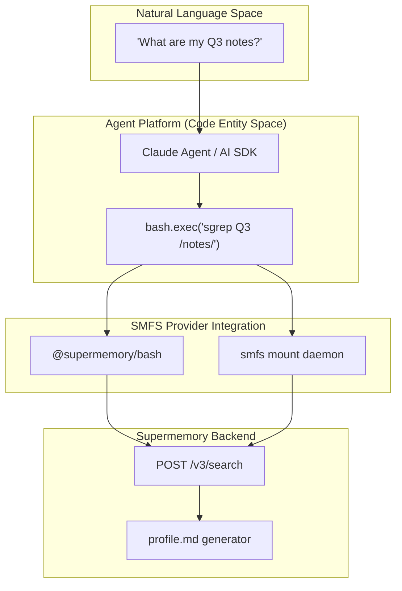
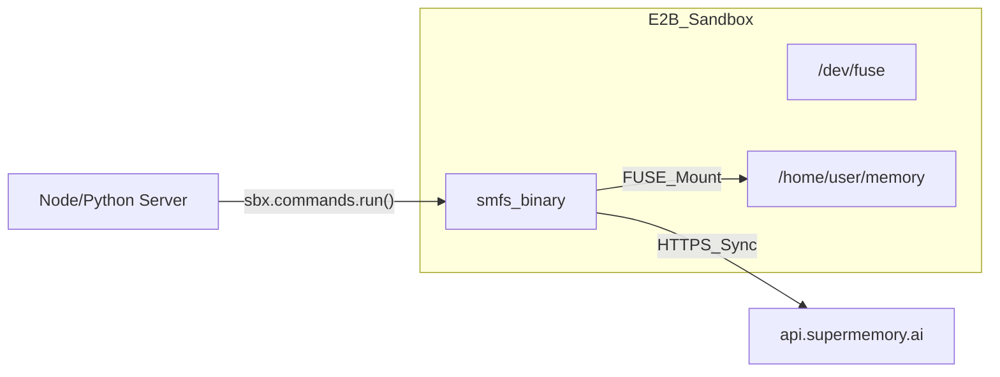
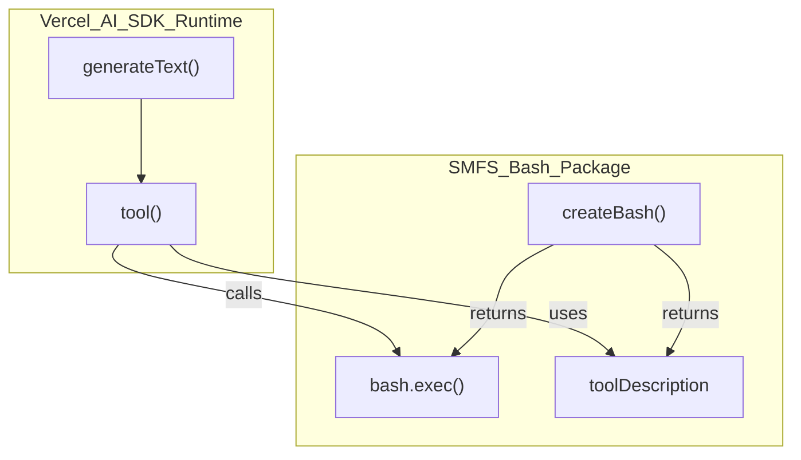

<!-- source: DeepWiki mcp.deepwiki.com · repo supermemoryai/supermemory · page 9.3 SMFS Provider Guides · fetched 2026-10-30 -->

# SMFS Provider Guides

<details>
<summary>Relevant source files</summary>

The following files were used as context for generating this wiki page:

- [apps/docs/smfs/bash-tool-python.mdx](apps/docs/smfs/bash-tool-python.mdx)
- [apps/docs/smfs/bash-tool.mdx](apps/docs/smfs/bash-tool.mdx)
- [apps/docs/smfs/examples.mdx](apps/docs/smfs/examples.mdx)
- [apps/docs/smfs/install.mdx](apps/docs/smfs/install.mdx)
- [apps/docs/smfs/mount.mdx](apps/docs/smfs/mount.mdx)
- [apps/docs/smfs/overview.mdx](apps/docs/smfs/overview.mdx)
- [apps/docs/smfs/providers/cloudflare.mdx](apps/docs/smfs/providers/cloudflare.mdx)
- [apps/docs/smfs/providers/daytona.mdx](apps/docs/smfs/providers/daytona.mdx)
- [apps/docs/smfs/providers/e2b.mdx](apps/docs/smfs/providers/e2b.mdx)
- [apps/docs/smfs/providers/vercel.mdx](apps/docs/smfs/providers/vercel.mdx)

</details>


The Supermemory Filesystem (SMFS) is designed to be highly portable, allowing AI agents to interact with persistent memory through standard shell commands across various environments. This guide details how to implement SMFS with specific sandbox providers (Daytona, E2B), serverless platforms (Vercel, Cloudflare Workers), and container runtimes.

## Architecture Overview

SMFS can be integrated into a provider environment using two primary patterns:
1.  **Direct Mount**: Using the `smfs` binary to create a real FUSE (Linux) or NFS (macOS) mount point [apps/docs/smfs/mount.mdx:8-12](). This allows agents to use any language or tool that interacts with a standard filesystem.
2.  **Bash Tool**: Using `@supermemory/bash` (TypeScript) or `supermemory-bash` (Python) to provide a virtual bash interface [apps/docs/smfs/bash-tool.mdx:8-10](). This is ideal for serverless or edge runtimes where FUSE mounts are not possible.

### Data Flow: Natural Language to Code Entities

The following diagram illustrates how natural language prompts from an agent are translated into filesystem operations that eventually interact with the Supermemory API via SMFS entities.

**SMFS Operational Flow**

Sources: [apps/docs/smfs/bash-tool.mdx:26-36](), [apps/docs/smfs/mount.mdx:201-208](), [apps/docs/smfs/overview.mdx:18-25]()

---

## E2B (Firecracker MicroVMs)

E2B provides isolated sandboxes for AI code execution. SMFS can be baked into an E2B custom template to provide persistent storage across sandbox sessions.

### Implementation Patterns
*   **Agent Inside**: The agent process runs directly inside the microVM and accesses the SMFS mount locally [apps/docs/smfs/providers/e2b.mdx:14-17]().
*   **Agent Outside**: The agent runs on your server and uses `sbx.commands.run()` to interact with the SMFS mount inside the sandbox remotely [apps/docs/smfs/providers/e2b.mdx:27-31]().

### Setup and Configuration
1.  **Custom Template**: Install `fuse3` and the `smfs` binary in the Dockerfile [apps/docs/smfs/providers/e2b.mdx:52-60]().
2.  **Permissions**: Run `sudo chmod 666 /dev/fuse` inside the sandbox to allow non-root mounting [apps/docs/smfs/providers/e2b.mdx:115-115]().
3.  **Mounting**: Execute `smfs login` followed by `smfs mount` with the `--foreground` flag in a background shell [apps/docs/smfs/providers/e2b.mdx:119-123]().

**E2B Integration Diagram**

Sources: [apps/docs/smfs/providers/e2b.mdx:33-40](), [apps/docs/smfs/providers/e2b.mdx:115-123]()

---

## Daytona (Isolated Linux Sandboxes)

Daytona sandboxes provide millisecond boot times for Linux-based agent environments.

### Installation
Since Daytona sandboxes may have restricted outbound access from certain datacenter IPs, the recommended installation method is downloading the binary directly from GitHub Releases and adding it to the local bin [apps/docs/smfs/providers/daytona.mdx:9-16](), [apps/docs/smfs/providers/daytona.mdx:57-61]().

```python
# Installation snippet for Daytona
SMFS_INSTALL = (
    "mkdir -p $HOME/.local/bin && "
    "curl -sL https://github.com/supermemoryai/smfs/releases/download/v0.0.1-rc2/smfs-linux-x64 -o $HOME/.local/bin/smfs && "
    "chmod +x $HOME/.local/bin/smfs && "
    "echo 'user_allow_other' | sudo tee -a /etc/fuse.conf > /dev/null"
)
```
Sources: [apps/docs/smfs/providers/daytona.mdx:65-74]()

---

## Vercel AI SDK Integration

For the Vercel AI SDK, the choice of SMFS provider depends on the runtime environment rather than the hosting provider.

### 1. Self-hosted Node (Long-lived)
If running on a standard VM (ECS, Railway, etc.), use the `smfs` binary to create a persistent mount point at `./memory` [apps/docs/smfs/providers/vercel.mdx:19-23](). Start the mount once at server boot, not per-request [apps/docs/smfs/providers/vercel.mdx:60-65]().

### 2. Serverless / Edge (Vercel Functions)
Serverless runtimes cannot maintain FUSE mounts. Instead, use the `@supermemory/bash` package to create a tool for `generateText` [apps/docs/smfs/providers/vercel.mdx:33-37]().

**Vercel AI SDK Code Mapping**

Sources: [apps/docs/smfs/providers/vercel.mdx:113-141](), [apps/docs/smfs/bash-tool.mdx:26-36]()

### Key Functions
*   `createBash({ apiKey, containerTag })`: Initializes the virtual bash environment [apps/docs/smfs/bash-tool.mdx:27-32]().
*   `bash.exec(cmd)`: Executes standard Unix commands (ls, cat, grep) or semantic `sgrep` [apps/docs/smfs/bash-tool.mdx:170-171]().
*   `configureMemoryPaths(paths)`: Defines which directories/files should be distilled into permanent memories [apps/docs/smfs/bash-tool.mdx:137-140]().

---

## Cloudflare (Workers & Containers)

### Cloudflare Containers
Cloudflare Containers allow for real FUSE mounts. SMFS is typically started in the container's `entrypoint.sh` using the `--foreground` flag to keep the daemon running [apps/docs/smfs/providers/cloudflare.mdx:84-95]().

### Cloudflare Workers
Workers use the `@supermemory/bash` tool. Because Workers are addressable via Durable Objects, you can maintain a persistent agent state that interacts with SMFS over HTTP [apps/docs/smfs/providers/cloudflare.mdx:125-136]().

| Feature | Cloudflare Container | Cloudflare Worker |
| :--- | :--- | :--- |
| **Interface** | Real Filesystem (FUSE) | Virtual Bash Tool |
| **Sync Mode** | Bidirectional Background | Request-Response Proxy |
| **Memory Extraction** | Automatic via paths | Manual or Path-based |
| **Best For** | Heavy Agent Workloads | Edge-first, Low Latency |

Sources: [apps/docs/smfs/providers/cloudflare.mdx:15-40](), [apps/docs/smfs/providers/cloudflare.mdx:50-56]()

---

## Provider Comparison Table

| Provider | Implementation Type | Recommended Tooling | Persistence |
| :--- | :--- | :--- | :--- |
| **E2B** | FUSE Mount | `smfs` binary + `e2b-code-interpreter` | Full (via SMFS Sync) |
| **Daytona** | FUSE Mount | `smfs` binary + `daytona-sdk` | Full (via SMFS Sync) |
| **Vercel Functions** | Virtual Bash | `@supermemory/bash` | Session-based |
| **CF Workers** | Virtual Bash | `@supermemory/bash` | Durable Object backed |
| **CF Containers** | FUSE Mount | `smfs` binary | Full (via SMFS Sync) |

Sources: [apps/docs/smfs/overview.mdx:40-57](), [apps/docs/smfs/providers/vercel.mdx:7-15]()

---

