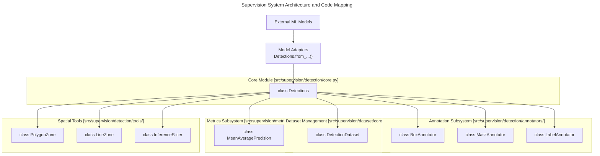
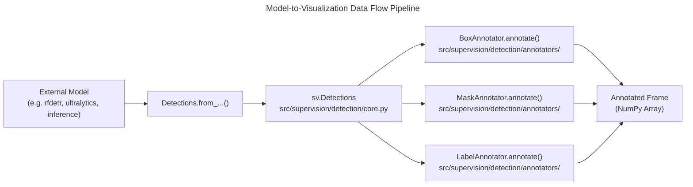

<!-- source: DeepWiki mcp.deepwiki.com · repo roboflow/supervision · page 1 Overview · fetched 2026-10-30 -->

# Overview

Relevant source files

The following files were used as context for generating this wiki page:

- [README.md](README.md)
- [demo.ipynb](demo.ipynb)
- [docs/changelog.md](docs/changelog.md)
- [docs/index.md](docs/index.md)
- [docs/notebooks/quickstart.ipynb](docs/notebooks/quickstart.ipynb)
- [mkdocs.yml](mkdocs.yml)
- [src/supervision/detection/core.py](src/supervision/detection/core.py)
- [src/supervision/detection/vlm.py](src/supervision/detection/vlm.py)
- [tests/detection/test_from_adapters.py](tests/detection/test_from_adapters.py)
- [tests/detection/test_vlm.py](tests/detection/test_vlm.py)

Supervision is a comprehensive computer vision toolkit designed to provide reusable, model-agnostic utilities that streamline computer vision workflows [README.md:43-45](). It offers a robust collection of tools for object detection, tracking, annotation, dataset management, and performance evaluation, allowing developers to focus on building applications rather than writing boilerplate code [README.md:43-45]().

This document provides a high-level architectural overview of the Supervision library and its central pipeline centered around `sv.Detections` [src/supervision/detection/core.py:114-121](). For details on installing dependencies, optional extras, and configuration options, see [Installation & Configuration](#1.1). For details on how the documentation is organized and navigated, see [Documentation Structure](#1.2).

Sources: [README.md:43-45](), [src/supervision/detection/core.py:114-121](), [mkdocs.yml:46-114]()

## Key Features

The library provides several core capabilities designed for production computer vision pipelines:

- **Standardized Detections (`sv.Detections`)**: Converts heterogeneous outputs from various model frameworks into a unified data structure [src/supervision/detection/core.py:114-121]().
- **Advanced Visualization**: A wide array of modular annotators supporting bounding boxes, masks, labels, heatmaps, and dynamic scaling [docs/index.md:31]().
- **Memory-Efficient Segmentation (`sv.CompactMask`)**: Specialized run-length encoded mask representation reducing memory overhead and supporting high-speed union operations [docs/changelog.md:10-10]().
- **Dataset Management (`sv.DetectionDataset`)**: Unified loading, splitting, merging, and exporting utilities for COCO, YOLO, and Pascal VOC formats [README.md:120-141]().
- **Zone Analysis (`sv.PolygonZone`, `sv.LineZone`)**: Spatial filtering and counting tools for video streams [docs/index.md:31]().
- **Performance Evaluation (`sv.metrics`)**: Comprehensive object detection and segmentation metrics with scikit-learn parity [mkdocs.yml:86-95]().

Sources: [src/supervision/detection/core.py:114-121](), [docs/changelog.md:10-10](), [docs/index.md:31](), [README.md:120-141](), [mkdocs.yml:86-95]()

## System Architecture & Code Entities

The following diagram bridges the high-level system components of Supervision to their concrete Python module and class implementations within the codebase structure.

Sources: [src/supervision/detection/core.py:114-121](), [mkdocs.yml:63-106](), [README.md:59-62]()

## Data Flow & Central Pipeline

The execution pipeline standardizes model predictions into the central `sv.Detections` structure [src/supervision/detection/core.py:114-121](). Once instantiated, `sv.Detections` objects can be sliced, filtered, combined, passed into tracking systems, evaluated against ground truth via metrics, or rendered onto frames using annotators following the scene-in/scene-out pattern [README.md:101-115]().

For installation prerequisites and setup instructions, consult [Installation & Configuration](#1.1). For details on the documentation structure and navigation, see [Documentation Structure](#1.2).

Sources: [src/supervision/detection/core.py:114-121](), [README.md:101-115](), [docs/index.md:27-32]()

---

