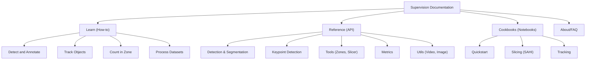
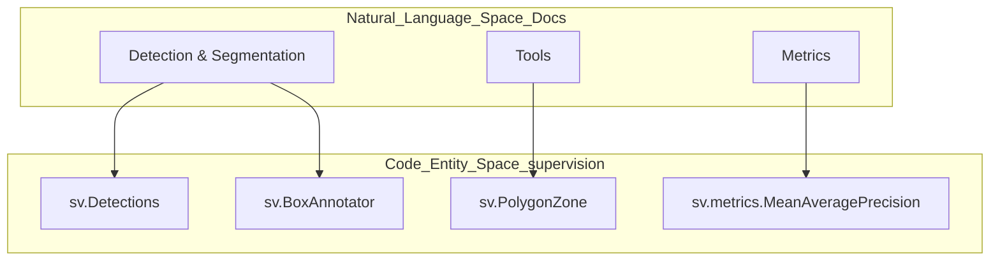
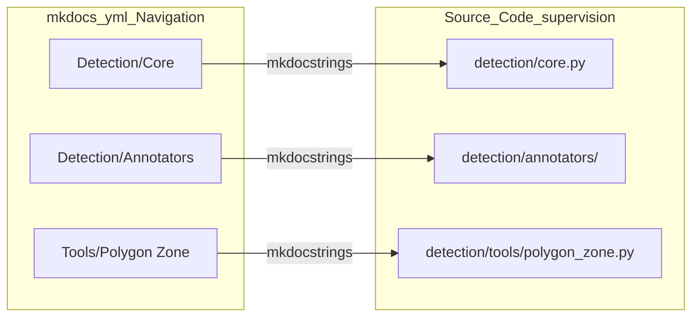

<!-- source: DeepWiki mcp.deepwiki.com · repo roboflow/supervision · page 1.2 Documentation Structure · fetched 2026-10-30 -->

# Documentation Structure

Relevant source files

The following files were used as context for generating this wiki page:

- [README.md](README.md)
- [docs/cookbooks.md](docs/cookbooks.md)
- [docs/faq.md](docs/faq.md)
- [docs/index.md](docs/index.md)
- [docs/javascripts/cookbooks-card.js](docs/javascripts/cookbooks-card.js)
- [docs/javascripts/init_kapa_widget.js](docs/javascripts/init_kapa_widget.js)
- [docs/javascripts/version-banner.js](docs/javascripts/version-banner.js)
- [docs/javascripts/zoominfo.js](docs/javascripts/zoominfo.js)
- [docs/llms-100k.txt](docs/llms-100k.txt)
- [docs/llms.full.txt](docs/llms.full.txt)
- [docs/llms.txt](docs/llms.txt)
- [docs/notebooks/occupancy_analytics.ipynb](docs/notebooks/occupancy_analytics.ipynb)
- [docs/notebooks/small-object-detection-with-sahi.ipynb](docs/notebooks/small-object-detection-with-sahi.ipynb)
- [docs/stylesheets/extra.css](docs/stylesheets/extra.css)
- [docs/theme/cookbooks.html](docs/theme/cookbooks.html)
- [docs/theme/main.html](docs/theme/main.html)
- [docs/theme/partials/header.html](docs/theme/partials/header.html)
- [mkdocs.yml](mkdocs.yml)

This page explains how the Supervision library documentation is organized and provides guidance on how to effectively navigate it. Understanding the structure will help you quickly find the information you need, whether you're looking for tutorials, API references, or examples.

## Purpose and Scope

The Supervision documentation is designed to:

1. Help new users get started quickly with the library [README.md:49-68]()
2. Provide comprehensive API reference for all components [mkdocs.yml:45-86]()
3. Offer practical examples through cookbooks and how-to guides [mkdocs.yml:36-44, 87]()
4. Enable contributors to understand and extend the codebase [mkdocs.yml:152-158]()

Sources: [README.md:49-68](), [mkdocs.yml:36-158]()

## Documentation Organization

The documentation is configured via `mkdocs.yml` and organized into several main sections, including learning guides, reference modules, cookbooks, and project meta-pages.

*Documentation Structure Overview*

Sources: [mkdocs.yml:31-91]()

## Content Types

The documentation leverages different formats to serve various technical needs:

| Content Type | Purpose | Implementation |
|--------------|---------|----------------|
| **How-to Guides** | Step-by-step instructions for specific tasks. | [mkdocs.yml:36-44]() |
| **API Reference** | Detailed technical documentation of classes and functions, generated from docstrings. | [mkdocs.yml:45-86, 131-151]() |
| **Cookbooks** | Executable Jupyter notebooks demonstrating end-to-end solutions. | [docs/theme/cookbooks.html:1-67]() |
| **LLM Context** | Specialized text files optimized for Large Language Model consumption. | [docs/llms.txt:1-120](), [docs/llms.full.txt:1-130]() |

Sources: [mkdocs.yml:126-151](), [docs/theme/cookbooks.html:14-64]()

## API Reference Structure

The API reference is the technical core of the documentation. It uses `mkdocstrings` to extract documentation directly from the Python source code in the `supervision/` directory [mkdocs.yml:131-137]().

*Mapping Documentation Sections to Code Entities*

Sources: [mkdocs.yml:46-77](), [docs/llms.txt:37-60]()

## Cookbook Gallery

Cookbooks are managed through a custom HTML template [docs/theme/cookbooks.html:1-69]() and a JavaScript-driven card system [docs/javascripts/cookbooks-card.js:1-143]().

Key cookbooks include:
* **Small Object Detection**: Demonstrates `supervision.InferenceSlicer` [docs/notebooks/small-object-detection-with-sahi.ipynb:9-16]().
* **Memory-Efficient Segmentation**: Showcases `CompactMask` with SAM3 [docs/theme/cookbooks.html:61-64]().
* **Object Tracking**: Uses `sv.ByteTrack` for persistent IDs [docs/theme/cookbooks.html:33-36]().

Sources: [docs/theme/cookbooks.html:14-64](), [docs/notebooks/small-object-detection-with-sahi.ipynb:9-16]()

## Navigation & Search

The documentation site uses the `material` theme with advanced features:
* **Search**: Powered by the `search` plugin [mkdocs.yml:125]().
* **Navigation Tabs**: Enabled for top-level categories [mkdocs.yml:105]().
* **Code Annotations**: Allows inline explanations in code blocks [mkdocs.yml:104]().
* **Version Management**: Uses `mike` to support multiple versions of the library documentation [mkdocs.yml:24-25]().

Sources: [mkdocs.yml:92-119]()

## Documentation to Code Mapping

The following diagram illustrates how the documentation navigation bridges the natural language documentation space to physical file structures and Python modules.

*Navigation to Source Module Mapping*

Sources: [mkdocs.yml:47-48, 63](), [docs/llms.txt:74-75, 95]()

## AI-Ready Documentation

Supervision provides specialized files for AI crawlers and LLM context:
* **llms.txt**: A high-level summary of key APIs like `sv.Detections`, `sv.BoxAnnotator`, and `sv.PolygonZone` [docs/llms.txt:37-52]().
* **llms.full.txt**: A more detailed version including full guide links [docs/llms.full.txt:70-110]().
* **robots.txt**: Explicitly allows AI crawlers like `GPTBot` and `ClaudeBot` [docs/llms.txt:11-18]().

Sources: [docs/llms.txt:1-120](), [docs/llms.full.txt:1-130]()

---

