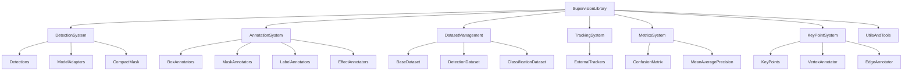
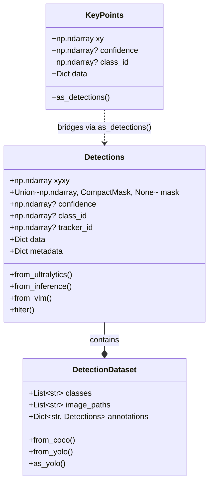

<!-- source: DeepWiki mcp.deepwiki.com · repo roboflow/supervision · page 2 Core Components · fetched 2026-10-30 -->

# Core Components

Relevant source files

The following files were used as context for generating this wiki page:

- [docs/changelog.md](docs/changelog.md)
- [docs/classification/core.md](docs/classification/core.md)
- [docs/detection/core.md](docs/detection/core.md)
- [src/supervision/detection/core.py](src/supervision/detection/core.py)
- [src/supervision/detection/vlm.py](src/supervision/detection/vlm.py)
- [tests/detection/test_from_adapters.py](tests/detection/test_from_adapters.py)
- [tests/detection/test_vlm.py](tests/detection/test_vlm.py)

This page provides an overview of the core components that make up the Supervision library. Supervision is a computer vision toolkit that standardizes object detection, tracking, dataset operations, and evaluation across various machine learning frameworks and Vision-Language Models (VLMs).

For detailed implementation specifics of individual components, refer to their respective child documentation pages: [Detection System](#2.1), [Annotation System](#2.2), [Dataset Management](#2.3), [Tracking System](#2.4), [Metrics System](#2.5), and [KeyPoint System](#2.6).

## Architecture Overview

Supervision provides a standardized set of components that work together to handle the entire computer vision pipeline, from model inference to visualization and analytics.

Sources: [src/supervision/detection/core.py:113-115](), [src/supervision/detection/vlm.py:22-51]()

## Core Data Structures

The main components of Supervision are built around fundamental data structures designed for interoperability across models and tasks.

Sources: [src/supervision/detection/core.py:113-115]()

### Detections Class

The `sv.Detections` class is the cornerstone of Supervision, providing a standardized format for object detection and segmentation results [src/supervision/detection/core.py:115-121](). It supports memory-efficient mask storage via `sv.CompactMask` [src/supervision/detection/core.py:18-18]().

Key attributes:
- `xyxy`: Bounding box coordinates in `[x1, y1, x2, y2]` format.
- `mask`: Segmentation masks as `bool` arrays or `sv.CompactMask` [src/supervision/detection/core.py:18-18]().
- `confidence`, `class_id`, `tracker_id`: Optional arrays for scores, labels, and tracking IDs.
- `data` and `metadata`: Dictionaries for custom fields and auxiliary metadata.

Sources: [src/supervision/detection/core.py:113-158]()

---

## 2.1. Detection System

The Detection System handles model output normalization, spatial filtering, non-max suppression (NMS/NMM), and coordinate system transformations. It exposes robust factory methods for major frameworks:
- `from_ultralytics()`: Support for YOLO models [src/supervision/detection/core.py:155-156]()
- `from_inference()`: Integration with Roboflow Inference [src/supervision/detection/core.py:139-140]()
- `from_vlm()`: Parsing for Vision-Language Models such as PaliGemma, Qwen-VL, and Gemini [src/supervision/detection/core.py:63-78]()

For deep technical details, see [Detection System](#2.1).

Sources: [src/supervision/detection/core.py:113-198]()

---

## 2.2. Annotation System

The Annotation System implements a flexible "scene-in/scene-out" pattern where annotators draw bounding boxes, segmentation masks, labels, and visual traces directly onto frames. It features automatic dynamic scaling, rich color lookups via `ColorLookup`, and native handling of `CompactMask` objects.

For deep technical details, see [Annotation System](#2.2).

Sources: [src/supervision/detection/core.py:18-18]()

---

## 2.3. Dataset Management

Dataset Management provides classes like `DetectionDataset` and `ClassificationDataset` to handle loading, splitting, merging, and exporting annotations across standard formats (COCO, YOLO, Pascal VOC, LabelMe). It includes built-in safeguards such as lazy image loading and basename collision checks.

For deep technical details, see [Dataset Management](#2.3).

Sources: [src/supervision/detection/core.py:113-115]()

---

## 2.4. Tracking System

The Tracking System associates detections across frames using `tracker_id`. Multi-object tracking utilities coordinate with external tracking packages (such as `trackers`), while `DetectionsSmoother` reduces trajectory jitter. Keypoints can also be seamlessly bridged to trackers via `KeyPoints.as_detections()`.

For deep technical details, see [Tracking System](#2.4).

Sources: [src/supervision/detection/core.py:113-115]()

---

## 2.5. Metrics System

The Metrics System offers COCO-compliant evaluation pipelines, including `MeanAveragePrecision`, `MeanAverageRecall`, precision/recall curves, `F1Score`, and `ConfusionMatrix`. It supports configurable metric targets, object size buckets, and rigorous sklearn parity validation.

For deep technical details, see [Metrics System](#2.5).

Sources: [src/supervision/detection/core.py:113-115]()

---

## 2.6. KeyPoint System

The KeyPoint System manages pose estimation and keypoint detection data through the `KeyPoints` dataclass. It integrates with `EdgeAnnotator` and `VertexAnnotator` for skeleton rendering and bridges pose estimation outputs directly into detection pipelines via `as_detections()`.

For deep technical details, see [KeyPoint System](#2.6).

Sources: [src/supervision/detection/core.py:113-115]()

---

