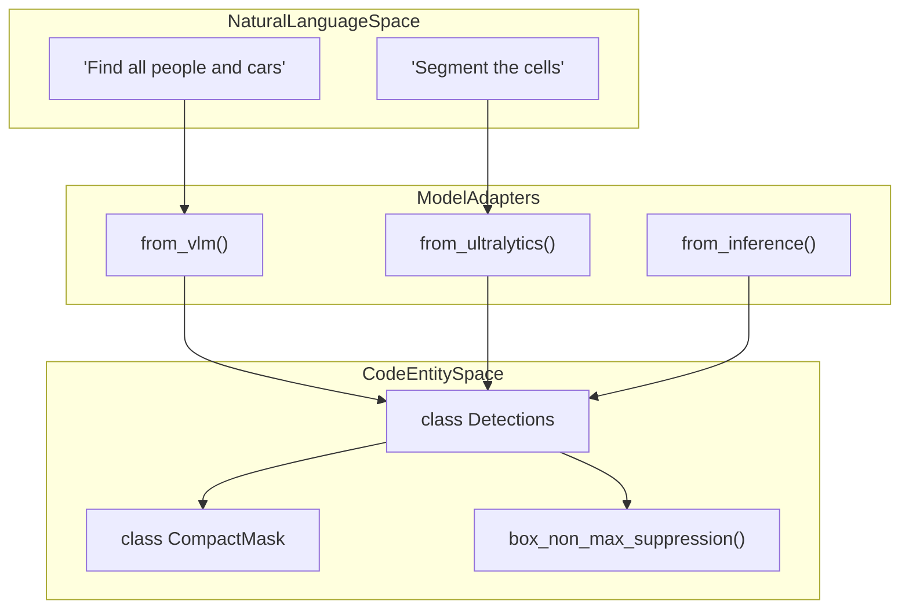
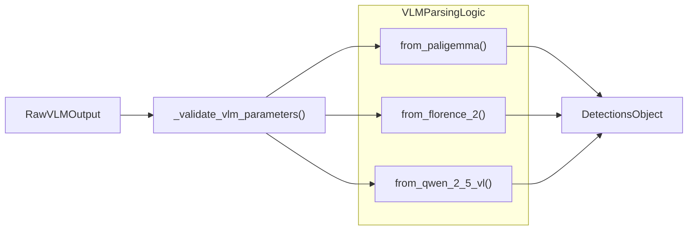
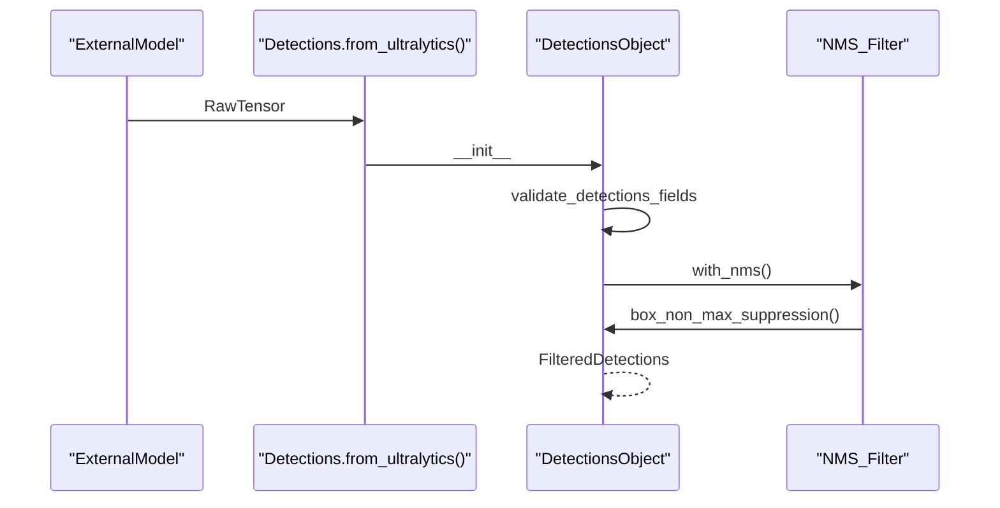

<!-- source: DeepWiki mcp.deepwiki.com · repo roboflow/supervision · page 2.1 Detection System · fetched 2026-10-30 -->

# Detection System

Relevant source files

The following files were used as context for generating this wiki page:

- [docs/changelog.md](docs/changelog.md)
- [src/supervision/detection/core.py](src/supervision/detection/core.py)
- [src/supervision/detection/utils/boxes.py](src/supervision/detection/utils/boxes.py)
- [src/supervision/detection/utils/converters.py](src/supervision/detection/utils/converters.py)
- [src/supervision/detection/utils/internal.py](src/supervision/detection/utils/internal.py)
- [src/supervision/detection/utils/iou_and_nms.py](src/supervision/detection/utils/iou_and_nms.py)
- [src/supervision/detection/utils/masks.py](src/supervision/detection/utils/masks.py)
- [src/supervision/detection/utils/polygons.py](src/supervision/detection/utils/polygons.py)
- [src/supervision/detection/vlm.py](src/supervision/detection/vlm.py)
- [tests/detection/test_core.py](tests/detection/test_core.py)
- [tests/detection/test_from_adapters.py](tests/detection/test_from_adapters.py)
- [tests/detection/test_vlm.py](tests/detection/test_vlm.py)
- [tests/detection/utils/test_boxes.py](tests/detection/utils/test_boxes.py)
- [tests/detection/utils/test_converters.py](tests/detection/utils/test_converters.py)
- [tests/detection/utils/test_internal.py](tests/detection/utils/test_internal.py)
- [tests/detection/utils/test_iou_and_nms.py](tests/detection/utils/test_iou_and_nms.py)
- [tests/detection/utils/test_polygons.py](tests/detection/utils/test_polygons.py)

The Detection System is the core component of the Supervision library, providing a standardized representation for object detection and instance segmentation results. It enables consistent handling of data regardless of the source model or framework, serving as a foundation for annotators, trackers, and analysis tools.

## Overview

The system centers around the `sv.Detections` class, which acts as a bridge between various ML frameworks and the Supervision ecosystem.

Sources: [src/supervision/detection/core.py:113-198](), [src/supervision/detection/vlm.py:22-51]()

## The Detections Class

The `Detections` class standardizes results into a common format. It is a `@dataclass` that validates its fields upon initialization [src/supervision/detection/core.py:113-198]().

### Structure and Attributes

| Attribute | Type | Description |
|-----------|------|-------------|
| `xyxy` | `np.ndarray` | Shape `(n, 4)`: `[x1, y1, x2, y2]` coordinates. |
| `mask` | `np.ndarray \| CompactMask \| None` | Shape `(n, H, W)` boolean masks or memory-efficient `CompactMask`. |
| `confidence` | `np.ndarray \| None` | Shape `(n,)` float scores. |
| `class_id` | `np.ndarray \| None` | Shape `(n,)` integer class identifiers. |
| `tracker_id` | `np.ndarray \| None` | Shape `(n,)` integer tracking identifiers. |
| `data` | `dict` | Additional per-detection data (e.g., class names). |
| `metadata` | `dict` | Global metadata (e.g., video filename). |

Sources: [src/supervision/detection/core.py:113-198]()

### Coordinate Systems
Supervision provides utilities to convert between common bounding box formats in `supervision.detection.utils.converters`:
- **xyxy**: `[x_min, y_min, x_max, y_max]` (Internal standard).
- **xywh**: `[x, y, width, height]` via `xywh_to_xyxy` [src/supervision/detection/core.py:34-39]().

Sources: [src/supervision/detection/core.py:34-39](), [src/supervision/detection/utils/boxes.py:10-48]()

## Factory Methods & VLM Parsing

The `Detections` class provides multiple static methods to ingest data from external sources.

### Standard Adapters
- `from_ultralytics(ultralytics_results)`: For YOLO models [src/supervision/detection/core.py:153-167]().
- `from_inference(roboflow_result)`: For Roboflow Inference API [src/supervision/detection/core.py:137-151]().
- `from_transformers(transformers_results)`: For HuggingFace models like DETR [src/supervision/detection/core.py:169-196]().

### Vision-Language Models (VLM)
The `from_vlm` method uses the `VLM` enum to parse text-based or dictionary-based outputs from multimodal models into structured detections [src/supervision/detection/vlm.py:22-51]().

Sources: [src/supervision/detection/core.py:63-78](), [src/supervision/detection/vlm.py:22-170]()

## CompactMask: Memory Efficiency

Storing dense boolean masks for high-resolution images can consume gigabytes of RAM. `CompactMask` solves this by storing masks as **Crop-RLE** (Run-Length Encoding of a bounding-box crop).

For a deep dive into memory-efficient mask storage, union/merge semantics, benchmarks, and integration with annotators and `InferenceSlicer`, see [CompactMask](#2.1.1).

Sources: [src/supervision/detection/compact_mask.py:1-10](), [docs/changelog.md:8-12]()

## Processing Detections

### Filtering and Merging
- **Indexing**: `Detections` supports NumPy-style indexing and boolean masking [tests/detection/test_core.py:170-211]().
- **Merging**: Combines multiple detection objects, including their `data` and `metadata` dictionaries [tests/detection/test_core.py:48-91]().

### Non-Maximum Suppression (NMS) and Non-Maximum Merge (NMM)
The system provides robust NMS and NMM for both boxes and masks via `OverlapFilter` and batch operations [src/supervision/detection/utils/iou_and_nms.py:16-59]().

| Function | Strategy | Description |
|----------|----------|-------------|
| `box_non_max_suppression()` | Suppression | Discards overlapping boxes with lower confidence [src/supervision/detection/utils/iou_and_nms.py:49-59](). |
| `box_non_max_merge()` | Merging | Merges overlapping boxes into a single detection [src/supervision/detection/utils/iou_and_nms.py:49-59](). |
| `mask_non_max_suppression()` | Mask NMS | Uses mask-based IoU for suppression [src/supervision/detection/utils/iou_and_nms.py:49-59](). |
| `mask_non_max_merge()` | Mask NMM | Forms `CompactMask` unions directly from run-length encoded foreground intervals [src/supervision/detection/utils/iou_and_nms.py:49-59](). |

Sources: [src/supervision/detection/utils/iou_and_nms.py:16-59](), [docs/changelog.md:8-12]()

## Data Flow Diagram

This diagram traces a detection from raw model output to a processed state.

Sources: [src/supervision/detection/core.py:113-198](), [src/supervision/detection/utils/iou_and_nms.py:49-59]()

---

