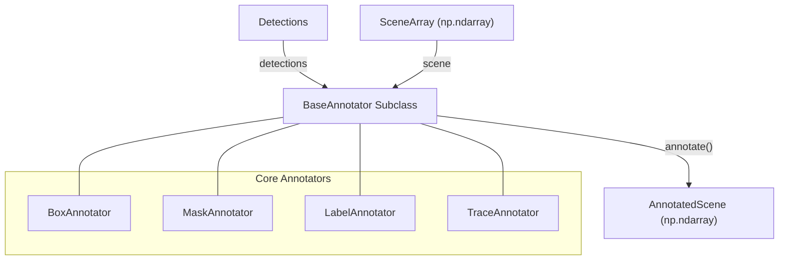
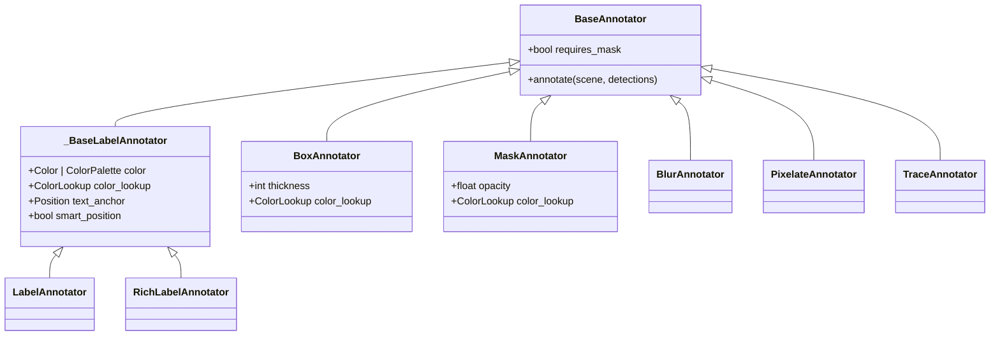

<!-- source: DeepWiki mcp.deepwiki.com · repo roboflow/supervision · page 2.2 Annotation System · fetched 2026-10-30 -->

# Annotation System

<details>
<summary>Relevant source files</summary>

The following files were used as context for generating this wiki page:

- [docs/deprecated.md](docs/deprecated.md)
- [docs/detection/annotators.md](docs/detection/annotators.md)
- [src/supervision/annotators/base.py](src/supervision/annotators/base.py)
- [src/supervision/annotators/core.py](src/supervision/annotators/core.py)
- [src/supervision/annotators/utils.py](src/supervision/annotators/utils.py)
- [src/supervision/detection/tools/smoother.py](src/supervision/detection/tools/smoother.py)
- [src/supervision/draw/utils.py](src/supervision/draw/utils.py)
- [tests/annotators/test_core.py](tests/annotators/test_core.py)
- [tests/annotators/test_utils.py](tests/annotators/test_utils.py)
- [tests/detection/tools/test_smoother.py](tests/detection/tools/test_smoother.py)
- [tests/draw/test_utils.py](tests/draw/test_utils.py)

</details>


The Annotation System in Roboflow Supervision provides visualization tools for object detections, tracking histories, keypoints, and segmentation masks on images and video streams. Built around a consistent interface, it interoperates directly with the [Detection System](#2.1) and complements the [Drawing & Visualization](#3.2) utilities.

Sources: [src/supervision/annotators/core.py:1-30](), [docs/detection/annotators.md:1-15]()

## Overview

All annotators in Supervision implement the **scene-in/scene-out** pattern. An annotator instance consumes a mutable or copied image scene (`np.ndarray`) and a [`Detections`](../detection/core.md) object, returning the modified scene in-place or as an updated array.

### Code Entity Bridge: Annotation Flow
This diagram maps the natural language concept of rendering overlays to the underlying code entities in `supervision`.


Sources: [src/supervision/annotators/base.py:7-21](), [src/supervision/annotators/core.py:189-208]()

## Annotator Architecture

Annotators inherit from `BaseAnnotator`, which declares the abstract interface method `annotate()` [src/supervision/annotators/base.py:7-21](). Additionally, annotators declare a `requires_mask` boolean flag indicating whether dense masks (`detections.mask`) must be materialized before execution [src/supervision/annotators/base.py:11-15](), [tests/annotators/test_core.py:60-112]().

### Class Hierarchy

Sources: [src/supervision/annotators/base.py:7-21](), [src/supervision/annotators/core.py:111-170](), [tests/annotators/test_core.py:60-112]()

## Core Annotator Types

### Box and Shape Annotators
- **`BoxAnnotator`**: Draws standard rectangular bounding boxes [docs/detection/annotators.md:12-25]().
- **`RoundBoxAnnotator`**: Draws rectangles with rounded corners via [`draw_rounded_rectangle`](../draw/utils.md) [src/supervision/draw/utils.py:152-171]().
- **`BoxCornerAnnotator`**: Renders only the four corners of each bounding box [docs/detection/annotators.md:54-67]().
- **`OrientedBoxAnnotator`**: Visualizes rotated/oriented bounding boxes (`xyxyxyxy`) [docs/detection/annotators.md]().

### Mask, Polygon, and Region Annotators
- **`MaskAnnotator`**: Paints instance segmentation masks onto the scene. It is **CompactMask-aware**, meaning it can consume `CompactMask` structures and unpack them efficiently during drawing without requiring full-memory boolean array expansion [src/supervision/detection/compact_mask.py](), [tests/annotators/test_core.py:40-41]().
- **`PolygonAnnotator`**: Draws boundary lines around mask polygons [docs/detection/annotators.md:117-130]().
- **`HaloAnnotator`**: Adds a glowing outline effect around masks or bounding shapes [docs/detection/annotators.md:161-174]().

### Label and Text Annotators
- **`LabelAnnotator`**: Renders textual metadata attached to bounding box anchors. Supports `smart_position` (avoiding overlaps via `snap_boxes` and `spread_out_boxes`) and `max_line_length` for automatic text wrapping [src/supervision/annotators/core.py:111-170]().
- **`RichLabelAnnotator`**: Provides advanced styled formatting for text labels [tests/annotators/test_core.py:159-161]().

### Effect Annotators & Dynamic Scaling
- **`BlurAnnotator`** & **`PixelateAnnotator`**: Obscure or pixelate detection regions. When kernel or pixel sizes are omitted (`None`), they invoke [`calculate_dynamic_pixel_size`](../annotators/utils.md) and [`calculate_dynamic_kernel_size`](../annotators/utils.md) to scale effect granularity relative to bounding box dimensions [src/supervision/annotators/core.py:21-22]().

### Trace Annotator
- **`TraceAnnotator`**: Draws object motion histories over sequential frames using the [`Trace`](../annotators/utils.md) tracking buffer utility, connecting past centroid or anchor points [tests/annotators/test_core.py:83-83]().

Sources: [src/supervision/annotators/core.py:1-3549](), [tests/annotators/test_core.py:60-112]()

## Color and Styling

### ColorLookup
Color assignment across detections is governed by the `ColorLookup` enumeration [src/supervision/annotators/utils.py:20-32]():

| Strategy (`ColorLookup`) | Description |
| :--- | :--- |
| `ColorLookup.INDEX` | Colors assigned by detection index position within the current frame. |
| `ColorLookup.CLASS` | Colors mapped from `detections.class_id`. |
| `ColorLookup.TRACK` | Colors mapped from `detections.tracker_id` (with `PENDING_TRACK_ID` falling back to `PENDING_TRACK_COLOR`) [src/supervision/annotators/utils.py:16-18](). |

### Hex and RGBA Support
`Color` and annotator parameters accept 6-digit or 8-digit hex strings (e.g., `#ff00ff80`), parsed internally via `hex_to_rgba` for transparent overlay rendering [src/supervision/annotators/core.py:95-105](), [tests/annotators/test_core.py:175-183]().

Sources: [src/supervision/annotators/utils.py:20-76](), [src/supervision/annotators/core.py:95-105]()

## Common Usage Pattern

```python
import cv2
import supervision as sv

image = cv2.imread("input.jpg")
detections = sv.Detections.from_ultralytics(results)

box_annotator = sv.BoxAnnotator(color=sv.ColorPalette.DEFAULT, color_lookup=sv.ColorLookup.CLASS)
label_annotator = sv.LabelAnnotator(text_position=sv.Position.TOP_CENTER)

annotated_frame = box_annotator.annotate(scene=image.copy(), detections=detections)
annotated_frame = label_annotator.annotate(scene=annotated_frame, detections=detections)
```
Sources: [docs/detection/annotators.md:12-25](), [docs/detection/annotators.md:154-170]()

## Key Classes and Functions Reference

| Class / Function | File Path | Role |
| :--- | :--- | :--- |
| `BaseAnnotator` | [src/supervision/annotators/base.py:7-21]() | Abstract base class defining `annotate()` and `requires_mask`. |
| `_BaseLabelAnnotator` | [src/supervision/annotators/core.py:111-170]() | Shared base logic for text-labeling annotators. |
| `ColorLookup` | [src/supervision/annotators/utils.py:20-32]() | Strategy enum (`INDEX`, `CLASS`, `TRACK`) for color resolution. |
| `resolve_color` | [src/supervision/annotators/utils.py:149-167]() | Resolves concrete `Color` for a given detection index. |
| `CompactMask` | [src/supervision/detection/compact_mask.py]() | Memory-efficient mask representation utilized by mask annotators. |
| `Trace` | [src/supervision/annotators/utils.py:17-17]() | Buffer manager for tracking object trajectories. |

Sources: [src/supervision/annotators/base.py:1-21](), [src/supervision/annotators/core.py:111-170](), [src/supervision/annotators/utils.py:20-167]()

---

