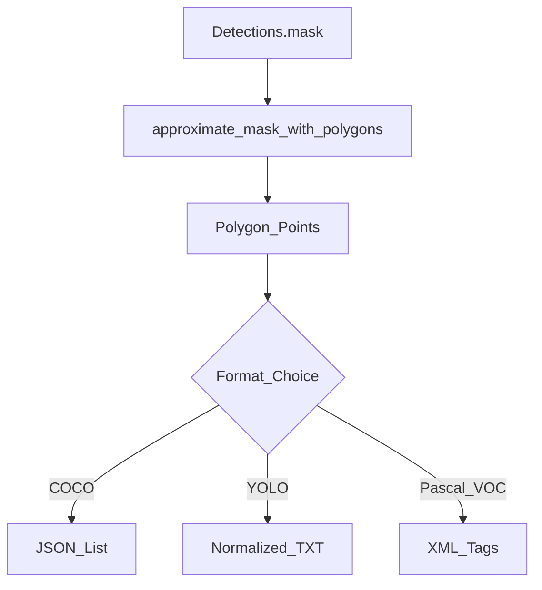

<!-- source: DeepWiki mcp.deepwiki.com · repo roboflow/supervision · page 2.3 Dataset Management · fetched 2026-10-30 -->

# Dataset Management

<details>
<summary>Relevant source files</summary>

The following files were used as context for generating this wiki page:

- [docs/datasets/core.md](docs/datasets/core.md)
- [docs/how_to/process_datasets.md](docs/how_to/process_datasets.md)
- [src/supervision/classification/core.py](src/supervision/classification/core.py)
- [src/supervision/dataset/core.py](src/supervision/dataset/core.py)
- [src/supervision/dataset/formats/coco.py](src/supervision/dataset/formats/coco.py)
- [src/supervision/dataset/formats/yolo.py](src/supervision/dataset/formats/yolo.py)
- [src/supervision/dataset/utils.py](src/supervision/dataset/utils.py)
- [tests/classification/test_core.py](tests/classification/test_core.py)
- [tests/dataset/formats/test_coco.py](tests/dataset/formats/test_coco.py)
- [tests/dataset/formats/test_yolo.py](tests/dataset/formats/test_yolo.py)
- [tests/dataset/test_core.py](tests/dataset/test_core.py)

</details>


This page documents the dataset management capabilities in the Supervision library [src/supervision/dataset/core.py:39-897](). The Supervision dataset management system provides classes, methods, and utilities for efficiently loading, manipulating, splitting, merging, and exporting computer vision datasets for object detection, instance segmentation, oriented bounding boxes (OBB), and image classification tasks.

Sources: [src/supervision/dataset/core.py:39-897]()

## Overview

The dataset management system in Supervision is designed to handle multiple aspects of working with computer vision datasets:

1.  **Dataset Representation**: Structured representation of detection and classification datasets [src/supervision/dataset/core.py:59-897]().
2.  **Format Conversion**: Support for loading from and saving to common dataset formats (COCO, YOLO, Pascal VOC, CreateML, LabelMe) [src/supervision/dataset/core.py:21-41]().
3.  **Dataset Operations**: Splitting datasets into train/test sets, merging datasets, and performing basename collision checks [src/supervision/dataset/utils.py:132-180](), [src/supervision/dataset/core.py:179-332]().
4.  **Memory Efficiency**: Lazy image loading on demand from file paths to handle large datasets [src/supervision/dataset/core.py:82-91](), [src/supervision/dataset/core.py:151-158]().
5.  **Dataset Preparation**: Utilities for manipulating and preparing datasets for training [src/supervision/dataset/utils.py:42-180]().

The system is based on two primary dataset classes inheriting from an abstract base class:
*   `DetectionDataset`: For object detection, instance segmentation, and OBB datasets [src/supervision/dataset/core.py:74-666]().
*   `ClassificationDataset`: For image classification datasets [src/supervision/dataset/core.py:668-897]().

### Code Entity Architecture

The following diagram bridges the natural language concepts of dataset management to the specific code entities in the `supervision` package.

**Dataset Entity Mapping**
```mermaid
classDiagram
    class "BaseDataset[ABC]" {
        <<abstract>>
        +__len__() int
        +split() Tuple[BaseDataset, BaseDataset]
    }
    
    class "DetectionDataset" {
        +classes List[str]
        +image_paths List[str]
        +annotations Dict[str, Detections]
        +_images_in_memory Dict[str, np.ndarray]
        +__init__(classes, images, annotations)
        +__len__() int
        +__getitem__(i) Tuple[str, np.ndarray, Detections]
        +__iter__()
        +split() Tuple[DetectionDataset, DetectionDataset]
        +merge(dataset_list) DetectionDataset
        +from_coco() DetectionDataset
        +as_coco()
        +from_yolo() DetectionDataset
        +as_yolo()
        +from_pascal_voc() DetectionDataset
        +as_pascal_voc()
    }
    
    class "ClassificationDataset" {
        +classes List[str]
        +image_paths List[str]
        +annotations Dict[str, Classifications]
        +_images_in_memory Dict[str, np.ndarray]
        +__init__(classes, images, annotations)
        +__len__() int
        +__getitem__(i) Tuple[str, np.ndarray, Classifications]
        +__iter__()
        +split() Tuple[ClassificationDataset, ClassificationDataset]
        +as_folder_structure()
        +from_folder_structure() ClassificationDataset
    }
    
    "BaseDataset[ABC]" <|-- "DetectionDataset"
    "BaseDataset[ABC]" <|-- "ClassificationDataset"
```

Sources: [src/supervision/dataset/core.py:59-72](), [src/supervision/dataset/core.py:74-666](), [src/supervision/dataset/core.py:668-897]()

## Dataset Classes

### DetectionDataset

`DetectionDataset` implements the `BaseDataset` interface for object detection tasks [src/supervision/dataset/core.py:74-160](). It stores a collection of image paths and their corresponding annotations in the form of `sv.Detections` objects [src/supervision/dataset/core.py:74-92]().

**Key Features:**
*   **Lazy Loading**: When a list of image file paths is provided, images are not loaded into RAM upfront. Instead, `_get_image` uses `cv2.imread` to load individual images lazily on demand when accessed via `__getitem__` or iteration [src/supervision/dataset/core.py:82-91](), [src/supervision/dataset/core.py:151-172]().
*   **Format Support**: Native factory methods and export methods for COCO JSON [src/supervision/dataset/core.py:391-446](), YOLO TXT [src/supervision/dataset/core.py:448-538](), Pascal VOC XML [src/supervision/dataset/core.py:540-608](), CreateML [src/supervision/dataset/core.py:610-640](), and LabelMe.
*   **OBB Support**: The `from_yolo` and `as_yolo` methods support Oriented Bounding Boxes when configured [src/supervision/dataset/formats/yolo.py:147-165]().

### ClassificationDataset

`ClassificationDataset` handles image classification tasks, mapping image paths or in-memory arrays to `sv.Classifications` objects [src/supervision/dataset/core.py:668-710]().

**Key Features:**
*   **Folder Structure**: Can be instantiated from a directory structure where subdirectories represent class names via `from_folder_structure` [src/supervision/dataset/core.py:850-897]().
*   **Splitting**: Supports random splitting into subsets while maintaining dataset interfaces [src/supervision/dataset/core.py:763-823]().

Sources: [src/supervision/dataset/core.py:74-160](), [src/supervision/dataset/core.py:668-710](), [src/supervision/dataset/core.py:850-897]()

## Dataset Operations

### Loading and Exporting

Supervision provides standardized methods for converting between major computer vision formats.

| Format | Import Method | Export Method |
| :--- | :--- | :--- |
| **COCO** | `DetectionDataset.from_coco` [src/supervision/dataset/core.py:391-446]() | `DetectionDataset.as_coco` |
| **YOLO** | `DetectionDataset.from_yolo` [src/supervision/dataset/core.py:448-538]() | `DetectionDataset.as_yolo` |
| **Pascal VOC** | `DetectionDataset.from_pascal_voc` [src/supervision/dataset/core.py:540-608]() | `DetectionDataset.as_pascal_voc` |
| **CreateML** | `DetectionDataset.from_createml` [src/supervision/dataset/core.py:610-640]() | `DetectionDataset.as_createml` |

**Format Conversion Workflow**


Sources: [src/supervision/dataset/core.py:334-640](), [docs/how_to/process_datasets.md:69-158]()

### Merging and Splitting

*   **`split`**: Divides a dataset into two new instances based on a `split_ratio` [src/supervision/dataset/core.py:179-239](). It supports shuffling and a fixed `random_state` for reproducibility [src/supervision/dataset/core.py:179-239]().
*   **`merge`**: Combines a list of `DetectionDataset` instances into one [src/supervision/dataset/core.py:241-332](). It automatically resolves class list discrepancies by creating a union of all classes and remapping class IDs accordingly [src/supervision/dataset/utils.py:84-91](), [src/supervision/dataset/utils.py:94-110]().

Sources: [src/supervision/dataset/core.py:179-332](), [src/supervision/dataset/utils.py:84-110]()

### Basename Collision Checks

When datasets are merged from different source directories, multiple image files may share the same filename or basename (e.g., `a/img.jpg` and `b/img.jpg`) [src/supervision/dataset/utils.py:132-144](). Exporting them into a flat output directory keyed by basename would silently overwrite one file and corrupt annotations [src/supervision/dataset/utils.py:132-144](). Supervision guards against this using `check_no_basename_collisions`, which scans image paths and raises a `ValueError` if any collision is detected prior to writing files [src/supervision/dataset/utils.py:132-180]().

Sources: [src/supervision/dataset/utils.py:132-180]()

## Implementation Details

### Format Parsers

The core logic for dataset formats is isolated in the `supervision.dataset.formats` module:

*   **COCO**: Uses `read_json_file` and handles complex polygon/RLE segmentation masks via `coco_annotations_to_masks` [src/supervision/dataset/formats/coco.py:99-163]().
*   **YOLO**: Parses `.txt` files with normalized bounding boxes and segmentations [src/supervision/dataset/formats/yolo.py:170-220]().
*   **Pascal VOC**: Uses XML parsing to extract `bndbox` and polygon tags [src/supervision/dataset/core.py:540-608]().

### Mask and Polygon Utilities

Supervision includes internal utilities for converting between representation types during dataset export:
*   **`approximate_mask_with_polygons`**: Reduces the number of points in a binary mask to create efficient polygon annotations [src/supervision/dataset/utils.py:51-81]().
*   **`mask_to_rle` / `rle_to_mask`**: Handles Run-Length Encoding for COCO-compliant compressed masks [src/supervision/detection/utils/converters.py:21-24]().

**Data Flow: Mask to Polygon Export**


Sources: [src/supervision/dataset/utils.py:51-81](), [src/supervision/dataset/formats/coco.py:99-163](), [src/supervision/dataset/formats/yolo.py:170-220]()

## Usage Example: Splitting and Converting

```python
import supervision as sv

# Load a YOLO dataset with lazy image loading
ds = sv.DetectionDataset.from_yolo(
    images_directory_path="data/images",
    annotations_directory_path="data/labels",
    data_yaml_path="data/data.yaml"
)

# Split into 80/20 train/test
train_ds, test_ds = ds.split(split_ratio=0.8, shuffle=True)

# Export test split to COCO format
test_ds.as_coco(
    images_directory_path="out/images",
    annotations_path="out/test_annotations.json"
)
```

Sources: [docs/how_to/process_datasets.md:160-179](), [src/supervision/dataset/core.py:334-389]()

---

