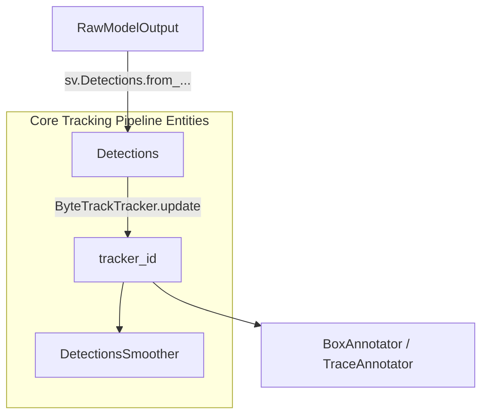
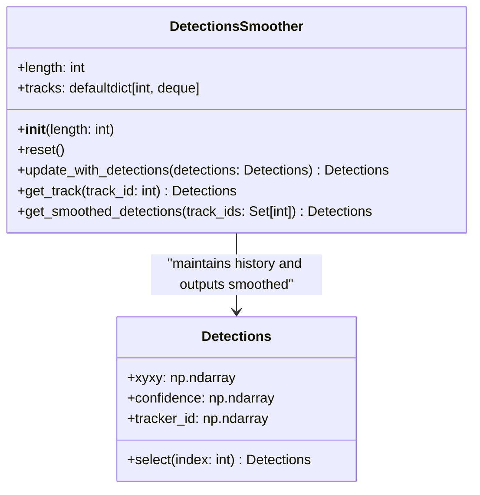
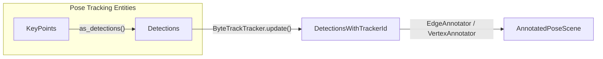

<!-- source: DeepWiki mcp.deepwiki.com · repo roboflow/supervision · page 2.4 Tracking System · fetched 2026-10-30 -->

# Tracking System

Relevant source files

The following files were used as context for generating this wiki page:

- [docs/deprecated.md](docs/deprecated.md)
- [docs/detection/annotators.md](docs/detection/annotators.md)
- [docs/detection/tools/smoother.md](docs/detection/tools/smoother.md)
- [docs/how_to/benchmark_a_model.md](docs/how_to/benchmark_a_model.md)
- [docs/how_to/count_in_zone.md](docs/how_to/count_in_zone.md)
- [docs/how_to/detect_and_annotate.md](docs/how_to/detect_and_annotate.md)
- [docs/how_to/detect_small_objects.md](docs/how_to/detect_small_objects.md)
- [docs/how_to/filter_detections.md](docs/how_to/filter_detections.md)
- [docs/how_to/save_detections.md](docs/how_to/save_detections.md)
- [docs/how_to/track_objects.md](docs/how_to/track_objects.md)
- [src/supervision/detection/tools/smoother.py](src/supervision/detection/tools/smoother.py)
- [tests/detection/tools/test_smoother.py](tests/detection/tools/test_smoother.py)

The Tracking System in Supervision provides object tracking capabilities that enable continuous identification and monitoring of objects across video frames. Building upon the core detection pipeline, tracking assigns persistent `tracker_id` attributes to detected objects, allowing systems to follow motion trajectories over time. Following recent version updates, native tracking wrappers have been deprecated in favor of external packages, while auxiliary tools like `DetectionsSmoother` and `KeyPoints.as_detections()` provide robust post-processing and pose-tracking integration.

Sources:
- [docs/deprecated.md:19-20]()
- [docs/how_to/track_objects.md:113-120]()
- [src/supervision/detection/tools/smoother.py:28-48]()

---

## 1. External Trackers and `tracker_id` Management

As of `supervision-0.31.0`, the legacy `sv.ByteTrack` implementation has been removed from the core library. Users should install and utilize the dedicated external `trackers` package (`pip install trackers`) for tracking algorithms like ByteTrack. 

The tracking workflow relies on passing `sv.Detections` containing bounding boxes and confidence scores into a tracker instance (such as `ByteTrackTracker`), which updates each detection with a unique `tracker_id`.

Sources:
- [docs/deprecated.md:19-20]()
- [docs/how_to/track_objects.md:113-120]()
- [src/supervision/detection/tools/smoother.py:28-44]()

---

## 2. `DetectionsSmoother` for Jitter Reduction

`DetectionsSmoother` is a utility class designed to mitigate bounding box jitter and confidence fluctuations in video tracking pipelines by smoothing detections over a sliding temporal window [src/supervision/detection/tools/smoother.py:28-31]().

### Implementation Details

`DetectionsSmoother` maintains a per-track history queue using a `defaultdict` of `deque` instances [src/supervision/detection/tools/smoother.py:114-116](). When `update_with_detections()` is invoked:
1. It validates that the incoming `Detections` object contains a valid `tracker_id` array [src/supervision/detection/tools/smoother.py:150-157](). If `tracker_id` is `None`, a warning is emitted via `SupervisionWarnings` and the input is returned unmodified [src/supervision/detection/tools/smoother.py:150-157]().
2. Individual detections are appended to their corresponding track queue [src/supervision/detection/tools/smoother.py:159-163]().
3. Unseen tracks in the current frame append `None` to their history queue to maintain window alignment [src/supervision/detection/tools/smoother.py:167-170]().
4. Bounding coordinates (`xyxy`) are averaged across all non-`None` entries within the window length [src/supervision/detection/tools/smoother.py:178-182](). Confidence scores are similarly averaged only across frames where confidence is present [src/supervision/detection/tools/smoother.py:45-47]().

Sources:
- [src/supervision/detection/tools/smoother.py:28-176]()
- [tests/detection/tools/test_smoother.py:1-44]()

---

## 3. Pose Tracking via `KeyPoints.as_detections()`

To track articulated objects or human poses across frames using multi-object tracking algorithms, Supervision provides a bridge method: `KeyPoints.as_detections()`.

This method calculates bounding boxes that encapsulate the keypoint coordinates for each detected instance, converting a `KeyPoints` object into a standard `sv.Detections` structure suitable for tracker input.

Sources:
- [docs/how_to/track_objects.md:409-414]()
- [src/supervision/key_points/core.py:1-20]()

---

