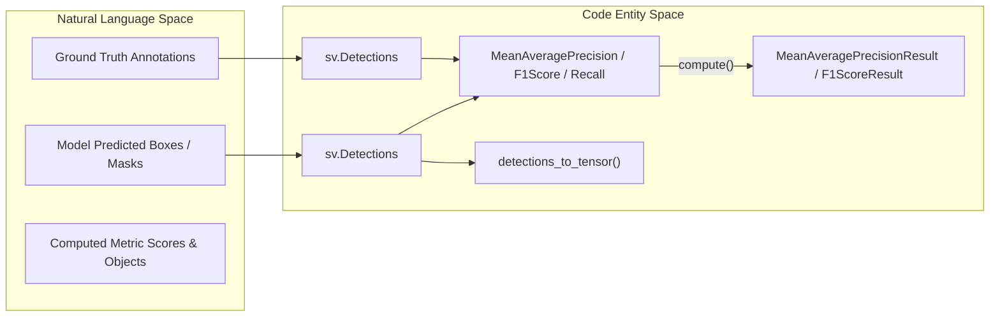

<!-- source: DeepWiki mcp.deepwiki.com · repo roboflow/supervision · page 2.5 Metrics System · fetched 2026-10-30 -->

# Metrics System

<details>
<summary>Relevant source files</summary>

The following files were used as context for generating this wiki page:

- [docs/metrics/aggregate.md](docs/metrics/aggregate.md)
- [docs/metrics/match_detections.md](docs/metrics/match_detections.md)
- [src/supervision/detection/utils/matching.py](src/supervision/detection/utils/matching.py)
- [src/supervision/metrics/__init__.py](src/supervision/metrics/__init__.py)
- [src/supervision/metrics/_confusion_matrix_metric.py](src/supervision/metrics/_confusion_matrix_metric.py)
- [src/supervision/metrics/core.py](src/supervision/metrics/core.py)
- [src/supervision/metrics/detection.py](src/supervision/metrics/detection.py)
- [src/supervision/metrics/f1_score.py](src/supervision/metrics/f1_score.py)
- [src/supervision/metrics/mean_average_precision.py](src/supervision/metrics/mean_average_precision.py)
- [src/supervision/metrics/mean_average_recall.py](src/supervision/metrics/mean_average_recall.py)
- [src/supervision/metrics/precision.py](src/supervision/metrics/precision.py)
- [src/supervision/metrics/recall.py](src/supervision/metrics/recall.py)
- [src/supervision/metrics/utils/aggregate.py](src/supervision/metrics/utils/aggregate.py)
- [src/supervision/metrics/utils/object_size.py](src/supervision/metrics/utils/object_size.py)
- [tests/detection/utils/test_matching.py](tests/detection/utils/test_matching.py)
- [tests/metrics/test_detection.py](tests/metrics/test_detection.py)
- [tests/metrics/test_f1_score.py](tests/metrics/test_f1_score.py)
- [tests/metrics/test_mean_average_precision.py](tests/metrics/test_mean_average_precision.py)
- [tests/metrics/test_mean_average_recall.py](tests/metrics/test_mean_average_recall.py)
- [tests/metrics/test_oriented_bounding_box_metrics.py](tests/metrics/test_oriented_bounding_box_metrics.py)
- [tests/metrics/test_precision.py](tests/metrics/test_precision.py)
- [tests/metrics/test_recall.py](tests/metrics/test_recall.py)
- [tests/metrics/utils/test_object_size.py](tests/metrics/utils/test_object_size.py)

</details>


The Metrics System in Supervision provides comprehensive tools for evaluating object detection, segmentation, and oriented bounding box performance. These metrics quantify model accuracy, precision, recall, and harmonic scores across varying Intersection over Union (IoU) thresholds, object size categories, and averaging methods.

For information about running inference with models, see [Model Adapters](#4.1), and for storing and manipulating detections, see [Detection System](#2.1).

## Overview and Architecture

The metrics architecture is organized around an abstract base class `Metric`, metric-specific accumulators and result containers, and utility modules for object sizing, tensor conversion, and detection matching.

### System Class Diagram

```mermaid
classDiagram
    class "Metric" {
        <<Abstract Base Class>>
        +update(predictions, targets)
        +reset()
        +compute()
    }
    
    class "MetricTarget" {
        <<Enum>>
        +BOXES
        +MASKS
        +ORIENTED_BOUNDING_BOXES
    }
    
    class "AveragingMethod" {
        <<Enum>>
        +MACRO
        +MICRO
        +WEIGHTED
    }
    
    class "MeanAveragePrecision" {
        +update()
        +reset()
        +compute()
        +benchmark()
    }
    
    class "MeanAverageRecall" {
        +update()
        +reset()
        +compute()
    }
    
    class "F1Score" {
        +update()
        +reset()
        +compute()
    }
    
    class "Precision" {
        +update()
        +reset()
        +compute()
    }
    
    class "Recall" {
        +update()
        +reset()
        +compute()
    }

    class "ConfusionMatrix" {
        +from_detections()
        +from_tensors()
        +evaluate_detection_batch()
    }
    
    class "MeanAveragePrecisionResult" {
        +map50_95
        +map50
        +map75
        +to_pandas()
    }
    
    "Metric" <|-- "MeanAveragePrecision"
    "Metric" <|-- "MeanAverageRecall"
    "Metric" <|-- "F1Score"
    "Metric" <|-- "Precision"
    "Metric" <|-- "Recall"
    
    "MeanAveragePrecision" --> "MeanAveragePrecisionResult" : "produces"
    "MeanAveragePrecision" --> "MetricTarget" : "uses"
    "F1Score" --> "AveragingMethod" : "uses"
```

Sources:
- [src/supervision/metrics/core.py:11-72]()
- [src/supervision/metrics/mean_average_precision.py:79-133]()
- [src/supervision/metrics/mean_average_recall.py:39-93]()
- [src/supervision/metrics/precision.py:41-95]()
- [src/supervision/metrics/recall.py:41-120]()
- [src/supervision/metrics/f1_score.py:41-95]()
- [src/supervision/metrics/detection.py:60-174]()

### Natural Language to Code Entity Mapping: Metric Computation



Sources:
- [src/supervision/metrics/mean_average_precision.py:145-179]()
- [src/supervision/metrics/detection.py:60-126]()

## Core Components

### Base Classes and Enums

The core supervision metrics rely on shared primitives defined in `supervision.metrics.core`:

1. **`Metric`**: Abstract base class defining `update()`, `reset()`, and `compute()` [src/supervision/metrics/core.py:39-72]().
2. **`MetricTarget`**: Enum specifying the evaluation geometry [src/supervision/metrics/core.py:11-16]():
   - `MetricTarget.BOXES`
   - `MetricTarget.MASKS`
   - `MetricTarget.ORIENTED_BOUNDING_BOXES`
3. **`AveragingMethod`**: Enum controlling class aggregation strategy [src/supervision/metrics/core.py:23-36]():
   - `AveragingMethod.MACRO`: Unweighted mean across active classes.
   - `AveragingMethod.MICRO`: Global tally across all instances.
   - `AveragingMethod.WEIGHTED`: Class frequency-weighted average.

Sources:
- [src/supervision/metrics/core.py:11-72]()

## Supported Metrics

### Mean Average Precision (`MeanAveragePrecision`)
Computes COCO-compliant evaluation metrics across IoU thresholds from 0.50 to 0.95 (step 0.05). It produces a `MeanAveragePrecisionResult` holding `map50_95`, `map50`, `map75`, and per-class AP breakdown.

Sources:
- [src/supervision/metrics/mean_average_precision.py:79-133]()

### Mean Average Recall (`MeanAverageRecall`)
Evaluates model recall completeness across detection count limits (`mAR@1`, `mAR@10`, `mAR@100`) and IoU thresholds.

Sources:
- [src/supervision/metrics/mean_average_recall.py:39-93]()

### Precision, Recall, and F1 Score (`Precision`, `Recall`, `F1Score`)
Derived from the underlying `(TP, FP, FN)` confusion matrix statistics across thresholded evaluations:
- **Precision**: `TP / (TP + FP)` [src/supervision/metrics/precision.py:41-48]()
- **Recall**: `TP / (TP + FN)` [src/supervision/metrics/recall.py:41-51]()
- **F1Score**: Harmonic mean `2 * TP / (2 * TP + FP + FN)` [src/supervision/metrics/f1_score.py:41-49]()

Sources:
- [src/supervision/metrics/_confusion_matrix_metric.py:60-94]()
- [src/supervision/metrics/precision.py:41-98]()
- [src/supervision/metrics/recall.py:41-120]()
- [src/supervision/metrics/f1_score.py:41-95]()

### Confusion Matrix (`ConfusionMatrix`)
The `ConfusionMatrix` class compiles prediction-to-target matching tensors via `ConfusionMatrix.from_detections()` or `ConfusionMatrix.from_tensors()`, accounting for background false positives and missed false negatives [src/supervision/metrics/detection.py:60-174]().

Sources:
- [src/supervision/metrics/detection.py:60-174]()

## Implementation Details

### Detection Matching and Tensors
Supervision converts `sv.Detections` into standardized float32 tensors using `detections_to_tensor()`, formatting bounding boxes or oriented coordinates alongside class IDs and confidence scores [src/supervision/metrics/detection.py:60-126]().

Sources:
- [src/supervision/metrics/detection.py:60-174]()

### Object Size Buckets
All primary metrics (`MeanAveragePrecision`, `MeanAverageRecall`, `Precision`, `Recall`, `F1Score`) automatically compute stratified results across standard COCO object size categories using `ObjectSizeCategory` [src/supervision/metrics/utils/object_size.py:20-44]():
- **Small**: `area < 32²` (`ObjectSizeCategory.SMALL`)
- **Medium**: `32² ≤ area < 96²` (`ObjectSizeCategory.MEDIUM`)
- **Large**: `area ≥ 96²` (`ObjectSizeCategory.LARGE`)

Area calculations use bounding box pixel dimensions, mask pixel counts via `count_mask_pixels()` [src/supervision/metrics/utils/object_size.py:199](), or oriented bounding box geometry.

Sources:
- [src/supervision/metrics/utils/object_size.py:20-125]()
- [src/supervision/metrics/utils/object_size.py:163-203]()

### Sklearn and Parity Tests
Supervision validates metrics against established reference implementations (such as `pycocotools` and `scikit-learn`) in `tests/metrics/`. Tests verify parity for macro/micro/weighted averaging, absent class handling, and edge cases like empty prediction/target sets.

Sources:
- [tests/metrics/test_detection.py:64-110]()
- [tests/metrics/test_f1_score.py:13-41]()
- [tests/metrics/test_recall.py:13-41]()

---

