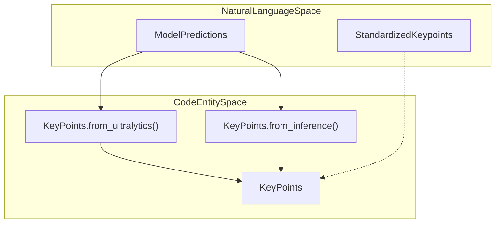
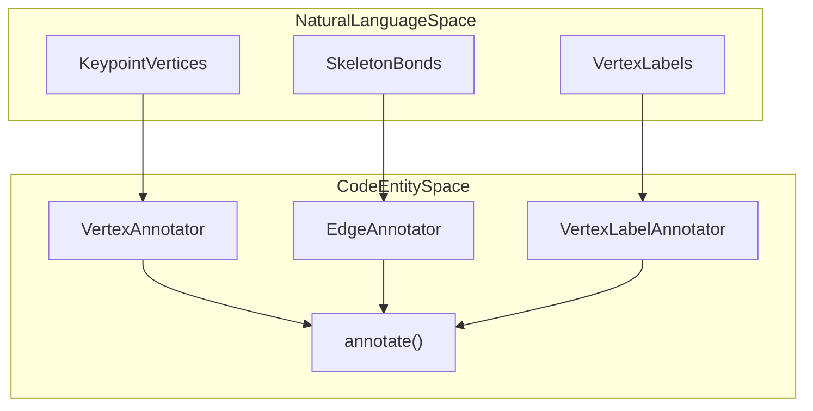
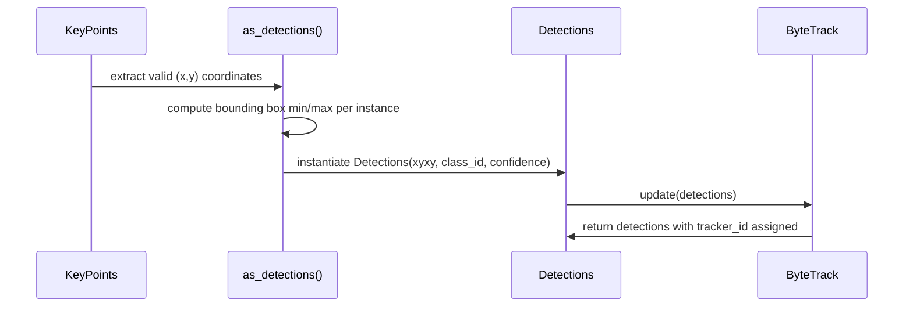

<!-- source: DeepWiki mcp.deepwiki.com · repo roboflow/supervision · page 2.6 KeyPoint System · fetched 2026-10-30 -->

# KeyPoint System

<details>
<summary>Relevant source files</summary>

The following files were used as context for generating this wiki page:

- [docs/detection/tools/inference_slicer.md](docs/detection/tools/inference_slicer.md)
- [docs/detection/tools/line_zone.md](docs/detection/tools/line_zone.md)
- [docs/detection/tools/polygon_zone.md](docs/detection/tools/polygon_zone.md)
- [docs/keypoint/annotators.md](docs/keypoint/annotators.md)
- [docs/keypoint/core.md](docs/keypoint/core.md)
- [src/supervision/assets/list.py](src/supervision/assets/list.py)
- [src/supervision/draw/base.py](src/supervision/draw/base.py)
- [src/supervision/key_points/annotators.py](src/supervision/key_points/annotators.py)
- [src/supervision/key_points/core.py](src/supervision/key_points/core.py)
- [src/supervision/key_points/skeletons.py](src/supervision/key_points/skeletons.py)
- [tests/helpers.py](tests/helpers.py)
- [tests/key_points/test_annotators.py](tests/key_points/test_annotators.py)
- [tests/key_points/test_core.py](tests/key_points/test_core.py)
- [tests/key_points/test_skeletons.py](tests/key_points/test_skeletons.py)
- [tests/utils/test_internal.py](tests/utils/test_internal.py)

</details>


The KeyPoint System in Supervision provides a standardized data structure, rich annotation capabilities, skeletal configurations, and interoperability bridges for pose estimation and landmark detection models [src/supervision/key_points/core.py:130-135](). 

---

## 1. Overview and Architecture

The keypoint subsystem decouples model inference outputs from downstream visualization, filtering, and tracking pipelines. It ingests predictions from frameworks like Ultralytics, Roboflow Inference, MediaPipe, and Hugging Face Transformers, normalizes them into the `KeyPoints` dataclass, and exposes them to specialized rendering and bridging utilities [src/supervision/key_points/core.py:130-183]().

### Diagram: Natural Language Space to Code Entity Space (Ingestion & Dataclass)



Sources: [src/supervision/key_points/core.py:130-183]()

---

## 2. KeyPoints Dataclass & Attributes

The `KeyPoints` class manages arrays representing spatial coordinates, confidences, visibilities, and class identifiers across multiple objects in a single frame [src/supervision/key_points/core.py:130-200]().

### Core Attributes

| Attribute | Type | Shape | Description |
| :--- | :--- | :--- | :--- |
| `xy` | `npt.NDArray[np.float32]` | `(n, m, 2)` | Coordinates `[x, y]` for `n` detections and `m` keypoints per detection [src/supervision/key_points/core.py:130-170]() |
| `keypoint_confidence` | `Optional[npt.NDArray[np.float32]]` | `(n, m)` | Per-keypoint confidence scores [tests/helpers.py:146-148]() |
| `detection_confidence` | `Optional[npt.NDArray[np.float32]]` | `(n,)` | Overall detection-level confidence scores [tests/helpers.py:149-153]() |
| `visible` | `Optional[npt.NDArray[np.bool_]]` | `(n, m)` | Boolean flags indicating whether keypoints are visible/valid [tests/helpers.py:154-154]() |
| `class_id` | `Optional[npt.NDArray[np.int_]]` | `(n,)` | Object category identifiers [tests/helpers.py:155-155]() |
| `data` | `dict[str, Any]` | Variable | Custom per-detection user metadata dictionary [tests/helpers.py:156-156]() |

Sources: [src/supervision/key_points/core.py:130-200](), [tests/helpers.py:96-158]()

---

## 3. Visualization and Annotation

Supervision offers dedicated keypoint annotators adhering to the standard `.annotate(scene, key_points)` pattern [src/supervision/key_points/annotators.py:47-50]().

### Diagram: Natural Language Space to Code Entity Space (Annotation)



Sources: [src/supervision/key_points/annotators.py:47-165](), [docs/keypoint/annotators.md:7-78]()

### Annotator Classes

*   **`VertexAnnotator`**: Draws circles at valid, finite, and visible keypoint coordinates [src/supervision/key_points/annotators.py:53-134]().
*   **`EdgeAnnotator`**: Connects designated keypoint pairs with lines according to selected skeleton configurations [src/supervision/key_points/annotators.py:136-200]().
*   **`VertexLabelAnnotator`**: Renders text annotations next to individual keypoints [docs/keypoint/annotators.md:55-78]().
*   **Ellipse Area Annotators**: `VertexEllipseAreaAnnotator`, `VertexEllipseOutlineAnnotator`, and `VertexEllipseHaloAnnotator` provide probabilistic uncertainty ellipses around keypoints [docs/keypoint/annotators.md:80-135]().

Sources: [src/supervision/key_points/annotators.py:47-200](), [docs/keypoint/annotators.md:7-135]()

---

## 4. Skeleton Definitions

Predefined skeletal graphs are stored in the `Skeleton` enum within `supervision.key_points.skeletons` [src/supervision/key_points/skeletons.py:1-6](). 

### Supported Skeletons
*   `Skeleton.COCO`: 17-point standard human pose layout [src/supervision/key_points/skeletons.py:6-25]().
*   `Skeleton.HAND`: 21-point hand landmark topology [src/supervision/key_points/skeletons.py:27-49]().
*   `Skeleton.GHUM`: Comprehensive 34-point full-body skeletal graph [src/supervision/key_points/skeletons.py:51-87]().
*   `Skeleton.FACEMESH_TESSELATION_NO_IRIS`: Dense facial mesh graph [src/supervision/key_points/skeletons.py:89-116]().

When `EdgeAnnotator` is initialized with `edges=None`, it automatically selects the appropriate skeleton based on the vertex count (`SKELETONS_BY_VERTEX_COUNT`) [src/supervision/key_points/annotators.py:143-164]().

Sources: [src/supervision/key_points/skeletons.py:1-116]()

---

## 5. The `as_detections()` Bridge & Pose Tracking

To use downstream object trackers (such as `ByteTrack`) with pose models, `KeyPoints` provides the `.as_detections()` method [src/supervision/key_points/core.py:712-774](). This bridge computes bounding boxes enclosing all valid, finite keypoints for each detected instance and populates an `sv.Detections` instance [src/supervision/key_points/core.py:712-774]().

### Diagram: Pose-to-Tracking Data Flow



Sources: [src/supervision/key_points/core.py:712-774]()

---

## 6. Usage Example

The following example demonstrates loading a pose model, extracting `KeyPoints`, and rendering them using vertex and edge annotators [src/supervision/key_points/core.py:136-170](), [docs/keypoint/annotators.md:9-47]().

```python
import supervision as sv
from supervision import _cv2 as cv2
from ultralytics import YOLO

image = cv2.imread("<SOURCE_IMAGE_PATH>")
model = YOLO("yolo11s-pose.pt")

result = model(image)[0]
key_points = sv.KeyPoints.from_ultralytics(result)

edge_annotator = sv.EdgeAnnotator(color=sv.Color.GREEN, thickness=2)
vertex_annotator = sv.VertexAnnotator(color=sv.Color.ROBOFLOW, radius=3)

annotated_frame = edge_annotator.annotate(scene=image.copy(), key_points=key_points)
annotated_frame = vertex_annotator.annotate(scene=annotated_frame, key_points=key_points)
```

Sources: [src/supervision/key_points/core.py:136-170](), [docs/keypoint/annotators.md:9-47]()

---

## 7. Deprecation Notice

As of version `0.27.0`, the singular legacy module path `supervision.keypoint` is deprecated in favor of `supervision.key_points` [src/supervision/key_point/core.py:1-6](). Public class names and behaviors remain fully backward-compatible.

Sources: [src/supervision/key_point/core.py:1-9]()

---

