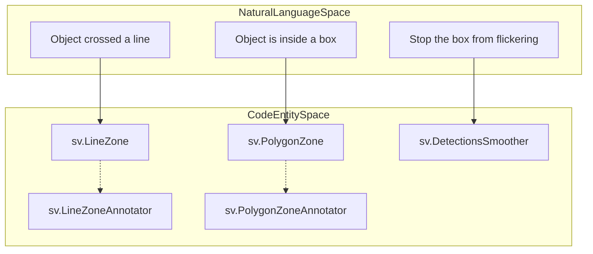
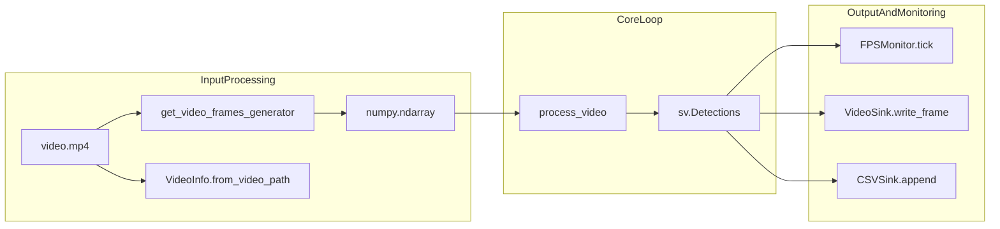

<!-- source: DeepWiki mcp.deepwiki.com · repo roboflow/supervision · page 3 Tools & Utilities · fetched 2026-10-30 -->

# Tools & Utilities

Relevant source files

The following files were used as context for generating this wiki page:

- [docs/utils/file.md](docs/utils/file.md)
- [docs/utils/image.md](docs/utils/image.md)
- [docs/utils/iterables.md](docs/utils/iterables.md)
- [docs/utils/notebook.md](docs/utils/notebook.md)
- [docs/utils/video.md](docs/utils/video.md)
- [src/supervision/__init__.py](src/supervision/__init__.py)
- [src/supervision/utils/conversion.py](src/supervision/utils/conversion.py)
- [src/supervision/utils/image.py](src/supervision/utils/image.py)
- [tests/utils/test_image.py](tests/utils/test_image.py)

This section provides an overview of the auxiliary tools and utilities provided by the Supervision library. These components are designed to work alongside core systems like `sv.Detections` and `sv.BaseAnnotator` to provide specialized capabilities for processing, analyzing, and managing visual data.

The tools and utilities are categorized into six main areas:
- **Zone Tools**: Counting and monitoring objects in specific spatial regions.
- **Drawing & Visualization**: Low-level primitives for rendering shapes, text, and colors.
- **Video & Image Processing**: Pipelines for frame manipulation and video I/O.
- **File & Asset Management**: Handling local files and downloading remote assets.
- **Inference Tools**: Enhancing model outputs with slicing, persistence, and format conversion.
- **OpenCV Compatibility Layer**: Ensuring execution even when OpenCV is optional or absent via pure-Python/Pillow fallbacks.

## Zone Tools (#3.1)

Supervision provides specialized tools for defining regions of interest and tracking object movement through them. These tools are essential for applications like traffic monitoring and people counting.

- **`LineZone`**: Counts objects crossing a predefined line, tracking "in" and "out" crossings using object `tracker_id` [supervision/detection/line_zone.py:23-315]().
- **`PolygonZone`**: Detects if objects are within a custom polygon region [supervision/detection/tools/polygon_zone.py:16-109]().
- **`DetectionsSmoother`**: Reduces bounding box jitter by averaging detections over a temporal window [supervision/detection/tools/smoother.py:12-124]().

For details, see [Zone Tools](#3.1).

Sources: [supervision/detection/line_zone.py](), [supervision/detection/tools/polygon_zone.py](), [supervision/detection/tools/smoother.py]()

## Drawing & Visualization (#3.2)

While the core annotation system provides high-level object visualization, the drawing utilities offer low-level control over rendering primitives.

- **Color Management**: `Color`, `ColorPalette`, and `ColorLookup` classes handle RGB/RGBA values, palettes, and hex strings [supervision/draw/color.py:15-188]().
- **Primitives**: Functions like `draw_line`, `draw_rectangle`, and `draw_polygon` allow for direct pixel manipulation [supervision/draw/utils.py:12-156]().
- **Dynamic Scaling**: `calculate_optimal_text_scale` and `calculate_optimal_line_thickness` automatically scale visual elements based on image resolution [supervision/draw/utils.py:186-224]().

For details, see [Drawing & Visualization](#3.2).

Sources: [supervision/draw/color.py](), [supervision/draw/utils.py]()

## Video & Image Processing (#3.3)

These utilities streamline the read-process-write loops common in computer vision workflows.

- **Video I/O**: `VideoInfo` retrieves metadata, while `VideoSink` handles encoded output streams [supervision/utils/video.py:13-176]().
- **Frame Generation**: `get_video_frames_generator` provides an efficient iterator for video files [supervision/utils/video.py:214-256]().
- **Image Manipulation**: Functions such as `crop_image`, `scale_image`, `resize_image`, and `letterbox_image` ensure input consistency [src/supervision/utils/image.py:134-204](), [docs/utils/image.md:9-37]().
- **Conversion & Display**: Utilities like `pillow_to_cv2`, `cv2_to_pillow` [src/supervision/utils/conversion.py:120-194](), and notebook plot helpers [docs/utils/notebook.md:5-17]() simplify inter-operability.

For details, see [Video & Image Processing](#3.3).

Sources: [src/supervision/utils/image.py](), [src/supervision/utils/conversion.py](), [docs/utils/image.md](), [docs/utils/video.md](), [docs/utils/notebook.md]()

## File & Asset Management (#3.4)

Supervision includes helpers for managing local file systems and accessing auxiliary resources.

- **File Discovery**: `list_files_with_extensions` simplifies batch processing across directories [docs/utils/file.md:8-11]().
- **Asset Downloader**: Methods to fetch example videos and images for testing and prototyping.
- **Iterables**: `create_batches` and `fill` helpers for managing data streams [docs/utils/iterables.md:8-17]().

For details, see [File & Asset Management](#3.4).

Sources: [docs/utils/file.md](), [docs/utils/iterables.md]()

## Inference Tools (#3.5)

These tools bridge the gap between raw model outputs and structured application data.

- **`InferenceSlicer`**: Implements Sliced Aided Hyper Inference (SAHI) for detecting small objects in high-resolution raster datasets and GeoTIFFs.
- **Data Sinks**: `CSVSink` and `JSONSink` provide structured persistence for detection metadata.
- **Transformers Helper**: Specialized logic for converting external model and transformer outputs into `sv.Detections`.

For details, see [Inference Tools](#3.5).

Sources: [src/supervision/__init__.py:54-60]()

## OpenCV Compatibility Layer (_cv2) (#3.6)

Supervision includes a vendored internal package, `src/supervision/_cv2`, which abstracts OpenCV dependencies. It provides pure-Python and Pillow-based fallbacks for drawing, text rendering, geometry, color space transformations, and contour operations when OpenCV is optional or unavailable.

For details, see [OpenCV Compatibility Layer (_cv2)](#3.6).

Sources: [src/supervision/_cv2]()

## System Architecture

The following diagrams illustrate how these utilities bridge the gap between high-level logic and code entities.

**Spatial Reasoning to Code Mapping**

Sources: [supervision/detection/line_zone.py](), [supervision/detection/tools/polygon_zone.py](), [supervision/detection/tools/smoother.py]()

**Data Flow & Processing Mapping**

Sources: [supervision/utils/video.py](), [docs/utils/video.md](), [docs/utils/image.md]()

## Summary

The **Tools & Utilities** layer provides the connective tissue of the Supervision library. While `sv.Detections` holds the data, these utilities provide the means to move that data through files, visualize it with precision, and analyze it within specific spatial or temporal contexts.

- **Zones** for spatial logic.
- **Draw** for visual primitives.
- **Video/Image** for I/O pipelines.
- **File/Asset** for management.
- **Inference** for advanced model execution.
- **_cv2** for robust dependency compatibility.

---

