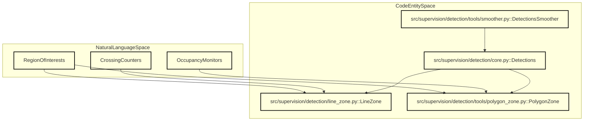
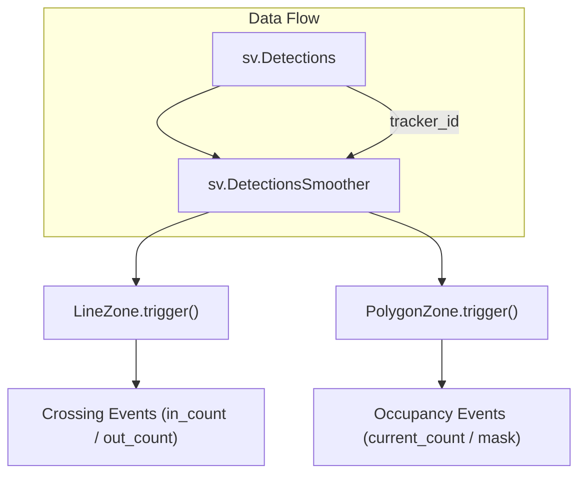
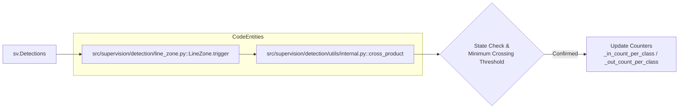
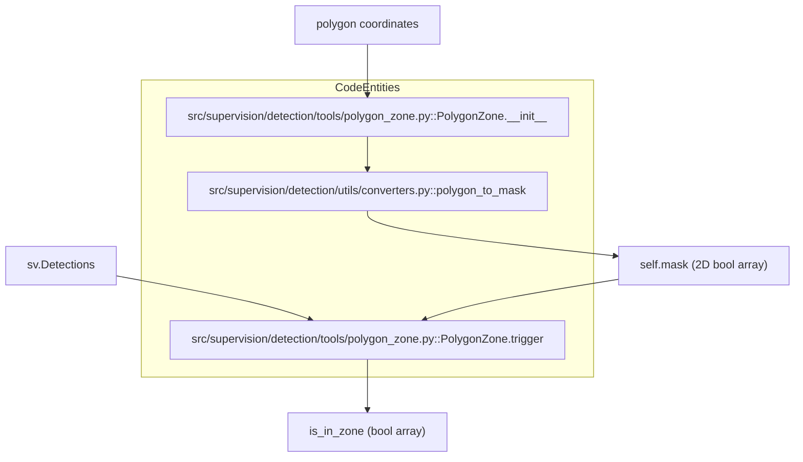
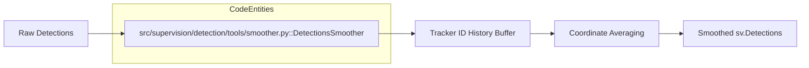

<!-- source: DeepWiki mcp.deepwiki.com · repo roboflow/supervision · page 3.1 Zone Tools · fetched 2026-10-30 -->

# Zone Tools

Relevant source files

The following files were used as context for generating this wiki page:

- [docs/detection/tools/inference_slicer.md](docs/detection/tools/inference_slicer.md)
- [docs/detection/tools/line_zone.md](docs/detection/tools/line_zone.md)
- [docs/detection/tools/polygon_zone.md](docs/detection/tools/polygon_zone.md)
- [docs/detection/tools/smoother.md](docs/detection/tools/smoother.md)
- [docs/keypoint/annotators.md](docs/keypoint/annotators.md)
- [docs/keypoint/core.md](docs/keypoint/core.md)
- [src/supervision/detection/line_zone.py](src/supervision/detection/line_zone.py)
- [src/supervision/detection/tools/polygon_zone.py](src/supervision/detection/tools/polygon_zone.py)
- [tests/detection/test_line_counter.py](tests/detection/test_line_counter.py)
- [tests/detection/test_polygonzone.py](tests/detection/test_polygonzone.py)

Zone tools in Supervision provide utilities for defining spatial regions of interest within video or image frames and detecting interactions between objects and these regions. These components are essential for analytics pipelines such as counting objects crossing boundaries, monitoring area occupancy, or measuring dwell times.

---

## Overview of Zone Tools Architecture

The architecture relies on the central `sv.Detections` pipeline, which coordinates with tracking modules (such as byte track or external trackers) and smoothing utilities to feed consistent bounding box features into zone classes (`PolygonZone` and `LineZone`). 

Sources: [src/supervision/detection/line_zone.py:23-155](), [src/supervision/detection/tools/polygon_zone.py:19-124]()

---

## LineZone

`LineZone` counts objects crossing a predefined linear vector in either direction (`in_count` versus `out_count`), maintaining separation by object classes.

### Key Components and Workflow

Sources: [src/supervision/detection/line_zone.py:89-200](), [src/supervision/detection/utils/internal.py:1-50]()

### Core Functionality & Parameters

- **`start` / `end`**: Defined via `sv.Point` instances to establish the vector line [src/supervision/detection/line_zone.py:90-92]().
- **`triggering_anchors`**: An iterable of `sv.Position` elements (defaulting to the four bounding box corners) evaluated for side-of-line positioning [src/supervision/detection/line_zone.py:93-98]().
- **`minimum_crossing_threshold`**: Specifies how many consecutive frames an object must remain on the opposite side to validate a confirmed crossing, filtering out boundary jitter [src/supervision/detection/line_zone.py:99-123]().

The primary method is `LineZone.trigger(detections: Detections)`, which updates internal queues per `tracker_id` and increments counters accordingly [src/supervision/detection/line_zone.py:128-200]().

Sources: [src/supervision/detection/line_zone.py:89-155]()

---

## PolygonZone

`PolygonZone` determines whether object detections fall inside a polygonal region defined by an array of vertices.

### Core Functionality & Implementation

Sources: [src/supervision/detection/tools/polygon_zone.py:77-161](), [src/supervision/detection/utils/converters.py:9-12]()

### Key Behavior and Rules

- **Validation**: `PolygonZone` validates that the input polygon has shape `(N, 2)` and contains at least `MIN_POLYGON_POINT_COUNT` vertices (defaulting to 3) to ensure a valid area is enclosed [src/supervision/detection/tools/polygon_zone.py:98-110]().
- **Anchor Calculation**: Anchors are calculated from unclipped detection boxes to prevent edge-clipping artifacts from misallocating objects across adjacent zones [src/supervision/detection/tools/polygon_zone.py:128-132]().
- **`require_all_anchors`**: Controls whether *all* specified `triggering_anchors` must fall within the polygon mask (`True`) or *any* anchor is sufficient (`False`) [src/supervision/detection/tools/polygon_zone.py:35-42]().

Sources: [src/supervision/detection/tools/polygon_zone.py:19-162]()

---

## DetectionsSmoother

`DetectionsSmoother` mitigates bounding box jitter across consecutive video frames, reducing false positive zone triggers caused by detector instability.

### Implementation Mechanics

The smoother tracks historical bounding box arrays per `tracker_id` using a sliding window buffer, returning averaged coordinates for each active identifier.

Sources: [src/supervision/detection/tools/smoother.py:1-115]()

---

## Integration Summary

| Component | Target Use Case | Primary Requirement | Main Attributes / Outputs |
| :--- | :--- | :--- | :--- |
| `LineZone` | Counting directional crossings | `tracker_id` | `in_count`, `out_count`, `in_count_per_class`, `out_count_per_class` [src/supervision/detection/line_zone.py:41-51]() |
| `PolygonZone` | Area occupancy & regional triggers | None (optional `tracker_id`) | `current_count`, `mask` [src/supervision/detection/tools/polygon_zone.py:43-44]() |
| `DetectionsSmoother` | Bounding box jitter reduction | `tracker_id` | Averaged `sv.Detections` coordinates [src/supervision/detection/tools/smoother.py:12-24]() |

Sources: [src/supervision/detection/line_zone.py:25-52](), [src/supervision/detection/tools/polygon_zone.py:20-45](), [src/supervision/detection/tools/smoother.py:12-24]()

---

