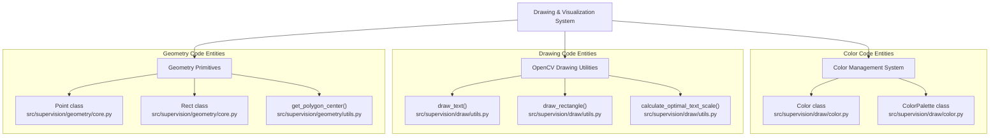
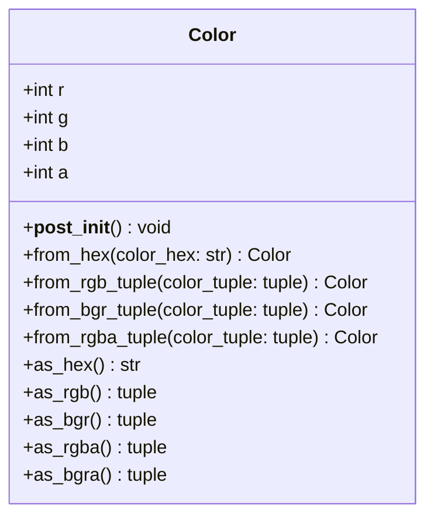
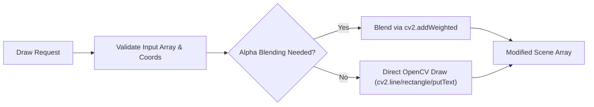

<!-- source: DeepWiki mcp.deepwiki.com · repo roboflow/supervision · page 3.2 Drawing & Visualization · fetched 2026-10-30 -->

# Drawing & Visualization

Relevant source files

The following files were used as context for generating this wiki page:

- [docs/utils/draw.md](docs/utils/draw.md)
- [docs/utils/geometry.md](docs/utils/geometry.md)
- [src/supervision/draw/color.py](src/supervision/draw/color.py)
- [src/supervision/geometry/core.py](src/supervision/geometry/core.py)
- [src/supervision/geometry/utils.py](src/supervision/geometry/utils.py)
- [src/supervision/utils/iterables.py](src/supervision/utils/iterables.py)
- [tests/draw/test_color.py](tests/draw/test_color.py)
- [tests/geometry/test_core.py](tests/geometry/test_core.py)
- [tests/geometry/test_utils.py](tests/geometry/test_utils.py)

The Drawing & Visualization system in Supervision provides a comprehensive set of foundational utilities for rendering shapes, text, colors, and geometry primitives onto computer vision image arrays. It underpins all high-level annotation pipelines, tracking visualizations, and zone counters across the library.

## 1. System Overview & Code Mapping

The following diagram and mapping table bridge natural language concepts to their precise code entities within the Supervision repository.

| Natural Language Concept | Code Entity & Path | Role & Description |
| :--- | :--- | :--- |
| **Color & RGBA Hex** | `Color` `[src/supervision/draw/color.py:66-103]()` | Dataclass representing RGBA channels with 3, 4, 6, and 8-digit hex parsing. |
| **Palette Collection** | `ColorPalette` `[src/supervision/draw/color.py:270-354]()` | Manages predefined or custom lists of `Color` instances with modulo index wrapping. |
| **Shape & Text Rendering** | `draw_text`, `draw_rectangle` `[src/supervision/draw/utils.py:14-281]()` | Functional wrappers around OpenCV with built-in padding, opacity, and BGR conversion. |
| **Dynamic Scaling** | `calculate_optimal_text_scale` `[src/supervision/draw/utils.py:346-459]()` | Resolution-aware scalar calculators for consistent text sizing and line thickness across varying image dimensions. |
| **Geometry Primitives** | `Point`, `Rect`, `Vector`, `Position` `[src/supervision/geometry/core.py:8-198]()` | Spatial containers and helpers for coordinates, bounding boxes, and centroids. |

Sources: `[src/supervision/draw/color.py:66-354]()`, `[src/supervision/draw/utils.py:14-459]`, `[src/supervision/geometry/core.py:8-198]()`, `[src/supervision/geometry/utils.py:7-55]()`

---

## 2. Color System & RGBA Hex Support

The color system is implemented in `[src/supervision/draw/color.py]()`. It standardizes color handling through the `Color` dataclass, supporting channel validations, tuple conversions, and robust hex string parsing.

### 2.1 The `Color` Class
The `Color` dataclass stores red (`r`), green (`g`), blue (`b`), and alpha (`a`) channels as 8-bit integers (`0-255`), defaulting to fully opaque (`a = 255`) `[src/supervision/draw/color.py:64-103]()`.

- **Hex Support (`from_hex`)**: Supports 3-digit (`#RGB`), 4-digit (`#RGBA`), 6-digit (`#RRGGBB`), and 8-digit (`#RRGGBBAA`) hex strings `[src/supervision/draw/color.py:116-155]()`. Short codes duplicate each character (e.g., `#f0f8` expands to `#ff00ff88`).
- **OpenCV Conversions**: Methods like `as_bgr()` and `as_bgra()` output tuples formatted for direct ingestion by OpenCV functions (`cv2.putText`, `cv2.rectangle`, etc.).

Sources: `[src/supervision/draw/color.py:64-228]`, `[tests/draw/test_color.py:10-103]()`

### 2.2 `ColorPalette` & `ColorLookup`
`ColorPalette` groups multiple `Color` instances to colorize detections by class ID, tracking ID, or index `[src/supervision/draw/color.py:270-354]()`. 
- **`by_idx(idx)`**: Safely indexes into the palette using modulo arithmetic (`idx % len(self.colors)`), preventing out-of-bounds exceptions when classes or tracks exceed palette length `[src/supervision/draw/utils.py]` / `[src/supervision/draw/color.py:339-354]()`.

Sources: `[src/supervision/draw/color.py:270-424]()`

---

## 3. Drawing Utilities & Primitives

Low-level drawing operations wrap OpenCV functions while adding conveniences such as auto-calculated padding, alpha blending via `cv2.addWeighted`, and robust type checking `[src/supervision/draw/utils.py:14-281]()`.

### 3.1 Shape & Text Functions

- **`draw_rectangle` & `draw_filled_rectangle`**: Renders bounding box outlines or filled boxes `[src/supervision/draw/utils.py:44-111]()`. Filled variants support transparency via an `opacity` parameter.
- **`draw_text`**: Renders text anchored to a given `Point` with optional background rectangle, padding, and text scaling `[src/supervision/draw/utils.py:218-281]()`.

Sources: `[src/supervision/draw/utils.py:14-281]()`

---

## 4. Dynamic Text Scale, Line Thickness, and Geometry

To ensure visual elements scale gracefully across diverse input resolutions (e.g., standard definition streams vs. 4K camera feeds), Supervision provides resolution-dependent scaling utilities `[src/supervision/draw/utils.py:346-459]()`.

### 4.1 Dynamic Scaling Functions
- **`calculate_optimal_text_scale` / `calculate_optimal_line_thickness`**: Computes text scales and line thicknesses proportional to image dimensions (typically referencing the image diagonal or resolution bounds) `[src/supervision/draw/utils.py:346-459]()`.

### 4.2 Geometry Primitives
Supporting spatial calculations for drawings and zone placement are defined in `[src/supervision/geometry/core.py]()` and `[src/supervision/geometry/utils.py]()`:
- **`Point`**: Represents 2D coordinates `(x, y)` with conversion helpers `as_xy_int_tuple()` `[src/supervision/geometry/core.py:28-66]()`.
- **`Rect`**: Represents bounding boxes with `top_left`, `bottom_right`, and `pad()` methods `[src/supervision/geometry/core.py:137-198]()`.
- **`Vector`**: Computes vector magnitude, center, and cross-products for line crossing tasks `[src/supervision/geometry/core.py:69-135]()`.
- **`get_polygon_center`**: Computes the true solid figure centroid (center of mass) of polygon vertices using signed polygon area algorithms, avoiding integer overflows and deprecated NumPy methods `[src/supervision/geometry/utils.py:7-55]()`.

Sources: `[src/supervision/draw/utils.py:346-459]()`, `[src/supervision/geometry/core.py:8-198]()`, `[src/supervision/geometry/utils.py:7-55]()`, `[tests/geometry/test_utils.py:36-135]()`

---

