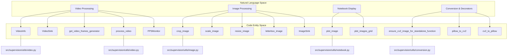
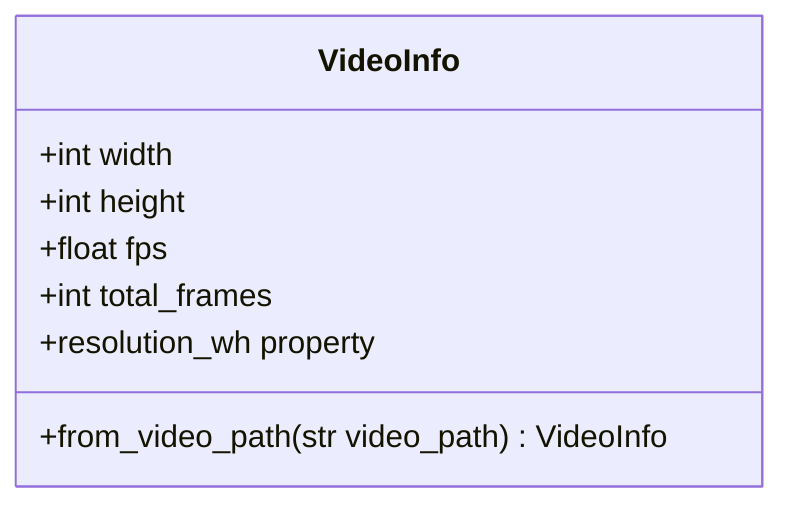
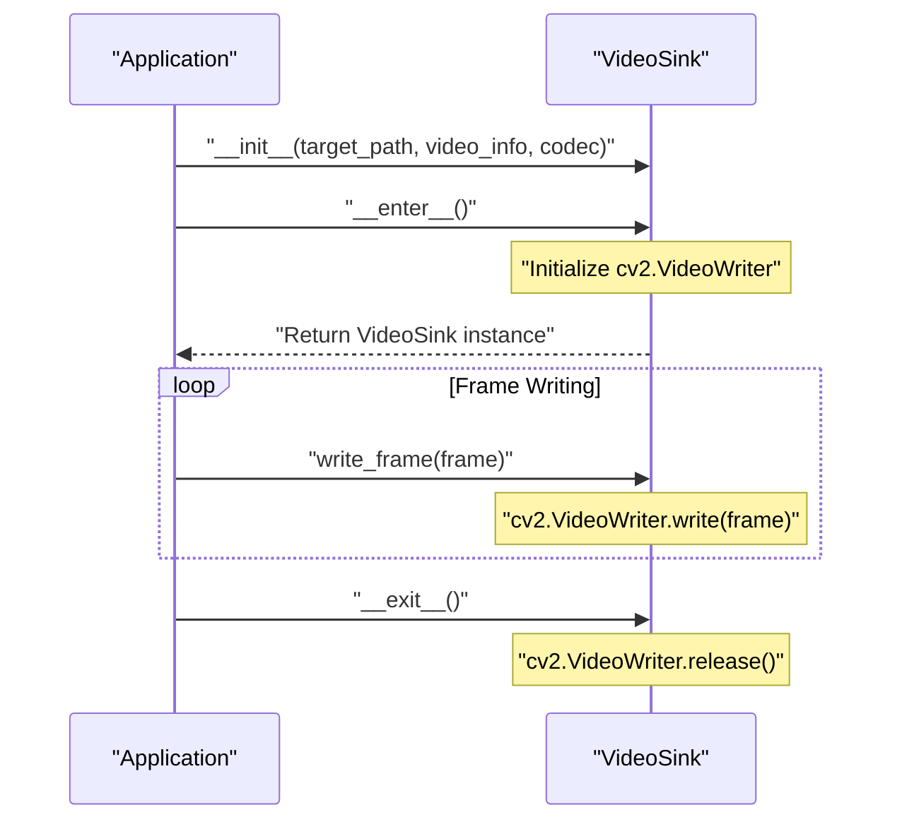

<!-- source: DeepWiki mcp.deepwiki.com · repo roboflow/supervision · page 3.3 Video & Image Processing · fetched 2026-10-30 -->

# Video & Image Processing

Relevant source files

The following files were used as context for generating this wiki page:

- [src/supervision/__init__.py](src/supervision/__init__.py)
- [src/supervision/_cv2/_video.py](src/supervision/_cv2/_video.py)
- [src/supervision/utils/conversion.py](src/supervision/utils/conversion.py)
- [src/supervision/utils/image.py](src/supervision/utils/image.py)
- [src/supervision/utils/notebook.py](src/supervision/utils/notebook.py)
- [src/supervision/utils/video.py](src/supervision/utils/video.py)
- [tests/cv2/test_video.py](tests/cv2/test_video.py)
- [tests/utils/test_conversion.py](tests/utils/test_conversion.py)
- [tests/utils/test_image.py](tests/utils/test_image.py)
- [tests/utils/test_notebook.py](tests/utils/test_notebook.py)
- [tests/utils/test_video.py](tests/utils/test_video.py)

This document covers the video and image processing utilities provided by the Supervision library. These utilities help developers efficiently work with multimedia data for computer vision tasks, offering streamlined methods for reading, transforming, processing, and saving video and image content.

For information about file operations and asset handling, see [File & Asset Management](#3.4).

## Overview

The Video & Image Processing utilities in Supervision provide core functionality for handling multimedia data that serves as a foundation for computer vision pipelines. These utilities are designed to work seamlessly with other components in the Supervision ecosystem, integrating OpenCV-backed operations with pure-Python fallbacks and flexible format conversion decorators.

### System Mapping: Utilities to Code Entities

The following diagram bridges the high-level utility concepts to the specific classes and functions implemented in the codebase.

Sources: [src/supervision/utils/video.py:23-165](), [src/supervision/utils/image.py:133-202](), [src/supervision/utils/notebook.py:10-121](), [src/supervision/utils/conversion.py:43-67]()

## Video Processing

### VideoInfo

The `VideoInfo` class is a dataclass that stores essential metadata about a video file, including width, height, fps, and total number of frames [src/supervision/utils/video.py:23-54](). It includes a class method `from_video_path` to read metadata directly from a file path using OpenCV [src/supervision/utils/video.py:55-83]().

Sources: [src/supervision/utils/video.py:23-88]()

### VideoSink

The `VideoSink` class acts as a context manager that saves video frames to a file using OpenCV's `VideoWriter` [src/supervision/utils/video.py:89-165](). It handles codec configuration via FOURCC integers and ensures correct resource cleanup upon exiting the context [src/supervision/utils/video.py:120-165]().

Sources: [src/supervision/utils/video.py:89-165]()

### Frame Generation and Seeking

The `get_video_frames_generator` function yields frames from a video source. It supports parameters like `stride` for skipping frames, `start` and `end` bounds, and `iterative_seek` for handling files where direct seeking via `cv2.CAP_PROP_POS_FRAMES` is unreliable [src/supervision/utils/video.py:193-210](). For environments lacking full OpenCV video backends, PyAV-backed fallbacks in `src/supervision/_cv2/_video.py` provide robust decoding and rotation correction [src/supervision/_cv2/_video.py:76-177]().

Sources: [src/supervision/utils/video.py:167-210](), [src/supervision/_cv2/_video.py:76-177]()

### Asynchronous Video Processing

The `process_video` function implements a threaded pipeline to maximize throughput by concurrently reading frames, executing a user callback, and writing output frames through dedicated queues [src/supervision/utils/video.py:212-250]().

Sources: [src/supervision/utils/video.py:212-250](), [tests/utils/test_video.py:100-194]()

### Performance Monitoring

The `FPSMonitor` class tracks processing speed by maintaining a rolling window of execution timestamps.

Sources: [src/supervision/utils/video.py:158]()

## Image Processing

Supervision provides standalone utility functions for image manipulation, optimized for computer vision workloads such as region extraction, normalization, and resizing.

| Function | Purpose |
| :--- | :--- |
| `crop_image` | Extracts a bounding box region (`xyxy`) from an OpenCV or PIL image [src/supervision/utils/image.py:133-202]() |
| `scale_image` | Resizes an image by a scale factor |
| `resize_image` | Resizes an image to exact dimensions |
| `letterbox_image` | Resizes an image while preserving aspect ratio and adding padding |
| `ImageSink` | Saves sequential image frames to disk |
| `load_image_from_url` | Downloads and decodes images from HTTP URLs with local caching [src/supervision/utils/image.py:59-131]() |

Sources: [src/supervision/utils/image.py:59-202](), [src/supervision/__init__.py:144-154]()

## Conversion Decorators & Utilities

To bridge NumPy arrays (OpenCV BGR format) and Pillow images (`PIL.Image.Image`), Supervision provides robust conversion functions and decorators [src/supervision/utils/conversion.py:1-194]().

- `pillow_to_cv2`: Converts Pillow images to OpenCV format, handling palette expansion and RGB-to-BGR reordering [src/supervision/utils/conversion.py:120-155]().
- `cv2_to_pillow`: Converts OpenCV arrays to Pillow format, handling channel reordering from BGR(A) to RGB(A) [src/supervision/utils/conversion.py:157-194]().
- `ensure_cv2_image_for_standalone_function`: A decorator that automatically transparently converts non-NumPy image inputs (such as `PIL.Image.Image`) into OpenCV arrays for processing and converts them back [src/supervision/utils/conversion.py:43-67]().

Sources: [src/supervision/utils/conversion.py:1-194]()

## Notebook Display Helpers

For visualization within Jupyter environments, display helpers integrate `matplotlib` while keeping heavy plotting dependencies lazy [src/supervision/utils/notebook.py:1-121]().

- `plot_image`: Plots a single image (NumPy array or `PIL.Image.Image`), automatically converting BGR arrays to RGB for correct color reproduction [src/supervision/utils/notebook.py:10-50]().
- `plot_images_grid`: Plots a list of images in a multi-row/multi-column grid layout [src/supervision/utils/notebook.py:52-121]().

Sources: [src/supervision/utils/notebook.py:1-121]()

## Summary

The Video & Image Processing utilities in Supervision provide essential capabilities for building end-to-end computer vision pipelines:
1. Managing video streams and metadata via `VideoInfo` [src/supervision/utils/video.py:23-88]().
2. Writing frames with `VideoSink` [src/supervision/utils/video.py:89-165]().
3. Multithreaded frame processing with `process_video` [src/supervision/utils/video.py:212-250]().
4. Image manipulation via `crop_image`, `letterbox_image`, and related utilities [src/supervision/utils/image.py:133-202]().
5. Format interoperability via `pillow_to_cv2`, `cv2_to_pillow`, and wrapper decorators [src/supervision/utils/conversion.py:43-194]().
6. Notebook visualization using `plot_image` and `plot_images_grid` [src/supervision/utils/notebook.py:10-121]().

---

