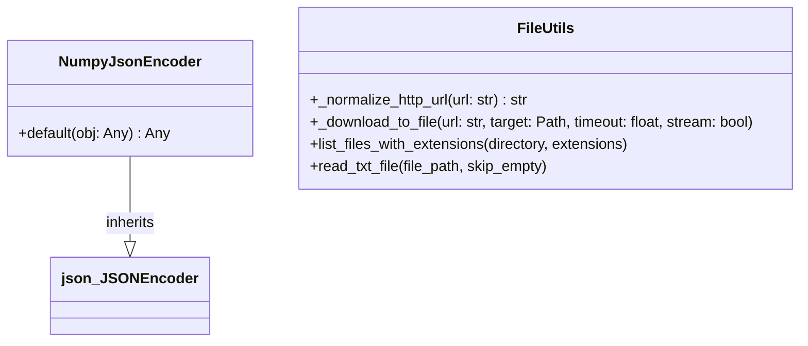
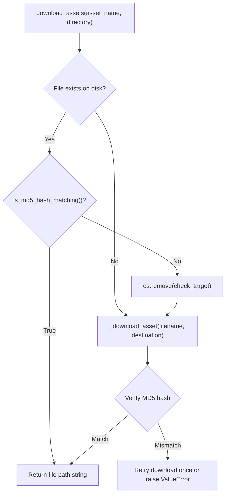

<!-- source: DeepWiki mcp.deepwiki.com · repo roboflow/supervision · page 3.4 File & Asset Management · fetched 2026-10-30 -->

# File & Asset Management

<details>
<summary>Relevant source files</summary>

The following files were used as context for generating this wiki page:

- [docs/assets.md](docs/assets.md)
- [docs/metrics/common_values.md](docs/metrics/common_values.md)
- [docs/metrics/f1_score.md](docs/metrics/f1_score.md)
- [docs/metrics/mean_average_precision.md](docs/metrics/mean_average_precision.md)
- [docs/metrics/mean_average_recall.md](docs/metrics/mean_average_recall.md)
- [docs/metrics/precision.md](docs/metrics/precision.md)
- [docs/metrics/recall.md](docs/metrics/recall.md)
- [src/supervision/assets/downloader.py](src/supervision/assets/downloader.py)
- [src/supervision/geometry/utils.py](src/supervision/geometry/utils.py)
- [src/supervision/utils/file.py](src/supervision/utils/file.py)
- [src/supervision/utils/iterables.py](src/supervision/utils/iterables.py)
- [tests/assets/test_downloader.py](tests/assets/test_downloader.py)
- [tests/geometry/test_utils.py](tests/geometry/test_utils.py)
- [tests/utils/test_file.py](tests/utils/test_file.py)

</details>


This page provides full technical documentation for the file operation utilities, asset management downloader, iterables helpers, and geometry utilities in Supervision. These components provide the underlying foundation for input/output handling, downloading sample media for demos and testing, and batch processing data.

## System Overview

The File & Asset Management subsystem supports the core computer vision pipeline by supplying helpers for reading/writing persistence data, downloading verified media assets, segmenting batch streams, and performing robust geometric calculations.

```mermaid
flowchart TD
    subgraph "File & Asset Management System"
        direction TB
        A["File Utilities Module"] --> A1["src/supervision/utils/file.py"]
        B["Asset Downloader Module"] --> B1["src/supervision/assets/downloader.py"]
        C["Iterables Helpers Module"] --> C1["src/supervision/utils/iterables.py"]
        D["Geometry Utilities Module"] --> D1["src/supervision/geometry/utils.py"]
    end
    
    subgraph "Natural Language to Code Entity Space"
        direction LR
        "Normalize URL" --> _normalize_http_url["_normalize_http_url()"]
        "Atomic Download" --> _download_to_file["_download_to_file()"]
        "Match MD5 Hash" --> is_md5_hash_matching["is_md5_hash_matching()"]
        "Download Asset" --> download_assets["download_assets()"]
    end

    A1 --> _normalize_http_url
    A1 --> _download_to_file
    B1 --> is_md5_hash_matching
    B1 --> download_assets
```

Sources: [src/supervision/utils/file.py:1-100](), [src/supervision/assets/downloader.py:1-75](), [src/supervision/utils/iterables.py:1-40](), [src/supervision/geometry/utils.py:1-55]()

## File Utilities

The file utilities module (`src/supervision/utils/file.py`) supplies robust, atomic helpers for downloading files over HTTP/HTTPS, serializing NumPy data types to JSON, scanning directories, and reading text files.

### Key Functions and Classes

- **`_normalize_http_url(url: str) -> str`**: Validates that a given URL uses either `http` or `https` schemes, strips malformed structures, and prepares a standard request URL [src/supervision/utils/file.py:16-50]().
- **`_download_to_file(url: str, target: Path, *, timeout: float = 30.0, stream: bool = False) -> None`**: Downloads a file atomically using a temporary file created in the target directory via `tempfile.NamedTemporaryFile` and finalizes it with `os.replace` to prevent corrupted partial files [src/supervision/utils/file.py:53-99]().
- **`NumpyJsonEncoder`**: A custom `json.JSONEncoder` subclass that handles `np.integer`, `np.floating`, and `np.ndarray` conversion [src/supervision/utils/file.py:101-110]().
- **`list_files_with_extensions(directory: str | Path, extensions: list[str] | None = None) -> list[Path]`**: Gathers file paths from a directory, supporting case-insensitive extension matching, leading dot normalization, and multi-part extensions (e.g., `tar.gz`) [src/supervision/utils/file.py:112-178]().
- **`read_txt_file(file_path: str | Path, skip_empty: bool = False) -> list[str]`**: Reads text files line-by-line, optionally omitting empty or whitespace-only lines [src/supervision/utils/file.py:181-192]().



Sources: [src/supervision/utils/file.py:16-192]()

## Asset Management & Downloader

The assets subsystem (`src/supervision/assets/downloader.py`) handles fetching, caching, and verifying demonstration videos and images from remote servers.

### Integrity Verification & Downloading Workflow

Assets are cataloged with expected MD5 hashes to prevent silent corruption during transfers. 
- **`is_md5_hash_matching(filename: str | Path, original_md5_hash: str) -> bool`**: Computes the MD5 hash of an existing file (using `usedforsecurity=False`) and verifies equality against the cataloged hash [src/supervision/assets/downloader.py:12-33]().
- **`download_assets(asset_name: Assets | str, directory: str | Path | None = None) -> str`**: Fetches the specified asset, verifies its integrity, handles auto-retry upon corruption, and saves it either to a custom directory or the current working directory [src/supervision/assets/downloader.py:69-134]().



Sources: [src/supervision/assets/downloader.py:12-134]()

## Iterables & Geometry Utilities

### Iterable Helpers

Located in `src/supervision/utils/iterables.py`, these generator and sequence helpers structure batches and pad sequences:

- **`create_batches(sequence: Iterable[V], batch_size: int) -> Generator[list[V], None, None]`**: Yields chunks of items from an input sequence up to `batch_size` [src/supervision/utils/iterables.py:7-41]().
- **`fill(sequence: list[V], desired_size: int, content: V) -> list[V]`**: Pads a list with `content` until it satisfies `desired_size` [src/supervision/utils/iterables.py:43-71]().
- **`find_duplicates(sequence: list[V]) -> list[V]`**: Scans a list for non-unique items and returns them [src/supervision/utils/iterables.py:73-99]().

### Geometry Utilities

Located in `src/supervision/geometry/utils.py`, spatial helpers calculate geometric centroids:

- **`get_polygon_center(polygon: npt.NDArray[np.number]) -> Point`**: Computes the center (centroid) of a solid polygon using signed area-weighted triangle centroids, robust against overflow and precision issues [src/supervision/geometry/utils.py:7-55]().

```mermaid
flowchart TD
    subgraph "Natural Language to Code Entity Space - Iterables & Geometry"
        direction LR
        "Create Batches" --> create_batches["create_batches()"]
        "Pad Sequence" --> fill["fill()"]
        "Find Duplicates" --> find_duplicates["find_duplicates()"]
        "Get Centroid" --> get_polygon_center["get_polygon_center()"]
    end
```

Sources: [src/supervision/utils/iterables.py:7-99](), [src/supervision/geometry/utils.py:7-55]()

---

