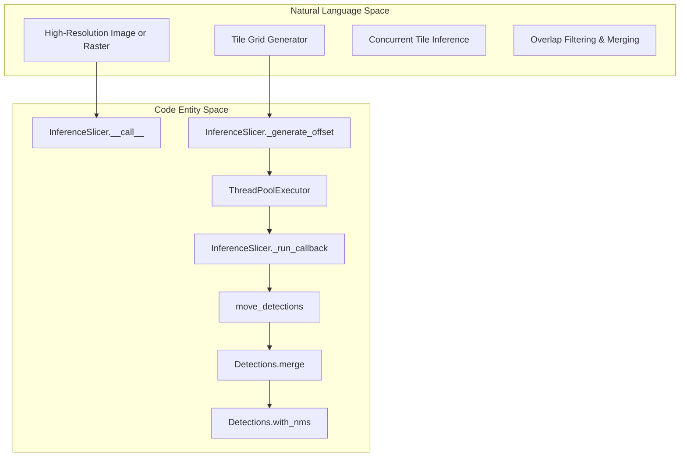
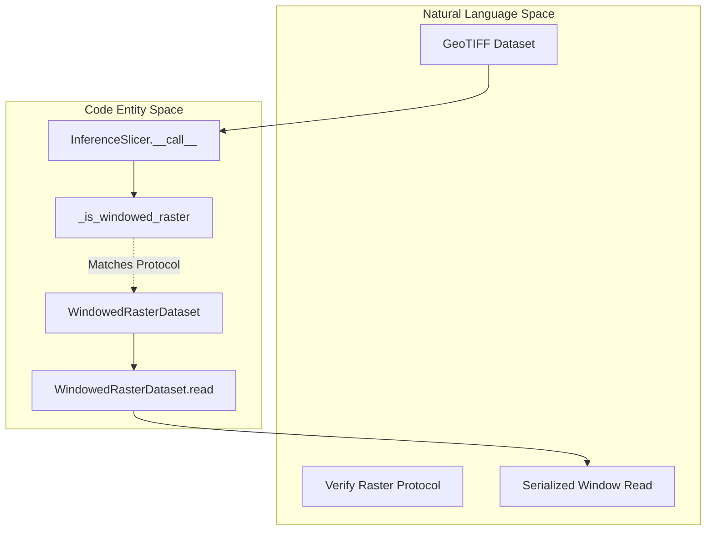

<!-- source: DeepWiki mcp.deepwiki.com · repo roboflow/supervision · page 3.5 Inference Tools · fetched 2026-10-30 -->

# Inference Tools

Relevant source files

The following files were used as context for generating this wiki page:

- [src/supervision/config.py](src/supervision/config.py)
- [src/supervision/detection/tools/csv_sink.py](src/supervision/detection/tools/csv_sink.py)
- [src/supervision/detection/tools/inference_slicer.py](src/supervision/detection/tools/inference_slicer.py)
- [src/supervision/detection/tools/json_sink.py](src/supervision/detection/tools/json_sink.py)
- [src/supervision/detection/tools/transformers.py](src/supervision/detection/tools/transformers.py)
- [tests/detection/test_csv.py](tests/detection/test_csv.py)
- [tests/detection/test_json.py](tests/detection/test_json.py)
- [tests/detection/tools/__init__.py](tests/detection/tools/__init__.py)
- [tests/detection/tools/test_inference_slicer.py](tests/detection/tools/test_inference_slicer.py)
- [tests/detection/tools/test_inference_slicer_geotiff.py](tests/detection/tools/test_inference_slicer_geotiff.py)
- [tests/detection/tools/test_transformers.py](tests/detection/tools/test_transformers.py)

## Overview

Inference Tools in Supervision provide specialized utilities to enhance the performance, scalability, and serialization of object detection and segmentation workflows. These tools address challenges such as detecting small objects in high-resolution imagery via Slicing Adaptive Inference (`InferenceSlicer`), reading large GeoTIFF rasters via windowed datasets (`WindowedRasterDataset`), managing memory efficiently with `CompactMask`, processing Hugging Face `transformers` outputs, and exporting detection results using `CSVSink` and `JSONSink`.

Sources: [src/supervision/detection/tools/inference_slicer.py:30-153](), [src/supervision/detection/tools/csv_sink.py:31-73](), [src/supervision/detection/tools/json_sink.py:13-48](), [src/supervision/detection/tools/transformers.py:14-106]()

---

## InferenceSlicer (SAHI) & GeoTIFF Support

The `InferenceSlicer` class implements Slicing Adaptive Inference (SAHI) to divide large images into overlapping patches, execute inference callbacks in parallel or sequentially, and merge the resulting detections [src/supervision/detection/tools/inference_slicer.py:106-153]().

### Implementation Architecture

Sources: [src/supervision/detection/tools/inference_slicer.py:60-103](), [src/supervision/detection/tools/inference_slicer.py:106-153]()

### Windowed Raster Dataset (GeoTIFF) Integration

`InferenceSlicer` supports rasterio-style datasets directly without forcing a dense numpy array materialization of massive aerial/satellite imagery. This is achieved via structural duck-typing rather than hard dependencies on `rasterio`.

*   **`WindowedRasterDataset` Protocol**: Defines the structural interface (`width`, `height`, `crs`, and `read(window)`) expected of raster datasets [src/supervision/detection/tools/inference_slicer.py:30-43]().
*   **`_is_windowed_raster`**: Duck-type validator function that checks for raster attributes without importing `rasterio` at runtime [src/supervision/detection/tools/inference_slicer.py:45-56]().
*   **Thread Safety**: When passing a raster dataset, tile reads are serialized via an internal lock to prevent race conditions during file handle reads, while model inference continues to execute concurrently [src/supervision/detection/tools/inference_slicer.py:141-147]().

Sources: [src/supervision/detection/tools/inference_slicer.py:30-57](), [src/supervision/detection/tools/inference_slicer.py:141-147]()

### Configuration Flags in Inference

`InferenceSlicer` and related utilities rely on global metadata/data configuration keys defined in `src/supervision/config.py`:
*   `SOURCE_IMAGE_METADATA_FIELD`: Temporarily stores source image references during slicing workflows [src/supervision/config.py:13-23]().
*   `ORIENTED_BOX_COORDINATES` (`xyxyxyxy`): Stores oriented bounding box corner coordinates; when detected in the first slice result, `InferenceSlicer` automatically falls back to sequential processing to maintain thread safety across OBB backends [src/supervision/config.py:24-34](), [src/supervision/detection/tools/inference_slicer.py:141-147]().

Sources: [src/supervision/config.py:1-34](), [src/supervision/detection/tools/inference_slicer.py:141-147]()

---

## CompactMask Integration

`CompactMask` stores segmentation masks as Run-Length Encodings (RLE) of their bounding-box crops rather than full-image boolean arrays, preventing massive memory overhead during tiled inference [src/supervision/detection/compact_mask.py:1-10]().

When `compact_masks=True` is passed to `InferenceSlicer`, dense slice masks are immediately compressed into `CompactMask` instances, shifted via `CompactMask.with_offset()`, and merged efficiently without expanding dense arrays [src/supervision/detection/tools/inference_slicer.py:151-153](), [src/supervision/detection/tools/inference_slicer.py:92-98]().

Sources: [src/supervision/detection/compact_mask.py:1-10](), [src/supervision/detection/tools/inference_slicer.py:92-98](), [src/supervision/detection/tools/inference_slicer.py:151-153]()

---

## Serialization Sinks (`CSVSink` & `JSONSink`)

`CSVSink` and `JSONSink` provide context-manager-backed serialization utilities for writing detection results and custom metadata to disk [src/supervision/detection/tools/csv_sink.py:31-99](), [src/supervision/detection/tools/json_sink.py:13-70]().

*   **Broadcasting and Slicing**: Both classes implement `parse_detection_data()` and `_slice_value()` to handle custom attributes. If a sequence length matches the detection count, it maps 1:1 to rows; otherwise, it broadcasts across all rows [src/supervision/detection/tools/csv_sink.py:135-190](), [src/supervision/detection/tools/json_sink.py:117-184]().
*   **JSON Serialization Hook**: `JSONSink` defines `_json_default()` to serialize NumPy scalars (`.item()`) and arrays (`.tolist()`) cleanly [src/supervision/detection/tools/json_sink.py:82-104]().

Sources: [src/supervision/detection/tools/csv_sink.py:31-190](), [src/supervision/detection/tools/json_sink.py:13-184]()

---

## Transformers Helpers

Supervision includes helper utilities in `src/supervision/detection/tools/transformers.py` to map Hugging Face `transformers` detection and segmentation outputs (such as DETR, Mask2Former, and Grounding DINO) directly into standard `sv.Detections` formats [src/supervision/detection/tools/transformers.py:14-106]().

*   `process_transformers_detection_result()`: Extracts `boxes`, `scores`, and `labels`, mapping class names via `id2label` [src/supervision/detection/tools/transformers.py:14-39]().
*   `process_transformers_v4_segmentation_result()` & `process_transformers_v5_segmentation_result()`: Handle semantic, instance, and panoptic segmentation outputs, converting mask tensors and segment maps into standard boolean stacks and bounding box coordinates [src/supervision/detection/tools/transformers.py:42-106]().

Sources: [src/supervision/detection/tools/transformers.py:14-106]()

---

## Summary Table

| Tool / Class | Primary Purpose | Key File & Class/Function |
|--------------|-----------------|---------------------------|
| **InferenceSlicer** | Tiled high-resolution inference (SAHI) | `src/supervision/detection/tools/inference_slicer.py:InferenceSlicer` [src/supervision/detection/tools/inference_slicer.py:106]() |
| **WindowedRasterDataset** | Duck-typed GeoTIFF windowed reads | `src/supervision/detection/tools/inference_slicer.py:WindowedRasterDataset` [src/supervision/detection/tools/inference_slicer.py:30]() |
| **CSVSink** | Row-by-row CSV detection export | `src/supervision/detection/tools/csv_sink.py:CSVSink` [src/supervision/detection/tools/csv_sink.py:31]() |
| **JSONSink** | Structured JSON detection export | `src/supervision/detection/tools/json_sink.py:JSONSink` [src/supervision/detection/tools/json_sink.py:13]() |
| **Transformers Helpers** | HF Transformers output adaptation | `src/supervision/detection/tools/transformers.py:process_transformers_detection_result` [src/supervision/detection/tools/transformers.py:14]() |

Sources: [src/supervision/detection/tools/inference_slicer.py:30-106](), [src/supervision/detection/tools/csv_sink.py:31](), [src/supervision/detection/tools/json_sink.py:13](), [src/supervision/detection/tools/transformers.py:14]()

---

