<!-- source: DeepWiki mcp.deepwiki.com · repo roboflow/supervision · page 3.6 OpenCV Compatibility Layer (_cv2) · fetched 2026-10-30 -->

# OpenCV Compatibility Layer (_cv2)

<details>
<summary>Relevant source files</summary>

The following files were used as context for generating this wiki page:

- [.github/scripts/verify_clean_wheel.py](.github/scripts/verify_clean_wheel.py)
- [docs/how_to/opencv_migration.md](docs/how_to/opencv_migration.md)
- [src/supervision/_cv2/__init__.py](src/supervision/_cv2/__init__.py)
- [src/supervision/_cv2/_color.py](src/supervision/_cv2/_color.py)
- [src/supervision/_cv2/_common.py](src/supervision/_cv2/_common.py)
- [src/supervision/_cv2/_components.py](src/supervision/_cv2/_components.py)
- [src/supervision/_cv2/_contours.py](src/supervision/_cv2/_contours.py)
- [src/supervision/_cv2/_drawing.py](src/supervision/_cv2/_drawing.py)
- [src/supervision/_cv2/_geometry.py](src/supervision/_cv2/_geometry.py)
- [src/supervision/_cv2/_image.py](src/supervision/_cv2/_image.py)
- [src/supervision/_cv2/_text.py](src/supervision/_cv2/_text.py)
- [src/supervision/_cv2/_transform.py](src/supervision/_cv2/_transform.py)
- [src/supervision/_cv2/constants.py](src/supervision/_cv2/constants.py)
- [tests/cv2/installed_wheel_fallback_manifest.txt](tests/cv2/installed_wheel_fallback_manifest.txt)
- [tests/cv2/test_color.py](tests/cv2/test_color.py)
- [tests/cv2/test_components.py](tests/cv2/test_components.py)
- [tests/cv2/test_constants.py](tests/cv2/test_constants.py)
- [tests/cv2/test_contours.py](tests/cv2/test_contours.py)
- [tests/cv2/test_cv2.py](tests/cv2/test_cv2.py)
- [tests/cv2/test_drawing.py](tests/cv2/test_drawing.py)
- [tests/cv2/test_geometry.py](tests/cv2/test_geometry.py)
- [tests/cv2/test_image.py](tests/cv2/test_image.py)
- [tests/cv2/test_integration.py](tests/cv2/test_integration.py)
- [tests/cv2/test_text.py](tests/cv2/test_text.py)
- [tests/cv2/test_transform.py](tests/cv2/test_transform.py)
- [tests/utils/test_sinks.py](tests/utils/test_sinks.py)

</details>


The `src/supervision/_cv2` package provides an optional OpenCV dependency layer for Supervision. Its primary purpose is to allow Supervision to function without a hard dependency on `opencv-python` or `opencv-python-headless`, while still leveraging OpenCV's capabilities when available. This is achieved through a facade pattern that dynamically loads OpenCV functions if the library is installed, or falls back to pure-Python/Pillow implementations otherwise. This design ensures that Supervision remains lightweight and flexible, catering to environments where OpenCV might be undesirable or unavailable.

Sources:
- [src/supervision/_cv2/__init__.py:1-3]()
- [docs/how_to/opencv_migration.md:7-9]()

## Architecture and Fallback Mechanism

The `_cv2` package acts as a compatibility layer. When Supervision is imported, it attempts to import `cv2` (OpenCV).
If `cv2` is successfully imported, Supervision uses the native OpenCV functions.
If `cv2` cannot be imported (due to `ImportError` or `OSError`), Supervision automatically switches to its pure-Python fallback implementations. A warning is issued in this case to inform the user about the fallback.
This dynamic selection happens once at import time and persists for the lifetime of the process.

The `_cv2.BACKEND_NAME` attribute can be used to verify which backend is active (`"opencv"` or `"fallback"`). This is primarily for diagnostic purposes and not intended for application API use.

Sources:
- [src/supervision/_cv2/__init__.py:83-88]()
- [src/supervision/_cv2/__init__.py:156-166]()
- [docs/how_to/opencv_migration.md:36-43]()

### Backend Selection Flow

```mermaid
graph TD
    A[Supervision Import] --> B{Try import cv2};
    B -- Success --> C[Set _IS_CV2_AVAILABLE = True];
    C --> D[Bind to native cv2 functions];
    D --> E[Set BACKEND_NAME = "opencv"];
    B -- Failure (ImportError/OSError) --> F[Set _IS_CV2_AVAILABLE = False];
    F --> G[Issue warning about fallback];
    G --> H[Bind to fallback implementations];
    H --> I[Set BACKEND_NAME = "fallback"];
```
**Diagram: OpenCV Backend Selection Flow**

Sources:
- [src/supervision/_cv2/__init__.py:83-88]()
- [src/supervision/_cv2/__init__.py:156-166]()

## Core Functionality and Fallbacks

The `_cv2` package provides fallback implementations for a wide range of OpenCV functionalities, categorized into:

*   **Image Operations**: Basic image manipulations like flipping, border creation, blending, scaling, and resizing.
*   **Drawing**: Primitives for drawing lines, rectangles, circles, ellipses, polygons, and contours.
*   **Text**: Functions for measuring text size and rendering text on images.
*   **Geometry**: Operations related to contours, such as area calculation, polygon approximation, and convex polygon intersection.
*   **Color**: Color space conversions and channel splitting/merging.
*   **Transforms**: Image blurring.
*   **Contours and Connected Components**: Finding contours and identifying connected regions in binary images.
*   **Video I/O**: Reading and writing video files.
*   **Constants**: Numerical constants mirroring OpenCV's definitions.

Each of these categories has a corresponding private module within `src/supervision/_cv2` (e.g., `_image.py`, `_drawing.py`, `_text.py`). These modules contain functions prefixed with an underscore (e.g., `_flip`, `_rectangle`, `_get_text_size`) which are the pure-Python/Pillow fallbacks.

Sources:
- [src/supervision/_cv2/__init__.py:10-45]()
- [src/supervision/_cv2/_image.py:1-372]()
- [src/supervision/_cv2/_drawing.py:1-212]()
- [src/supervision/_cv2/_text.py:1-132]()
- [src/supervision/_cv2/_geometry.py:1-234]()
- [src/supervision/_cv2/_color.py:1-96]()
- [src/supervision/_cv2/_transform.py:1-26]()
- [src/supervision/_cv2/_contours.py:1-100]()
- [src/supervision/_cv2/_components.py:1-100]()
- [src/supervision/_cv2/_video.py:1-200]()
- [src/supervision/_cv2/constants.py:1-32]()

### Image Operations

The `src/supervision/_cv2/_image.py` module provides NumPy-based fallbacks for common image processing tasks.

*   `_flip(image, flip_code)`: Flips an image along specified axes [src/supervision/_cv2/_image.py:22-32]().
*   `_copy_make_border(image, top, bottom, left, right, border_type, value)`: Adds a constant border to an image [src/supervision/_cv2/_image.py:35-67](). Only `_BORDER_CONSTANT` is supported by the fallback.
*   `_add_weighted(src1, alpha, src2, beta, gamma, dst, dtype)`: Blends two images with specified weights and an offset [src/supervision/_cv2/_image.py:70-94]().
*   `_convert_scale_abs(image, alpha, beta)`: Scales, offsets, takes the absolute value, and saturates an image to `uint8` [src/supervision/_cv2/_image.py:97-102]().
*   `_mean(image, mask)`: Calculates the mean of image channels, optionally masked [src/supervision/_cv2/_image.py:105-129]().
*   `_resize(src, dsize, fx, fy, interpolation)`: Resizes an image. Supports `_INTER_NEAREST` (NumPy) and `_INTER_LINEAR` (Pillow for `uint8` images, NumPy for others) [src/supervision/_cv2/_image.py:132-191]().

Sources:
- [src/supervision/_cv2/_image.py:1-372]()
- [tests/cv2/test_image.py:40-203]()

### Drawing Primitives

The `src/supervision/_cv2/_drawing.py` module implements drawing functions using NumPy and Pillow.

*   `_line(img, pt1, pt2, color, thickness, lineType, shift)`: Draws a line [src/supervision/_cv2/_drawing.py:22-40]().
*   `_rectangle(img, pt1, pt2, color, thickness, lineType, shift)`: Draws a rectangle [src/supervision/_cv2/_drawing.py:43-60]().
*   `_circle(img, center, radius, color, thickness, lineType, shift)`: Draws a circle [src/supervision/_cv2/_drawing.py:63-80]().
*   `_ellipse(img, center, axes, angle, startAngle, endAngle, color, thickness, lineType, shift)`: Draws an ellipse [src/supervision/_cv2/_drawing.py:83-100]().
*   `_polylines(img, pts, isClosed, color, thickness, lineType, shift)`: Draws polylines [src/supervision/_cv2/_drawing.py:103-120]().
*   `_fill_poly(img, pts, color, lineType, shift, offset)`: Fills a polygon [src/supervision/_cv2/_drawing.py:123-140]().
*   `_draw_contours(image, contours, contourIdx, color, thickness, lineType, hierarchy, maxLevel, offset)`: Draws contours [src/supervision/_cv2/_drawing.py:143-160](). The `hierarchy` parameter is not supported by the fallback [tests/cv2/test_drawing.py:162-172]().

Sources:
- [src/supervision/_cv2/_drawing.py:1-212]()
- [tests/cv2/test_drawing.py:41-172]()

### Text Rendering

The `src/supervision/_cv2/_text.py` module uses Pillow for text rendering. It aims to emulate OpenCV's text behavior, though visual differences may occur due to the use of proportional TrueType fonts instead of Hershey stroke fonts.

*   `_get_text_size(text, fontFace, fontScale, thickness)`: Returns the width, height, and baseline of the text [src/supervision/_cv2/_text.py:55-73](). The height and baseline are string-independent, similar to OpenCV's contract [tests/cv2/test_text.py:73-78]().
*   `_put_text(img, text, org, fontFace, fontScale, color, thickness, lineType, bottomLeftOrigin)`: Renders text on an image [src/supervision/_cv2/_text.py:76-132](). `bottomLeftOrigin` is not supported [tests/cv2/test_text.py:167-180]().

Sources:
- [src/supervision/_cv2/_text.py:1-132]()
- [tests/cv2/test_text.py:53-186]()

### Geometry Operations

The `src/supervision/_cv2/_geometry.py` module provides implementations for geometric calculations.

*   `_contour_area(contour, oriented)`: Calculates the area of a contour using the shoelace formula [src/supervision/_cv2/_geometry.py:21-29]().
*   `_approx_poly_dp(contour, epsilon, closed)`: Approximates a polygonal curve with a reduced number of vertices using the Douglas-Peucker algorithm [src/supervision/_cv2/_geometry.py:162-178]().
*   `_intersect_convex_convex(first, second, handle_nested)`: Computes the intersection area and vertices of two convex polygons [src/supervision/_cv2/_geometry.py:187-192]().

Sources:
- [src/supervision/_cv2/_geometry.py:1-234]()
- [tests/cv2/test_geometry.py:51-198]()

### Color Conversions

The `src/supervision/_cv2/_color.py` module handles color space conversions and channel manipulation.

*   `_cvt_color(src, code)`: Converts an image from one color space to another (e.g., BGR to RGB) [src/supervision/_cv2/_color.py:19-40]().
*   `_split(m)`: Splits a multi-channel array into individual single-channel arrays [src/supervision/_cv2/_color.py:43-50]().
*   `_merge(mv)`: Merges several single-channel arrays into a multi-channel array [src/supervision/_cv2/_color.py:53-60]().

Sources:
- [src/supervision/_cv2/_color.py:1-96]()
- [tests/cv2/test_color.py:39-100]()

### Transforms

The `src/supervision/_cv2/_transform.py` module includes basic image transformations.

*   `_blur(src, ksize, anchor, borderType)`: Blurs an image using a normalized box filter [src/supervision/_cv2/_transform.py:10-26]().

Sources:
- [src/supervision/_cv2/_transform.py:1-26]()
- [tests/cv2/test_transform.py:27]()

### Contours and Connected Components

The `src/supervision/_cv2/_contours.py` and `src/supervision/_cv2/_components.py` modules provide functionalities for contour detection and connected component analysis.

*   `_find_contours(image, mode, method, offset)`: Finds contours in a binary image [src/supervision/_cv2/_contours.py:10-98]().
*   `_connected_components(image, connectivity, ltype)`: Computes connected components in a binary image [src/supervision/_cv2/_components.py:10-30]().
*   `_connected_components_with_stats(image, connectivity, ltype)`: Computes connected components and their statistics [src/supervision/_cv2/_components.py:33-98]().

Sources:
- [src/supervision/_cv2/_contours.py:1-100]()
- [src/supervision/_cv2/_components.py:1-100]()
- [tests/cv2/test_contours.py:30-100]()
- [tests/cv2/test_components.py:30-100]()

### Video I/O

The `src/supervision/_cv2/_video.py` module offers classes for video capture and writing.

*   `_VideoCapture`: A class mimicking `cv2.VideoCapture` for reading video frames [src/supervision/_cv2/_video.py:10-100]().
*   `_VideoWriter`: A class mimicking `cv2.VideoWriter` for writing video frames [src/supervision/_cv2/_video.py:103-198]().
*   `_video_writer_fourcc(c1, c2, c3, c4)`: Creates a 4-character code for video codecs [src/supervision/_cv2/_video.py:201-206]().

Sources:
- [src/supervision/_cv2/_video.py:1-206]()
- [tests/utils/test_sinks.py:95-157]()

### Constants

The `src/supervision/_cv2/constants.py` module defines numerical constants that mirror their OpenCV counterparts. These are used by both the native OpenCV binding and the fallback implementations to ensure consistent behavior.

Sources:
- [src/supervision/_cv2/constants.py:1-32]()
- [tests/cv2/test_constants.py:24-53]()

## Clean-Wheel Verification and Migration Guide

Supervision no longer bundles OpenCV as a direct dependency or an extra. This change aims to reduce installation size and avoid conflicts with other libraries that might require specific OpenCV versions.

### Installation and Backend Selection

*   **Default Fallback**: Installing `pip install supervision` will use the pure-Python/Pillow/NumPy/SciPy/PyAV fallback. This is suitable if your application doesn't explicitly need OpenCV.
*   **Prefer OpenCV**: If your application relies on OpenCV or needs its native behavior, you should install a compatible OpenCV wheel (e.g., `opencv-python-headless` for servers or `opencv-python` for desktop applications) *before* installing Supervision. Supervision will detect the installed `cv2` and use it.

### Verification

To check which backend is active, you can run:
`python -c "from supervision import _cv2; print(_cv2.BACKEND_NAME)"`
This will output either `fallback` or `opencv`.

### Migration Considerations

*   **Image Baselines**: Due to differences in rendering (especially for text and anti-aliased drawing), image-level baselines might differ between the OpenCV and fallback backends. It's recommended to validate baselines using the same backend that will be used in production.
*   **File I/O**: JPEG and WebP files written by either backend now use consistent default quality settings (JPEG quality 95, lossless WebP). PNG and TIFF remain lossless.
*   **Webcam Capture**: Supervision's video helpers support file paths for both backends. However, live camera capture (e.g., `cv2.VideoCapture(0)`) remains an OpenCV-specific feature. If you need this, ensure `opencv-python` is installed.
*   **Rollback**: If an immediate migration is not feasible, you can pin Supervision to a version prior to `0.30.0` to retain the old behavior.

Sources:
- [docs/how_to/opencv_migration.md:1-63]()
- [tests/cv2/test_constants.py:79-127]()
- [tests/cv2/test_drawing.py:175-207]()

### Code Entity Diagram

```mermaid
graph TD
    subgraph "supervision._cv2"
        A[_cv2.__init__.py] --> B{_IS_CV2_AVAILABLE};
        B -- True --> C[Native OpenCV Functions];
        B -- False --> D[Fallback Implementations];

        subgraph "Fallback Modules"
            D --> D1[_image.py];
            D --> D2[_drawing.py];
            D --> D3[_text.py];
            D --> D4[_geometry.py];
            D --> D5[_color.py];
            D --> D6[_transform.py];
            D --> D7[_contours.py];
            D --> D8[_components.py];
            D --> D9[_video.py];
            D --> D10[constants.py];
        end

        D1 -- Implements --> F1[_flip];
        D1 -- Implements --> F2[_copy_make_border];
        D1 -- Implements --> F3[_add_weighted];
        D1 -- Implements --> F4[_convert_scale_abs];
        D1 -- Implements --> F5[_mean];
        D1 -- Implements --> F6[_resize];

        D2 -- Implements --> G1[_line];
        D2 -- Implements --> G2[_rectangle];
        D2 -- Implements --> G3[_circle];
        D2 -- Implements --> G4[_ellipse];
        D2 -- Implements --> G5[_polylines];
        D2 -- Implements --> G6[_fill_poly];
        D2 -- Implements --> G7[_draw_contours];

        D3 -- Implements --> H1[_get_text_size];
        D3 -- Implements --> H2[_put_text];

        D4 -- Implements --> I1[_contour_area];
        D4 -- Implements --> I2[_approx_poly_dp];
        D4 -- Implements --> I3[_intersect_convex_convex];

        D5 -- Implements --> J1[_cvt_color];
        D5 -- Implements --> J2[_split];
        D5 -- Implements --> J3[_merge];

        D6 -- Implements --> K1[_blur];

        D7 -- Implements --> L1[_find_contours];

        D8 -- Implements --> M1[_connected_components];
        D8 -- Implements --> M2[_connected_components_with_stats];

        D9 -- Implements --> N1[_VideoCapture];
        D9 -- Implements --> N2[_VideoWriter];
        D9 -- Implements --> N3[_video_writer_fourcc];

        D10 -- Defines --> O1[Constants];

        A --> P[BACKEND_NAME];
    end

    C --> Q[cv2.flip];
    C --> R[cv2.rectangle];
    C --> S[cv2.putText];
    C --> T[cv2.contourArea];
    C --> U[cv2.cvtColor];
    C --> V[cv2.blur];
    C --> W[cv2.findContours];
    C --> X[cv2.connectedComponents];
    C --> Y[cv2.VideoCapture];
    C --> Z[cv2.BORDER_CONSTANT];

    style C fill:#f9f,stroke:#333,stroke-width:2px
    style D fill:#ccf,stroke:#333,stroke-width:2px
```


**Diagram: `_cv2` Module Structure and Fallback Implementations**

Sources:
- [src/supervision/_cv2/__init__.py:10-45]()
- [src/supervision/_cv2/__init__.py:91-155]()
- [src/supervision/_cv2/__init__.py:168-219]()

---

