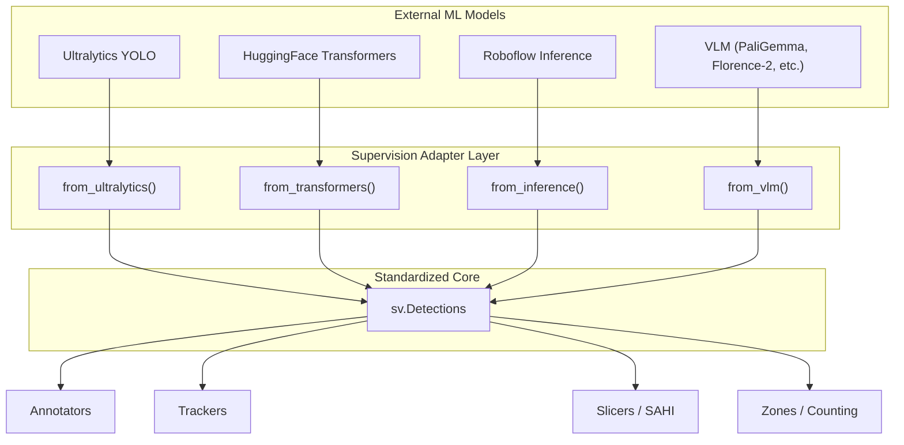
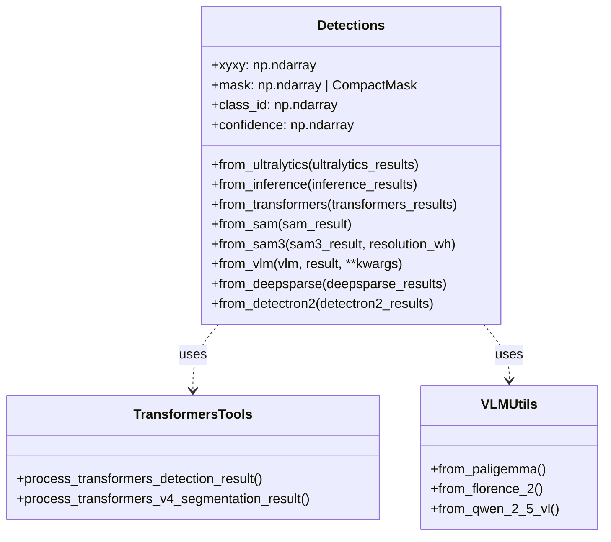

<!-- source: DeepWiki mcp.deepwiki.com · repo roboflow/supervision · page 4 Framework Integration · fetched 2026-10-30 -->

# Framework Integration

Relevant source files

The following files were used as context for generating this wiki page:

- [docs/changelog.md](docs/changelog.md)
- [docs/detection/metrics.md](docs/detection/metrics.md)
- [docs/detection/utils/vlms.md](docs/detection/utils/vlms.md)
- [docs/utils/conversion.md](docs/utils/conversion.md)
- [src/supervision/detection/core.py](src/supervision/detection/core.py)
- [src/supervision/detection/vlm.py](src/supervision/detection/vlm.py)
- [tests/detection/test_from_adapters.py](tests/detection/test_from_adapters.py)
- [tests/detection/test_vlm.py](tests/detection/test_vlm.py)

Supervision's framework integration system provides a unified interface for working with various machine learning frameworks and dataset formats. It standardizes outputs from different model architectures and file structures into consistent core objects like `sv.Detections` and `sv.DetectionDataset`. This allows for a "write once, use anywhere" pipeline for visualization, tracking, and analysis.

## Framework Integration Architecture

Supervision uses an adapter pattern to ingest data from external sources. These adapters reside primarily within factory methods of the core data classes.

### High-level Architecture Diagram

Sources: [src/supervision/detection/core.py:64-150](), [src/supervision/detection/vlm.py:162-200]()

### Code Entity Space: Detections Adapters

This diagram maps the natural language "Adapters" to the specific static methods defined in the `Detections` class.

Sources: [src/supervision/detection/core.py:64-159](), [src/supervision/detection/vlm.py:72-113](), [src/supervision/detection/core.py:16-20]()

## Model Adapters

Supervision supports a wide range of model frameworks. Each adapter handles the specific quirks of the source framework (e.g., coordinate scaling, mask format conversion, or text parsing for VLMs).

*   **Ultralytics**: Seamlessly handles YOLOv8 through YOLOv11, including Detection, Segmentation, and Oriented Bounding Box (OBB) results [src/supervision/detection/core.py:153-167]().
*   **Transformers**: Supports HuggingFace `DetrImageProcessor` and similar pipelines, with dedicated logic for different segmentation output versions [src/supervision/detection/core.py:169-196]().
*   **Vision Language Models (VLM)**: Features a centralized `from_vlm` entry point that uses the `VLM` enum to route results from models like PaliGemma, Florence-2, Qwen, and Gemini [src/supervision/detection/core.py:63-78](). The `VLM` enum itself defines the supported models [src/supervision/detection/vlm.py:22-51]().
*   **Inference**: Direct integration with Roboflow's inference server and package [src/supervision/detection/core.py:138-151]().

For deep technical details on specific model adapters, see **[Model Adapters](#4.1)**.

## Dataset Format Converters

Beyond model inference, Supervision facilitates the conversion between common computer vision dataset formats. This is primarily handled by the `DetectionDataset` class and its associated format-specific utilities.

### Supported Formats

| Format | Load Method | Save Method |
| :--- | :--- | :--- |
| **COCO** | `from_coco` | `as_coco` |
| **YOLO** | `from_yolo` | `as_yolo` |
| **Pascal VOC** | `from_pascal_voc` | `as_pascal_voc` |

### Conversion Utilities
Supervision provides low-level utilities to bridge the gap between different geometric representations, such as converting between Run-Length Encoding (RLE), Polygons, and Masks.

*   **Mask to Polygon**: `mask_to_polygons` is used for COCO export.
*   **Polygon to Mask**: `polygon_to_mask` is used during dataset loading [src/supervision/detection/utils/converters.py:36]().
*   **RLE Support**: `mask_to_rle` and `rle_to_mask` are available for compressed segmentation data [src/supervision/detection/utils/converters.py:37-38](). Note that `sv.mask_to_rle` and `sv.rle_to_mask` were moved from `supervision.dataset.utils` to `supervision.detection.utils.converters` in `supervision-0.31.0` [docs/changelog.md:14]().

For a guide on converting and managing datasets, see **[Dataset Format Converters](#4.2)**.

## Image Type Integration

Supervision is framework-agnostic regarding images, supporting both `numpy.ndarray` (OpenCV) and `PIL.Image` (Pillow). It uses decorators to ensure internal functions receive the expected format regardless of what the user provides.

*   **`ensure_cv2_image_for_standalone_function`**: Automatically converts PIL images to BGR NumPy arrays for processing and back to PIL for the return value. This function was removed in `supervision-0.31.0` [docs/changelog.md:14]().
*   **`ensure_pil_image_for_class_method`**: Used for annotators that prefer Pillow's drawing capabilities. This function was removed in `supervision-0.31.0` [docs/changelog.md:14]().

The `supervision._cv2` compatibility layer now handles image type conversions and fallbacks, ensuring consistent behavior whether OpenCV is installed or not. For example, `sv.VideoInfo.from_video_path` and `sv.process_video` now correctly handle rotated videos even without OpenCV [docs/changelog.md:16](). Similarly, `sv.ImageSink` and dataset exporters now write JPEG and WebP files with consistent quality settings across OpenCV and Pillow backends [docs/changelog.md:18](). `sv.IconAnnotator` and `sv.draw_image` also correctly handle CMYK JPEG/TIFF and 16-bit PNG images regardless of OpenCV installation [docs/changelog.md:20-22]().

Sources: [docs/changelog.md:14-22]()

## Best Practices

1.  **Use Factory Methods**: Always prefer `sv.Detections.from_*` methods over manual instantiation to ensure proper validation [src/supervision/detection/core.py:138-196]().
2.  **Resolution Awareness**: When using models that return normalized coordinates (like many VLMs or SAM), ensure the correct `resolution_wh` is passed to the adapter [src/supervision/detection/vlm.py:88-99]().
3.  **Validation**: Supervision automatically validates input shapes and types (e.g., ensuring masks are `bool`) during integration [src/supervision/detection/core.py:84-88]().

Sources: [src/supervision/detection/core.py:64-196](), [src/supervision/detection/vlm.py:88-99]()

---

