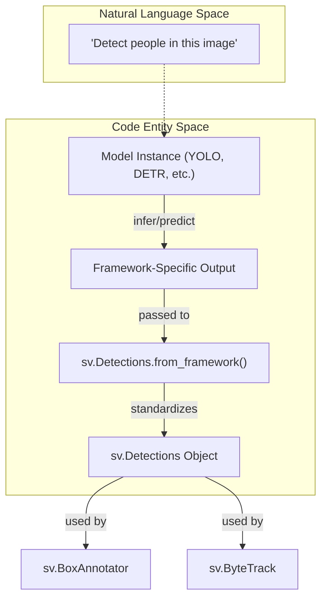
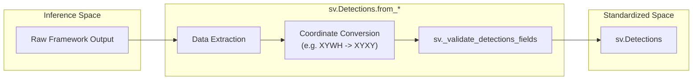

<!-- source: DeepWiki mcp.deepwiki.com · repo roboflow/supervision · page 4.1 Model Adapters · fetched 2026-10-30 -->

# Model Adapters

<details>
<summary>Relevant source files</summary>

The following files were used as context for generating this wiki page:

- [docs/changelog.md](docs/changelog.md)
- [src/supervision/detection/core.py](src/supervision/detection/core.py)
- [src/supervision/detection/tools/transformers.py](src/supervision/detection/tools/transformers.py)
- [src/supervision/detection/vlm.py](src/supervision/detection/vlm.py)
- [tests/detection/test_from_adapters.py](tests/detection/test_from_adapters.py)
- [tests/detection/test_from_sam.py](tests/detection/test_from_sam.py)
- [tests/detection/test_vlm.py](tests/detection/test_vlm.py)
- [tests/detection/tools/__init__.py](tests/detection/tools/__init__.py)
- [tests/detection/tools/test_transformers.py](tests/detection/tools/test_transformers.py)

</details>


Model adapters in the Supervision library serve as bridge components that convert outputs from various computer vision model frameworks into a standardized `sv.Detections` format. This standardization allows all of Supervision's visualization, analysis, and processing tools to work consistently regardless of which underlying model or framework you're using [src/supervision/detection/core.py:64-70]().

## Purpose and Architecture

Model adapters enable Supervision to support multiple AI frameworks without requiring users to handle different output formats manually. They are implemented primarily as class methods of the `Detections` class, following the `from_*` naming convention [src/supervision/detection/core.py:200-1006]().

### Data Flow Overview



Sources: [src/supervision/detection/core.py:64-130](), [src/supervision/detection/core.py:137-196]()

## Supported Model Frameworks

Supervision provides a wide range of adapters for popular computer vision frameworks and APIs:

| Framework | Adapter Method | Supported Tasks |
|-----------|---------------|-----------------|
| **Ultralytics** | `from_ultralytics` | Detection, Segmentation, OBB (YOLO v8/v9/v10/v11) |
| **Transformers** | `from_transformers` | DETR, Segmentation (HuggingFace) |
| **Inference** | `from_inference` | Roboflow API, local Inference server |
| **SAM / SAM 2** | `from_sam` / `from_sam3` | Segment Anything Model outputs |
| **VLM** | `from_vlm` | Florence-2, PaliGemma, Qwen, Gemini, Moondream, DeepSeek |
| **Legacy** | `from_yolov5`, `from_detectron2` | Older framework support |

Sources: [src/supervision/detection/core.py:200-1006](), [src/supervision/detection/vlm.py:72-93]()

## Key Implementation Details

### Ultralytics Adapter
The `from_ultralytics` method is one of the most comprehensive adapters. It handles standard bounding boxes, instance segmentation masks, and Oriented Bounding Boxes (OBB) [src/supervision/detection/core.py:234-302](). It uses internal utilities like `extract_ultralytics_masks` to handle GPU-to-CPU transfer and boolean conversion [src/supervision/detection/utils/internal.py:27-27]().

Sources: [src/supervision/detection/core.py:234-302](), [src/supervision/detection/utils/internal.py:27-27](), [tests/detection/test_from_adapters.py:64-83]()

### Transformers Adapter
The `from_transformers` adapter dynamically routes results to specific processors based on the output structure:
*   `process_transformers_detection_result`: For standard object detection [src/supervision/detection/tools/transformers.py:14-39]().
*   `process_transformers_v4_segmentation_result`: For older segmentation outputs [src/supervision/detection/tools/transformers.py:42-77]().
*   `process_transformers_v5_segmentation_result`: For newer segmentation formats [src/supervision/detection/tools/transformers.py:80-106]().

Sources: [src/supervision/detection/core.py:19-22](), [src/supervision/detection/tools/transformers.py:14-106](), [tests/detection/test_from_adapters.py:177-188](), [tests/detection/tools/test_transformers.py:113-147](), [tests/detection/tools/test_transformers.py:153-172]()

### SAM Adapters
Supervision provides two adapters for Segment Anything Model (SAM) outputs:
*   `from_sam`: Converts results from the original SAM model, which typically provides segmentation masks, bounding boxes, and areas. It can decode COCO RLE masks into dense boolean masks [tests/detection/test_from_sam.py:113-149]().
*   `from_sam3`: Designed for SAM3 (Segment Anything Model 3) results, which often come in a dictionary format with `prompt_results` containing polygons and confidence scores. It extracts bounding boxes and confidence from these polygon masks [tests/detection/test_from_sam.py:151-220]().

Sources: [src/supervision/detection/core.py:304-340](), [src/supervision/detection/core.py:342-378](), [tests/detection/test_from_sam.py:82-111](), [tests/detection/test_from_sam.py:113-149](), [tests/detection/test_from_sam.py:151-220]()

### Vision-Language Models (VLM)
The `from_vlm` adapter (and the `VLM` enum) supports a variety of modern multimodal models. It validates parameters using `_validate_vlm_parameters` to ensure the correct resolution and class lists are provided for parsing [src/supervision/detection/vlm.py:131-170]().

*   **PaliGemma**: Parsed via `from_paligemma` using regex to extract locations and labels from text strings [src/supervision/detection/vlm.py:91-97]().
*   **Florence-2**: Parsed via `from_florence_2` which supports complex tasks like `<CAPTION_TO_PHRASE_GROUNDING>` and `<OD>` [src/supervision/detection/vlm.py:117-128]().
*   **Qwen**: Supports both `QWEN_2_5_VL` and `QWEN_3_VL` [src/supervision/detection/vlm.py:91-97]().
*   **Google Gemini**: Includes support for `GOOGLE_GEMINI_2_0`, `GOOGLE_GEMINI_2_5`, `GOOGLE_GEMINI_3_5`, `GOOGLE_GEMINI_3_6`, and `GOOGLE_GEMINI_3_7` [src/supervision/detection/core.py:68-72]().
*   **DeepSeek-VL-2**: Supported via `from_deepseek_vl_2` [src/supervision/detection/core.py:66-66]().
*   **Moondream**: Supported via `from_moondream` [src/supervision/detection/core.py:74-74]().
*   **Kosmos-2**: Supported via `from_kosmos_2` [src/supervision/detection/core.py:75-75]().

The `_VLM_BOX_PARSERS` and `_VLM_SEGMENTATION_PARSERS` dictionaries map `VLM` enum values to their respective parsing functions, handling both bounding box and segmentation outputs [src/supervision/detection/core.py:91-106](). Some VLMs, like Qwen, do not report per-detection scores, so `Detections.from_vlm` fills the `confidence` field with an array of ones for these models [src/supervision/detection/core.py:109-110]().

Sources: [src/supervision/detection/core.py:64-78](), [src/supervision/detection/core.py:91-110](), [src/supervision/detection/vlm.py:22-50](), [src/supervision/detection/vlm.py:131-170](), [src/supervision/detection/vlm.py:182-196](), [tests/detection/test_vlm.py:30-77](), [tests/detection/test_vlm.py:80-206]()

### Legacy Adapters
Supervision maintains compatibility with older frameworks through legacy adapters:
*   `from_yolov5`: Converts results from YOLOv5 models [tests/detection/test_from_adapters.py:25-40]().
*   `from_detectron2`: For Detectron2 outputs [src/supervision/detection/core.py:700-739]().
*   `from_mmdetection`: For MMDetection outputs [src/supervision/detection/core.py:741-780]().
*   `from_yolo_nas`: For YOLO-NAS models [tests/detection/test_from_adapters.py:99-136]().
*   `from_tensorflow`: Handles TensorFlow detection results, including scaling for non-square images and ensuring source boxes are not mutated [tests/detection/test_from_adapters.py:139-170]().

Sources: [src/supervision/detection/core.py:700-780](), [src/supervision/detection/core.py:800-839](), [src/supervision/detection/core.py:841-879](), [src/supervision/detection/core.py:881-919](), [src/supervision/detection/core.py:921-959](), [src/supervision/detection/core.py:961-999](), [tests/detection/test_from_adapters.py:25-40](), [tests/detection/test_from_adapters.py:99-136](), [tests/detection/test_from_adapters.py:139-170]()

## Internal Data Flow and Validation

When an adapter creates a `Detections` object, it triggers `__post_init__`, which executes `_validate_detections_fields` [src/supervision/detection/core.py:113-114](). This ensures all converted data meets the internal requirements:
*   `xyxy`: Must be a 2D `np.ndarray` of shape `(N, 4)` [src/supervision/validators/__init__.py:10-25]().
*   `mask`: Must be a 3D boolean `np.ndarray` of shape `(N, H, W)` or a `CompactMask` [src/supervision/validators/__init__.py:28-50]().
*   `class_id`, `confidence`, `tracker_id`: Must be 1D arrays of length `N` [src/supervision/validators/__init__.py:66-124]().

### Adapter Pipeline Diagram



Sources: [src/supervision/detection/core.py:113-114](), [src/supervision/validators/__init__.py:157-172]()

## Example Usage

### Ultralytics (YOLO v8/v11)
```python
import supervision as sv
from ultralytics import YOLO

model = YOLO("yolov8n.pt")
results = model(image)[0]
detections = sv.Detections.from_ultralytics(results)
```
Sources: [src/supervision/detection/core.py:153-167]()

### Roboflow Inference
```python
import supervision as sv
from inference import get_model

model = get_model(model_id="rfdetr-small")
image = cv2.imread("<SOURCE_IMAGE_PATH>")
results = model.infer(image)[0]
detections = sv.Detections.from_inference(results)
```
Sources: [src/supervision/detection/core.py:144-151]()

### Hugging Face Transformers
```python
import torch
import supervision as sv
from PIL import Image
from transformers import DetrImageProcessor, DetrForObjectDetection

processor = DetrImageProcessor.from_pretrained("facebook/detr-resnet-50")
model = DetrForObjectDetection.from_pretrained("facebook/detr-resnet-50")

image = Image.open("<SOURCE_IMAGE_PATH>")
inputs = processor(images=image, return_tensors="pt")

with torch.no_grad():
    outputs = model(**inputs)

width, height = image.size
target_size = torch.tensor([[height, width]])
results = processor.post_process_object_detection(
    outputs=outputs, target_sizes=target_size)[0]
detections = sv.Detections.from_transformers(
    transformers_results=results,
    id2label=model.config.id2label)
```
Sources: [src/supervision/detection/core.py:175-196]()

## Memory-Efficient Masks
For segmentation models, adapters now support `CompactMask`. Instead of storing full `(N, H, W)` boolean arrays, `CompactMask` stores only the foreground crops and their offsets, significantly reducing memory usage for high-resolution images [src/supervision/detection/compact_mask.py:15-15](), [src/supervision/detection/core.py:135-137](). This is particularly beneficial when merging masks, as `sv.Detections.with_nmm` and `sv.mask_non_max_merge` now form `CompactMask` unions directly from run-length encoded foreground intervals, avoiding full-image mask allocations [docs/changelog.md:10-10]().

Sources: [src/supervision/detection/core.py:135-137](), [src/supervision/detection/compact_mask.py:15-15](), [docs/changelog.md:10-10]()

---

