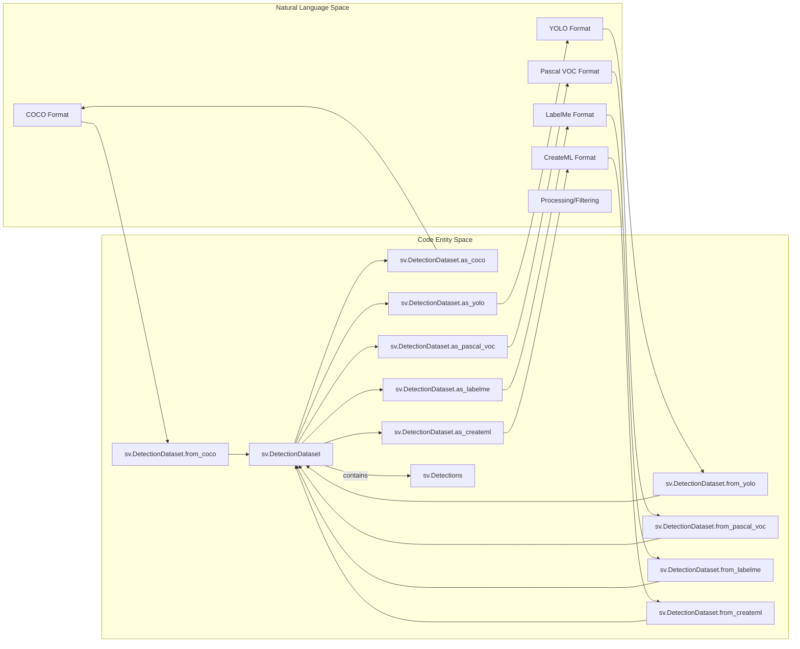
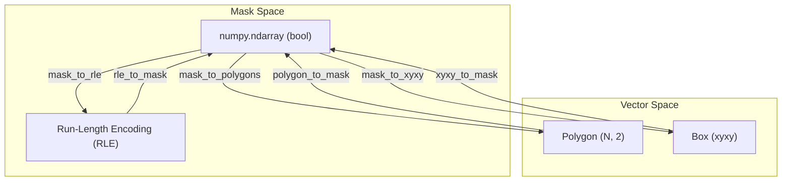
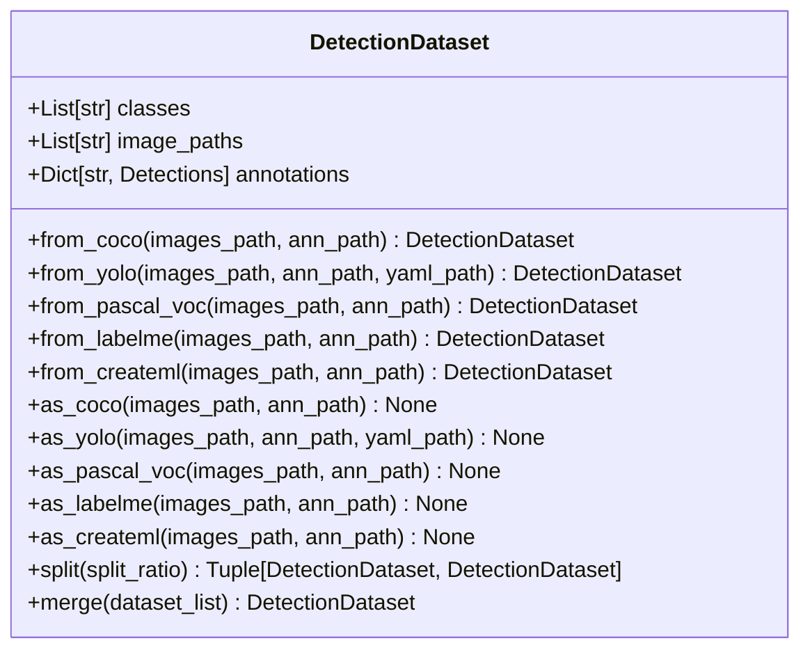

<!-- source: DeepWiki mcp.deepwiki.com · repo roboflow/supervision · page 4.2 Dataset Format Converters · fetched 2026-10-30 -->

# Dataset Format Converters

<details>
<summary>Relevant source files</summary>

The following files were used as context for generating this wiki page:

- [src/supervision/dataset/core.py](src/supervision/dataset/core.py)
- [src/supervision/dataset/formats/coco.py](src/supervision/dataset/formats/coco.py)
- [src/supervision/dataset/formats/createml.py](src/supervision/dataset/formats/createml.py)
- [src/supervision/dataset/formats/labelme.py](src/supervision/dataset/formats/labelme.py)
- [src/supervision/dataset/formats/pascal_voc.py](src/supervision/dataset/formats/pascal_voc.py)
- [src/supervision/dataset/formats/yolo.py](src/supervision/dataset/formats/yolo.py)
- [src/supervision/dataset/utils.py](src/supervision/dataset/utils.py)
- [tests/dataset/formats/test_coco.py](tests/dataset/formats/test_coco.py)
- [tests/dataset/formats/test_createml.py](tests/dataset/formats/test_createml.py)
- [tests/dataset/formats/test_labelme.py](tests/dataset/formats/test_labelme.py)
- [tests/dataset/formats/test_pascal_voc.py](tests/dataset/formats/test_pascal_voc.py)
- [tests/dataset/formats/test_yolo.py](tests/dataset/formats/test_yolo.py)
- [tests/dataset/test_core.py](tests/dataset/test_core.py)
- [tests/dataset/test_progress.py](tests/dataset/test_progress.py)
- [tests/dataset/test_utils.py](tests/dataset/test_utils.py)

</details>


This document describes the dataset format conversion system in Supervision, which allows seamless translation between common computer vision dataset formats including COCO, YOLO, Pascal VOC, LabelMe, and CreateML. These converters facilitate interoperability between different vision tools and workflows, enabling you to leverage datasets across different platforms and frameworks.

For information about model adapters that work with these datasets, see [Model Adapters](4.1).

## Overview of Dataset Format Converters

The Supervision library provides a comprehensive system for converting between different dataset formats for computer vision tasks. The format converters are designed to work with the `DetectionDataset` class, which serves as a unified representation of computer vision datasets.

### Natural Language to Code Entity Space: Dataset Pipeline

This diagram maps the high-level conversion concepts to the specific functions and classes implemented in the `supervision` package.



Sources: [src/supervision/dataset/core.py:21-41](), [src/supervision/dataset/core.py:391-443](), [src/supervision/dataset/core.py:446-506](), [src/supervision/dataset/core.py:561-608](), [src/supervision/dataset/core.py:610-665](), [src/supervision/dataset/core.py:667-719](), [src/supervision/dataset/core.py:721-773](), [src/supervision/dataset/core.py:775-827](), [src/supervision/dataset/core.py:829-881]()

## Supported Dataset Formats

### COCO Format
COCO (Common Objects in Context) uses a centralized JSON structure. Supervision handles category mapping, image metadata, and complex segmentations (both polygons and RLE).

*   **Implementation**: `coco.py` handles the parsing of `iscrowd` flags and conversion between COCO category IDs and zero-indexed Supervision class IDs. The `coco_categories_to_classes` function [src/supervision/dataset/formats/coco.py:34-38]() extracts class names, and `build_coco_class_index_mapping` [src/supervision/dataset/formats/coco.py:41-50]() creates the necessary mapping.
*   **Mask Handling**: Polygons are merged into a single mask using `polygon_to_mask` [src/supervision/dataset/formats/coco.py:157-158](). RLE is decoded via `rle_to_mask` [src/supervision/dataset/formats/coco.py:126-127](). The `coco_annotations_to_masks` function [src/supervision/dataset/formats/coco.py:99-164]() rasterizes COCO segmentations into boolean masks.

Sources: [src/supervision/dataset/formats/coco.py:34-38](), [src/supervision/dataset/formats/coco.py:41-50](), [src/supervision/dataset/formats/coco.py:99-164](), [src/supervision/dataset/formats/coco.py:119-154](), [src/supervision/dataset/formats/coco.py:157-202]()

### YOLO Format
YOLO format uses individual `.txt` files per image with normalized coordinates.

*   **Detection Types**: Supports standard bounding boxes, polygons for segmentation, and Oriented Bounding Boxes (OBB) [src/supervision/dataset/formats/yolo.py:170-175](). The `_parse_box` function [src/supervision/dataset/formats/yolo.py:35-45]() handles standard boxes, while `_parse_polygon` [src/supervision/dataset/formats/yolo.py:55-56]() handles polygons.
*   **Coordinate Transformation**: Converts normalized `x_center, y_center, width, height` to absolute `xyxy` pixels [src/supervision/dataset/formats/yolo.py:35-45]().
*   **Class Names**: `_extract_class_names` [src/supervision/dataset/formats/yolo.py:78-138]() reads class names from `data.yaml` files, supporting both list and dictionary formats.

Sources: [src/supervision/dataset/formats/yolo.py:35-45](), [src/supervision/dataset/formats/yolo.py:55-56](), [src/supervision/dataset/formats/yolo.py:78-138](), [src/supervision/dataset/formats/yolo.py:142-171](), [src/supervision/dataset/formats/yolo.py:262-289]()

### Pascal VOC Format
Pascal VOC uses XML files. Supervision supports both standard bounding boxes and the polygon-based segmentation extensions.

*   **Coordinate Offset**: Pascal VOC is 1-indexed; Supervision automatically handles the `+1/-1` adjustment during import/export. The `object_to_pascal_voc` function [src/supervision/dataset/formats/pascal_voc.py:26-91]() adds 1 to coordinates for export, and `detections_from_xml_obj` [src/supervision/dataset/formats/pascal_voc.py:202-203]() subtracts 1 during import.
*   **Mask Approximation**: When exporting detections with masks, `approximate_mask_with_polygons` [src/supervision/dataset/formats/pascal_voc.py:169-174]() is used to convert masks to polygons before writing to XML.

Sources: [src/supervision/dataset/formats/pascal_voc.py:26-91](), [src/supervision/dataset/formats/pascal_voc.py:56-145](), [src/supervision/dataset/formats/pascal_voc.py:148-199](), [src/supervision/dataset/formats/pascal_voc.py:169-174]()

### LabelMe Format
LabelMe uses JSON files, typically one per image, containing shape definitions.

*   **Supported Shapes**: Only `rectangle` and `polygon` shapes are imported. Other types like `circle`, `line`, `point`, `linestrip` are skipped with a warning [src/supervision/dataset/formats/labelme.py:98-101]().
*   **Shape Conversion**: `_rectangle_to_xyxy` [src/supervision/dataset/formats/labelme.py:39-50]() converts rectangle points to `xyxy` format, and `_xyxy_to_polygon` [src/supervision/dataset/formats/labelme.py:53-58]() converts `xyxy` to polygon points.
*   **Mask Generation**: When `with_masks` is `True`, both rectangle and polygon shapes produce masks using `polygon_to_mask` [src/supervision/dataset/formats/labelme.py:155-159]().
*   **Class Mapping**: Class names are inferred from labels across all files and assigned sorted, zero-based IDs [src/supervision/dataset/formats/labelme.py:171-180]().

Sources: [src/supervision/dataset/formats/labelme.py:39-50](), [src/supervision/dataset/formats/labelme.py:53-58](), [src/supervision/dataset/formats/labelme.py:61-164](), [src/supervision/dataset/formats/labelme.py:98-101](), [src/supervision/dataset/formats/labelme.py:155-159](), [src/supervision/dataset/formats/labelme.py:171-180]()

### CreateML Format
CreateML uses a single JSON file containing a list of per-image entries with axis-aligned bounding boxes.

*   **Coordinate System**: Boxes are defined by `x`, `y` (center), `width`, and `height`. `createml_annotations_to_detections` [src/supervision/dataset/formats/createml.py:58-129]() converts these to `xyxy` format.
*   **Class Inference**: Class names are inferred from the labels present in the file, similar to LabelMe, and assigned sorted, zero-based IDs [src/supervision/dataset/formats/createml.py:140-143]().
*   **Path Resolution**: `_resolve_image_path` [src/supervision/dataset/formats/createml.py:19-54]() ensures image paths are valid and within the specified directory, preventing path traversal vulnerabilities.

Sources: [src/supervision/dataset/formats/createml.py:19-54](), [src/supervision/dataset/formats/createml.py:58-129](), [src/supervision/dataset/formats/createml.py:140-143]()

## Conversion Utilities and Helpers

The conversion system relies on a suite of low-level utilities located in `supervision.detection.utils.converters` and `supervision.dataset.utils`.

### Mask and Polygon Conversions
Supervision provides high-performance utilities for bridging pixel-level masks and vector-level polygons.



Sources: [src/supervision/detection/utils/converters.py:31-49](), [src/supervision/detection/utils/converters.py:202-224](), [src/supervision/detection/utils/converters.py:230-251](), [src/supervision/dataset/utils.py:52-77]()

### Key Conversion Functions

| Function | Purpose | Source |
|---|---|---|
| `xyxy_to_xywh` | Convert `[x1, y1, x2, y2]` to `[x, y, w, h]` | [src/supervision/detection/utils/converters.py:85-116]() |
| `xywh_to_xyxy` | Convert `[x, y, w, h]` to `[x1, y1, x2, y2]` | [src/supervision/detection/utils/converters.py:52-82]() |
| `mask_to_rle` | Encode boolean mask to RLE (compressed or uncompressed) | [src/supervision/detection/utils/converters.py:69-76]() (Reference) |
| `rle_to_mask` | Decode RLE to boolean mask | [src/supervision/detection/utils/converters.py:230-251]() |
| `polygon_to_mask` | Rasterize polygon to boolean mask | [src/supervision/detection/utils/converters.py:202-224]() |
| `mask_to_polygons` | Convert boolean mask to list of polygons | [src/supervision/detection/utils/converters.py:31-49]() |
| `approximate_mask_with_polygons` | Simplifies masks into polygons using RDP algorithm and area filtering | [src/supervision/dataset/utils.py:52-77]() |
| `map_detections_class_id` | Remaps class IDs in a `Detections` object based on a provided mapping | [src/supervision/dataset/utils.py:113-129]() |
| `check_no_basename_collisions` | Ensures no output file name collisions during export | [src/supervision/dataset/utils.py:133-180]() |

Sources: [src/supervision/detection/utils/converters.py:31-49](), [src/supervision/detection/utils/converters.py:52-82](), [src/supervision/detection/utils/converters.py:69-76](), [src/supervision/detection/utils/converters.py:85-116](), [src/supervision/detection/utils/converters.py:202-224](), [src/supervision/detection/utils/converters.py:230-251](), [src/supervision/dataset/utils.py:52-77](), [src/supervision/dataset/utils.py:113-129](), [src/supervision/dataset/utils.py:133-180]()

## DetectionDataset Class

The `DetectionDataset` class is the central component for handling computer vision datasets in Supervision. It provides methods for loading and exporting data in various formats.



Sources: [src/supervision/dataset/core.py:54-666]()

## Loading and Exporting Examples

### COCO Loading and Export
```python
import supervision as sv

# Loading
dataset = sv.DetectionDataset.from_coco(
    images_directory_path="path/to/images",
    annotations_path="path/to/annotations.json"
)

# Exporting with mask approximation
dataset.as_coco(
    images_directory_path="path/to/output/images",
    annotations_path="path/to/output/annotations.json",
    approximation_percentage=0.75
)
```
Sources: [src/supervision/dataset/core.py:561-608](), [src/supervision/dataset/core.py:610-665]()

### YOLO Loading and Export
```python
# Loading YOLO (supports OBB)
dataset = sv.DetectionDataset.from_yolo(
    images_directory_path="path/to/images",
    annotations_directory_path="path/to/labels",
    data_yaml_path="path/to/data.yaml",
    is_obb=True
)

# Exporting YOLO
dataset.as_yolo(
    images_directory_path="path/to/output/images",
    annotations_directory_path="path/to/output/labels",
    data_yaml_path="path/to/output/data.yaml"
)
```
Sources: [src/supervision/dataset/core.py:446-506](), [src/supervision/dataset/core.py:508-558]()

### Pascal VOC Loading and Export
```python
# Loading Pascal VOC
dataset = sv.DetectionDataset.from_pascal_voc(
    images_directory_path="path/to/images",
    annotations_directory_path="path/to/annotations"
)

# Exporting Pascal VOC
dataset.as_pascal_voc(
    images_directory_path="path/to/output/images",
    annotations_directory_path="path/to/output/annotations"
)
```
Sources: [src/supervision/dataset/core.py:391-443](), [src/supervision/dataset/core.py:446-506]()

### LabelMe Loading and Export
```python
# Loading LabelMe
dataset = sv.DetectionDataset.from_labelme(
    images_directory_path="path/to/images",
    annotations_directory_path="path/to/annotations",
    force_masks=True # Ensure masks are generated even for rectangles
)

# Exporting LabelMe
dataset.as_labelme(
    images_directory_path="path/to/output/images",
    annotations_directory_path="path/to/output/annotations"
)
```
Sources: [src/supervision/dataset/core.py:667-719](), [src/supervision/dataset/core.py:721-773]()

### CreateML Loading and Export
```python
# Loading CreateML
dataset = sv.DetectionDataset.from_createml(
    images_directory_path="path/to/images",
    annotations_path="path/to/annotations.json"
)

# Exporting CreateML
dataset.as_createml(
    images_directory_path="path/to/output/images",
    annotations_path="path/to/output/annotations.json"
)
```
Sources: [src/supervision/dataset/core.py:775-827](), [src/supervision/dataset/core.py:829-881]()

## Internal Data Flow: Roboflow Integration
The `process_roboflow_result` function in `internal.py` demonstrates how Supervision standardizes raw API responses (containing RLE or points) into the internal `Detections` format.

*   **RLE Processing**: Checks for `rle` or `rle_mask` keys and uses `rle_to_mask` [src/supervision/detection/utils/internal.py:94-110]().
*   **Polygon Processing**: Checks for `points` and uses `polygon_to_mask` [src/supervision/detection/utils/internal.py:132-143]().

Sources: [src/supervision/detection/utils/internal.py:54-174]()

---

