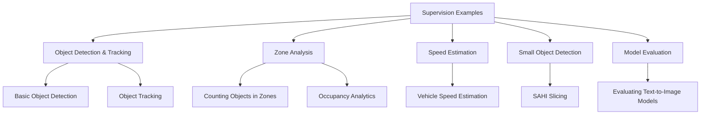
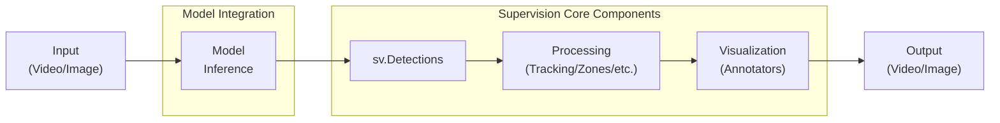
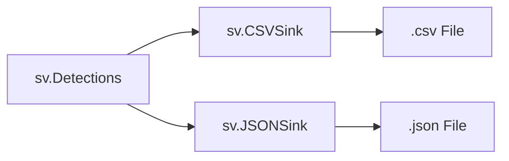
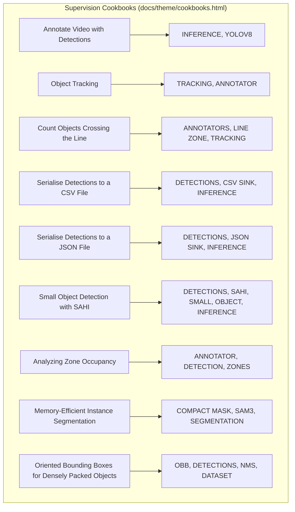

<!-- source: DeepWiki mcp.deepwiki.com · repo roboflow/supervision · page 5 Examples & Tutorials · fetched 2026-10-30 -->

# Examples & Tutorials

Relevant source files

The following files were used as context for generating this wiki page:

- [docs/cookbooks.md](docs/cookbooks.md)
- [docs/javascripts/cookbooks-card.js](docs/javascripts/cookbooks-card.js)
- [docs/javascripts/init_kapa_widget.js](docs/javascripts/init_kapa_widget.js)
- [docs/javascripts/version-banner.js](docs/javascripts/version-banner.js)
- [docs/javascripts/zoominfo.js](docs/javascripts/zoominfo.js)
- [docs/notebooks/occupancy_analytics.ipynb](docs/notebooks/occupancy_analytics.ipynb)
- [docs/notebooks/small-object-detection-with-sahi.ipynb](docs/notebooks/small-object-detection-with-sahi.ipynb)
- [docs/stylesheets/extra.css](docs/stylesheets/extra.css)
- [docs/theme/cookbooks.html](docs/theme/cookbooks.html)
- [docs/theme/partials/header.html](docs/theme/partials/header.html)
- [examples/README.md](examples/README.md)

This page provides an overview of practical examples and tutorials for using the Supervision library in computer vision projects. These examples demonstrate real-world applications and show how to implement common computer vision tasks using Supervision's components.

For detailed information about specific components and systems in the Supervision library, refer to the corresponding pages in the Core Components section.

## Overview of Examples

Supervision provides a variety of examples showcasing different capabilities of the library. These examples demonstrate how to use Supervision's components together to build effective computer vision solutions.

### Example Categories

Sources: [examples/README.md:1-12](), [docs/notebooks/evaluating-alignment-of-text-to-image-diffusion-models.ipynb:9-26]()

## Common Workflow Pattern

Most examples in Supervision follow a similar workflow pattern, which includes loading a model, processing video or images, detecting objects, applying additional processing (tracking, zone analysis), and visualizing the results.

Sources: [examples/README.md:7-12]()

## Object Detection and Tracking

Tutorials on basic object detection and tracking workflows cover the core pipeline of converting raw model outputs into `sv.Detections` and visualizing them using various annotators.

### Object Tracking Tutorial
Supervision provides built-in support for tracking objects across video frames. This assigns a unique `tracker_id` to objects, which is essential for counting or path analysis.

For details, see [Object Detection & Tracking](#5.1).

Sources: [docs/notebooks/object-tracking.ipynb:34-35]()

## Speed Estimation

The speed estimation guide demonstrates how to combine object detection, tracking, and perspective correction using the `ViewTransformer` to calculate the real-world speed of moving objects.

Key features include:
1. **Perspective transformation**: Mapping video coordinates to real-world meters.
2. **Object tracking**: Maintaining vehicle identity to calculate displacement over time.
3. **Video Utilities**: Using `VideoInfo` and `get_video_frames_generator` for frame-by-frame processing.

For details, see [Speed Estimation](#5.2).

Sources: [examples/README.md:10]()

## Zone-Based Counting

These tutorials focus on spatial analysis within a frame. Users can define specific areas of interest using `PolygonZone` or crossing lines using `LineZone`.

### Key Counting Workflows:
- **Polygon Counting**: Counting how many objects are currently inside a defined shape.
- **Line Crossing**: Detecting when objects cross a threshold, often used for traffic or entry/exit analysis.
- **Dwell Time**: Using `time_in_zone` to measure how long objects remain within a specific area.

For details, see [Zone-based Counting](#5.3).

Sources: [examples/README.md:8-9,11]()

## Data Serialization

Supervision provides tools to export detected data for further analysis. The `sv.CSVSink` and `sv.JSONSink` tools allow for serializing detection metadata (like bounding boxes, class IDs, and tracker IDs) into structured files.

Sources: [docs/notebooks/serialise-detections-to-csv.ipynb:9-15](), [docs/notebooks/serialise-detections-to-json.ipynb:9-15]()

## Available Tutorials & Notebooks

The `docs/notebooks/` directory and the `examples/` directory contain a rich collection of tutorials and runnable examples. These cover a wide range of use cases, from basic object detection to advanced analytics. The `docs/theme/cookbooks.html` file dynamically lists many of these notebooks, providing a quick overview of their content and the Supervision components they utilize.

### Cookbooks Overview

Sources: [docs/theme/cookbooks.html:17-72]()

| Tutorial | Description | Key Components |
|----------|-------------|----------------|
| **Quickstart** | Basic introduction to Detection, Video, and Dataset APIs | `sv.Detections`, `sv.VideoSink` |
| **Annotate Video with Detections** | Step-by-step guide to the video processing pipeline | `sv.get_video_frames_generator` |
| **Object Tracking** | Implementing object tracking for identity persistence | `sv.Detections.track_id` |
| **Count Objects Crossing the Line** | Counting objects that cross a specific line | `sv.LineZone` |
| **Zero-Shot Object Detection with YOLO-World** | Demonstrates zero-shot detection capabilities | `sv.Detections.from_inference` |
| **Serialise Detections to a CSV File** | Exporting detection data to CSV format | `sv.CSVSink` |
| **Serialise Detections to a JSON File** | Exporting detection data to JSON format | `sv.JSONSink` |
| **Small Object Detection with SAHI** | Using `InferenceSlicer` for improved small object detection | `sv.InferenceSlicer` |
| **Analyzing Zone Occupancy** | Demonstrates occupancy analytics using zones | `sv.PolygonZone` |
| **Memory-Efficient Instance Segmentation** | Showcases `CompactMask` for efficient segmentation | `sv.CompactMask` |
| **Oriented Bounding Boxes for Densely Packed Objects** | Handling rotated bounding boxes | `sv.Detections` with OBB |

Sources: [docs/theme/cookbooks.html:17-72](), [docs/notebooks/small-object-detection-with-sahi.ipynb:9-16](), [docs/notebooks/occupancy_analytics.ipynb:9-15]()

---

