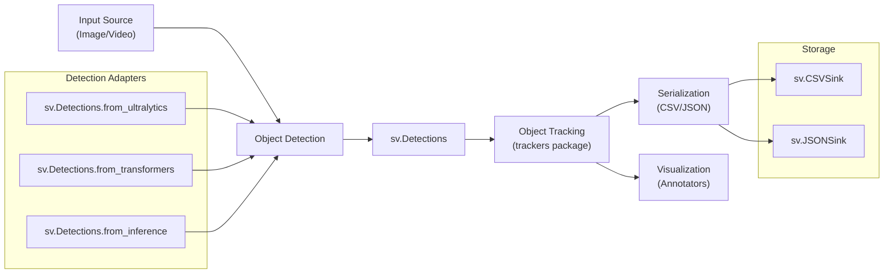
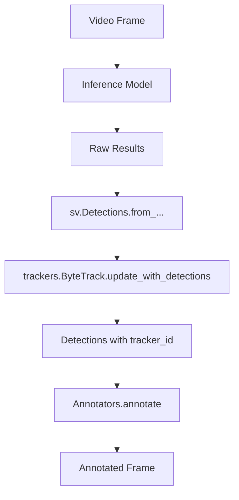

<!-- source: DeepWiki mcp.deepwiki.com · repo roboflow/supervision · page 5.1 Object Detection & Tracking · fetched 2026-10-30 -->

# Object Detection & Tracking

<details>
<summary>Relevant source files</summary>

The following files were used as context for generating this wiki page:

- [demo.ipynb](demo.ipynb)
- [docs/notebooks/annotate-video-with-detections.ipynb](docs/notebooks/annotate-video-with-detections.ipynb)
- [docs/notebooks/count-objects-crossing-the-line.ipynb](docs/notebooks/count-objects-crossing-the-line.ipynb)
- [docs/notebooks/download-supervision-assets.ipynb](docs/notebooks/download-supervision-assets.ipynb)
- [docs/notebooks/evaluating-alignment-of-text-to-image-diffusion-models.ipynb](docs/notebooks/evaluating-alignment-of-text-to-image-diffusion-models.ipynb)
- [docs/notebooks/object-tracking.ipynb](docs/notebooks/object-tracking.ipynb)
- [docs/notebooks/quickstart.ipynb](docs/notebooks/quickstart.ipynb)
- [docs/notebooks/serialise-detections-to-csv.ipynb](docs/notebooks/serialise-detections-to-csv.ipynb)
- [docs/notebooks/serialise-detections-to-json.ipynb](docs/notebooks/serialise-detections-to-json.ipynb)
- [examples/count_people_in_zone/README.md](examples/count_people_in_zone/README.md)
- [examples/heatmap_and_track/README.md](examples/heatmap_and_track/README.md)
- [examples/heatmap_and_track/requirements.txt](examples/heatmap_and_track/requirements.txt)
- [examples/heatmap_and_track/script.py](examples/heatmap_and_track/script.py)
- [examples/time_in_zone/README.md](examples/time_in_zone/README.md)
- [examples/tracking/README.md](examples/tracking/README.md)
- [examples/tracking/inference_example.py](examples/tracking/inference_example.py)
- [examples/tracking/requirements.txt](examples/tracking/requirements.txt)
- [examples/tracking/ultralytics_example.py](examples/tracking/ultralytics_example.py)
- [examples/traffic_analysis/README.md](examples/traffic_analysis/README.md)
- [examples/traffic_analysis/requirements.txt](examples/traffic_analysis/requirements.txt)

</details>


This page covers the core functionality of Supervision for detecting and tracking objects in images and videos. The guide focuses on how to use the library to perform inference with various model types, track objects across video frames, serialize results, and visualize data using advanced annotators like heatmaps.

For information about zone-based counting of objects, see [Zone-based Counting](5.3). For speed estimation capabilities, see [Speed Estimation](5.2).

## Overview

Supervision provides a streamlined workflow for object detection and tracking tasks that includes:

1. Running inference with detection models (YOLO, Transformers, etc.).
2. Standardizing detection data with the `sv.Detections` class.
3. Tracking objects between frames with the external `trackers` package.
4. Serializing detection data to persistent storage (CSV/JSON).
5. Visualizing results with various annotators and heatmaps.



Sources:
- [docs/notebooks/serialise-detections-to-csv.ipynb:9-15]()
- [docs/notebooks/object-tracking.ipynb:17-19]()

## Detection System

Supervision standardizes detection data through the `sv.Detections` class, which is the central data structure for detection results. This normalization step ensures all downstream annotators and filters work identically regardless of the source model.

### Converting Model Results to Detections

Supervision provides factory methods to convert raw model outputs into `sv.Detections` objects:

| Method | Source Framework |
| :--- | :--- |
| `from_ultralytics` | Ultralytics YOLO (v8/v9/v10/v11) |
| `from_inference` | Roboflow Inference API |
| `from_transformers` | Hugging Face Transformers (DETR, etc.) |
| `from_sam` | Segment Anything Model |

### Small Object Detection (SAHI)
For high-resolution images where objects are tiny, Supervision provides the `sv.InferenceSlicer`. It divides images into smaller segments, runs inference on each, and aggregates results to improve recall.

Sources:
- [docs/notebooks/quickstart.ipynb:30-34]()

## Object Tracking with `trackers`

Supervision integrates with the external `trackers` package to provide object tracking capabilities. This package offers algorithms like ByteTrack to assign persistent `tracker_id` values to objects across video frames [docs/notebooks/object-tracking.ipynb:17-19]().

### Tracking Workflow

The typical tracking pipeline uses `sv.process_video` with a per-frame callback:



### Implementation Details
- **Tracker ID Assignment**: The `tracker_id` is stored in the `detections.tracker_id` property.
- **Persistence**: Tracking allows for motion analysis and distinguishing individual objects in crowded scenes [examples/tracking/README.md:44-50]().
- **Installation**: The `trackers` package needs to be installed separately: `pip install trackers` [docs/notebooks/object-tracking.ipynb:95]().

Sources:
- [docs/notebooks/object-tracking.ipynb:17-19]()
- [docs/notebooks/object-tracking.ipynb:95]()
- [examples/tracking/README.md:44-50]()

## Data Serialization

Supervision provides tools to save detection data for post-processing or auditing via "Sinks".

### CSV Serialization
The `sv.CSVSink` tool writes object detection data (frame ID, class ID, confidence, bounding boxes) to a CSV file [docs/notebooks/serialise-detections-to-csv.ipynb:9-15]().

### JSON Serialization
Similarly, `sv.JSONSink` allows for serializing `sv.Detections` into a JSON format, which is often more suitable for hierarchical data or web integrations [docs/notebooks/serialise-detections-to-json.ipynb:9-15]().

Sources:
- [docs/notebooks/serialise-detections-to-csv.ipynb:9-15]()
- [docs/notebooks/serialise-detections-to-json.ipynb:9-15]()

## Visualization & Heatmaps

Beyond basic bounding boxes, Supervision supports advanced visualization techniques to analyze spatial distribution and motion.

### Annotator Classes
- **`sv.BoxAnnotator`**: Draws bounding boxes [docs/notebooks/quickstart.ipynb:37]().
- **`sv.LabelAnnotator`**: Overlays class names and tracker IDs [docs/notebooks/quickstart.ipynb:39]().
- **`sv.TraceAnnotator`**: Visualizes the path an object has taken across previous frames.
- **`sv.HeatMapAnnotator`**: Generates a heatmap based on detection density or object tracks, useful for identifying "hotspots" in a scene [examples/heatmap_and_track/README.md:1-5]().

### Heatmap and Track Example
The `heatmap_and_track` example combines object detection with ByteTrack and a heatmap overlay to visualize traffic or pedestrian flow over time [examples/heatmap_and_track/README.md:1-5](). This example can be run with RF-DETR or Ultralytics models [examples/heatmap_and_track/README.md:31-55]().

```mermaid
graph TD
    A[Video Input] --> B{Object Detection Model\n(RF-DETR, YOLOv8)}
    B --> C[sv.Detections]
    C --> D{Object Tracking\n(trackers.ByteTrack)}
    D --> E[sv.HeatMapAnnotator]
    D --> F[sv.BoxAnnotator]
    D --> G[sv.LabelAnnotator]
    E & F & G --> H[Annotated Video Output]

    subgraph "Parameters"
        B -- "confidence_threshold" --> B
        B -- "iou_threshold" --> B
        E -- "heatmap_alpha" --> E
        E -- "radius" --> E
        D -- "track_activation_threshold" --> D
        D -- "track_seconds" --> D
        D -- "minimum_matching_threshold" --> D
    end
```
**Diagram: Heatmap and Tracking Pipeline**

Sources:
- [docs/notebooks/quickstart.ipynb:37-39]()
- [examples/heatmap_and_track/README.md:1-5]()
- [examples/heatmap_and_track/README.md:31-55]()

## Quickstart Demo

The Supervision library includes a `demo.ipynb` (and `quickstart.ipynb`) that provides an interactive environment to test these features.

### Demo Pipeline
1.  **Setup**: Initialize constants and download assets using `supervision.assets.download_assets` [demo.ipynb:90-93]().
2.  **Inference**: Plug in models like RF-DETR, YOLO-NAS, YOLOv8, or Roboflow Inference [demo.ipynb:30-34]().
3.  **Filtering**: Filter detections by `class_id`, `confidence`, or advanced logical conditions [demo.ipynb:36-40]().
4.  **Video Processing**: Use `sv.VideoInfo` and `sv.get_video_frames_generator` to handle video streams [demo.ipynb:41-44]().

Sources:
- [demo.ipynb:11-52]()
- [demo.ipynb:30-34]()
- [demo.ipynb:36-40]()
- [demo.ipynb:41-44]()
- [demo.ipynb:90-93]()
- [docs/notebooks/quickstart.ipynb:11-52]()
- [docs/notebooks/annotate-video-with-detections.ipynb:9-16]()

---

