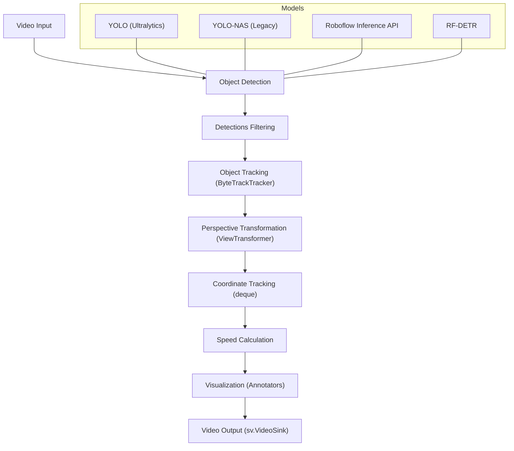
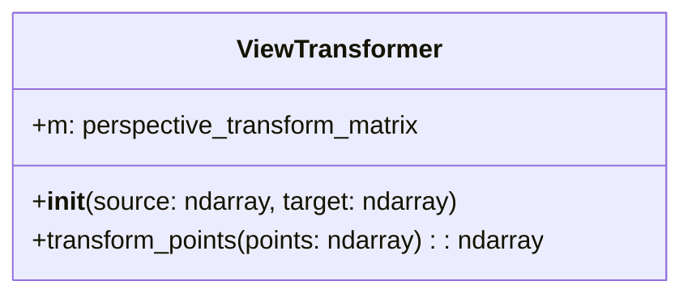
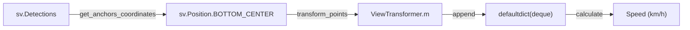
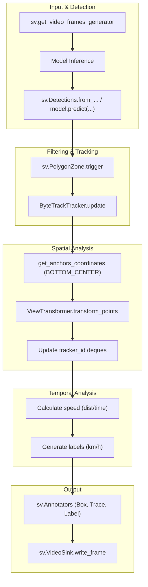

<!-- source: DeepWiki mcp.deepwiki.com · repo roboflow/supervision · page 5.2 Speed Estimation · fetched 2026-10-30 -->

# Speed Estimation

<details>
<summary>Relevant source files</summary>

The following files were used as context for generating this wiki page:

- [examples/heatmap_and_track/rfdetr_example.py](examples/heatmap_and_track/rfdetr_example.py)
- [examples/speed_estimation/README.md](examples/speed_estimation/README.md)
- [examples/speed_estimation/inference_example.py](examples/speed_estimation/inference_example.py)
- [examples/speed_estimation/requirements.txt](examples/speed_estimation/requirements.txt)
- [examples/speed_estimation/rfdetr_example.py](examples/speed_estimation/rfdetr_example.py)
- [examples/speed_estimation/ultralytics_example.py](examples/speed_estimation/ultralytics_example.py)
- [examples/speed_estimation/yolo_nas_example.py](examples/speed_estimation/yolo_nas_example.py)
- [examples/tracking/rfdetr_example.py](examples/tracking/rfdetr_example.py)
- [examples/traffic_analysis/rfdetr_example.py](examples/traffic_analysis/rfdetr_example.py)

</details>


## Purpose and Scope

This document details the implementation and usage of the speed estimation system in Supervision. The system provides tools to estimate the speed of moving objects in videos using object detection, tracking, and perspective transformation. It is particularly useful for vehicle traffic analysis, pedestrian monitoring, and other applications requiring motion speed measurement.

Sources: [examples/speed_estimation/README.md:6-10]()

## Overview

The speed estimation system combines object detection models, the `ByteTrackTracker` tracking algorithm, and a perspective transformation approach to calculate object speed in real-world units (km/h). The implementation handles the challenges of estimating speed from a 2D video of a 3D scene by transforming detected object positions to a normalized plane.

Sources: [examples/speed_estimation/README.md:6-10]()

### Speed Estimation Architecture



Sources: [examples/speed_estimation/ultralytics_example.py:55-122](), [examples/speed_estimation/yolo_nas_example.py:56-125](), [examples/speed_estimation/inference_example.py:69-138](), [examples/speed_estimation/rfdetr_example.py:99-133]()

## Key Components

### ViewTransformer

The `ViewTransformer` class is the core component responsible for transforming points from the camera perspective to a normalized coordinate system. This transformation is crucial for accurate speed estimation as it corrects for perspective distortion. It uses `cv2.getPerspectiveTransform` to compute the transformation matrix `m` and `cv2.perspectiveTransform` to map points.



Sources: [examples/speed_estimation/ultralytics_example.py:25-37]()

### Data Flow: From Pixels to Speed

The system bridges natural video space to real-world speed through a sequence of code entities:



Sources: [examples/speed_estimation/ultralytics_example.py:91-109]()

## Implementation Details

### Configuration Parameters

Two critical configuration parameters must be adjusted for each camera view to define the perspective mapping:

1. **SOURCE**: A numpy array defining a quadrilateral in the original image representing the measurement zone.
2. **TARGET**: A normalized rectangular representation of the SOURCE area, used for consistent distance measurement.

```python
SOURCE = np.array([[1252, 787], [2298, 803], [5039, 2159], [-550, 2159]])

TARGET_WIDTH = 25
TARGET_HEIGHT = 250

TARGET = np.array([
    [0, 0],
    [TARGET_WIDTH - 1, 0],
    [TARGET_WIDTH - 1, TARGET_HEIGHT - 1],
    [0, TARGET_HEIGHT - 1],
])
```

Sources: [examples/speed_estimation/ultralytics_example.py:9-21]()

### Object Tracking

The system uses `trackers.ByteTrackTracker` to maintain object identity across frames. The tracker is initialized with the video's FPS to handle temporal consistency.

```python
byte_track = ByteTrackTracker(
    frame_rate=video_info.fps, 
    track_activation_threshold=confidence_threshold
)

# In processing loop:
detections = byte_track.update(detections)
```

Sources: [examples/speed_estimation/ultralytics_example.py:57-59](), [examples/speed_estimation/ultralytics_example.py:89]()

### Coordinate Tracking and Calculation

For each `tracker_id`, the system maintains a `deque` of recent y-coordinates, limited to the number of frames per second (tracking one second of movement).

| Variable | Definition | Code Source |
|---|---|---|
| `coordinates` | `defaultdict` mapping `tracker_id` to a `deque` of positions. | [examples/speed_estimation/ultralytics_example.py:82]() |
| `distance` | `abs(coordinate_start - coordinate_end)` in normalized units. | [examples/speed_estimation/ultralytics_example.py:106]() |
| `time` | `len(coordinates[tracker_id]) / video_info.fps` in seconds. | [examples/speed_estimation/ultralytics_example.py:107]() |
| `speed` | `distance / time * 3.6` (conversion to km/h). | [examples/speed_estimation/ultralytics_example.py:108]() |

Sources: [examples/speed_estimation/ultralytics_example.py:82-109]()

### Visualization

The system utilizes Supervision's annotation suite for visual feedback:

1. **sv.BoxAnnotator**: Draws bounding boxes around detected objects.
2. **sv.TraceAnnotator**: Shows the historical path of each object.
3. **sv.LabelAnnotator**: Displays the object ID and calculated speed at `sv.Position.BOTTOM_CENTER`.

Sources: [examples/speed_estimation/ultralytics_example.py:65-75]()

## Supported Detection Models

The speed estimation examples demonstrate integration with various model providers:

| Provider | Factory Method | Example Script |
|-----------|------------------|--------------|
| Ultralytics | `sv.Detections.from_ultralytics(result)` | `ultralytics_example.py` |
| YOLO-NAS | `sv.Detections.from_yolo_nas(result)` | `yolo_nas_example.py` |
| Roboflow Inference | `sv.Detections.from_inference(results)` | `inference_example.py` |
| RF-DETR | `model.predict(...)` (returns `sv.Detections` directly) | `rfdetr_example.py` |

Sources: [examples/speed_estimation/ultralytics_example.py:87](), [examples/speed_estimation/yolo_nas_example.py:91](), [examples/speed_estimation/inference_example.py:104](), [examples/speed_estimation/rfdetr_example.py:102]()

## Usage Examples

### Video Download Utility

Before running examples, use the provided `video_downloader.py` to fetch sample data.

```bash
python video_downloader.py
```

This script downloads `vehicles.mp4` to the `data/` directory.

Sources: [examples/speed_estimation/README.md:39-40]()

### Running the Analysis

To execute speed estimation using an Ultralytics model:

```bash
python ultralytics_example.py \
    --source_video_path data/vehicles.mp4 \
    --target_video_path data/vehicles-result.mp4 \
    --confidence_threshold 0.3 \
    --iou_threshold 0.5
```

Sources: [examples/speed_estimation/README.md:86-91]()

For Roboflow Inference:

```bash
python inference_example.py \
    --roboflow_api_key "ROBOFLOW_API_KEY" \
    --source_video_path data/vehicles.mp4 \
    --target_video_path data/vehicles-result.mp4 \
    --confidence_threshold 0.3 \
    --iou_threshold 0.5
```

Sources: [examples/speed_estimation/README.md:75-81]()

For RF-DETR:

```bash
python rfdetr_example.py \
    --source_video_path data/vehicles.mp4 \
    --target_video_path data/vehicles-result.mp4 \
    --confidence_threshold 0.3 \
    --iou_threshold 0.5
```

Sources: [examples/speed_estimation/README.md:65-71]()

The `yolo_nas_example.py` script is provided for reference but is not recommended for new projects.

Sources: [examples/speed_estimation/README.md:7]()

## Customization and Calibration

### Camera Calibration

The most critical step for accuracy is setting the `SOURCE` and `TARGET` parameters.
- **SOURCE**: Quadrilateral coordinates in the image.
- **TARGET**: Normalized rectangular representation of the `SOURCE` area, used for consistent distance measurement.

It is important to adjust these parameters separately for each camera view. A YouTube tutorial is available for guidance.

Sources: [examples/speed_estimation/README.md:11](), [examples/speed_estimation/ultralytics_example.py:10-22]()

### Complete Logic Flow



Sources: [examples/speed_estimation/ultralytics_example.py:84-122](), [examples/speed_estimation/rfdetr_example.py:99-133]()

---

