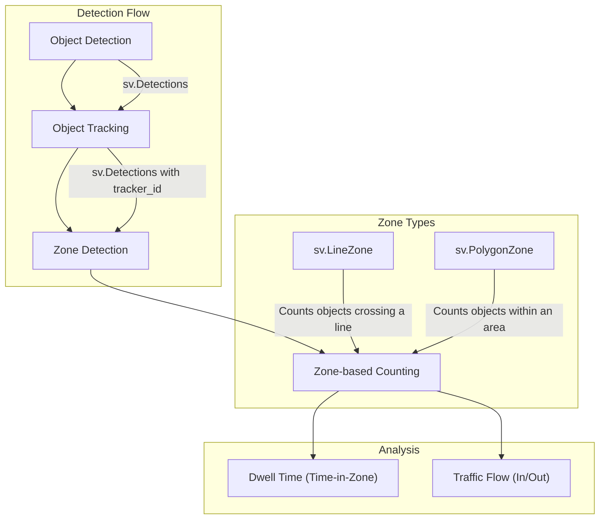
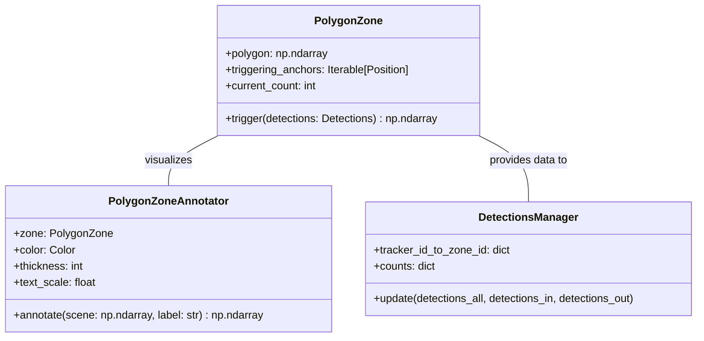
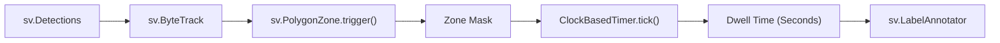

<!-- source: DeepWiki mcp.deepwiki.com · repo roboflow/supervision · page 5.3 Zone-based Counting · fetched 2026-10-30 -->

# Zone-based Counting

<details>
<summary>Relevant source files</summary>

The following files were used as context for generating this wiki page:

- [examples/count_people_in_zone/data/horizontal-zone-config.json](examples/count_people_in_zone/data/horizontal-zone-config.json)
- [examples/count_people_in_zone/data/quarters-zone-config.json](examples/count_people_in_zone/data/quarters-zone-config.json)
- [examples/count_people_in_zone/data/vertical-zone-config.json](examples/count_people_in_zone/data/vertical-zone-config.json)
- [examples/count_people_in_zone/inference_example.py](examples/count_people_in_zone/inference_example.py)
- [examples/count_people_in_zone/requirements.txt](examples/count_people_in_zone/requirements.txt)
- [examples/count_people_in_zone/ultralytics_example.py](examples/count_people_in_zone/ultralytics_example.py)
- [examples/time_in_zone/inference_file_example.py](examples/time_in_zone/inference_file_example.py)
- [examples/time_in_zone/inference_naive_stream_example.py](examples/time_in_zone/inference_naive_stream_example.py)
- [examples/time_in_zone/inference_stream_example.py](examples/time_in_zone/inference_stream_example.py)
- [examples/time_in_zone/requirements.txt](examples/time_in_zone/requirements.txt)
- [examples/time_in_zone/rfdetr_file_example.py](examples/time_in_zone/rfdetr_file_example.py)
- [examples/time_in_zone/rfdetr_naive_stream_example.py](examples/time_in_zone/rfdetr_naive_stream_example.py)
- [examples/time_in_zone/rfdetr_stream_example.py](examples/time_in_zone/rfdetr_stream_example.py)
- [examples/time_in_zone/scripts/download_from_youtube.py](examples/time_in_zone/scripts/download_from_youtube.py)
- [examples/time_in_zone/scripts/draw_zones.py](examples/time_in_zone/scripts/draw_zones.py)
- [examples/time_in_zone/scripts/stream_from_file.py](examples/time_in_zone/scripts/stream_from_file.py)
- [examples/time_in_zone/ultralytics_file_example.py](examples/time_in_zone/ultralytics_file_example.py)
- [examples/time_in_zone/ultralytics_naive_stream_example.py](examples/time_in_zone/ultralytics_naive_stream_example.py)
- [examples/time_in_zone/ultralytics_stream_example.py](examples/time_in_zone/ultralytics_stream_example.py)
- [examples/traffic_analysis/inference_example.py](examples/traffic_analysis/inference_example.py)
- [examples/traffic_analysis/ultralytics_example.py](examples/traffic_analysis/ultralytics_example.py)

</details>


This document covers the zone-based counting capabilities in the Supervision library. Zone-based counting allows you to count objects that either cross predefined lines or exist within polygon areas. For information about object detection and tracking, see [Object Detection & Tracking]().

## Overview

Supervision provides tools for monitoring spatial relationships between detections and defined regions. These tools are essential for applications like retail analytics, traffic management, and safety monitoring.

1.  **LineZone** - Counts objects crossing a line (in both directions).
2.  **PolygonZone** - Counts objects within a defined polygon area.
3.  **Time-in-Zone** - Analyzes the duration (dwell time) objects spend within specific areas.

### How Zone Counting Works



Sources: [examples/traffic_analysis/inference_example.py:160-175](), [examples/count_people_in_zone/inference_example.py:118-127]()

## PolygonZone

`PolygonZone` is used to count objects within a defined polygon area. It tracks the current count of objects inside the zone and can be configured to trigger based on specific anchor points of a bounding box.

### PolygonZone Architecture



Sources: [examples/count_people_in_zone/inference_example.py:43-60](), [examples/traffic_analysis/inference_example.py:31-59]()

### Implementation Example

To implement polygon counting, you typically define polygons as NumPy arrays and initialize the zones.

```python
import supervision as sv
import numpy as np

# Define polygon coordinates
polygon = np.array([[592, 282], [900, 282], [900, 82], [592, 82]])

# Initialize zone
zone = sv.PolygonZone(
    polygon=polygon, 
    triggering_anchors=[sv.Position.CENTER]
)

# In the processing loop:
mask = zone.trigger(detections=detections)
detections_in_zone = detections[mask]
print(f"Objects in zone: {len(detections_in_zone)}")
```

Sources: [examples/traffic_analysis/inference_example.py:16-21](), [examples/traffic_analysis/inference_example.py:62-72](), [examples/traffic_analysis/inference_example.py:170-174]()

## Time-in-Zone (Dwell Time)

Time-in-zone analysis measures how long a specific `tracker_id` remains within a `PolygonZone`. This is implemented using a timer mechanism (e.g., `ClockBasedTimer`) that tracks the duration between the first and last appearance of a tracker ID within a zone's trigger mask.

### Dwell Time Data Flow



Sources: [examples/time_in_zone/inference_stream_example.py:32-72](), [examples/time_in_zone/ultralytics_stream_example.py:35-72]()

### Implementation with Timers

The `ClockBasedTimer` (often found in example utilities) is used alongside `PolygonZone` to calculate time.

```python
# Initialize timer for each zone
timers = [ClockBasedTimer() for _ in polygons]

# Inside frame loop
for idx, zone in enumerate(zones):
    mask = zone.trigger(detections)
    detections_in_zone = detections[mask]
    
    # Calculate time for all objects in this zone
    times = timers[idx].tick(detections_in_zone)
    
    # Format labels with time
    labels = [
        f"#{tid} {int(t // 60):02d}:{int(t % 60):02d}"
        for tid, t in zip(detections_in_zone.tracker_id, times)
    ]
```

Sources: [examples/time_in_zone/inference_naive_stream_example.py:42-50](), [examples/time_in_zone/inference_naive_stream_example.py:72-95]()

## Traffic Analysis (In/Out Counting)

Traffic analysis involves using multiple zones (entry and exit) to determine flow. A `DetectionsManager` tracks which `tracker_id` entered through an "In" zone and subsequently passed through an "Out" zone.

### Logic for Flow Tracking
1.  **Entry**: If a `tracker_id` triggers `ZONE_IN`, map `tracker_id` -> `zone_in_id`.
2.  **Exit**: If a `tracker_id` triggers `ZONE_OUT` AND exists in the entry map, increment the specific counter for that path (`zone_in` -> `zone_out`).

Sources: [examples/traffic_analysis/inference_example.py:31-59](), [examples/traffic_analysis/ultralytics_example.py:29-57]()

## Zone Configuration Files

For complex setups with many zones, Supervision examples often use JSON configuration files to store polygon coordinates.

### Configuration Format
```json
{
  "polygons": [
    [[592, 282], [900, 282], [900, 82], [592, 82]],
    [[950, 860], [1250, 860], [1250, 1060], [950, 1060]]
  ]
}
```

### Loading Configuration
```python
def load_zones_config(file_path: str) -> list[np.ndarray]:
    with open(file_path) as file:
        data = json.load(file)
        return [np.array(polygon, np.int32) for polygon in data["polygons"]]
```

Sources: [examples/count_people_in_zone/inference_example.py:15-31](), [examples/count_people_in_zone/ultralytics_example.py:13-29]()

## Best Practices

| Category | Recommendation |
| :--- | :--- |
| **Tracking** | Use `sv.ByteTrack` to ensure objects maintain the same ID while in or crossing zones. [examples/traffic_analysis/inference_example.py:91]() |
| **Anchors** | Use `sv.Position.BOTTOM_CENTER` for people counting to trigger only when feet enter a zone. [examples/traffic_analysis/inference_example.py:64]() |
| **Visualization** | Use `sv.calculate_optimal_line_thickness` to scale annotations based on video resolution. [examples/count_people_in_zone/inference_example.py:37-38]() |
| **Performance** | For high-FPS streams, use `InferencePipeline` with a `CustomSink` to handle zone logic asynchronously. [examples/time_in_zone/inference_stream_example.py:17-75]() |

Sources: [examples/count_people_in_zone/inference_example.py:37-58](), [examples/time_in_zone/inference_stream_example.py:17-33](), [examples/time_in_zone/ultralytics_stream_example.py:23-33]()

---

