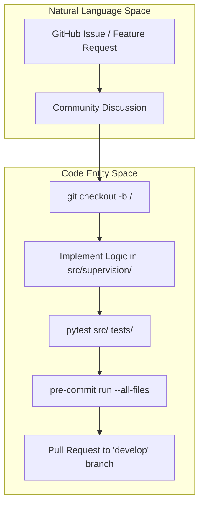
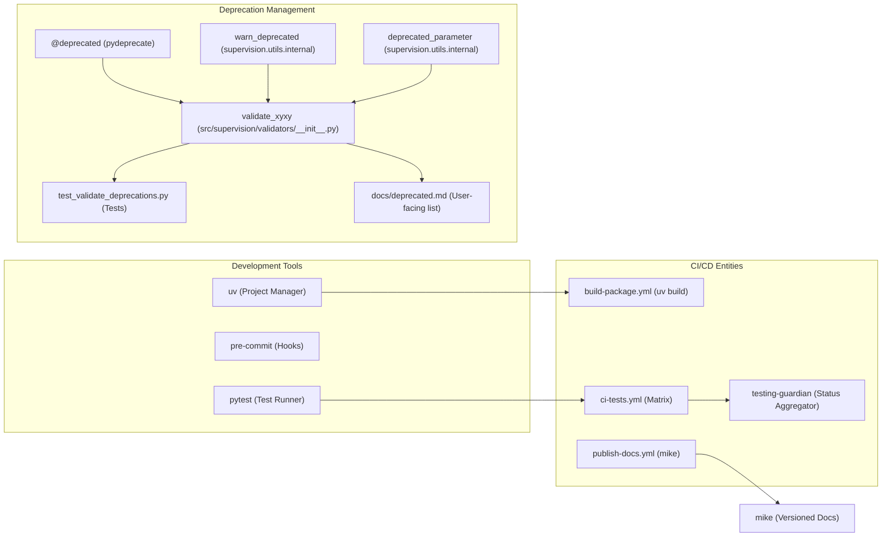

<!-- source: DeepWiki mcp.deepwiki.com · repo roboflow/supervision · page 6 Development & Contribution · fetched 2026-10-30 -->

# Development & Contribution

<details>
<summary>Relevant source files</summary>

The following files were used as context for generating this wiki page:

- [.github/CODE_OF_CONDUCT.md](.github/CODE_OF_CONDUCT.md)
- [.github/CONTRIBUTING.md](.github/CONTRIBUTING.md)
- [.github/copilot-instructions.md](.github/copilot-instructions.md)
- [AGENTS.md](AGENTS.md)
- [LICENSE.md](LICENSE.md)
- [docs/code_of_conduct.md](docs/code_of_conduct.md)
- [docs/contributing.md](docs/contributing.md)
- [docs/deprecated.md](docs/deprecated.md)
- [docs/detection/annotators.md](docs/detection/annotators.md)
- [docs/license.md](docs/license.md)
- [src/supervision/detection/tools/smoother.py](src/supervision/detection/tools/smoother.py)
- [src/supervision/validators/__init__.py](src/supervision/validators/__init__.py)
- [tests/detection/tools/test_smoother.py](tests/detection/tools/test_smoother.py)
- [tests/test_validate_deprecations.py](tests/test_validate_deprecations.py)

</details>


This page provides information for developers looking to contribute to the Supervision library. It covers environment setup, contribution workflows, and high-level summaries of the automation pipelines.

## Development Environment Setup

Supervision uses `uv` as its primary package and project manager. To set up a development environment, follow these steps:

1.  **Fork and Clone**: Fork the repository and clone it locally.
2.  **Install uv**: Follow the [uv installation guide](https://docs.astral.sh/uv/getting-started/installation/).
3.  **Sync Dependencies**: Install the library along with development, documentation, and optional metric dependencies:
    ```bash
    uv sync --group dev --group docs --extra metrics
    ```
4.  **Pre-commit Hooks**: Install pre-commit hooks to ensure code style consistency:
    ```bash
    uv run pre-commit install
    ```

Sources: [.github/CONTRIBUTING.md:13-20](), [.github/copilot-instructions.md:37-45]()

## Contribution Workflow



### Branching and Commits
- **Target Branch**: All pull requests must target the `develop` branch [[.github/CONTRIBUTING.md:114-114]]().
- **Branch Naming**: Use prefixes like `feat/`, `fix/`, `docs/`, `chore/`, `test/`, or `refactor/` [[.github/CONTRIBUTING.md:78-83]]().
- **Conventional Commits**: Use clear, structured commit messages (e.g., `feat: add support for SAM3`) [[.github/CONTRIBUTING.md:94-109]]().

Sources: [.github/CONTRIBUTING.md:54-124](), [.github/copilot-instructions.md:134-140]()

## CI/CD Workflows

Supervision employs several GitHub Action workflows to maintain code quality and automate releases.

| Workflow | File Path | Purpose |
| :--- | :--- | :--- |
| **Pytest/Test** | [.github/workflows/ci-tests.yml]() | Matrix testing across OS (Ubuntu, Windows, macOS) and Python versions (3.9-3.13). |
| **Build Package** | [.github/workflows/build-package.yml]() | Validates the build process, runs `twine check`, and performs link checking via `lychee`. |
| **Docs Build** | [.github/workflows/ci-build-docs.yml]() | Verifies that `mkdocs` can build the site without errors on every PR. |
| **Publish Docs** | [.github/workflows/publish-docs.yml]() | Deploys versioned documentation using `mike` and notifies IndexNow. |
| **Publish Release** | [.github/workflows/publish-release.yml]() | Automates PyPI uploads for official releases. |

For details on matrix configurations and deployment logic, see [CI/CD Workflows](#6.1).

Sources: [.github/workflows/ci-tests.yml:30-32](), [.github/workflows/publish-docs.yml:3-6](), [.github/workflows/build-package.yml:36-51]()

## Testing Practices

All contributions require unit tests. Supervision targets a high coverage standard (95% for project and patch) [[.codecov.yml:22-29]]().

- **Framework**: `pytest` is used for both unit tests and doctests [[.github/workflows/ci-tests.yml:51-51]]().
- **Coverage**: Reports are uploaded to Codecov [[.github/workflows/ci-tests.yml:58-66]]().
- **Guardian Pattern**: The `testing-guardian` job ensures that the CI pipeline fails if any matrix combination fails, preventing accidental merges [[.github/workflows/ci-tests.yml:71-90]]().

For a guide on writing tests and using fixtures, see [Testing](#6.2).

Sources: [.github/workflows/ci-tests.yml:71-90](), [.codecov.yml:18-31]()

## Deprecation Policy

Supervision follows a clear deprecation policy to ensure stability while allowing for API evolution. Deprecated APIs must remain for at least **3 minor releases** before being removed [[AGENTS.md:84-84]](). For example, a feature deprecated in `0.29.0` will be removed in `0.32.0` [[AGENTS.md:84-85]]().

The library uses the `@deprecated` decorator from `pydeprecate` for public functions, methods, or classes [[AGENTS.md:88-88](), src/supervision/validators/__init__.py:44-47](). For module-level deprecations, `supervision.utils.internal.warn_deprecated` is used [[AGENTS.md:86-87]](), and for parameter renames, `supervision.utils.internal.deprecated_parameter` is applied [[AGENTS.md:87-87]](). All deprecation warnings explicitly state the version in which the feature was deprecated and when it will be removed [[AGENTS.md:90-91]]().

An example of a deprecated public validation function is `validate_xyxy` which was deprecated in `0.29.0` and is scheduled for removal in `0.32.0` [[src/supervision/validators/__init__.py:44-47]](). Internal validation functions, such as `_validate_xyxy`, are used to avoid triggering deprecation warnings within the library's own codebase [[tests/test_validate_deprecations.py:93-96]]().

Sources: [AGENTS.md:82-96](), [docs/deprecated.md:10-13](), [src/supervision/validators/__init__.py:44-47](), [tests/test_validate_deprecations.py:38-90](), [tests/test_validate_deprecations.py:93-96]()

## Code Entity Map

The following diagram bridges the high-level contribution concepts to the specific code entities used in the automation and development process.



Sources: [.github/workflows/ci-tests.yml:17-25](), [.github/workflows/publish-docs.yml:58-73](), [.github/copilot-instructions.md:37-55](), [AGENTS.md:86-88](), [src/supervision/validators/__init__.py:44-47](), [docs/deprecated.md:10-13](), [tests/test_validate_deprecations.py:38-90]()

---

