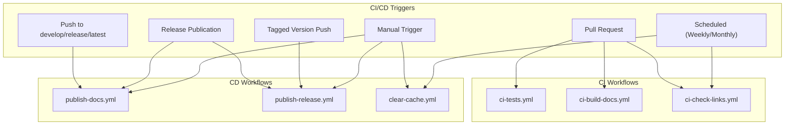
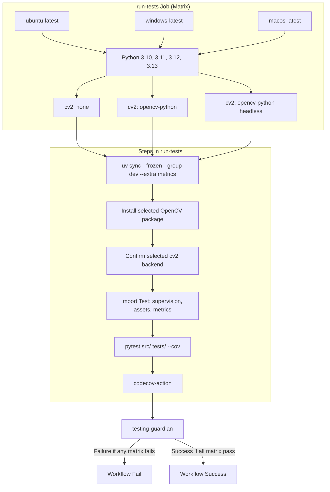

<!-- source: DeepWiki mcp.deepwiki.com · repo roboflow/supervision · page 6.1 CI/CD Workflows · fetched 2026-10-30 -->

# CI/CD Workflows

<details>
<summary>Relevant source files</summary>

The following files were used as context for generating this wiki page:

- [.github/_tests/conftest.py](.github/_tests/conftest.py)
- [.github/_tests/test_ci_helpers.py](.github/_tests/test_ci_helpers.py)
- [.github/_tests/test_compute_is_latest_release.py](.github/_tests/test_compute_is_latest_release.py)
- [.github/_tests/test_docs_backfill_workflow.py](.github/_tests/test_docs_backfill_workflow.py)
- [.github/_tests/test_docs_publish_workflow.py](.github/_tests/test_docs_publish_workflow.py)
- [.github/_tests/test_docs_theme.py](.github/_tests/test_docs_theme.py)
- [.github/_tests/test_update_docs_stats.py](.github/_tests/test_update_docs_stats.py)
- [.github/lychee.toml](.github/lychee.toml)
- [.github/root-index.html](.github/root-index.html)
- [.github/scripts/augment_links.py](.github/scripts/augment_links.py)
- [.github/scripts/compute_is_latest_release.py](.github/scripts/compute_is_latest_release.py)
- [.github/scripts/inject_outdated_banner.py](.github/scripts/inject_outdated_banner.py)
- [.github/scripts/update_docs_stats.py](.github/scripts/update_docs_stats.py)
- [.github/workflows/build-package.yml](.github/workflows/build-package.yml)
- [.github/workflows/ci-build-docs.yml](.github/workflows/ci-build-docs.yml)
- [.github/workflows/ci-check-links.yml](.github/workflows/ci-check-links.yml)
- [.github/workflows/ci-docs-stats.yml](.github/workflows/ci-docs-stats.yml)
- [.github/workflows/ci-github-tests.yml](.github/workflows/ci-github-tests.yml)
- [.github/workflows/ci-tests.yml](.github/workflows/ci-tests.yml)
- [.github/workflows/clear-cache.yml](.github/workflows/clear-cache.yml)
- [.github/workflows/docs-backfill.yml](.github/workflows/docs-backfill.yml)
- [.github/workflows/publish-docs.yml](.github/workflows/publish-docs.yml)
- [.github/workflows/publish-pre-release.yml](.github/workflows/publish-pre-release.yml)
- [.github/workflows/publish-release.yml](.github/workflows/publish-release.yml)
- [.github/workflows/publish-testpypi.yml](.github/workflows/publish-testpypi.yml)

</details>


## Purpose and Scope

This document details the Continuous Integration and Continuous Deployment (CI/CD) workflows used in the Supervision library. It covers the automated processes for testing, documentation building, and package publishing. For information about testing practices and writing tests for Supervision, see [Testing](6.2).

## Overview of CI/CD Architecture

The Supervision project uses GitHub Actions for all CI/CD workflows. These workflows are triggered by specific events such as pull requests, pushes to branches, tag creation, and manual dispatch. The workflows help maintain code quality, automate testing, update documentation, and publish package releases.



Sources: [.github/workflows/ci-tests.yml:1-8](), [.github/workflows/publish-docs.yml:1-15](), [.github/workflows/publish-release.yml:1-8](), [.github/workflows/clear-cache.yml:1-6](), [.github/workflows/ci-check-links.yml:1-12]()

## Testing Workflows

### Python Testing Workflow (`ci-tests.yml`)

The main testing workflow runs `pytest` across multiple Python versions and operating systems. It employs a "Testing Guardian" pattern to ensure that the overall CI status accurately reflects the matrix results.



Sources: [.github/workflows/ci-tests.yml:24-70](), [.github/workflows/ci-tests.yml:71-91]()

The workflow performs:
1.  **Matrix Testing**: Validates compatibility across Linux, Windows, and macOS with Python 3.10 through 3.13. It also tests with different OpenCV configurations (`none`, `opencv-python`, `opencv-python-headless`) for Python 3.13 across all OSes [.github/workflows/ci-tests.yml:30-40]().
2.  **OpenCV Backend Confirmation**: A Python script confirms that the `_cv2.BACKEND_NAME` matches the expected backend based on the matrix configuration [.github/workflows/ci-tests.yml:59-68]().
3.  **Import Test**: Executes a smoke test `python -c "import supervision; ..."` to ensure basic package integrity [.github/workflows/ci-tests.yml:70-71]().
4.  **Coverage Reporting**: Uploads XML coverage reports to Codecov with flags for OS and Python version [.github/workflows/ci-tests.yml:84-93]().
5.  **Clean Wheel Test**: A separate job `clean-wheel` builds the package and installs it in an isolated environment without OpenCV, then verifies that the fallback `_cv2` backend is correctly used [.github/workflows/ci-tests.yml:97-139]().
6.  **Testing Guardian**: A downstream job `testing-guardian` explicitly fails if any of the `run-tests` or `clean-wheel` jobs result in `failure`, `cancelled`, or `skipped` [.github/workflows/ci-tests.yml:140-159]().

### Documentation Testing Workflow (`ci-build-docs.yml`)

This workflow verifies that the documentation builds correctly using `mkdocs` before merging changes. It installs the `docs` dependency group via `uv sync --frozen --group docs` [.github/workflows/ci-build-docs.yml:33-34]() and runs `mkdocs build --verbose` [.github/workflows/ci-build-docs.yml:42-43]().

Sources: [.github/workflows/ci-build-docs.yml:1-43]()

## Build and Deployment Workflows

### Package Building (`build-package.yml`)

This is a reusable workflow used by release processes. It performs:
-   **Link Augmentation**: Runs `.github/scripts/augment_links.py` to adjust paths in `README.md` for the specific branch, ensuring links point to the correct location on GitHub [.github/workflows/build-package.yml:31-34]().
-   **Link Checking**: Uses `lycheeverse/lychee-action` to validate URLs in `README.md` against configurations in `.github/lychee.toml` [.github/workflows/build-package.yml:36-44]().
-   **Distribution**: Builds source and wheel distributions using `uv build` and verifies them with `twine check --strict` [.github/workflows/build-package.yml:46-50]().
-   **Artifact Upload**: Uploads the built distributions as artifacts named `dist` [.github/workflows/build-package.yml:52-56]().

Sources: [.github/workflows/build-package.yml:1-56]()

### Documentation Publishing (`publish-docs.yml`)

Supervision uses `mike` for versioned documentation and implements SEO/VLM optimizations through "GEO root" injection.

```mermaid
graph TD
    A[Push to develop/release/latest or workflow_dispatch] --> B{Determine Docs Version}
    B -- "develop branch" --> C[Deploy Development Docs (mike deploy develop)]
    B -- "release/latest branch" --> D[Deploy Latest Docs (mike delete latest; mike deploy latest)]
    B -- "release published event" --> E[Determine Release Metadata (is_rc, release_tag, is_latest_release)]
    E -- "Not RC" --> F[Deploy Release Docs (mike deploy <tag>)]
    F -- "Is latest release" --> G[Archive Previously-Latest Release's Docs Tree]
    G --> H[Inject GEO root files]
    H --> I[Notify IndexNow]
    C --> H
    D --> H
```

Sources: [.github/workflows/publish-docs.yml:10-17](), [.github/workflows/publish-docs.yml:63-70](), [.github/workflows/publish-docs.yml:72-79](), [.github/workflows/publish-docs.yml:83-106](), [.github/workflows/publish-docs.yml:108-115](), [.github/workflows/publish-docs.yml:124-148]()

| Feature | Implementation |
| :--- | :--- |
| **Versioning** | `mike deploy` handles `develop`, `latest`, and `<tag>` versions. The `MIKE_DOCS_VERSION` environment variable is used to control the outdated-version banner in `mkdocs.yml` [.github/workflows/publish-docs.yml:66](). |
| **Archiving Previous Latest** | When a new stable release is published, the previously-latest release's documentation tree is patched to include an "outdated" banner using the `.github/scripts/inject_outdated_banner.py` script [.github/workflows/publish-docs.yml:124-137](). This script modifies static HTML, CSS, and JS directly to update the banner without rebuilding the entire tree. |
| **GEO Root Injection** | Copies `robots.txt`, `llms.txt`, and `sitemap.xml` to the root of the `gh-pages` branch. This ensures search engines and LLMs can correctly crawl the documentation [.github/workflows/publish-docs.yml:146-170](). |
| **IndexNow** | Notifies search engines (Bing/Yandex) of updates to key documentation URLs. This involves injecting a key file (`0d5d9799b1cc4a39825146388c6781eb.txt`) and then sending a notification via `curl` [.github/workflows/publish-docs.yml:172-211](). The key must be kept in sync across `docs/0d5d9799b1cc4a39825146388c6781eb.txt`, `docs/theme/main.html`, and this workflow [.github/workflows/publish-docs.yml:140-144](). |

Sources: [.github/workflows/publish-docs.yml:1-212](), [.github/scripts/inject_outdated_banner.py:1-450]()

### Package Publishing Workflows

Supervision maintains separate workflows for different release tiers, all utilizing `pypa/gh-action-pypi-publish`:

1.  **Release Publishing** (`publish-release.yml`): Triggers on published releases. It downloads the `dist` artifacts from the `build` job, uploads them as assets to the GitHub Release, and publishes to PyPI if it is not a pre-release [.github/workflows/publish-release.yml:41-53]().
2.  **Pre-release Publishing** (`publish-pre-release.yml`): Triggers on pushes to tags matching patterns like `*a*`, `*b*`, or `*rc*` (e.g., `1.0.0a1`, `1.0.0b1`, `1.0.0rc1`) [.github/workflows/publish-pre-release.yml:3-11](). It publishes to the main PyPI index.
3.  **TestPyPI Publishing** (`publish-testpypi.yml`): A manual or PR-based workflow that pushes to `https://test.pypi.org/legacy/` [.github/workflows/publish-testpypi.yml:39-44](). This is used for testing the publishing process without affecting the main PyPI.

Sources: [.github/workflows/publish-release.yml:1-53](), [.github/workflows/publish-pre-release.yml:1-51](), [.github/workflows/publish-testpypi.yml:1-44]()

## Maintenance Workflows

### Cache Management (`clear-cache.yml`)

To prevent cache bloat, a scheduled workflow runs on the first day of every month, or can be triggered manually via `workflow_dispatch` [.github/workflows/clear-cache.yml:4-7](). It uses `actions/github-script` to interact with the GitHub API and programmatically delete all actions caches for the repository using `github.rest.actions.deleteActionsCacheById` [.github/workflows/clear-cache.yml:18-42]().

Sources: [.github/workflows/clear-cache.yml:1-42]()

### Link Checking (`ci-check-links.yml`)

A standalone link checker runs weekly on Sundays and on pull requests [.github/workflows/ci-check-links.yml:7-12](). It uses `lycheeverse/lychee-action` to check links in all Markdown files (`./**/*.md`) [.github/workflows/ci-check-links.yml:24-31](). A custom configuration file `.github/lychee.toml` is used to define acceptable HTTP status codes (e.g., 408, 429, 502, 503, 504 for transient issues) and exclude specific URLs that are known to cause issues or are placeholders (e.g., `http://127.0.0.1:8000`, `https://huggingface.co/spaces/Roboflow/Annotators`) [.github/lygithub.toml:8-36]().

Sources: [.github/workflows/ci-check-links.yml:1-37](), [.github/lychee.toml:1-36]()

## Implementation Details

### Workflow Permissions

Workflows follow the principle of least privilege. For example, the `publish-release.yml` workflow explicitly removes all permissions by default (`permissions: {}`) [.github/workflows/publish-release.yml:13]() and only grants `id-token: write` for OIDC PyPI publishing and `contents: write` for asset uploads [.github/workflows/publish-release.yml:29-31](). Similarly, `clear-cache.yml` only requests `actions: write` for cache management [.github/workflows/clear-cache.yml:10]().

Sources: [.github/workflows/publish-release.yml:13](), [.github/workflows/publish-release.yml:29-31](), [.github/workflows/clear-cache.yml:10]()

### Dependency Resolution

All workflows utilize `uv` for high-performance dependency management.
-   **Installation**: `astral-sh/setup-uv` action is used to install `uv` and set the Python version [.github/workflows/ci-tests.yml:46-50]().
-   **Syncing**: `uv sync --frozen` ensures reproducible environments based on the `uv.lock` lockfile [.github/workflows/ci-tests.yml:52]().
-   **Groups**: Dependencies are segmented into `dev`, `docs`, and `build` groups defined in `pyproject.toml`. For example, `uv sync --frozen --group dev --extra metrics` is used for testing [.github/workflows/ci-tests.yml:52](), and `uv sync --frozen --group docs` for documentation builds [.github/workflows/ci-build-docs.yml:33-34]().
-   **Extras**: The `metrics` extra is explicitly installed during test runs when needed [.github/workflows/ci-tests.yml:52]().

Sources: [.github/workflows/ci-tests.yml:46-52](), [.github/workflows/ci-build-docs.yml:33-34](), [.github/workflows/build-package.yml:48]()

---

