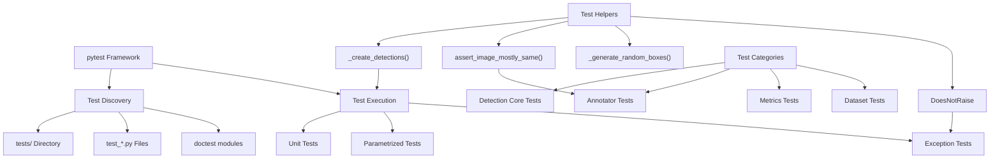
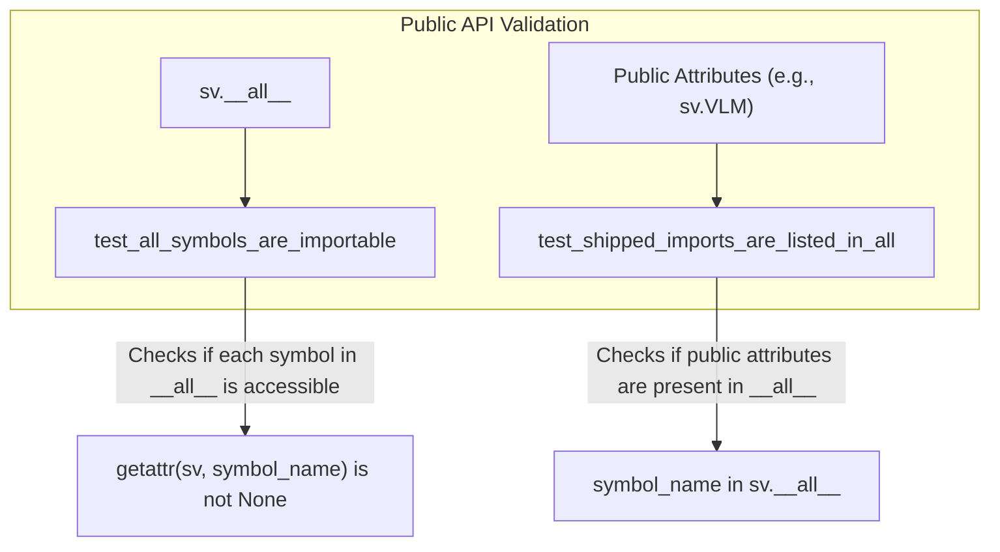
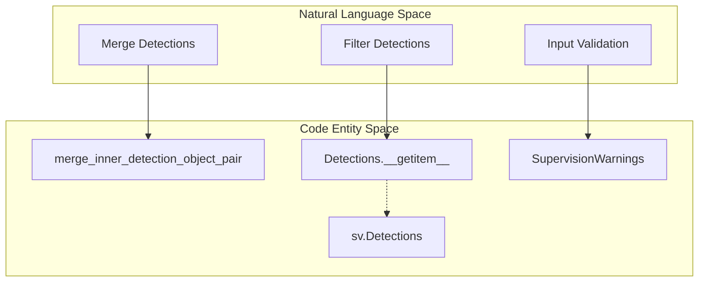
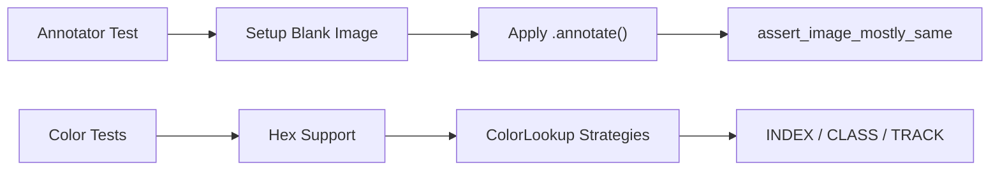
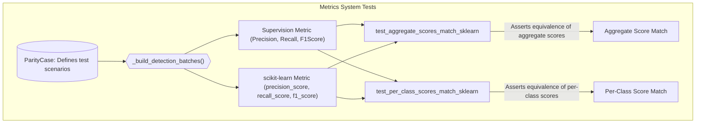
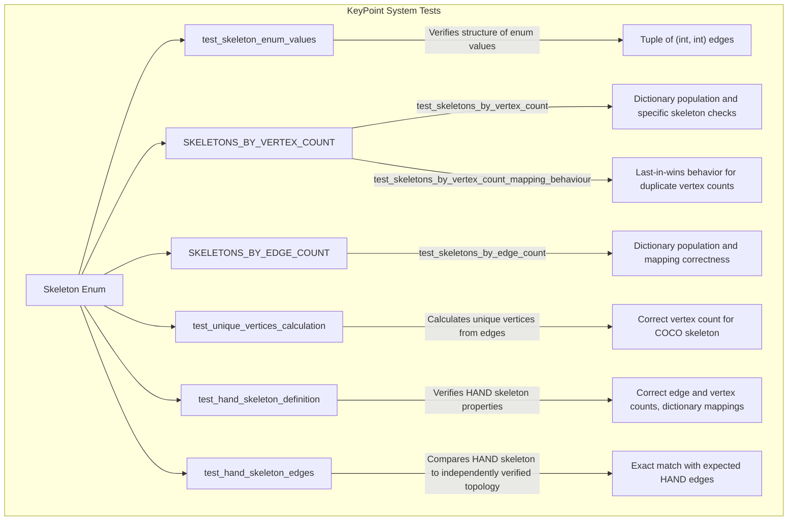

<!-- source: DeepWiki mcp.deepwiki.com · repo roboflow/supervision · page 6.2 Testing · fetched 2026-10-30 -->

# Testing

<details>
<summary>Relevant source files</summary>

The following files were used as context for generating this wiki page:

- [.codecov.yml](.codecov.yml)
- [.pre-commit-config.yaml](.pre-commit-config.yaml)
- [pyproject.toml](pyproject.toml)
- [src/supervision/assets/list.py](src/supervision/assets/list.py)
- [src/supervision/draw/base.py](src/supervision/draw/base.py)
- [src/supervision/key_points/skeletons.py](src/supervision/key_points/skeletons.py)
- [tests/conftest.py](tests/conftest.py)
- [tests/helpers.py](tests/helpers.py)
- [tests/key_points/test_skeletons.py](tests/key_points/test_skeletons.py)
- [tests/metrics/test_sklearn_parity.py](tests/metrics/test_sklearn_parity.py)
- [tests/test_public_api.py](tests/test_public_api.py)
- [tox.ini](tox.ini)
- [uv.lock](uv.lock)

</details>


This page documents the testing infrastructure and practices used in the Supervision library. Supervision employs a comprehensive test suite to verify the functionality of components like detection processing, annotators, metrics calculations, and dataset management. The project maintains a high quality bar with a **95% Codecov target**.

For information about how tests are automatically run in continuous integration pipelines, see [CI/CD Workflows](#6.1).

## Testing Architecture

The testing system is built on `pytest` and utilizes a directory structure that mirrors the source code.



Sources: [tests/helpers.py:1-7](), [tests/metrics/test_sklearn_parity.py:1-7](), [tests/public_api/test_public_api.py:1-2]()

### Test Organization

Supervision's test suite is organized in a directory structure that mirrors the main codebase:

```
src/supervision/      # Main library code
  ├── detection/
  │   └── core.py
  └── annotators/
      └── base.py

tests/                # Test code
  ├── detection/
  │   └── test_core.py
  ├── annotators/
  │   └── test_base.py
  └── helpers.py      # Shared test utilities
```

### Shared Test Helpers

The `tests/helpers.py` file contains factory functions and custom assertions used across the suite to simplify test creation.

| Helper | Description | Source |
|-----------|-------------|--------------|
| `_create_detections()` | Creates `Detections` from lists instead of NumPy arrays. | [tests/helpers.py:37-93]() |
| `_create_key_points()` | Creates `KeyPoints` from list-based inputs. | [tests/helpers.py:96-157]() |
| `_generate_random_boxes()` | Generates random `xyxy` boxes within constraints. | [tests/helpers.py:160-189]() |
| `make_panoptic_png()` | Encodes a segment-ID array as a 24-bit RGBA PNG byte string. | [tests/helpers.py:20-34]() |

Sources: [tests/helpers.py:1-189]()

## Test Categories and Patterns

### Public API Validation Tests

The `tests/test_public_api.py` module ensures that the public API of the `supervision` package remains consistent and discoverable.



*   **`test_all_symbols_are_importable`**: Iterates through `sv.__all__` and verifies that each listed symbol can be accessed as a non-`None` attribute of the `supervision` package [tests/test_public_api.py:8-19]().
*   **`test_shipped_imports_are_listed_in_all`**: Explicitly checks that key public attributes (like `sv.VLM`, `sv.denormalize_boxes`) are both accessible and correctly listed in `sv.__all__` [tests/test_public_api.py:21-32]().

Sources: [tests/test_public_api.py:1-32]()

### Detection System Tests

Tests for the `Detections` class verify logic for filtering, merging, and data consistency.



Key behaviors tested:
*   **Filtering**: Using boolean masks or integer indices to slice detections [tests/metrics/test_sklearn_parity.py:152-169]().
*   **Merging**: Combining multiple `Detections` objects, including their `data` and `metadata` dictionaries.
*   **Warnings**: Ensuring that deprecated or incorrect types (like non-boolean masks) trigger `SupervisionWarnings`.

Sources: [tests/metrics/test_sklearn_parity.py:152-169]()

### Annotation System Tests

Annotator tests focus on visual correctness and color resolution strategies.



*   **Visual Regression**: Tests like `test_annotate_with_single_detection` use a blank image and verify that the annotator actually draws pixels.
*   **Hex Color Support**: A parametrized test verifies that all major annotators (Box, Mask, Label, etc.) correctly parse hex strings into internal `Color` objects.
*   **Color Resolution**: Tests verify that `resolve_color_idx` correctly maps detections to colors based on `ColorLookup` enum.

Sources: [src/supervision/draw/base.py]()

### Metrics System Tests

Metrics tests verify evaluation accuracy for Precision, Recall, and F1-Score, including parity with `scikit-learn`.



*   **`ParityCase`**: A dataclass defining equivalent Supervision detection batches and scikit-learn label events for various scenarios (balanced, prediction-only, target-only, background images, non-contiguous IDs) [tests/metrics/test_sklearn_parity.py:27-47]().
*   **`MetricSpec`**: A dataclass linking Supervision metric classes (`Precision`, `Recall`, `F1Score`) to their corresponding scikit-learn functions [tests/metrics/test_sklearn_parity.py:38-47]().
*   **`_detections_from_classes`**: Helper to build isolated `Detections` objects from class IDs for controlled matching [tests/metrics/test_sklearn_parity.py:152-169]().
*   **`_build_detection_batches`**: Converts `ParityCase` class batches into Supervision `Detections` inputs [tests/metrics/test_sklearn_parity.py:172-184]().
*   **`test_aggregate_scores_match_sklearn`**: Parametrized test comparing aggregate scores (micro, macro, weighted) of Supervision metrics against scikit-learn's results for various `ParityCase` scenarios [tests/metrics/test_sklearn_parity.py:197-207]().
*   **`test_per_class_scores_match_sklearn`**: Similar to aggregate scores, but verifies per-class scores.

Sources: [tests/metrics/test_sklearn_parity.py:1-207]()

### Dataset Management Tests

Tests for dataset utilities verify the integrity of data splits and class mapping.

*   **Train/Test Split**: Verifies that `train_test_split` respects ratios, random seeds, and shuffling.
*   **Class Mapping**: Ensures that `build_class_index_mapping` and `map_detections_class_id` correctly re-index detections when merging datasets with different class lists.

### KeyPoint System Tests

Tests for the `KeyPoints` system ensure the correctness of skeleton definitions and mappings.



*   **`test_skeleton_enum_values`**: Checks that each `Skeleton` enum member's value is a tuple of `(int, int)` tuples, representing edges [tests/key_points/test_skeletons.py:38-46]().
*   **`test_skeletons_by_vertex_count`**: Verifies that `SKELETONS_BY_VERTEX_COUNT` is correctly populated and contains expected skeletons like `COCO` [tests/key_points/test_skeletons.py:48-55]().
*   **`test_skeletons_by_edge_count`**: Ensures `SKELETONS_BY_EDGE_COUNT` accurately maps edge counts to skeleton definitions [tests/key_points/test_skeletons.py:57-69]().
*   **`test_unique_vertices_calculation`**: Confirms that the number of unique vertices derived from a skeleton's edges matches the expected count (e.g., 17 for COCO) [tests/key_points/test_skeletons.py:71-76]().
*   **`test_skeletons_by_vertex_count_mapping_behaviour`**: Validates the "last-in-wins" behavior when multiple skeletons have the same vertex count in `SKELETONS_BY_VERTEX_COUNT` [tests/key_points/test_skeletons.py:78-91]().
*   **`test_hand_skeleton_definition`**: Specifically checks the `Skeleton.HAND` definition for correct edge and vertex counts and its presence in the lookup dictionaries [tests/key_points/test_skeletons.py:93-99]().
*   **`test_hand_skeleton_edges`**: Compares `Skeleton.HAND.value` against an independently defined `HAND` tuple to ensure its topology matches the MediaPipe specification [tests/key_points/test_skeletons.py:101-110]().

Sources: [src/supervision/key_points/skeletons.py:1-316](), [tests/key_points/test_skeletons.py:1-110]()

## Test Configuration & Fixtures

### pytest Configuration
Supervision is configured to run `doctest` modules, ensuring that code examples in docstrings remain functional [pyproject.toml:216-219](). It also sets `testpaths` to include both `src` and `tests` directories and defines `norecursedirs` to exclude non-test related folders [pyproject.toml:214-215](). Warnings are treated as errors to catch potential issues early [pyproject.toml:220-222]().

Sources: [pyproject.toml:213-222]()

### conftest Fixtures
The `tests/conftest.py` file provides common fixtures for tests:
*   `scene`: Returns a blank `numpy.ndarray` representing an image, useful for annotator tests [tests/conftest.py:21-22]().
*   `sample_key_points`: Provides a pre-populated `sv.KeyPoints` object for testing keypoint-related functionalities [tests/conftest.py:25-74]().
*   `empty_key_points`: Returns an empty `sv.KeyPoints` object [tests/conftest.py:77-79]().

Sources: [tests/conftest.py:1-79]()

## Running Tests

### Local Execution
To run the full suite with coverage:
```bash
pytest --cov=supervision tests/
```
The `tox.ini` file defines test environments for different Python versions, allowing `pytest` to be run with `tox` [tox.ini:1-7]().

Sources: [tox.ini:1-7]()

### Coverage Requirements
The project aims for **95% coverage**. Pull requests that significantly drop coverage are flagged in CI. The `.codecov.yml` configuration sets a project-wide target of 95% and a patch target of 95% for new or changed code, with a threshold of 10% allowed decrease [.codecov.yml:18-30]().

Sources: [.codecov.yml:1-41]()

### Exception Testing Pattern
Supervision uses a standard pattern for testing both success and failure cases in a single parametrized test:

```python
@pytest.mark.parametrize(
    ("input", "expected", "exception"),
    [
        (valid_val, expected_val, DoesNotRaise()),
        (invalid_val, None, pytest.raises(ValueError, match="Error message")),
    ],
)
def test_function(input, expected, exception):
    with exception:
        result = some_function(input)
        assert result == expected
```

Sources: [tests/metrics/test_sklearn_parity.py:197-207]()

---

