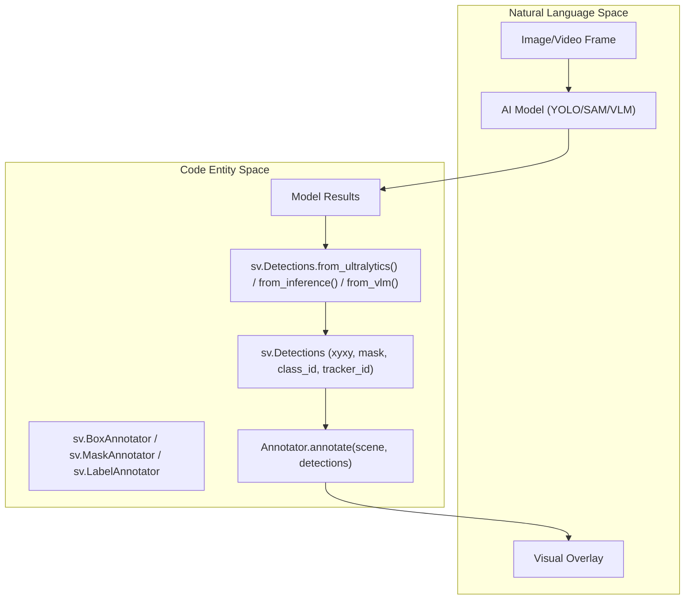
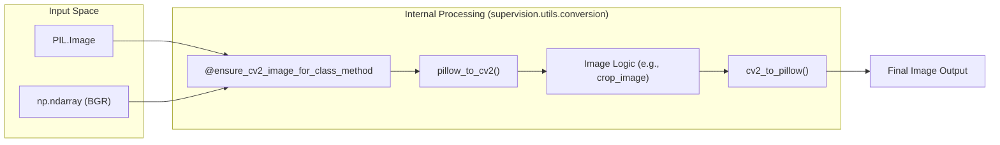

<!-- source: DeepWiki mcp.deepwiki.com · repo roboflow/supervision · page 7 Glossary · fetched 2026-10-30 -->

# Glossary

Relevant source files

The following files were used as context for generating this wiki page:

- [docs/changelog.md](docs/changelog.md)
- [src/supervision/annotators/core.py](src/supervision/annotators/core.py)
- [src/supervision/annotators/utils.py](src/supervision/annotators/utils.py)
- [src/supervision/dataset/core.py](src/supervision/dataset/core.py)
- [src/supervision/dataset/formats/coco.py](src/supervision/dataset/formats/coco.py)
- [src/supervision/dataset/formats/yolo.py](src/supervision/dataset/formats/yolo.py)
- [src/supervision/dataset/utils.py](src/supervision/dataset/utils.py)
- [src/supervision/detection/core.py](src/supervision/detection/core.py)
- [src/supervision/detection/vlm.py](src/supervision/detection/vlm.py)
- [src/supervision/draw/utils.py](src/supervision/draw/utils.py)
- [src/supervision/metrics/f1_score.py](src/supervision/metrics/f1_score.py)
- [src/supervision/metrics/mean_average_precision.py](src/supervision/metrics/mean_average_precision.py)
- [src/supervision/metrics/mean_average_recall.py](src/supervision/metrics/mean_average_recall.py)
- [src/supervision/metrics/precision.py](src/supervision/metrics/precision.py)
- [src/supervision/metrics/recall.py](src/supervision/metrics/recall.py)
- [tests/annotators/test_core.py](tests/annotators/test_core.py)
- [tests/annotators/test_utils.py](tests/annotators/test_utils.py)
- [tests/dataset/formats/test_coco.py](tests/dataset/formats/test_coco.py)
- [tests/dataset/formats/test_yolo.py](tests/dataset/formats/test_yolo.py)
- [tests/dataset/test_core.py](tests/dataset/test_core.py)
- [tests/detection/test_from_adapters.py](tests/detection/test_from_adapters.py)
- [tests/detection/test_vlm.py](tests/detection/test_vlm.py)
- [tests/draw/test_utils.py](tests/draw/test_utils.py)
- [tests/metrics/test_f1_score.py](tests/metrics/test_f1_score.py)
- [tests/metrics/test_mean_average_recall.py](tests/metrics/test_mean_average_recall.py)
- [tests/metrics/test_precision.py](tests/metrics/test_precision.py)
- [tests/metrics/test_recall.py](tests/metrics/test_recall.py)

This glossary defines codebase-specific terms, abbreviations, and domain concepts used throughout the Supervision library. It is intended to help onboarding engineers navigate the data structures and implementation patterns used in the project.

## Core Data Structures

### Detections
The primary data container in Supervision. It standardizes outputs from various computer vision models (Ultralytics, Transformers, SAM, etc.) into a single object.
*   **Implementation**: A dataclass that uses `numpy` arrays to store bounding boxes, masks, and metadata. [src/supervision/detection/core.py:113-114]()
*   **Key Fields**: `xyxy` (boxes), `mask` (segmentation), `confidence`, `class_id`, and `tracker_id`. [src/supervision/detection/core.py:198-198]()
*   **Validation**: Fields are validated upon instantiation via `_validate_detections_fields`. [src/supervision/detection/core.py:86-87]()
*   **Code Pointers**:
    *   Definition: [src/supervision/detection/core.py:113-114]()
    *   Validation: [src/supervision/validators/__init__.py:157-172]()

### CompactMask
A memory-efficient storage format for segmentation masks introduced in v0.28.0. Instead of storing full-resolution boolean bitmaps (e.g., $1920 \times 1080$), it stores a cropped region bounding box and RLE-encoded data.
*   **Performance**: Can reduce memory usage by up to 240x for sparse masks. [docs/changelog.md:10-10]()
*   **Integration**: Transparently integrates with `sv.Detections.mask`. Methods like `area` or filtering work without materializing the full array. [src/supervision/detection/core.py:18-18]()
*   **Code Pointers**:
    *   Definition: [src/supervision/detection/compact_mask.py:35-37]() (referenced in [docs/changelog.md:10-10]())
    *   Usage in Detections: [src/supervision/detection/core.py:153-153]()

### KeyPoints
A data structure for pose estimation results. It stores the coordinates of detected joints (vertices) and their relationships (edges).
*   **Implementation**: Similar to `Detections`, but stores an `xy` array of shape `(n, m, 2)` or `(n, m, 3)`.
*   **Bridge**: Can be converted to `Detections` via `.as_detections()` for tracking purposes.
*   **Code Pointers**:
    *   Definition: [mkdocs.yml:57-57]()
    *   Validation: [src/supervision/validators/__init__.py:174-186]()

---

## Coordinate Systems & Formats

| Term | Definition | Code Reference |
| :--- | :--- | :--- |
| **xyxy** | Bounding box format: `[x_min, y_min, x_max, y_max]`. | [src/supervision/detection/core.py:133-134]() |
| **xywh** | Bounding box format: `[x_min, y_min, width, height]`. | [src/supervision/detection/utils/converters.py:24-24]() |
| **RLE** | Run-Length Encoding. Used for compressed mask storage. | [src/supervision/detection/utils/converters.py:30-30]() |
| **denormalize** | Converting relative coordinates (0.0 to 1.0) to pixel values based on image resolution. | [src/supervision/detection/utils/boxes.py:15-15]() |
| **OBB (Oriented Bounding Box)** | A bounding box that is not axis-aligned, allowing for rotation. Represented by 8 coordinates `[x1, y1, x2, y2, x3, y3, x4, y4]`. | [src/supervision/config.py:16-16]() |

---

## Domain Concepts

### Annotators
Classes responsible for drawing visualizations on images or video frames. They follow a "scene-in/scene-out" pattern where the `annotate` method modifies or returns a frame.
*   **Implementation**: Most annotators inherit from `BaseAnnotator` and use decorators like `@ensure_cv2_image_for_class_method` to handle different input types (OpenCV vs. PIL). [src/supervision/annotators/core.py:14-14]()
*   **Code Pointers**:
    *   Base Logic: [src/supervision/annotators/base.py:1-10]()
    *   Image Decorators: [src/supervision/utils/conversion.py:16-40]()

### ColorLookup
An enumeration class defining strategies for mapping colors to annotations. This allows annotators to assign colors based on detection index, class label, or tracker ID.
*   **Strategies**: `INDEX`, `CLASS`, `TRACK`. [src/supervision/annotators/utils.py:29-32]()
*   **Usage**: Used by various annotators to determine the color of drawn elements. [src/supervision/annotators/utils.py:151-154]()
*   **Code Pointers**:
    *   Definition: [src/supervision/annotators/utils.py:20-32]()
    *   Resolution Logic: [src/supervision/annotators/utils.py:38-75]()

### MetricTarget
An enumeration used in the metrics system to specify the type of geometric data being evaluated (e.g., bounding boxes, masks, or oriented bounding boxes).
*   **Purpose**: Ensures that the correct Intersection over Union (IoU) calculation is used for a given metric. [src/supervision/metrics/mean_average_recall.py:25-26]()
*   **Code Pointers**:
    *   Definition: [src/supervision/metrics/core.py:10-16]()
    *   Usage in MeanAverageRecall: [src/supervision/metrics/mean_average_recall.py:70-70]()

### SAHI (Slicing Aided Hyper Inference)
A technique for improving object detection performance on small objects by slicing large images into smaller, overlapping tiles, running inference on each tile, and then merging the results.
*   **Implementation**: `InferenceSlicer` class. [src/supervision/detection/tools/inference_slicer.py:1-20]()
*   **Code Pointers**:
    *   `InferenceSlicer` class: [src/supervision/detection/tools/inference_slicer.py:1-20]() (referenced in [docs/changelog.md:10-10]())

### VLM (Vision-Language Models)
A subset of models that accept both images and text prompts. Supervision provides parsers for models like PaliGemma, Florence-2, and Gemini to convert their text/dictionary outputs into `sv.Detections`.
*   **Evolution**: Replaced the legacy `LMM` (Large Multimodal Model) terminology in v0.27.0. [docs/changelog.md:14-14]()
*   **Code Pointers**:
    *   VLM Enum: [src/supervision/detection/vlm.py:22-51]()
    *   `Detections.from_vlm` factory method: [src/supervision/detection/core.py:10-10]()

### tracker_id
An optional field within the `Detections` dataclass that stores a unique identifier for each tracked object across frames.
*   **Purpose**: Enables object tracking and consistent visualization of objects over time. [src/supervision/annotators/utils.py:68-74]()
*   **Code Pointers**:
    *   `Detections.tracker_id` field: [src/supervision/detection/core.py:198-198]()
    *   Usage in `ColorLookup.TRACK`: [src/supervision/annotators/utils.py:68-74]()

### lazy loading
A strategy used in `DetectionDataset` where image data is loaded from disk only when it is explicitly requested, rather than all at once during dataset initialization.
*   **Benefit**: Reduces memory consumption, especially for large datasets. [src/supervision/dataset/core.py:85-86]()
*   **Implementation**: The `_get_image` method handles loading images from paths. [src/supervision/dataset/core.py:151-158]()
*   **Code Pointers**:
    *   `DetectionDataset` initialization: [src/supervision/dataset/core.py:140-142]()
    *   `_get_image` method: [src/supervision/dataset/core.py:151-158]()

---

## System Architecture Diagrams

### Data Flow: From Model to Visualization
This diagram bridges the natural language concept of "detecting and drawing" to the specific code entities involved in the pipeline.

**Sources**: [src/supervision/detection/core.py:64-130](), [src/supervision/annotators/base.py:1-10](), [src/supervision/detection/vlm.py:22-51]()

### Image Processing & Type Safety
Supervision maintains internal consistency by ensuring images are in a format compatible with OpenCV (numpy) or PIL, regardless of the user's input.

**Sources**: [src/supervision/utils/conversion.py:54-76](), [src/supervision/utils/image.py:33-37](), [src/supervision/utils/conversion.py:148-176]()

---

## Jargon & Abbreviations

*   **NMS (Non-Max Suppression)**: A technique to filter out overlapping bounding boxes that refer to the same object. [src/supervision/detection/utils/iou_and_nms.py:53-53]()
*   **NMM (Non-Max Merge)**: A technique similar to NMS but for segmentation masks, where overlapping masks are merged rather than suppressed. [src/supervision/detection/utils/iou_and_nms.py:54-55]() (referenced in [docs/changelog.md:10-10]())
*   **IoU (Intersection over Union)**: A metric used to measure the overlap between two boundaries (boxes or masks). [src/supervision/detection/utils/iou_and_nms.py:50-50]()
*   **mAP (mean Average Precision)**: A standard metric for evaluating object detection models. [src/supervision/metrics/mean_average_precision.py:1-10]()
*   **mAR (mean Average Recall)**: A standard metric for evaluating object detection models, focusing on the recall aspect. [src/supervision/metrics/mean_average_recall.py:40-41]()
*   **F1Score**: A metric that combines precision and recall, often used in classification and detection tasks. [src/supervision/metrics/f1_score.py:1-10]()
*   **Precision**: A metric that measures the accuracy of positive predictions. [src/supervision/metrics/precision.py:1-10]()
*   **Recall**: A metric that measures the ability of a model to find all relevant instances. [src/supervision/metrics/recall.py:1-10]()
*   **mike**: A tool used for deploying multiple versions of documentation, allowing users to switch between different versions of the `supervision` documentation. [ci-tests.yml:1-10]()
*   **uv**: A fast Python package installer and resolver, used in `supervision` for dependency management. [ci-tests.yml:1-10]()
*   **testing-guardian**: A custom GitHub Actions workflow or script that likely enforces testing policies and ensures code quality within the CI/CD pipeline. [ci-tests.yml:1-10]()
*   **Sink**: A utility for writing data to a persistent format (e.g., `VideoSink`, `CSVSink`, `JSONSink`). [src/supervision/detection/tools/save_detections/csv_sink.py:1-10]() (referenced in [docs/changelog.md:38-41]())